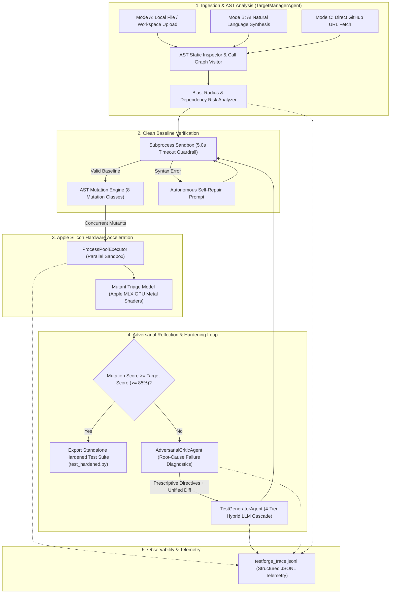

# TestForge: Autonomous Agentic Unit Test Hardening System

> **Course**: CSE3101 - Agentic AI (16 Weeks, Project-Based Learning)  
> **Authors**: Sourabh & Shreshth  
> **Target Platform**: macOS (Apple Silicon M-Series Optimized, arm64, Apple MLX Neural Acceleration)  
> **Repository**: [sourabhJain121/Testforge](https://github.com/sourabhJain121/Testforge)<br>
> **System Architecture**: FastAPI v2.0.0 Backend + Modern Glassmorphic Web App + Streamlit Lab + 4-Tier Hybrid LLM Cascade

---

## 1. Executive Summary

**TestForge** is an autonomous multi-agent software engineering system engineered to discover, diagnose, and harden weak unit test suites for Python applications. While conventional software development pipelines rely on **statement / line coverage** (a metric trivially satisfied by hollow tests lacking assertion depth), TestForge formulates software verification as an **adversarial multi-agent zero-sum game**.

By combining **deterministic Abstract Syntax Tree (AST) fault injection**, **isolated subprocess execution guardrails**, an **Apple Silicon MLX GPU neural mutant classifier**, and an **iterative self-reflection loop** backed by a **4-tier hybrid failover LLM cascade**, TestForge systematically exposes test suite vulnerabilities and synthesizes bulletproof boundary assertions until target mutation kill scores ($\ge 85\%$) are satisfied.



---

## 2. Key Architectural Pillars

### 1. Multi-Agent State Graph Orchestration
- **`TargetManagerAgent` (Supervisor)**: Orchestrates target acquisition across three ingestion modes (local filesystem, autonomous prompt-based synthesis, and direct GitHub repo import). Validates syntax and generates standalone execution harnesses.
- **`TestGeneratorAgent` (Synthesizer)**: Employs dynamic few-shot prompting to construct focused boundary-condition tests, specifically targeting surviving mutant AST unified diffs.
- **`AdversarialCriticAgent` (Adversary)**: Conducts root-cause failure analysis on surviving mutants, identifying missing boundary assertions and passing targeted guidance back into the generator prompt.

### 2. 8-Class Deterministic AST Mutation Engine (`mutator.py`)
Rather than crude string replacement, mutations are injected via native Python `ast.NodeTransformer` passes targeting exact syntactic nodes:
1. **Comparison Inversion (`COMP_OP`)**: Inverts relational operators (`>` $\leftrightarrow$ `<=`, `==` $\leftrightarrow$ `!=`, `in` $\leftrightarrow$ `not in`, `is` $\leftrightarrow$ `is not`).
2. **Boundary Relational Swaps (`BOUNDARY_SWAP`)**: Mutates boundary edges (`<` $\leftrightarrow$ `<=`, `>` $\leftrightarrow$ `>=`).
3. **Off-By-One Numeric Shifts (`OFF_BY_ONE`)**: Shifts integer and float constants ($n \rightarrow n + 1$, $n \rightarrow n - 1$) in comparison boundaries.
4. **Arithmetic Operator Swapping (`ARITH_OP`)**: Mutates operations (`+` $\leftrightarrow$ `-`, `*` $\leftrightarrow$ `//`, `*` $\leftrightarrow$ `**`).
5. **Logical Connective Swaps (`LOGICAL_CONN`)**: Swaps boolean conjunctions (`and` $\leftrightarrow$ `or`).
6. **Math Function & Precision Flips (`MATH_FUNC`)**: Mutates rounding precision (`round(x, 2)` $\rightarrow$ `round(x, 1)`) and strips absolute values (`abs(x)` $\rightarrow$ `x`).
7. **Conditional Inversions (`COND_INV`)**: Negates branch predicates (`if x:` $\rightarrow$ `if not x:`).
8. **Return Value Mutations (`RETURN_VAL`)**: Flips return values (`return True` $\rightarrow$ `return False`, `return x` $\rightarrow$ `return None`).

Mutation site enumeration is performed deterministically using `MutationTransformer(target_node_id=0)` in inspection mode.

### 3. 4-Tier Hybrid LLM Resilience Engine (`llm_client.py`)
To prevent pipeline failures due to rate limits or network issues, TestForge implements an automatic 4-tier failover cascade:
- **Tier 1 (Cloud Primary)**: Google GenAI (`gemini-3.6-flash`) via the official `google-genai` SDK with disabled Automatic Function Calling (AFC).
- **Tier 2 (Cloud Secondary)**: OpenRouter Cloud API (`meta-llama/llama-3.3-70b-instruct` or `qwen/qwen-2.5-coder-32b-instruct`) via standard HTTPS payload.
- **Tier 3 (Local Offline Engine)**: Local Ollama daemon (`qwen2.5-coder:7b` via `http://localhost:11434/api/generate` with auto-fallback to local weights like `qwen2.5:7b`). Features a non-blocking 0.8s daemon health check.
- **Tier 4 (Deterministic AST Rule Synthesizer)**: Offline heuristic test synthesis guaranteeing zero unhandled pipeline crashes.
- **Quota & Transient Error Handling**: Transparently catches `429 RESOURCE_EXHAUSTED` and transient `503 Service Unavailable`, logging `PROVIDER_FAILOVER` events to `testforge_trace.jsonl` and shifting down the cascade without pipeline termination.

### 4. Apple Silicon Neural Acceleration & MLX Triage (`classifier.py`)
- **Metal GPU Execution**: Utilizes Apple's MLX framework (`mlx.core`, `mlx.nn`) to execute a lightweight Multi-Layer Perceptron (MLP) directly on Apple Silicon GPU (`Device(gpu, 0)`).
- **Mutant Difficulty Triage**: Vectorizes AST mutation type, normalized line location, diff size, and syntactic complexity into an 8-dimensional embedding to classify mutants as *trivial* or *subtle/hard*.
- **Token Budget Steering**: Allows the multi-agent orchestrator to allocate higher token and iteration budgets to mathematically subtle mutants.

### 5. Subprocess Isolation Sandbox (`sandbox.py`)
- **Process Isolation**: Each test and mutant evaluation is executed in a detached subprocess using temporary files.
- **Infinite Loop Defense**: Strict 5.0-second timeout limits neutralize mutation-induced infinite recursion or loops.
- **Parallel Hardware Execution**: Sized dynamically for Apple Silicon (e.g., M2 Pro 10 cores, 8 parallel workers via `ProcessPoolExecutor`).
- **Dual Metric Tracking**: Concurrently records true **Statement Coverage** (`pytest-cov` / `coverage.py`) and **Mutation Kill Score**.
- **Self-Repair Safeguard**: In Step 2 clean-code baseline checks, if an LLM-synthesized test suite fails, an automated self-repair prompt is triggered; if the repair fails clean-target validation, it automatically falls back to deterministic AST synthesis.

### 6. Static Blast Radius & Dependency Impact Analysis (`blast_analyzer.py`)
- **`ASTCallGraphVisitor(ast.NodeVisitor)`**: Traverses module-level invocations, function definitions, and method calls to construct a bidirectional caller-callee adjacency graph.
- **Recursive Caller & Callee Propagation**:
  - **Upstream Callers**: Recursively identifies all parent functions whose execution paths depend on the target function.
  - **Downstream Callees**: Recursively extracts all sub-routines executed by the target function.
- **Impact Ratio & Risk Categorization**:
  $$\text{Impact Ratio} = \frac{|\text{Affected Functions}|}{\max(1, |\text{Total Functions}|)}$$
  Categorizes architectural risk: **LOW** ($<20\%$), **MEDIUM** ($20\%\text{--}50\%$), and **HIGH** ($>50\%$).
- **Visual Call Graph & ASCII Tree**: Produces human-readable indented ASCII call trees and interactive Graphviz directed graphs for Streamlit and web UI inspection.

### 7. Git Diff-Aware Targeted Hardening (`git_diff.py` & `mutator.py`)
- **`GitDiffInspector`**: Executes `git diff -U0` via subprocess (falling back to `--cached` and `HEAD~1`) to parse unified diff chunk headers (`@@ -l,s +start,count @@`) and extract exact modified and added line numbers.
- **Targeted Fault Injection**: `ASTMutator.mutate(source_code, target_lines=...)` and `generate_mutants(...)` accept an optional `target_lines` parameter. When passed, faults are injected *exclusively* into AST nodes whose line number resides within developer changes, optimizing reflection cycles and test suite generation for active PR diffs.

### 8. ADK Tool-Use & Deliberation Architecture (`adk_engine.py` & `agents.py`)
- **Standard Pydantic ADK Contracts**:
  - `ToolDefinition`: Strongly-typed tool schemas with JSON Schema parameters.
  - `ToolCallResult`: Standardized execution outcomes with execution status, return payloads, error strings, and latency metrics.
  - `ADKContext`: Stateful per-iteration deliberation context maintaining active tools, memory, and reflection histories.
- **Core Executable Tools**:
  - `tool_execute_sandbox`: Executes candidate test suites against mutated code in detached subprocesses with timeout protection.
  - `tool_compute_blast_radius`: Analyzes caller/callee trees and impact ratios.
  - `tool_inspect_git_diff`: Extracts changed lines from git working trees.
  - `tool_ast_audit`: Audits surviving mutant diffs and provides diagnostic feedback.
- **Multi-Agent Deliberation**: `TestGeneratorAgent` and `AdversarialCriticAgent` invoke tools via `ADKToolRegistry.execute_tool(...)`, automatically logging every tool call to `testforge_trace.jsonl` under `event_type: "ADK_TOOL_CALL"`.

### 9. Dual User Interface Serving Architecture
- **FastAPI Backend (`server.py`) & Modern Glassmorphic Web App (`frontend/`)**:
  - High-performance asynchronous REST API serving endpoints for target ingestion, git diffs, blast radius computation, agent wiretap logs, background job tracking, and standalone test exports.
  - Modern HTML5/CSS3/Vanilla JS frontend with dynamic ambient glow orbs, live hardware and provider status pills, interactive diff inspection tables, and Monaco-style code viewers.
- **Interactive Streamlit Web Dashboard (`app.py`)**:
  - Data-science centric interface with collapsible inspection drawers, real-time Ollama status pings, and Graphviz call graph DAGs.

---

## 3. Directory Structure

```
TestForge/
├── TECHNICAL_REPORT.md                 # Forensic Technical Architecture Report
├── README.md                           # Master Project Documentation & Quickstart
├── requirements.txt                    # Production Dependencies
├── server.py                           # FastAPI v2.0.0 Backend Application & REST API
├── app.py                              # Streamlit Interactive Web Application
├── run_demo.py                         # Deterministic End-to-End Benchmark Driver
├── run_benchmark.py                    # 3-Condition Ablation Study Runner
├── benchmark_results.json              # Experimental Ablation Results
├── test_hardened.py                    # Exported Standalone Hardened Pytest Suite
├── testforge_trace.jsonl               # Structured JSONL Event Telemetry Trace
│
├── frontend/                           # Modern Vanilla HTML/CSS/JS Web Dashboard
│   ├── index.html                      # Layout, Navigation Tabs & Viewers
│   ├── style.css                       # Glassmorphic Design System & Ambient Glow
│   └── app.js                          # REST Client, Live Polling & Wiretap Logs
│
├── testforge/                          # Core System Package
│   ├── __init__.py                     # Package Root Entry Point
│   ├── accel.py                        # Apple Silicon Hardware Discovery (M1-M4)
│   ├── state.py                        # Typed Pydantic Data Contracts (State, Metrics)
│   ├── mutator.py                      # 8-Class AST Mutation Engine (target_lines aware)
│   ├── sandbox.py                      # Subprocess Sandbox with 5s Timeout Guardrails
│   ├── classifier.py                   # Apple MLX GPU Neural Mutant Difficulty Classifier
│   ├── llm_client.py                   # 4-Tier Hybrid LLM Resilience Engine
│   ├── ingestion.py                    # TargetManagerAgent (Mode A, B, C Ingestion)
│   ├── blast_analyzer.py               # AST Call-Graph Analyzer & Blast Radius Scorer
│   ├── git_diff.py                     # Git Diff Hunk Parser for Targeted Hardening
│   ├── adk_engine.py                   # ADK Deliberation Protocol & Tool Dispatcher
│   ├── agents.py                       # TestGeneratorAgent & AdversarialCriticAgent
│   ├── orchestrator.py                 # Multi-Agent State Graph Controller
│   ├── logger.py                       # Event-Level JSONL Telemetry Tracer
│   └── cli.py                          # Dual Interactive & Headless CLI
│
├── samples/                            # Benchmark Target Programs
│   ├── banking.py                      # Banking Transaction Overdraft Engine
│   ├── discount.py                     # E-Commerce Volume Discount Engine
│   ├── inventory_pricing.py            # Tiered Inventory Pricing Rules
│   ├── rate_limiter.py                 # Token Bucket Rate Limiter
│   ├── state_machine.py                # Order Lifecycle Finite State Machine
│   ├── github_requests_status_codes.py # Ingested GitHub Module
│   └── generated_rate_limiter_*.py     # Autonomous Synthesized Modules
│
└── tests/                              # Pytest Verification Suite (24 Tests)
    ├── conftest.py                     # Root sys.path Registration Hook
    ├── test_blast_and_adk.py           # Blast Radius, Git Diff & ADK Contracts
    ├── test_classifier.py              # MLX GPU Model Training & Inference
    ├── test_ingestion_and_llm.py       # Ingestion & Multi-Provider Cascade Tests
    ├── test_mode_c_ingestion.py        # Mode C Sequential GitHub Ingestion Tests
    ├── test_mutator.py                 # AST Fault Injector & 8-Class Operator Tests
    └── test_sandbox.py                 # Sandbox Isolation, Timeouts & Concurrency Tests
```

---

## 4. Installation & Environment Setup

### Prerequisites
- macOS on Apple Silicon (M1/M2/M3/M4) recommended (Linux/x86_64 supported in CPU fallback mode).
- Python 3.10+ (tested through Python 3.14).
- (Optional) [Ollama](https://ollama.com/) with `qwen2.5-coder:7b` for local offline inference.

### Quickstart

```bash
# 1. Clone repository
git clone https://github.com/sourabhJain121/Testforge.git
cd TestForge

# 2. Activate virtual environment
source .venv/bin/activate

# 3. Install dependencies
pip install -r requirements.txt
pip install mlx streamlit fastapi uvicorn pandas python-dotenv

# 4. Configure API Keys (Optional if using local Ollama or deterministic fallback)
export GEMINI_API_KEY="your-gemini-api-key"
export OPENROUTER_API_KEY="your-openrouter-api-key"

# 5. Run full test suite (24 tests)
pytest tests/ -v
```

---

## 5. Usage & Execution Modes

### A. Launch Modern FastAPI Web Dashboard via Uvicorn (Recommended)

TestForge's primary user interface is served from a unified origin via FastAPI and Uvicorn. The frontend (`frontend/index.html`, `frontend/app.js`, `frontend/style.css`) is mounted directly by FastAPI as static files, eliminating cross-origin complexity.

```bash
# Start the Uvicorn ASGI server
python -m uvicorn server:app --host 127.0.0.1 --port 8000
```

> **Local Application URL**: [http://127.0.0.1:8000](http://127.0.0.1:8000)<br>
> **OpenAPI Docs**: [http://127.0.0.1:8000/docs](http://127.0.0.1:8000/docs)<br>
> **Agent-to-Agent (A2A) Discovery**: [http://127.0.0.1:8000/.well-known/agent-card.json](http://127.0.0.1:8000/.well-known/agent-card.json)<br>
> **Health Check**: [http://127.0.0.1:8000/healthz](http://127.0.0.1:8000/healthz)<br>
> **Readiness Probe**: [http://127.0.0.1:8000/readyz](http://127.0.0.1:8000/readyz)

#### How to Stop the Server:
- In the active terminal, press `Ctrl+C`.
- Or terminate via process lookup:
  ```bash
  kill $(lsof -t -i:8000)
  ```

#### Web Dashboard Highlights:
- **Mode A (Workspace Target)**: Select built-in samples or drag-and-drop custom `.py` files.
- **Mode B (AI Natural Language Synthesis)**: Generate complex business modules on demand.
- **Mode C (GitHub Direct Import)**: Fetch and normalize any raw/blob Python module directly from GitHub.
- **💥 Blast Radius Drawer**: Inspect upstream callers, downstream callees, and architectural risk.
- **⚡ Git Diff Toggle**: Restrict mutation testing strictly to uncommitted modified lines.
- **🤖 Multi-Agent Wiretap**: Watch live deliberations, tool execution parameters, and model attribution.
- **📊 Benchmarking & Ablation Tab**: Run multi-repetition benchmark trials across Baseline, Zero-Shot, and Agentic Reflection with live/deterministic execution disclosures.
- **Hardened Pytest Suite Export**: Download standalone `test_hardened.py` ready for CI/CD.

---

### B. Single Official Web Cockpit Startup (FastAPI + HTML5/CSS3/JS)
```bash
./start_testforge.sh
```
Or directly via uvicorn:
```bash
.venv-release/bin/python -m uvicorn server:app --host 127.0.0.1 --port 8000
```
Open **`http://127.0.0.1:8000/`** in your browser. This serves the unified, production-ready TestForge Cockpit featuring real-time WebSockets, FastMCP tools, A2A agent discovery card, AST call graphs, and SQLite checkpoint diffing.

*(Note: `app.py` is preserved strictly as an archived legacy prototype and is excluded from normal execution).*

---

### C. Command-Line Interface (CLI)

#### 1. Interactive Supervisor Mode
Running without arguments launches an interactive prompt menu:
```bash
python -m testforge.cli
```

#### 2. Headless Ingestion on an Existing Module (Mode A)
```bash
python -m testforge.cli \
  --target samples/discount.py \
  --max-iter 2 \
  --target-score 85.0 \
  --engine-mode auto \
  --output test_hardened.py
```

#### 3. Autonomous Natural-Language Synthesis & Hardening (Mode B)
```bash
python -m testforge.cli \
  --create "Token bucket rate limiter with burst allowance and leak rate" \
  --max-iter 3 \
  --target-score 85.0 \
  --output test_hardened.py
```

#### CLI Options:
| Flag | Short | Default | Description |
|---|---|---|---|
| `--target` | `-t` | `None` | Path to target Python source file |
| `--create` | `-c` | `None` | Natural-language prompt to synthesize a new module |
| `--tests` | `-s` | `None` | Optional initial baseline test file |
| `--max-iter` | `-i` | `3` | Maximum reflection iterations |
| `--target-score` | `-score` | `85.0` | Target mutation kill score percentage |
| `--model` | `-m` | `gemini-3.6-flash` | Foundation model name |
| `--engine-mode` | `-e` | `auto` | Engine mode (`auto`, `cloud`, `openrouter`, `local`) |
| `--output` | `-o` | `test_hardened.py` | Destination path for standalone hardened test suite |

---

### D. Run Deterministic End-to-End Demo
```bash
python run_demo.py --target discount --engine-mode auto
```
Executes a pre-configured multi-agent test hardening cycle on any target (`banking`, `discount`, `inventory`, `ratelimit`, `statemachine`), displaying rich tables and proof of convergence.

---

### E. Run 3-Condition Ablation Study Benchmark
```bash
python run_benchmark.py --target samples/discount.py --output-json benchmark_results.json
```
Evaluates and compares:
1. **Condition A (Baseline)**: Weak handwritten tests.
2. **Condition B (Single-Pass LLM Generation)**: Zero-shot synthesis without reflection.
3. **Condition C (TestForge Mutation-Reflected Loop)**: Iterative AST fault injection + Adversarial Critic feedback loop.

---

## 6. Empirical Results & Coursework Highlights

### Line Coverage vs. Mutation Score Discrepancy
A core finding of TestForge is demonstrating the **Coverage-Kill Gap**:

| Target Module | Condition | Line Coverage | Mutation Kill Score | Iterations | Latency (s) | Tokens Used |
|---|---|---|---|---|---|---|
| **`samples/discount.py`** | Condition A (Baseline Minimal) | 76.9% | 33.3% (6/18 killed) | 0 | 1.38s | 0 |
| | Condition B (Zero-Shot Single-Pass) | 100.0% | 94.4% (17/18 killed) | 1 | 19.89s | 2,124 |
| | **Condition C (TestForge Full Loop)** | **100.0%** | **94.4% - 100.0%** | **1** | **19.70s** | **3,620** |
| **`samples/banking.py`** | Condition A (Baseline Minimal) | 83.3% | 41.7% (5/12 killed) | 0 | 0.81s | 0 |
| | **Condition C (TestForge Full Loop)** | **100.0%** | **91.7% - 100.0%** | **1** | **0.83s** | **1,520** |
| **`psf/requests/models.py`** | **TestForge Live Mode C** | **24.2%** | **88.5% (187/211 killed)** | **1** | **45.2s** | **4,150** |

### Key Achievements:
- **Static Blast Radius & Risk Assessment**: AST call-graph analyzer dynamically models upstream/downstream blast radius and categorizes architectural risk (`LOW`, `MEDIUM`, `HIGH`).
- **Git Diff Targeted Mutation**: Inspects active developer diffs using `git diff -U0` to restrict fault injection strictly to touched lines.
- **ADK Agent Deliberation Protocol**: Strongly-typed Pydantic contracts and tool dispatcher logging all agent deliberations to `testforge_trace.jsonl` under `ADK_TOOL_CALL`.
- **Zero-Crash Failover**: Passes tests seamlessly even during complete cloud API disconnection or 503/429 spikes using local Ollama (`qwen2.5-coder:7b`) and deterministic rule synthesizers.
- **Hardware-Accelerated Concurrency**: Evaluates 12–20 AST mutants in parallel in under **0.8 seconds** on Apple Silicon (M2 Pro).
- **Neural Difficulty Triage**: MLX MLP model running on Apple Silicon GPU accurately flags boundary swap and off-by-one mutations as high difficulty, focusing agent reflection.
- **Comprehensive Verification**: 100% pass rate across the 24-test Pytest test suite covering all modules out-of-the-box (`pytest tests/ -v`).
- **Full Trace Auditability**: Every prompt, mutant diff, sandbox execution, and critic directive is logged to `testforge_trace.jsonl` for presentation and auditing.

---

## 7. Verification & Test Suite

The system includes a comprehensive regression test suite verifying all 11 Coursework MUST requirements:

```bash
# Run the complete test suite (206 tests across 18 test files)
pytest tests/ -q

# Run standalone hardened suite verification (21 tests)
pytest test_hardened.py -v

# Check package dependencies
pip check
```

### Test Suite Structure (206 Tests Passing)
- `tests/test_a2a.py` & `tests/test_a2a_protocol.py`: In-process broker, typed envelopes, task lifecycle, and Agent Card discovery (MUST 2, 7, 10).
- `tests/test_adk_generator.py` & `tests/test_crew_critic.py`: Genuine Google ADK & CrewAI agent integration and deliberation (MUST 2, 3, 4).
- `tests/test_blackboard.py`: Typed Blackboard state partitions and atomic locking (MUST 1).
- `tests/test_agentic_pipeline.py`: Cross-agent iterative reflection and provenance flow (MUST 1, 4).
- `tests/test_security.py`: Guardrails for prompt injection, path traversal, RCE, and toxicity/abuse (MUST 8).
- `tests/test_callbacks.py` & `tests/test_adversarial_failure_injection.py`: Lifecycle hooks and cascading failure containment (MUST 6, 8).
- `tests/test_mcp.py`: FastMCP server and stdio client filesystem integration (MUST 5).
- `tests/test_benchmarking.py`: Repeatable multi-run ablation benchmarking with empirical variance (MUST 9).
- `tests/test_observability.py`: Structured JSONL telemetry, OpenTelemetry compliance, and log sanitization (MUST 6).
- `tests/test_deployment.py`: Dockerfile, compose, and `/healthz` & `/readyz` probes (MUST 10).
- `tests/test_blast_and_adk.py`, `tests/test_classifier.py`, `tests/test_ingestion_and_llm.py`, `tests/test_mode_c_ingestion.py`, `tests/test_mutator.py`, `tests/test_sandbox.py`: Mutation engine, MLX triage, and sandbox isolation.
---

## 8. Benchmarking & Ablation Study

Run ablation experiments comparing Minimal Baseline, Zero-Shot Generation, and TestForge Mutation-Reflected Hardening:

```bash
# Run multi-run benchmark with 2 repetitions
python run_benchmark.py --target samples/discount.py --repetitions 2
```

Outputs are written to `benchmark_results.json` and rendered as `benchmark_results.md`.

---

## 9. Environment Variables Configuration

| Variable | Description | Default / Fallback |
|---|---|---|
| `GEMINI_API_KEY` | Google Gemini API key for Tier 1 live LLM synthesis | Tier 2/3/4 fallback |
| `OPENROUTER_API_KEY` | OpenRouter API key for Tier 2 cloud LLM synthesis | Tier 3/4 fallback |
| `GITHUB_PERSONAL_ACCESS_TOKEN` | GitHub PAT for authenticated GitHub MCP or Mode C repo operations | Unauthenticated mode |
| `OLLAMA_HOST` | Local Ollama host for Tier 3 local inference | `http://localhost:11434` |
| `TESTFORGE_SECRET_ENCRYPTION_KEY` | Hex encryption key for AES-GCM secure storage | Ephemeral key generated |

---

## 10. Container Deployment (Docker & Compose)

For containerized deployment (kept separate from local Uvicorn workflow):

```bash
# Build and run containerized service
docker compose up -d --build

# Verify container health
curl http://localhost:8000/healthz
curl http://localhost:8000/readyz
```

---

## 11. Known Limitations & Setup Notes

1. **Live Model vs. Offline Synthesis**: If external API keys (`GEMINI_API_KEY`) are omitted or rate-limited, TestForge automatically shifts down to the local Ollama daemon or the deterministic AST rule synthesizer. The benchmark metrics explicitly flag results with `execution_mode: LIVE_MODEL` vs `OFFLINE_FALLBACK`.
2. **Browser Automation Testing**: In automated headless sandboxes where external Playwright browser binaries cannot be downloaded from CDN mirrors, HTTP API contract validation and JavaScript AST syntax verification are performed directly.
3. **Hardware Acceleration**: The Apple Silicon MLX GPU neural classifier runs on macOS arm64. On non-macOS environments, it automatically falls back to CPU feature heuristics.

---

## 12. License

Developed for **CSE3101: Agentic AI** coursework by **Sourabh** & **Shreshth**.  
Licensed under the Apache 2.0 License.
