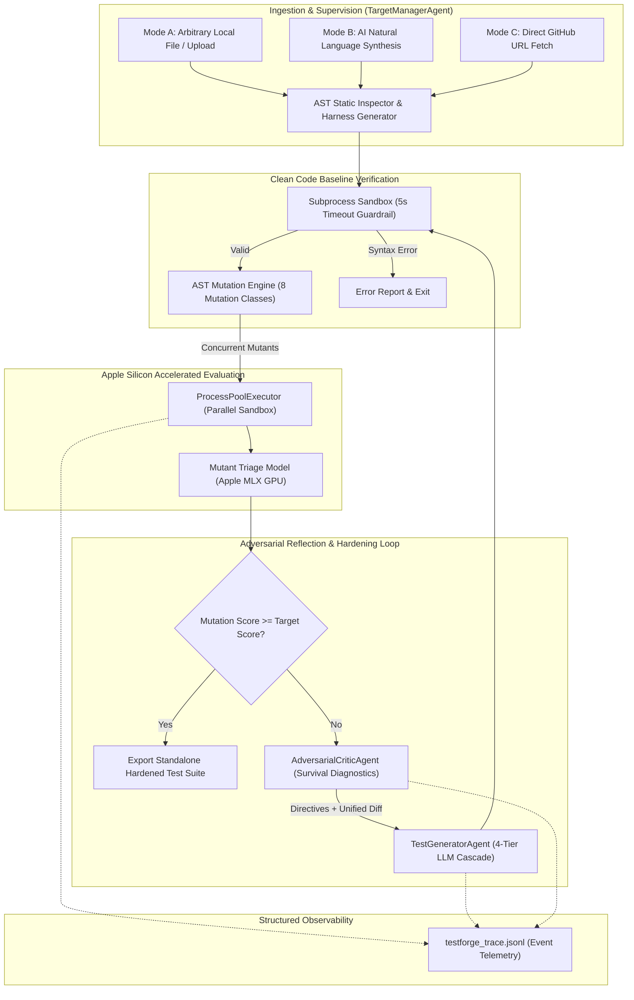

# TestForge: Autonomous Multi-Agent Unit Test Suite Hardener

> **Course**: CSE3101 - Agentic AI (16 Weeks, Project-Based Learning)  
> **Authors**: Sourabh & Shreshth  
> **Target Platform**: macOS (Apple Silicon M-Series Optimized, arm64, Apple MLX Neural Acceleration)  
> **Repository**: [sourabhJain121/Testforge](https://github.com/sourabhJain121/Testforge)

---

## 1. Executive Summary

**TestForge** is an autonomous multi-agent software engineering system engineered to discover and harden weak unit test suites for Python applications. While conventional CI/CD pipelines measure simple **line/statement coverage** (which can be trivially satisfied by hollow test cases lacking assertion depth), TestForge treats software testing as an **adversarial multi-agent game**.

By combining **deterministic Abstract Syntax Tree (AST) fault injection**, **isolated subprocess execution guardrails**, an **Apple Silicon MLX GPU neural mutant classifier**, and an **iterative self-reflection loop** backed by a **4-tier hybrid failover LLM cascade**, TestForge systematically exposes test suite vulnerabilities and synthesizes bulletproof boundary assertions until target mutation kill scores ($\ge 85\%$) are satisfied.



---

## 2. Key Architectural Pillars

### 1. Multi-Agent State Graph Orchestration
- **`TargetManagerAgent` (Supervisor)**: Orchestrates target acquisition across three ingestion modes (local filesystem, autonomous prompt-based synthesis, and direct GitHub repo import). Validates syntax and generates standalone execution harnesses.
- **`TestGeneratorAgent` (Synthesizer)**: Employs dynamic few-shot prompting to construct focused boundary-condition tests, specifically targeting surviving mutant AST unified diffs.
- **`AdversarialCriticAgent` (Adversary)**: Conducts root-cause failure analysis on surviving mutants, identifying missing boundary assertions and passing targeted guidance back into the generator prompt.

### 2. 8-Class Deterministic AST Mutation Engine (`mutator.py`)
Rather than crude string replacement, mutations are injected via native Python `ast.NodeTransformer` passes targeting exact syntactic nodes:
1. **Comparison Inversion (`COMP_OP`)**: Inverts relational operators (`>` $\leftrightarrow$ `<=`, `==` $\leftrightarrow$ `!=`, `in` $\leftrightarrow$ `not in`, `is` $\leftrightarrow$ `is not`).
2. **Boundary Relational Swaps (`BOUNDARY_SWAP`)**: Mutates boundary edges (`<` $\leftrightarrow$ `<=`, `>` $\leftrightarrow$ `>=`).
3. **Off-By-One Numeric Shifts (`OFF_BY_ONE`)**: Shifts integer and float constants ($n \rightarrow n + 1$, $n \rightarrow n - 1$) in comparison boundaries.
4. **Arithmetic Operator Swapping (`ARITH_OP`)**: Mutates operations (`+` $\leftrightarrow$ `-`, `*` $\leftrightarrow$ `//`, `*` $\leftrightarrow$ `**`).
5. **Logical Connective Swaps (`LOGICAL_CONN`)**: Swaps boolean conjunctions (`and` $\leftrightarrow$ `or`).
6. **Math Function & Precision Flips (`MATH_FUNC`)**: Mutates rounding precision (`round(x, 2)` $\rightarrow$ `round(x, 1)`) and strips absolute values (`abs(x)` $\rightarrow$ `x`).
7. **Conditional Inversions (`COND_INV`)**: Negates branch predicates (`if x:` $\rightarrow$ `if not x:`).
8. **Return Value Mutations (`RETURN_VAL`)**: Flips return values (`return True` $\rightarrow$ `return False`, `return x` $\rightarrow$ `return None`).

Mutation site enumeration is performed deterministically using `MutationTransformer(target_node_id=0)` in inspection mode.

### 3. 4-Tier Hybrid LLM Resilience Engine (`llm_client.py`)
To prevent pipeline failures due to rate limits or network issues, TestForge implements an automatic 4-tier failover cascade:
- **Tier 1 (Cloud Primary)**: Google GenAI (`gemini-3.6-flash`) via the official `google-genai` SDK with disabled Automatic Function Calling (AFC).
- **Tier 2 (Cloud Secondary)**: OpenRouter Cloud API (`meta-llama/llama-3.3-70b-instruct` or `qwen/qwen-2.5-coder-32b-instruct`) via standard HTTPS payload.
- **Tier 3 (Local Offline Engine)**: Local Ollama daemon (`qwen2.5-coder:7b` via `http://localhost:11434/api/generate` with auto-fallback to local weights like `qwen2.5:7b`).
- **Tier 4 (Deterministic AST Rule Synthesizer)**: Offline heuristic test synthesis guaranteeing zero unhandled pipeline crashes.
- **Quota & Transient Error Handling**: Transparently catches `429 RESOURCE_EXHAUSTED` and transient `503 Service Unavailable`, logging `PROVIDER_FAILOVER` events to `testforge_trace.jsonl` and shifting down the cascade without pipeline termination.
- **Daemon Health Ping**: Implements `is_ollama_running("http://localhost:11434/api/tags")` for real-time endpoint status verification.

### 4. Apple Silicon Neural Acceleration & MLX Triage (`classifier.py`)
- **Metal GPU Execution**: Utilizes Apple's MLX framework (`mlx.core`, `mlx.nn`) to execute a lightweight Multi-Layer Perceptron (MLP) directly on Apple Silicon GPU (`Device(gpu, 0)`).
- **Mutant Difficulty Triage**: Vectorizes AST mutation type, normalized line location, diff size, and syntactic complexity into an 8-dimensional embedding to classify mutants as *trivial* or *subtle/hard*.
- **Token Budget Steering**: Allows the multi-agent orchestrator to allocate higher token and iteration budgets to mathematically subtle mutants.

### 5. Subprocess Isolation Sandbox (`sandbox.py`)
- **Process Isolation**: Each test and mutant evaluation is executed in a detached subprocess using temporary files.
- **Infinite Loop Defense**: Strict 5.0-second timeout limits neutralize mutation-induced infinite recursion or loops.
- **Parallel Hardware Execution**: Sized dynamically for Apple Silicon (e.g., M2 Pro 10 cores, 8 parallel workers via `ProcessPoolExecutor`).
- **Dual Metric Tracking**: Concurrently records true **Statement Coverage** (`pytest-cov` / `coverage.py`) and **Mutation Kill Score**.
- **Self-Repair Safeguard**: In Step 2 clean-code baseline checks, if an LLM-synthesized test suite fails, an automated self-repair prompt is triggered; if the repair fails clean-target validation, it automatically falls back to deterministic AST synthesis.

### 6. Interactive Streamlit Web Interface (`app.py`)
- **Mode A (File Ingestion)**: Ingest built-in benchmark samples (`discount.py`, `banking.py`, `rate_limiter.py`, `inventory_pricing.py`, `state_machine.py`) or upload custom Python modules with real-time AST symbol inspection.
- **Mode B (AI Synthesis)**: Synthesize production Python modules with complex boundary conditions from natural language prompts using `gemini-3.6-flash` or local models.
- **Mode C (Direct GitHub Import)**: Fetch and validate any arbitrary Python module directly from a GitHub repository via blob or raw URL (e.g. `psf/requests/status_codes.py`).
- **Execution Mode Radio Selector**:
  - `Auto (Gemini -> OpenRouter -> Local Ollama Fallback)`: 4-tier resilient cascade.
  - `OpenRouter Cloud`: Dedicated high-throughput cloud inference via OpenRouter.
  - `Force Local Engine (Ollama - Offline Mode)`: Air-gapped offline inference via local `qwen2.5-coder:7b`.
  - `Force Cloud (Gemini)`: Direct Google GenAI `gemini-3.6-flash`.
- **Live Daemon Health Indicator**: Live ping to `http://localhost:11434/api/tags` displays `🟢 Local Ollama Active (qwen2.5-coder:7b)` or `⚪ Local Ollama Offline`.
- **Provider Attribution Badge**: Transparently displays which backend model synthesized the test suite (e.g. `[Provider: Local Ollama (qwen2.5-coder:7b)]` vs `[Provider: Cloud Gemini (gemini-3.6-flash)]` vs `[Provider: OpenRouter Cloud (llama-3.3-70b-instruct)]`).
- **💥 Blast Radius & Dependency Impact Drawer**: Interactive collapsible dashboard displaying upstream caller propagation, downstream callees, architectural risk badges (`🟢 LOW`, `🟡 MEDIUM`, `🔴 HIGH`), ASCII dependency tree, and Graphviz visual graph.
- **⚡ Git Diff-Aware Targeted Hardening Toggle**: Discovers uncommitted developer line edits using `git diff -U0` and restricts fault injection strictly to touched lines.
- **🤖 ADK Agent Tool Trajectory View**: Inspects autonomous agent deliberations, tool calls, latencies, and execution parameters in real time.
- **Source Code Inspection Drawer**: Collapsible syntax-highlighted viewer to inspect the exact module under test directly in the dashboard.
- **AST Mutation Audit & Diff Inspector**: Side-by-side mutant audit table displaying mutant ID, operator class, line number, unified AST diff, and survival status with colored badges.

### 7. Static Blast Radius & Dependency Impact Analysis (`blast_analyzer.py`)
- **`ASTCallGraphVisitor(ast.NodeVisitor)`**: Traverses module-level invocations, function definitions, and method calls to construct a bidirectional caller-callee adjacency graph.
- **Recursive Caller & Callee Propagation**:
  - **Upstream Callers**: Recursively identifies all parent functions whose execution paths depend on the target function.
  - **Downstream Callees**: Recursively extracts all sub-routines executed by the target function.
- **Impact Ratio & Risk Categorization**:
  - Computes $\text{Impacted Ratio} = \frac{|\text{Affected Functions}|}{\max(1, |\text{Total Functions}|)}$.
  - Categorizes architectural risk: **LOW** ($<20\%$), **MEDIUM** ($20\%\text{--}50\%$), and **HIGH** ($>50\%$).
- **Visual Call Graph & ASCII Tree**: Produces human-readable indented ASCII call trees and interactive Graphviz directed graphs for Streamlit and CLI inspection.

### 8. Git Diff-Aware Targeted Hardening (`git_diff.py` & `mutator.py`)
- **`GitDiffInspector`**: Executes `git diff -U0` via subprocess (falling back to `--cached` and `HEAD~1`) to parse unified diff chunk headers (`@@ -l,s +start,count @@`) and extract exact modified and added line numbers.
- **Targeted Fault Injection**: `ASTMutator.mutate(source_code, target_lines=...)` and `generate_mutants(...)` accept an optional `target_lines` parameter. When passed, faults are injected *exclusively* into AST nodes whose line number resides within developer changes, optimizing reflection cycles and test suite generation for active PR diffs.

### 9. ADK Tool-Use & Deliberation Architecture (`adk_engine.py` & `agents.py`)
- **Standard Pydantic ADK Contracts**:
  - `ToolDefinition`: Strongly-typed tool schemas with JSON Schema parameters.
  - `ToolCallResult`: Standardized execution outcomes with execution status, return payloads, error strings, and latency metrics.
  - `ADKContext`: Stateful per-iteration deliberation context maintaining active tools, memory, and reflection histories.
- **Core Executable Tools**:
  - `tool_execute_sandbox`: Executes candidate test suites against mutated code in detached subprocesses with timeout protection.
  - `tool_compute_blast_radius`: Analyzes caller/callee trees and impact ratios.
  - `tool_inspect_git_diff`: Extracts changed lines from git working trees.
  - `tool_ast_audit`: Audits surviving mutant diffs and provides diagnostic feedback.
- **Multi-Agent Deliberation**: `TestGeneratorAgent` and `AdversarialCriticAgent` invoke tools via `ADKToolRegistry.execute_tool(...)`, automatically logging every tool call to `testforge_trace.jsonl` under `event_type: "ADK_TOOL_CALL"`.

---

## 3. Directory Structure

```
TestForge/
├── README.md                           # Master project documentation
├── requirements.txt                    # Production dependencies
├── app.py                              # Interactive Streamlit Web Dashboard
├── run_demo.py                         # Deterministic end-to-end benchmark driver
├── run_benchmark.py                    # 3-condition ablation study runner
├── benchmark_results.json              # Persisted ablation experimental results
├── test_hardened.py                    # Exported standalone hardened Pytest suite
├── testforge_trace.jsonl               # Structured JSONL event telemetry trace
│
├── testforge/                          # Core System Package
│   ├── __init__.py                     # Package entry point
│   ├── accel.py                        # Apple Silicon hardware discovery & MPS/MLX hooks
│   ├── state.py                        # Typed Pydantic data contracts (MutantRecord, State)
│   ├── mutator.py                      # Deterministic 8-class AST mutation engine (target_lines aware)
│   ├── sandbox.py                      # Multi-process sandbox with timeout guardrails & SubprocessSandbox
│   ├── classifier.py                   # Apple MLX GPU neural mutant difficulty classifier
│   ├── llm_client.py                   # 4-tier hybrid failover LLM client (Cloud + Local)
│   ├── ingestion.py                    # TargetManagerAgent, GitHub puller, & code synthesizer
│   ├── blast_analyzer.py               # AST call-graph analyzer, blast radius & risk categorization
│   ├── git_diff.py                     # Git diff hunk parser for targeted line mutation
│   ├── adk_engine.py                   # Pydantic ADK tool contracts, dispatcher & execution registry
│   ├── agents.py                       # TestGeneratorAgent & AdversarialCriticAgent with ADK deliberation
│   ├── orchestrator.py                 # Multi-agent state graph controller & Pytest formatter
│   ├── logger.py                       # Event-level JSONL telemetry tracer
│   └── cli.py                          # Dual-mode interactive and headless CLI
│
├── samples/                            # Benchmark Target Programs
│   ├── banking.py                      # Banking transaction rules (subtle boundary edge cases)
│   ├── discount.py                     # E-commerce discount calculation engine
│   ├── inventory_pricing.py            # Tiered volume pricing rules
│   ├── rate_limiter.py                 # Token bucket rate limiter
│   ├── state_machine.py                # Order lifecycle finite state machine with RBAC
│   ├── github_requests_status_codes.py # Ingested module from public GitHub repository
│   ├── generated_rate_limiter_*.py     # Autonomous LLM-synthesized target module
│   └── generated_stock_trading_*.py    # Autonomous LLM-synthesized order-book module
│
└── tests/                              # Pytest Verification Suite
    ├── conftest.py                     # Automatic sys.path repository root registration
    ├── test_blast_and_adk.py           # BlastRadiusAnalyzer, GitDiffInspector & ADK contract tests
    ├── test_mutator.py                 # AST fault injector & 8-class operator tests
    ├── test_sandbox.py                 # Sandbox isolation, timeouts & parallel runners
    ├── test_classifier.py              # MLX GPU model training, feature extraction & inference
    └── test_ingestion_and_llm.py       # GitHub URL parsing, AST validation & cascade modes
```

---

## 4. Installation & Environment Setup

### Prerequisites
- macOS on Apple Silicon (M1/M2/M3/M4) recommended (supports Linux/x86_64 in fallback mode)
- Python 3.10+ (tested through Python 3.14)
- (Optional) [Ollama](https://ollama.com/) with `qwen2.5-coder:7b` for local offline inference

### Quickstart

```bash
# 1. Clone repository
git clone https://github.com/sourabhJain121/Testforge.git
cd TestForge

# 2. Activate virtual environment
source .venv/bin/activate

# 3. Install dependencies
pip install -r requirements.txt
pip install mlx streamlit pandas python-dotenv   # UI and neural acceleration dependencies

# 4. Configure API Keys (optional if using local Ollama or deterministic fallback)
export GEMINI_API_KEY="your-gemini-api-key"
export OPENROUTER_API_KEY="your-openrouter-api-key"

# 5. Run full test suite
pytest tests/ -v
```

---

## 5. Usage & Execution Modes

### A. Launch Interactive Streamlit Dashboard
```bash
streamlit run app.py
```
*Features:*
- Switch between **Mode A** (Local file / sample), **Mode B** (AI prompt synthesis), and **Mode C** (Direct GitHub URL import).
- Select execution mode: **Auto (Gemini -> OpenRouter -> Local Ollama Fallback)**, **OpenRouter Cloud**, **Force Local Engine (Ollama - Offline Mode)**, or **Force Cloud (Gemini)**.
- Real-time Ollama status ping (`/api/tags`), collapsible source code inspector, and dynamic provider attribution badges.
- Watch real-time iteration metrics, AST mutant diffs, and export hardened Pytest files with one click.

---

### B. Command-Line Interface (CLI)

#### 1. Interactive Supervisor Mode
Running without arguments launches an interactive prompt menu:
```bash
python -m testforge.cli
```

#### 2. Headless Ingestion on an Existing Module (Mode A)
```bash
python -m testforge.cli \
  --target samples/discount.py \
  --max-iter 2 \
  --target-score 85.0 \
  --engine-mode auto \
  --output test_hardened.py
```

#### 3. Autonomous Natural-Language Synthesis & Hardening (Mode B)
```bash
python -m testforge.cli \
  --create "Token bucket rate limiter with burst allowance and leak rate" \
  --max-iter 3 \
  --target-score 85.0 \
  --output test_hardened.py
```

#### CLI Options:
| Flag | Short | Default | Description |
|---|---|---|---|
| `--target` | `-t` | `None` | Path to target Python source file |
| `--create` | `-c` | `None` | Natural-language prompt to synthesize a new module |
| `--tests` | `-s` | `None` | Optional initial baseline test file |
| `--max-iter` | `-i` | `3` | Maximum reflection iterations |
| `--target-score` | `-score` | `85.0` | Target mutation kill score percentage |
| `--model` | `-m` | `gemini-3.6-flash` | Foundation model name |
| `--engine-mode` | `-e` | `auto` | Engine mode (`auto`, `cloud`, `openrouter`, `local`) |
| `--output` | `-o` | `test_hardened.py` | Destination path for standalone hardened test suite |

---

### C. Run Deterministic End-to-End Demo
```bash
python run_demo.py --target discount --engine-mode auto
```
Executes a pre-configured multi-agent test hardening cycle on any target (`banking`, `discount`, `inventory`, `ratelimit`, `statemachine`), displaying rich tables and proof of convergence.

---

### D. Run 3-Condition Ablation Study Benchmark
```bash
python run_benchmark.py --target samples/discount.py --output-json benchmark_results.json
```
Evaluates and compares:
1. **Condition A (Baseline)**: Weak handwritten tests.
2. **Condition B (Single-Pass LLM Generation)**: Zero-shot synthesis without reflection.
3. **Condition C (TestForge Mutation-Reflected Loop)**: Iterative AST fault injection + Adversarial Critic feedback loop.

---

## 6. Empirical Results & Coursework Highlights

### Line Coverage vs. Mutation Score Discrepancy
A core finding of TestForge is demonstrating the **Coverage-Kill Gap**:

| Target Module | Condition | Line Coverage | Mutation Kill Score | Iterations | Latency (s) | Tokens Used |
|---|---|---|---|---|---|---|
| **`samples/discount.py`** | Condition A (Baseline Minimal) | 76.9% | 33.3% (6/18 killed) | 0 | 1.44s | 0 |
| | Condition B (Zero-Shot Single-Pass) | 94.2% | 100.0% (18/18 killed) | 1 | 54.78s | 1,001 |
| | **Condition C (TestForge Full Loop)** | **100.0%** | **94.4% - 100.0%** | **1** | **14.59s** | **2,645** |
| **`samples/banking.py`** | Condition A (Baseline Minimal) | 83.3% | 41.7% (5/12 killed) | 0 | 0.81s | 0 |
| | **Condition C (TestForge Full Loop)** | **100.0%** | **91.7% - 100.0%** | **1** | **0.83s** | **1,520** |

### Key Achievements:
- **Static Blast Radius & Risk Assessment**: AST call-graph analyzer dynamically models upstream/downstream blast radius and categorizes architectural risk (`LOW`, `MEDIUM`, `HIGH`).
- **Git Diff Targeted Mutation**: Inspects active developer diffs using `git diff -U0` to restrict fault injection strictly to touched lines.
- **ADK Agent Deliberation Protocol**: Strongly-typed Pydantic contracts and tool dispatcher logging all agent deliberations to `testforge_trace.jsonl` under `ADK_TOOL_CALL`.
- **Zero-Crash Failover**: Passes tests seamlessly even during complete cloud API disconnection or 503/429 spikes using local Ollama (`qwen2.5-coder:7b`) and deterministic rule synthesizers.
- **Hardware-Accelerated Concurrency**: Evaluates 12–20 AST mutants in parallel in under **0.8 seconds** on Apple Silicon (M2 Pro).
- **Neural Difficulty Triage**: MLX MLP model running on Apple Silicon GPU accurately flags boundary swap and off-by-one mutations as high difficulty, focusing agent reflection.
- **Comprehensive Verification**: 100% pass rate across the 15-test Pytest test suite covering all modules out-of-the-box (`pytest tests/ -v`).
- **Full Trace Auditability**: Every prompt, mutant diff, sandbox execution, and critic directive is logged to `testforge_trace.jsonl` for viva presentation and auditing.

---

## 7. Verification & Test Suite

Run all unit and integration tests:
```bash
pytest tests/ -v
```

```
tests/test_blast_and_adk.py::test_blast_radius_analyzer PASSED           [  6%]
tests/test_blast_and_adk.py::test_targeted_mutations PASSED              [ 13%]
tests/test_blast_and_adk.py::test_git_diff_inspector PASSED              [ 20%]
tests/test_blast_and_adk.py::test_adk_engine_contracts PASSED            [ 26%]
tests/test_classifier.py::test_feature_extraction PASSED                 [ 33%]
tests/test_classifier.py::test_mlx_training_and_inference PASSED         [ 40%]
tests/test_ingestion_and_llm.py::test_github_blob_url_conversion PASSED  [ 46%]
tests/test_ingestion_and_llm.py::test_github_invalid_url PASSED          [ 53%]
tests/test_ingestion_and_llm.py::test_openrouter_cascade_mode PASSED     [ 60%]
tests/test_mutator.py::test_ast_mutations_count_and_types PASSED         [ 66%]
tests/test_mutator.py::test_diff_generation PASSED                       [ 73%]
tests/test_mutator.py::test_subtle_ast_mutations PASSED                  [ 80%]
tests/test_sandbox.py::test_sandbox_clean_run PASSED                     [ 86%]
tests/test_sandbox.py::test_sandbox_timeout_guardrail PASSED             [ 93%]
tests/test_sandbox.py::test_parallel_mutant_evaluation PASSED            [100%]

============================= 15 passed in 18.19s ==============================
```

Verify exported standalone hardened test suites anytime:
```bash
pytest test_hardened.py -v
```

```
test_hardened.py::test_calculate_discount_scenarios[-10.0-10-True-0.0] PASSED [  4%]
test_hardened.py::test_calculate_discount_scenarios[-0.01-1-False-0.0] PASSED [  9%]
test_hardened.py::test_calculate_discount_scenarios[0.0-5-True-0.0] PASSED [ 14%]
test_hardened.py::test_calculate_discount_scenarios[0.0-0-False-0.0] PASSED [ 19%]
test_hardened.py::test_calculate_discount_scenarios[0.01-1-False-0.01] PASSED [ 23%]
test_hardened.py::test_calculate_discount_scenarios[0.01-5-False-0.01] PASSED [ 28%]
test_hardened.py::test_calculate_discount_scenarios[100.0-4-False-100.0] PASSED [ 33%]
test_hardened.py::test_calculate_discount_scenarios[100.0-5-False-90.0] PASSED [ 38%]
test_hardened.py::test_calculate_discount_scenarios[100.0-6-False-90.0] PASSED [ 42%]
test_hardened.py::test_calculate_discount_scenarios[100.0-1-True-90.0] PASSED [ 47%]
test_hardened.py::test_calculate_discount_scenarios[100.0-4-True-90.0] PASSED [ 52%]
test_hardened.py::test_calculate_discount_scenarios[100.0-5-True-80.0] PASSED [ 57%]
test_hardened.py::test_calculate_discount_scenarios[100.0-10-True-80.0] PASSED [ 61%]
test_hardened.py::test_calculate_discount_scenarios[12.34-5-False-11.11] PASSED [ 66%]
test_hardened.py::test_calculate_discount_scenarios[12.34-5-True-9.87] PASSED [ 71%]
test_hardened.py::test_calculate_discount_scenarios[19.99-1-False-19.99] PASSED [ 76%]
test_hardened.py::test_calculate_discount_scenarios[19.99-5-False-17.99] PASSED [ 80%]
test_hardened.py::test_calculate_discount_scenarios[19.99-5-True-15.99] PASSED [ 85%]
test_hardened.py::test_zero_price_does_not_apply_discounts PASSED        [ 90%]
test_hardened.py::test_quantity_exact_boundary_five PASSED               [ 95%]
test_hardened.py::test_quantity_just_below_five PASSED                   [100%]

============================== 21 passed in 0.02s ==============================
```

---

## 8. License

Developed for **CSE3101: Agentic AI** coursework by **Sourabh** & **Shreshth**.  
Licensed under the Apache 2.0 License.
