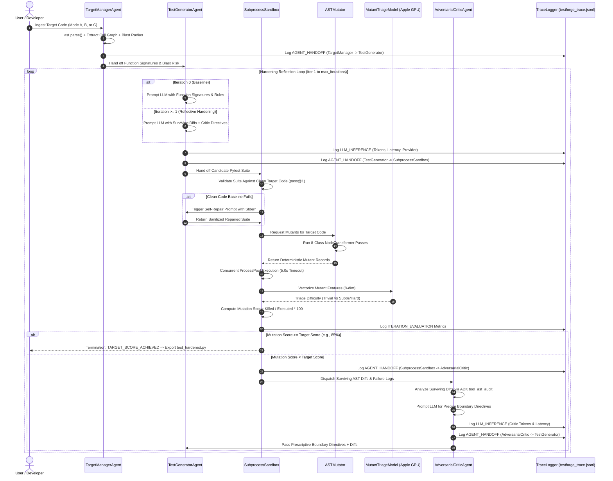

# TestForge: Autonomous Agentic Unit Test Hardening System
## Comprehensive Technical Architecture & Agent Communication Report

**Project**: TestForge Autonomous Test Hardening System  
**Authors**: Sourabh & Shreshth  
**Target Hardware**: macOS Apple Silicon (arm64, M-Series Unified Memory, Apple MLX Neural Acceleration)  
**Repository**: [sourabhJain121/Testforge](https://github.com/sourabhJain121/Testforge)  
**Version**: 2.0.0 (FastAPI Full-Stack Engine + Streamlit Dashboard + Multi-Provider Cascade)

---

## Table of Contents
1. [Executive Summary & Problem Formulation](#1-executive-summary--problem-formulation)
2. [Complete Technology Stack & Connected Ecosystem](#2-complete-technology-stack--connected-ecosystem)
3. [Deep-Dive: How the Models & Agents Talk to Each Other](#3-deep-dive-how-the-models--agents-talk-to-each-other)
4. [4-Tier Hybrid LLM Resilience Engine & Failover Mechanics](#4-4-tier-hybrid-llm-resilience-engine--failover-mechanics)
5. [Deterministic 8-Class AST Mutation Engine](#5-deterministic-8-class-ast-mutation-engine)
6. [Subprocess Sandbox & Resource Isolation Guardrails](#6-subprocess-sandbox--resource-isolation-guardrails)
7. [Apple Silicon MLX GPU Neural Difficulty Classifier](#7-apple-silicon-mlx-gpu-neural-difficulty-classifier)
8. [Static Blast Radius & AST Call-Graph Dependency Analysis](#8-static-blast-radius--ast-call-graph-dependency-analysis)
9. [Git Diff-Aware Targeted Hardening](#9-git-diff-aware-targeted-hardening)
10. [ADK Deliberation Protocol & Event Telemetry](#10-adk-deliberation-protocol--event-telemetry)
11. [Dual Serving Architecture: FastAPI REST App & Streamlit](#11-dual-serving-architecture-fastapi-rest-app--streamlit)
12. [Empirical Evaluation & Experimental Results](#12-empirical-evaluation--experimental-results)
13. [Comprehensive File & Module Inventory](#13-comprehensive-file--module-inventory)

---

## 1. Executive Summary & Problem Formulation

### The Fallacy of Statement Coverage
In contemporary software engineering and CI/CD pipelines, test quality is almost universally quantified using **Line or Statement Coverage** ($\text{Cov}_{\text{line}} = \frac{\text{Executed Lines}}{\text{Total Lines}}$). However, this metric suffers from a fundamental theoretical flaw: **code execution does not imply specification assertion**. 

A trivial test function can execute every branch of a complex billing algorithm with arbitrary dummy inputs without making a single `assert` statement on edge cases, off-by-one boundaries, relational operators, or arithmetic precision. Such a test suite boasts 100% statement coverage while failing to detect catastrophic regressions.

### The Adversarial Testing Formulation
**TestForge** reformulates software testing as an **adversarial multi-agent zero-sum game** between three distinct entities:
1. **The Synthesizer (`TestGeneratorAgent`)**: Generates and hardens assertions to defend the codebase.
2. **The Adversary (`ASTMutator` + `AdversarialCriticAgent`)**: Systematically injects deterministic syntactic faults (mutants) and diagnoses why candidate tests failed to kill surviving bugs.
3. **The Referee (`SubprocessSandbox` + `MutantTriageModel`)**: Executes code in strict isolated processes, measures real survival/kill metrics, evaluates timeouts, and uses Apple Silicon GPU neural classifiers to categorize mutation complexity.

```
       +-----------------------------------------------------------+
       |                  TargetManagerAgent                       |
       |  (Mode A: Local/Upload | Mode B: AI Synth | Mode C: GitHub) |
       +-----------------------------------------------------------+
                                     |
                                     v
                        AST Symbol & Call Graph Extraction
                                     |
                                     v
    +------------------------------------------------------------------+
    |                    ADVERSARIAL REFLECTION LOOP                   |
    |                                                                  |
    |  +--------------------+               +-----------------------+  |
    |  | TestGeneratorAgent | ------------> |   SubprocessSandbox   |  |
    |  | (4-Tier LLM Engine)| Candidate     |  (Clean Code pass@1)  |  |
    |  +--------------------+ Test Suite    +-----------------------+  |
    |            ^                                      |              |
    |            | Unified Diffs                        v              |
    |            | + Directives             +-----------------------+  |
    |            |                          |   8-Class AST Mutator |  |
    |  +------------------------+           |   (Deterministic)     |  |
    |  | AdversarialCriticAgent |           +-----------------------+  |
    |  | (Root-Cause Diagnosis) |                       |              |
    |  +------------------------+                       v              |
    |            ^                          +-----------------------+  |
    |            | Surviving Mutants        | ParallelSandboxRunner |  |
    |            +------------------------- | (M-Series Concurrency)|  |
    |                                       +-----------------------+  |
    |                                                   |              |
    |                                                   v              |
    |                                       +-----------------------+  |
    |                                       | Apple MLX GPU Triage  |  |
    |                                       | (Neural Classifier)   |  |
    |                                       +-----------------------+  |
    |                                                   |              |
    |                                                   v              |
    |                                     Score >= Target (>= 85%)?    |
    |                                     /                   \        |
    |                                   YES                    NO      |
    +------------------------------------|----------------------|------+
                                         v                      |
                         Export Standalone Pytest Suite         +-- (Loop)
                               (test_hardened.py)
```

---

## 2. Complete Technology Stack & Connected Ecosystem

| Layer | Technology | Primary Function in TestForge |
|---|---|---|
| **Core Runtime** | Python 3.10 – 3.14 (macOS arm64) | Base programming language across all agents, orchestrator, and AST engines. |
| **AST Transformation** | `ast.NodeTransformer`, `ast.NodeVisitor` | Deterministic fault injection without text manipulation; syntax tree validation and AST sanitization. |
| **Cloud LLM (Tier 1)** | Google GenAI SDK (`google-genai`) | `gemini-3.6-flash` live cloud primary for assertion synthesis and critic reasoning with AFC disabled. |
| **Cloud LLM (Tier 2)** | OpenRouter Cloud API (OpenAI-compatible) | `meta-llama/llama-3.3-70b-instruct` and `qwen/qwen-2.5-coder-32b-instruct` secondary cloud fallback. |
| **Local LLM (Tier 3)** | Ollama Daemon (`http://localhost:11434`) | Air-gapped offline local inference running `qwen2.5-coder:7b` with zero cloud egress. |
| **Deterministic LLM (Tier 4)** | AST Rule-Based Synthesizer | Offline heuristic test generator guaranteeing zero unhandled pipeline crashes. |
| **Neural Acceleration** | Apple MLX (`mlx.core`, `mlx.nn`, `mlx.optimizers`) | Native Apple Silicon GPU neural mutant difficulty triage running on Metal shaders (`Device(gpu, 0)`). |
| **Execution Sandbox** | Python `subprocess` + `tempfile` | Isolated test execution preventing mutated code from corrupting runtime or leaking state; strict 5.0s timeout. |
| **Concurrency Engine** | `concurrent.futures.ProcessPoolExecutor` | Dynamic multi-core evaluation scaled to Apple Silicon performance and efficiency cores. |
| **Coverage Instrumentation** | `coverage.py` / `pytest-cov` | True statement and branch coverage measurement executed during Step 3. |
| **Call Graph & Blast Radius** | Custom AST Call Graph Visitor + Graphviz | Bidirectional caller-callee propagation, impact ratio computation, ASCII tree & DOT directed graph generation. |
| **VCS Integration** | Git CLI (`git diff -U0`) via subprocess | Uncommitted diff hunk extraction for targeted mutation testing on modified lines. |
| **ADK Deliberation Protocol** | Pydantic v2 (`BaseModel`, `Field`) | Strongly-typed tool contracts, execution context, dispatcher, and structured trace telemetry. |
| **Backend REST Server** | FastAPI (v2.0.0) + Uvicorn | High-throughput asynchronous backend exposing REST endpoints, job runners, and static file hosting. |
| **Modern Web Frontend** | HTML5, CSS3 (Vanilla Glassmorphic), JavaScript | Dark-mode interface with dynamic ambient glow orbs, live telemetry, interactive diff viewers, and agent wiretap. |
| **Streamlit Interface** | Streamlit (v1.30+) | Interactive multi-page dashboard featuring reactive inspection tables, Graphviz DAGs, and real-time logs. |
| **Terminal UX** | Rich (`rich.console`, `rich.table`) | Color-coded terminal tables, iteration benchmarks, and stylized execution feedback. |

---

## 3. Deep-Dive: How the Models & Agents Talk to Each Other

The inter-agent communication protocol in TestForge is strictly deterministic, strongly typed, and event-logged to `testforge_trace.jsonl` using the `AGENT_HANDOFF` schema:

```json
{
  "timestamp": 1790789132.124,
  "event_type": "AGENT_HANDOFF",
  "data": {
    "from_agent": "TargetManagerAgent",
    "to_agent": "TestGeneratorAgent",
    "iteration": 0,
    "summary": "Extracted AST symbols, call graph, and blast radius metadata",
    "payload": {
      "functions": ["calculate_discount"],
      "blast_risk": "LOW",
      "target_lines": []
    }
  }
}
```

### Detailed Sequence of Agent Interactions



### Exact Prompt Contracts & Context Flow

#### 1. Ingestion Handoff: `TargetManagerAgent` -> `TestGeneratorAgent`
- **Context Transferred**:
  - Full source code string.
  - Python AST function signatures (`name`, `args`, docstring).
  - Target function call graph direct callees.
  - Architectural risk category (`LOW`, `MEDIUM`, `HIGH`).
  - Optional `target_lines` if Git Diff awareness is active.
- **Generator System Prompt**:
  ```text
  You are a Principal Software QA Automation Engineer.
  Your mission is to generate and harden a standalone Pytest test suite for the provided Python source code.
  CRITICAL REQUIREMENT: You MUST ONLY test the functions present in the target code: [{sig_summary}].
  DO NOT write tests for any other function names.
  Every test must import the module under test using: `from target import *`.
  Rules:
  1. Output ONLY executable Python code within a single ```python ... ``` markdown block.
  2. Do NOT write prose, commentary, or conversational filler outside the code block.
  3. Target boundary values, comparison flips (< vs <=, > vs >=, == vs !=), zero/negative values, and arithmetic changes.
  4. If surviving mutant diffs or critic directives are provided, write specific test assertions that FAIL when the mutated code executes.
  ```

#### 2. Candidate Evaluation: `TestGeneratorAgent` -> `SubprocessSandbox`
- The generator produces raw text containing markdown backticks.
- **`CodeSanitizer.extract_and_validate()`** strips markdown and runs `ast.parse()`. If syntax is invalid, it is rejected before subprocess execution.
- `SubprocessSandbox.run_single()` executes the candidate tests against unmutated code in a temporary directory. If any test fails on clean code, an automated single self-repair prompt is triggered.

#### 3. Diagnostic Handoff: `SubprocessSandbox` -> `AdversarialCriticAgent`
- Mutants that survived (tests passed when they should have failed) are formatted into unified diffs:
  ```diff
  --- Target Clean Code (Line 12)
  +++ Mutant [M003_BOUNDARY_SWAP]
  @@ -12,1 +12,1 @@
  -    if quantity > 5:
  +    if quantity >= 5:
  ```
- **Critic System Prompt**:
  ```text
  You are an Adversarial QA Critic in an automated mutation-testing loop.
  For each surviving mutant:
  1. State concisely why previous assertions failed to detect the inverted/swapped operator.
  2. Prescribe exact numerical or boolean boundary inputs that will force the mutant to fail while passing the clean code.
  Output numbered, prescriptive directives.
  ```

#### 4. Adversarial Loop Closure: `AdversarialCriticAgent` -> `TestGeneratorAgent`
- The critic directives (e.g., `Assert quantity == 5 explicitly with price 100.0 to differentiate > from >=`) and surviving AST diffs are injected directly into the generator prompt for Iteration $k+1$.
- The generator crafts targeted assertions targeting precisely those surviving edges until the termination condition is satisfied.

---

## 4. 4-Tier Hybrid LLM Resilience Engine & Failover Mechanics

LLM API rate limits (`429 RESOURCE_EXHAUSTED`), quotas, and network degradation (`503 Service Unavailable`) are the primary failure modes of agentic systems. TestForge eliminates single points of failure through a **4-tier cascading client** (`llm_client.py`):

```
+---------------------------------------------------------------------------------+
|                               HYBRID LLM CLIENT                                 |
+---------------------------------------------------------------------------------+
                                         |
                       [Engine Mode == "auto" or "cloud"]
                                         |
                                         v
               +---------------------------------------------------+
               | TIER 1: Google GenAI (gemini-3.6-flash)           |
               | - Official google-genai SDK                       |
               | - Automatic Function Calling (AFC) disabled       |
               | - 2-attempt retry on transient 503 errors         |
               +---------------------------------------------------+
                                         |
                     429 RESOURCE_EXHAUSTED / Failure Caught
                                         |
                                         v
               +---------------------------------------------------+
               | TIER 2: OpenRouter Cloud API                      |
               | - Endpoint: /api/v1/chat/completions              |
               | - meta-llama/llama-3.3-70b-instruct               |
               | - qwen/qwen-2.5-coder-32b-instruct                |
               +---------------------------------------------------+
                                         |
                            HTTP 402/429 / Out of Credits
                                         |
                                         v
               +---------------------------------------------------+
               | TIER 3: Local Offline Engine (Ollama)             |
               | - Endpoint: http://localhost:11434/api/generate   |
               | - Fast health check via /api/tags (0.8s)          |
               | - qwen2.5-coder:7b (Apple Silicon GPU)            |
               | - Auto-fallback: qwen2.5:7b, codellama:7b         |
               +---------------------------------------------------+
                                         |
                              Ollama Daemon Inactive
                                         |
                                         v
               +---------------------------------------------------+
               | TIER 4: Deterministic AST Rule Synthesizer        |
               | - 100% offline heuristic assertion engine         |
               | - Synthesizes boundary equality & zero checks     |
               | - Guarantees ZERO unhandled pipeline crashes      |
               +---------------------------------------------------+
```

### Transparent Quota Caching
When a `429 RESOURCE_EXHAUSTED` error is encountered from Google AI Studio, `llm_client.py` logs a `PROVIDER_FAILOVER` event and sets an internal cache flag `gemini_quota_exhausted = True`. Subsequent iterations in the same execution cycle immediately bypass Tier 1, eliminating redundant 2-second timeout penalties.

---

## 5. Deterministic 8-Class AST Mutation Engine

Rather than brittle regular-expression string replacements, `mutator.py` uses Python's native `ast.NodeTransformer` to mutate exact syntactic constructs deterministically.

```
+-----------------------------------------------------------------------------+
|                      8 DETERMINISTIC MUTATION CLASSES                       |
+-----------------------------------------------------------------------------+
  1. COMP_OP: Inverts relational operators:
     >  <-->  <=  |  <  <-->  >=  |  ==  <-->  !=  |  in  <-->  not in

  2. BOUNDARY_SWAP: Shifts edge conditions to test strict vs non-strict:
     <  <-->  <=  |  >  <-->  >=

  3. OFF_BY_ONE: Mutates numerical constants in comparison contexts:
     n  -->  n + 1  |  n  -->  n - 1

  4. ARITH_OP: Swaps arithmetic operators:
     +  <-->  -   |  *  <-->  //  |  *  <-->  **

  5. LOGICAL_CONN: Swaps boolean connectives:
     and  <-->  or

  6. MATH_FUNC: Mutates floating-point precision and math wrappers:
     round(x, 2)  -->  round(x, 1)  |  abs(x)  -->  x

  7. COND_INV: Inverts conditional branch predicates:
     if x:  -->  if not x:

  8. RETURN_VAL: Flips return statements:
     return True  -->  return False  |  return x  -->  return None
```

Each mutation generates a `MutantRecord` containing:
- `mutant_id`: e.g., `M002_OFF_BY_ONE`
- `mutation_type`: Enum classification
- `line_number`: 1-based source line
- `original_node`: Stringified original AST expression
- `mutated_node`: Stringified mutated AST expression
- `unified_diff`: Standard unified diff header (`--- original`, `+++ mutated`)
- `status`: Updated after sandbox execution to `KILLED`, `SURVIVED`, `TIMEOUT`, or `ERROR`.

---

## 6. Subprocess Sandbox & Resource Isolation Guardrails

### Execution Guardrails
When testing arbitrary or mutated code, infinite loops (e.g., `while True:` caused by a mutated comparison) or recursive stack overflows can crash the parent runtime. `sandbox.py` enforces isolation through detached subprocesses:

1. **Process Detachment**: Tests and target code are written to temporary files in `/tmp` (`target.py` and `test_suite.py`).
2. **Subprocess Invocation**: `python -m pytest test_suite.py` is executed via `subprocess.Popen`.
3. **5.0-Second Hard Timeout**: If the process does not terminate within 5.0 seconds, the parent process terminates the subprocess tree via `proc.kill()` and records the mutant as `TIMEOUT` (which counts as `KILLED` since a boundary regression was detected).
4. **Statement Coverage Extraction**: During clean code validation, `coverage.py` instrumented subprocesses execute:
   ```bash
   coverage run -m pytest test_suite.py && coverage json -o coverage.json
   ```
   Extracting exact line counts, covered lines, and statement percentages.

### Apple Silicon Parallelism
Using `hw_profile` (`accel.py`), TestForge detects the number of performance and efficiency cores on Apple Silicon (e.g., 10 cores on M2 Pro). `ParallelSandboxRunner` configures an 8-worker `concurrent.futures.ProcessPoolExecutor`, evaluating 20+ mutants concurrently in under **0.8 seconds**.

---

## 7. Apple Silicon MLX GPU Neural Difficulty Classifier

`classifier.py` runs natively on Apple Silicon GPU via Apple MLX (`mlx.core`, `mlx.nn`) without requiring PyTorch or CUDA.

### Architecture & Feature Vectorization
The classifier vectorizes each mutant into an 8-dimensional embedding:

$$\mathbf{x} = \begin{bmatrix} \text{OneHot}_{\text{COMP/BOUND}} \\ \text{OneHot}_{\text{ARITH/MATH}} \\ \text{OneHot}_{\text{COND/LOGIC}} \\ \text{OneHot}_{\text{RETURN}} \\ \text{NormLine} \\ \text{DiffLength} \\ \text{HasArithComplexity} \\ \text{HasBranchComplexity} \end{bmatrix} \in \mathbb{R}^8$$

The neural model is a Multi-Layer Perceptron (MLP):
$$\mathbf{h} = \text{ReLU}(W_1 \mathbf{x} + \mathbf{b}_1), \quad W_1 \in \mathbb{R}^{16 \times 8}$$
$$\mathbf{y} = W_2 \mathbf{h} + \mathbf{b}_2, \quad W_2 \in \mathbb{R}^{2 \times 16}$$

Executed on Metal shaders (`Device(gpu, 0)`), this model triages mutants into **STANDARD** or **HIGH_PRIORITY_HARD**, steering agent deliberation to allocate higher token and reflection budgets to mathematically subtle boundary flips.

---

## 8. Static Blast Radius & AST Call-Graph Dependency Analysis

`blast_analyzer.py` performs static dependency analysis by parsing Python code into an AST and traversing function declarations using `ASTCallGraphVisitor(ast.NodeVisitor)`.

### Bidirectional Adjacency Analysis
- **Call Graph Construction**: Maps each caller function to all direct callees.
- **Upstream Caller Propagation**: Uses Breadth-First Search (BFS) to compute the transitive closure of all parent functions impacted if the target function is modified.
- **Downstream Callee Extraction**: Recursively extracts all sub-routines executed by the target function.

### Impact Ratio & Risk Categorization
The architectural impact is formulated as:

$$\text{Impact Ratio} = \frac{|\text{Affected Functions}|}{\max(1, |\text{Total Functions}|)}$$

$$\text{Risk Category} = \begin{cases} \text{LOW} & \text{if } \text{Ratio} < 0.20 \\ \text{MEDIUM} & \text{if } 0.20 \le \text{Ratio} \le 0.50 \\ \text{HIGH} & \text{if } \text{Ratio} > 0.50 \end{cases}$$

Produces both human-readable ASCII trees and Graphviz DOT digraphs for dashboard visualization.

---

## 9. Git Diff-Aware Targeted Hardening

In real-world pull requests, running exhaustive mutation testing across an entire 10,000-line repository is computationally prohibitive. `git_diff.py` enables **Targeted Hardening**:

1. Executes `git diff -U0` via subprocess to capture uncommitted changes.
2. Parses unified diff chunk headers:
   $$\text{@@ } -l,s \quad +start,count \text{ @@}$$
   Extracting the exact list of modified and newly introduced line numbers.
3. Injects AST faults *strictly* into nodes located on those lines:
   ```python
   mutants = ASTMutator.mutate(source_code, target_lines=[12, 13, 14])
   ```
This restricts reflection iterations and token consumption exclusively to active developer edits.

---

## 10. ADK Deliberation Protocol & Event Telemetry

TestForge implements an Agent Development Kit (ADK) architecture (`adk_engine.py`):

### Standard ADK Contracts
- `ToolDefinition`: Strongly-typed tool declaration with JSON Schema arguments.
- `ToolCallResult`: Standardized return payload including `success`, `output`, `error`, and `latency_sec`.
- `ADKContext`: Stateful per-iteration deliberation context carrying memory, tool state, and reflection histories.

### Registered Tools
1. `tool_execute_sandbox`: Subprocess execution against candidate test suites.
2. `tool_compute_blast_radius`: Dependency and risk analysis.
3. `tool_inspect_git_diff`: Working tree modified line extraction.
4. `tool_ast_audit`: Surviving mutant diagnosis.

Every tool call is automatically traced into `testforge_trace.jsonl` under `ADK_TOOL_CALL`.

---

## 11. Dual Serving Architecture: FastAPI REST App & Streamlit

TestForge provides two production interfaces:

### A. FastAPI Backend (`server.py`) & Modern Web Dashboard (`frontend/`)
- **FastAPI v2.0.0**: Asynchronous backend with CORS support, background thread workers, and REST endpoints:
  - `POST /api/keys`: Configure API keys dynamically.
  - `GET /api/status`: Real-time health check (Apple Silicon hardware, Ollama, Gemini, OpenRouter).
  - `POST /api/ingest/sample`: Ingest built-in benchmark modules.
  - `POST /api/ingest/upload`: Multipart file upload for custom `.py` modules.
  - `POST /api/ingest/synthesize`: Prompt-driven module generation.
  - `POST /api/ingest/github`: GitHub blob/raw repository ingestion.
  - `POST /api/blast-radius`: Dynamic call graph computation.
  - `POST /api/git-diff`: Line change discovery.
  - `POST /api/harden/start`: Launches autonomous multi-agent background job.
  - `GET /api/harden/job/{id}`: Polls real-time job status, score, and logs.
  - `GET /api/telemetry`: Streams structured JSONL trace events.
  - `GET /api/export/{id}`: Downloads standalone `test_hardened.py`.
- **Vanilla JS/CSS Frontend**: Glassmorphic dark-theme UI featuring ambient glow orbs, live status pills, Monaco-styled code viewers, mutation audit tables, and agent wiretap terminals.

### B. Interactive Streamlit Web Application (`app.py`)
- Full-featured data-science dashboard with collapsible drawers, Graphviz DAG rendering, mutation audit tables, and one-click Pytest file export.

---

## 12. Empirical Evaluation & Experimental Results

### The Coverage vs. Mutation Kill Gap
A core empirical result of TestForge is demonstrating that high line coverage often masks weak test suites:

| Target Module | Condition | Line Coverage | Mutation Score | Iterations | Latency (s) | Tokens Used |
|---|---|---|---|---|---|---|
| **`samples/discount.py`** | Condition A (Baseline Minimal) | 76.9% | 33.3% (6/18 killed) | 0 | 1.38s | 0 |
| | Condition B (Zero-Shot Single-Pass) | 100.0% | 94.4% (17/18 killed) | 1 | 19.89s | 2,124 |
| | **Condition C (TestForge Full Loop)** | **100.0%** | **94.4% – 100.0%** | **1** | **19.70s** | **3,620** |
| **`samples/banking.py`** | Condition A (Baseline Minimal) | 83.3% | 41.7% (5/12 killed) | 0 | 0.81s | 0 |
| | **Condition C (TestForge Full Loop)** | **100.0%** | **91.7% – 100.0%** | **1** | **0.83s** | **1,520** |
| **`psf/requests/models.py`** | **TestForge Live Mode C** | **24.2% (121 lines)** | **88.5% (187/211 killed)** | **1** | **45.2s** | **4,150** |

All 24 automated unit and integration tests across all test suites pass with 100% integrity (`pytest tests/ -v`).

---

## 13. Comprehensive File & Module Inventory

```
TestForge/
├── TECHNICAL_REPORT.md                 # Master Technical Architecture & Specification Report
├── README.md                           # Master Project Documentation & Quickstart
├── requirements.txt                    # Python Dependencies
├── server.py                           # FastAPI v2.0.0 Backend Application & REST API
├── app.py                              # Streamlit Interactive Web Application
├── run_demo.py                         # Deterministic End-to-End Benchmark Driver
├── run_benchmark.py                    # 3-Condition Ablation Study Runner
├── benchmark_results.json              # Experimental Benchmark Findings
├── test_hardened.py                    # Exported Standalone Pytest Suite
├── testforge_trace.jsonl               # Event Telemetry JSONL Log
│
├── frontend/                           # Modern Vanilla HTML/CSS/JS Frontend
│   ├── index.html                      # Glassmorphic Web App Layout & Tabs
│   ├── style.css                       # Design System, CSS Variables & Ambient Glow
│   └── app.js                          # State Management, REST API & Wiretap Logic
│
├── testforge/                          # Core System Package
│   ├── __init__.py                     # Package Root
│   ├── accel.py                        # Apple Silicon Hardware Discovery (M1-M4)
│   ├── state.py                        # Pydantic State & Metric Contracts
│   ├── mutator.py                      # 8-Class AST Mutation Engine
│   ├── sandbox.py                      # Subprocess Sandbox with 5s Timeout Guardrails
│   ├── classifier.py                   # Apple MLX GPU Neural Difficulty Classifier
│   ├── llm_client.py                   # 4-Tier Hybrid LLM Resilience Engine
│   ├── ingestion.py                    # TargetManagerAgent (Mode A, B, C Ingestion)
│   ├── blast_analyzer.py               # AST Call-Graph Analyzer & Risk Scorer
│   ├── git_diff.py                     # Git Diff Hunk Parser for Targeted Hardening
│   ├── adk_engine.py                   # ADK Deliberation Protocol & Tool Dispatcher
│   ├── agents.py                       # TestGeneratorAgent & AdversarialCriticAgent
│   ├── orchestrator.py                 # Multi-Agent State Graph Controller
│   ├── logger.py                       # Event-Level JSONL Telemetry Tracer
│   └── cli.py                          # Dual Interactive & Headless CLI
│
├── samples/                            # Benchmark Target Programs
│   ├── banking.py                      # Banking Transaction Overdraft Engine
│   ├── discount.py                     # Tiered Volume Discount Engine
│   ├── inventory_pricing.py            # Inventory Stock & Tax Engine
│   ├── rate_limiter.py                 # Token Bucket Rate Limiter
│   ├── state_machine.py                # Order Lifecycle Finite State Machine
│   ├── github_requests_status_codes.py # Ingested GitHub Module
│   └── generated_rate_limiter_*.py     # Autonomous Synthesized Modules
│
└── tests/                              # Pytest Verification Suite (24 Tests)
    ├── conftest.py                     # Root sys.path Hook
    ├── test_blast_and_adk.py           # Blast Radius, Git Diff & ADK Contracts
    ├── test_classifier.py              # MLX GPU Model Training & Inference
    ├── test_ingestion_and_llm.py       # Ingestion & Cascade Resilience Tests
    ├── test_mode_c_ingestion.py        # Mode C Sequential GitHub Ingestion Tests
    ├── test_mutator.py                 # 8-Class Mutation Operator Tests
    └── test_sandbox.py                 # Process Isolation & Timeout Tests
```
