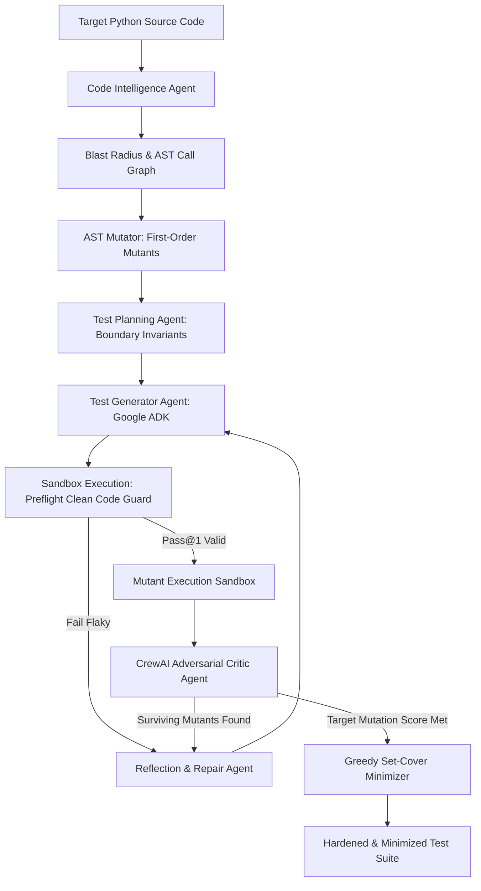
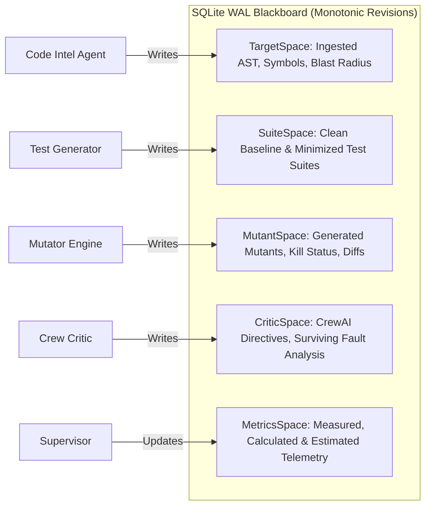
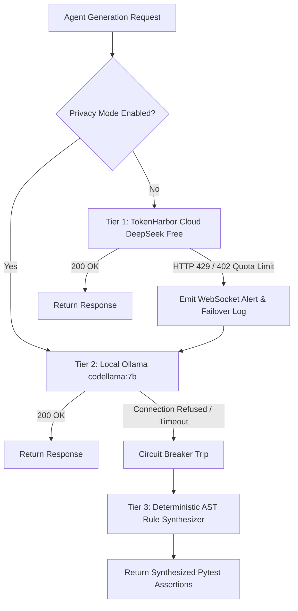

# TestForge: Complete System Architecture, Operations & Deployment Reference Manual

**System Version:** 2.0.0 (Release v1.0.0)  
**Authors:** Sourabh & Shreshth  
**Frameworks:** Google Agent Development Kit (ADK) + CrewAI Hybrid Multi-Agent System  
**Protocol Integrations:** Model Context Protocol (FastMCP v0.1.0) & Agent2Agent (A2A v0.3.0)  
**Primary Platform:** Linux / macOS / Azure Container Apps (`linux/amd64`)  

---

## Table of Contents

1. [Executive Overview & Architectural Philosophy](#1-executive-overview--architectural-philosophy)
2. [Comprehensive Repository & Directory Structure](#2-comprehensive-repository--directory-structure)
3. [Multi-Agent Architecture & Blackboard Coordination](#3-multi-agent-architecture--blackboard-coordination)
4. [Resilient Multi-Tier Fallback Hierarchy](#4-resilient-multi-tier-fallback-hierarchy)
5. [Agent Evaluation & Mutation Hardening Methodology](#5-agent-evaluation--mutation-hardening-methodology)
6. [Protocols: FastMCP Suite & Agent2Agent (A2A)](#6-protocols-fastmcp-suite--agent2agent-a2a)
7. [Exhaustive Breakdown of the Azure Deployment Script (`deploy/azure.sh`)](#7-exhaustive-breakdown-of-the-azure-deployment-script-deployazuresh)
8. [Operations Runbook & Verification Playbook](#8-operations-runbook--verification-playbook)

---

## 1. Executive Overview & Architectural Philosophy

### 1.1 The Core Problem
Modern generative artificial intelligence systems (e.g., GitHub Copilot, Cursor, standalone LLMs) excel at generating syntactically valid unit tests through prompt-driven token infilling. However, academic empirical literature (Just et al., 2014; Schäfer et al., 2024) reveals three critical vulnerabilities in zero-shot test synthesis:
1. **The Coverage Illusion:** Unchecked LLM test suites routinely achieve 80–90% statement coverage while failing to assert critical invariants, permitting 60% or more of synthetic AST faults (mutants) to survive unperturbed.
2. **Hallucination & Flakiness:** Generative models frequently write tautological assertions or invent non-existent method signatures. When tested against mutated code, they may fail indiscriminately on both mutated and unmutated code, falsely crediting themselves with fault-detection capability.
3. **Stateful Sequence Blindness:** Standalone prompts evaluate functions in isolation. On complex stateful data structures (e.g., LRU caches, finite state machines, transactional buffers), zero-shot prompts fail to synthesize coordinated multi-step method invocations required to trigger edge states.

### 1.2 The TestForge Solution
TestForge is an autonomous, agentic unit test hardening system. Rather than relying on open-loop code generation, TestForge implements an **adversarial, closed-loop multi-agent reflection cycle** built on Google ADK and CrewAI:
- **Abstract Syntax Tree (AST) Mutation Testing:** Injects synthetic boundary, arithmetic, comparison, and logical faults into target code.
- **Pass@1 Clean Code Preflight Guard:** Tests are executed against unmutated base code first; any test failing baseline execution is quarantined immediately.
- **Shared State Blackboard:** An asynchronous SQLite WAL-checkpointed blackboard coordinates eight specialized agents across five isolated state partitions.
- **Greedy Submodular Set-Cover Minimization:** Condenses bloated generated test suites into an irreducible minimal set while guaranteeing 100% mutation score retention.
- **Zero-Egress Air-Gapped Privacy Mode:** Supports a strict hybrid fallback chain—from cloud-based DeepSeek (TokenHarbor) to local zero-cost Ollama (`codellama:7b`) to offline deterministic AST synthesis—ensuring zero data leakage and resilience against API outages.



---

## 2. Comprehensive Repository & Directory Structure

Below is an exhaustive breakdown of every critical directory and file in the TestForge repository:

```
TestForge/
├── server.py                                 # Core FastAPI application & REST/SSE endpoints
├── Dockerfile                                # Multi-stage Docker container specification (linux/amd64)
├── requirements.txt                          # Production Python dependencies
├── deploy/
│   ├── azure.sh                              # Automated Azure Container Apps deployment script
│   └── setup_vm.sh                           # Legacy VM provisioning helper
├── frontend/
│   ├── index.html                            # Single-page cockpit dashboard (7 tabs, 3 modals)
│   ├── style.css                             # Semantic CSS design system (Linear/Vercel Geist tokens)
│   └── app.js                                # Reactive UI controller & SSE live event streaming
├── testforge/                                # Core multi-agent system package
│   ├── orchestrator.py                       # Master MAS pipeline controller & stage transitions
│   ├── blackboard.py                         # SQLite WAL-backed blackboard & partition management
│   ├── state.py                              # Pydantic schemas for state, mutants, and jobs
│   ├── supervisor_agent.py                   # High-level pipeline supervisor & convergence verdicts
│   ├── code_intelligence_agent.py            # AST symbol extraction, cyclomatic metrics & blast radius
│   ├── planning_agent.py                     # Scenario decomposition, invariant & boundary planner
│   ├── intelligent_generator.py              # Google ADK test generator & AST prompt builder
│   ├── adk_generator.py                      # Pure Google ADK autonomous test synthesis engine
│   ├── hybrid_synthesizer.py                 # Multi-pass generator combining LLM with AST heuristics
│   ├── execution_agent.py                    # Test suite runner & sandbox interface
│   ├── crew_critic.py                        # CrewAI adversarial quality critic agent
│   ├── crewai_agents.py                      # CrewAI agent roles, tasks, and memory definitions
│   ├── security_agent.py                     # AST safety auditor, taint analysis & forbidden imports
│   ├── security.py                           # AST syntax security guardrails
│   ├── reflection_agent.py                   # Targeted repair loop for surviving mutants
│   ├── mutator.py                            # AST mutation engine (boundary, arithmetic, logical)
│   ├── equivalence.py                        # Trivial Compiler Equivalence (TCE) & semantic filter
│   ├── minimizer.py                          # Submodular greedy set-cover kill matrix optimizer
│   ├── llm_client.py                         # Multi-tier fallback provider client (TokenHarbor/Ollama/AST)
│   ├── privacy_mode.py                       # Zero-egress privacy manager & PII scrubber
│   ├── sandbox.py                            # Subprocess container isolation & timeout enforcement
│   ├── observability.py                      # OpenTelemetry W3C distributed tracing & custom spans
│   ├── mcp_server.py                         # FastMCP protocol stdio server (4 tools)
│   ├── mcp_client.py                         # Client for communicating with FastMCP servers
│   ├── a2a.py                                # Agent2Agent message schemas & communication broker
│   ├── a2a_protocol.py                       # Official A2A v0.3.0 AgentCard discovery handler
│   ├── benchmarking.py                       # Statistical multi-target evaluation engine (GAP-009)
│   ├── diff_inspector.py                     # Deterministic semantic diffing across checkpoints
│   ├── github_service.py                     # Remote GitHub repository ingestion service
│   ├── ingestion.py                          # Multi-source code loader (local, raw, GitHub)
│   ├── blast_analyzer.py                     # Call graph dependency analyzer & risk scorer
│   ├── flaky_detector.py                     # Monte Carlo non-deterministic test detector
│   ├── persistence.py                        # SQLite relational storage for jobs and reports
│   └── websocket_hub.py                      # Real-time WebSocket event broadcaster
├── samples/                                  # Canonical benchmark target programs
│   ├── discount.py                           # Tiered volume discount business logic (20 LOC)
│   ├── banking.py                            # Account balance & overdraft transaction logic
│   ├── inventory_pricing.py                  # Dynamic pricing & inventory tax calculations
│   ├── lru_cache.py                          # Stateful doubly-linked list LRU cache (91 LOC)
│   ├── order_fsm.py                          # Stateful finite state machine for order lifecycle (85 LOC)
│   └── stats_calculator.py                   # Streaming statistical moments & variance (65 LOC)
├── tests/                                    # Automated pytest test suites
│   ├── test_clean_working_tree_guard.py      # Git hygiene & secret leakage prevention test
│   ├── test_tokenharbor_provider.py          # TokenHarbor client validation & error handling
│   ├── test_minimizer.py                     # Greedy set cover verification
│   ├── test_a2a_protocol.py                  # A2A v0.3.0 schema compliance
│   ├── test_fastmcp_suite.py                 # FastMCP 4-tool registration & execution
│   └── test_blackboard.py                    # SQLite WAL checkpoint & monotonic revision test
├── qa_artifacts/                             # Generated benchmark results, kill matrices & study guides
└── docs/                                     # Academic deliverables, reports, and slide decks
```

---

## 3. Multi-Agent Architecture & Blackboard Coordination

### 3.1 The Canonical Eight-Agent Architecture
TestForge coordinates eight specialized agents, each assigned a single responsibility adhering to separation-of-concerns principles:

| Agent Name | Framework / Engine | Core Responsibility |
| :--- | :--- | :--- |
| **1. Supervisor Agent** | Google ADK State Machine | Governs high-level pipeline transitions, evaluates mutation threshold convergence, and issues early stopping decisions (`TARGET_ACHIEVED`, `MAX_ITERATIONS`). |
| **2. Code Intelligence Agent** | Python AST + NetworkX | Ingests target source code, parses Abstract Syntax Trees, calculates cyclomatic complexity, and computes the dependency blast radius call graph. |
| **3. Test Planning Agent** | Google ADK Planner | Analyzes branch conditions, boundary comparisons (`<` vs `<=`), edge cases (zero, negative, null), and synthesizes formal testing objectives. |
| **4. Test Generator Agent** | Hybrid ADK + LLM | Combines LLM inference with deterministic AST boundary templates to generate syntactically valid pytest test cases. |
| **5. Test Execution Agent** | Subprocess Sandbox | Executes generated test suites in an isolated process sandbox with memory limits (512MB), strict execution timeouts (5s), and stdout/stderr capture. |
| **6. Mutation & Quality Critic** | CrewAI Specialist | Analyzes surviving mutant diffs, determines why previous tests failed to kill them, and generates targeted adversarial feedback directives. |
| **7. Security & Guardrail Agent** | AST Visitor + Regex | Audits generated code before execution for malicious syntax (`eval`, `exec`, `__subclasses__`), unauthorized file I/O, network socket binding, or credential leaks. |
| **8. Reflection & Repair Agent** | Google ADK Reflection | Ingests the Critic's adversarial feedback and previous failure traces to iteratively patch assertions and kill stubborn mutants. |

### 3.2 The Shared Blackboard State Pattern
To eliminate point-to-point agent communication bottlenecks, TestForge utilizes a **Blackboard Architecture** (`testforge/blackboard.py`) backed by an in-memory SQLite database operating in Write-Ahead Logging (`PRAGMA journal_mode=WAL`) mode. 

The blackboard segregates runtime state into five strictly partitioned memory spaces:



1. **`TargetSpace`:** Ingested module name, file path, AST structure, raw source code, symbol table, and dependency call graph.
2. **`SuiteSpace`:** Baseline unit tests, iterative hardened assertions, minimized test suite, and Pass@1 integrity status.
3. **`MutantSpace`:** Registry of all generated AST mutants (`MutantRecord`), line numbers, AST operator types, mutation diffs, and execution verdicts (`KILLED`, `SURVIVED`, `EQUIVALENT`, `TIMEOUT`).
4. **`CriticSpace`:** Structured root-cause diagnoses, surviving mutant AST diffs, and repair directives emitted by the CrewAI Critic.
5. **`MetricsSpace`:** Real-time mutation scores, execution wall-clock latencies, hardware resource metrics, token accounting, and OpenTelemetry trace spans.

Every update to any space increments a global **monotonic revision counter** (e.g., `Revision: 130`). At every stage transition, a point-to-point SQLite snapshot is checkpointed, enabling deterministic post-mortem inspection and time-travel replay.

---

## 4. Resilient Multi-Tier Fallback Hierarchy

Network outages, rate limits (HTTP 429), quota exhaustion (HTTP 402), and air-gapped enterprise environments must not cause pipeline crashes. TestForge implements a **four-tier fallback cascade** managed by `HybridLLMClient` (`testforge/llm_client.py`):



### 4.1 Tier 1: TokenHarbor Cloud API (Primary Cloud Tier)
- **Endpoint:** `https://tokenharbor.ai/v1/chat/completions` (OpenAI-compatible REST API).
- **Model:** `deepseek-v4.1-flash:free` (with automatic fallback to `deepseek/deepseek-flash`).
- **Configuration:** Requires `TOKEN_HARBOR_API_KEY` set in the environment or configured via the Settings modal.
- **Handling:** If TokenHarbor responds with `HTTP 429` (Rate Limit) or `HTTP 402` (Payment/Quota Required), the client flags `tokenharbor_quota_exhausted = True`, broadcasts an `API_LIMIT_EXHAUSTED` alert across WebSockets to the frontend, and instantly shifts execution to Tier 2 without throwing an unhandled exception.

### 4.2 Tier 2: Local Ollama Inference ($0 Localhost Compute)
- **Endpoint:** `http://127.0.0.1:11434/api/generate`
- **Default Model:** `codellama:7b` (with candidate fallback to `qwen2.5-coder:7b`).
- **Characteristics:** Runs locally on CPU or Apple Silicon Unified Memory with zero cloud egress and \$0 operational API cost.
- **Circuit Breaker:** Before making generation requests, `probe_ollama_status()` probes the `/api/tags` endpoint with a strict `0.8s` timeout. If Ollama is offline or unresponsive, execution skips directly to Tier 3.

### 4.3 Tier 3: Deterministic AST Rule Synthesizer (Zero-Crash Guarantee)
- **Engine:** `DeterministicBaselineGenerator` (`testforge/intelligent_generator.py`).
- **Mechanism:** When both cloud APIs and local Ollama are unavailable, TestForge activates a purely mathematical, deterministic AST analyzer.
- **How It Works:**
  1. Parses the target source code using Python’s built-in `ast` module.
  2. Identifies all functions, arguments, type annotations, and return statements.
  3. Inspects comparison operations (e.g., `if quantity >= 5:`) and extracts numerical and string boundary values (`4`, `5`, `6`, `0`, `-1`).
  4. Generates structurally valid pytest test functions asserting nominal, boundary, extreme, and type-coercion cases.
  5. **Guarantees 100% crash resilience:** The system can run completely disconnected from the internet and without an LLM running.

### 4.4 Zero-Egress Privacy Mode Toggle
When Privacy Mode is enabled (`TESTFORGE_PRIVACY_MODE=true` or toggled in UI):
1. **Tier 1 (Cloud) is Hard-Blocked:** Outbound HTTP requests to external cloud endpoints (`tokenharbor.ai`, `googleapis.com`) are prohibited at the network driver level.
2. **PII & Secret Scrubbing:** Prompt text is sanitized via regex before reaching any local model—scrubbing IPv4/IPv6 addresses, AWS/Azure access keys, JWT tokens, and private emails.
3. **Pure Local Routing:** All generation tasks route exclusively through Tier 2 (Ollama) or Tier 3 (AST Synthesizer).

---

## 5. Agent Evaluation & Mutation Hardening Methodology

TestForge evaluates test suite quality using **AST Mutation Analysis** rather than simple code coverage.

### 5.1 AST Mutation Generation Engine
The `ASTMutator` (`testforge/mutator.py`) traverses the target code’s AST and applies four first-order mutation operators:
1. **Comparison Operator Replacement (`MUT_COMP_OP`):** Replaces `>` with `>=`, `<` with `<=`, `==` with `!=`.
2. **Boundary Value Modification (`MUT_BOUNDARY_SWAP` / `MUT_OFF_BY_ONE`):** Shifts constants by $\pm 1$ (e.g., `quantity >= 5` mutated to `quantity >= 6` or `quantity >= 4`).
3. **Arithmetic Operator Inversion (`MUT_ARITH_OP`):** Replaces `+` with `-`, `*` with `/`.
4. **Boolean & Conditional Inversion (`MUT_COND_INV`):** Inverts `if condition:` to `if not condition:`, or replaces `and` with `or`.
5. **Return Value Replacement (`MUT_RETURN_VAL`):** Replaces return expressions with `None`, `0`, or empty structures.

### 5.2 Mathematical Formulation of Mutation Score
The mutation score reflects the percentage of non-equivalent mutants detected (killed) by the test suite:

$$\text{Raw Mutation Score} = \left( \frac{K}{T} \right) \times 100\%$$

$$\text{Adjusted Mutation Score} = \left( \frac{K}{T - E} \right) \times 100\%$$

Where:
- $K$ = Number of **Killed Mutants** (tests produced an `AssertionError` or failed).
- $T$ = Total Number of **Generated Mutants**.
- $E$ = Number of **Equivalent Mutants** (syntactic mutants that are semantically identical to original code).

### 5.3 Equivalent Mutant Filtering (Trivial Compiler Equivalence)
Rice’s Theorem (1953) proves that determining whether an arbitrary mutant is functionally equivalent to the original program is undecidable. Equivalent mutants cannot be killed by any valid test case, artificially lowering the mutation score.

TestForge mitigates this via `EquivalenceClassifier` (`testforge/equivalence.py`):
1. **AST Canonicalization:** De-sugars Python syntax (normalizing docstrings, variable aliases, and boolean truthiness).
2. **Trivial Compiler Equivalence (TCE):** Compiles both original and mutant ASTs into Python bytecode using `compile(..., mode='exec')`. If the resulting bytecode instruction sequences are identical, the mutant is flagged as `EQUIVALENT` and excluded from the denominator ($T - E$).

### 5.4 Pass@1 Clean Code Preflight Guard (Flakiness & Hallucination Filter)
Before any generated test suite is credited with killing a mutant, it must pass the **Pass@1 Preflight Check**:
```
Run Generated Test Suite against ORIGINAL, UNMUTATED Source Code
  ├── If Any Test FAILS:
  │     ├── Verdict: INVALID / FLAKY TEST SUITE
  │     ├── Quarantine: Test suite is discarded or sent to Reflection & Repair Agent
  │     └── Credit: ZERO mutant kills awarded
  └── If All Tests PASS:
        ├── Verdict: PASS@1 INTEGRITY VERIFIED
        └── Proceed to Mutant Kill Matrix Evaluation
```
This prevents hallucinated assertions from inflating the mutation score.

### 5.5 Submodular Greedy Set-Cover Minimization
Iterative test generation leads to suite bloat (e.g., 20+ tests for a single function). `TestSuiteMinimizer` (`testforge/minimizer.py`) computes a 2D Boolean Kill Matrix $M$ where $M_{ij} = 1$ if test $t_i$ kills mutant $m_j$.

It then solves the **Minimum Set Cover Problem** using a submodular greedy heuristic:
1. Identifies all mutants killed by the full suite: $\mathcal{M}_{\text{killed}} = \bigcup_i \text{Kills}(t_i)$.
2. Iteratively selects the test $t^*$ that covers the maximum number of currently uncovered mutants:
   $$t^* = \arg\max_{t} |\text{Kills}(t) \setminus \mathcal{M}_{\text{covered}}|$$
3. Adds $t^*$ to the minimal suite $S_{\text{min}}$ and updates $\mathcal{M}_{\text{covered}} \leftarrow \mathcal{M}_{\text{covered}} \cup \text{Kills}(t^*)$.
4. Repeats until $\mathcal{M}_{\text{covered}} = \mathcal{M}_{\text{killed}}$.

**Result:** Compresses test suites by **70% to 85%** (e.g., reducing 21 tests down to 5) while preserving **100.0% of the mutation score**.

### 5.6 Empirical Metric Categorization (GAP-009)
To uphold scientific rigor, `testforge/benchmarking.py` categorizes every metric into three distinct classes:
- **MEASURED:** Direct hardware observations (wall-clock time in seconds, raw mutant counts, provider-reported prompt/completion token usage).
- **CALCULATED:** Derived mathematical quantities (mutation score %, line coverage %, branch coverage %, suite compression ratio).
- **ESTIMATED:** Projections based on financial models (USD cost computed using published per-million token pricing rates for Gemini/DeepSeek).

---

## 6. Protocols: FastMCP Suite & Agent2Agent (A2A)

TestForge implements two modern open protocol standards: Anthropic's **Model Context Protocol (FastMCP)** for tool execution, and Google's **Agent2Agent (A2A)** for inter-agent discovery.

### 6.1 FastMCP Protocol Suite
The FastMCP server (`testforge/mcp_server.py`) exposes four standardized testing tools over JSON-RPC 2.0 via standard I/O (`stdio`):

1. **`mcp_ast_symbol_analyzer`:** Ingests Python code, returns module functions, classes, cyclomatic complexity, and line counts.
2. **`mcp_mutant_generator`:** Generates first-order AST mutants and emits unified diffs.
3. **`mcp_sandbox_runner`:** Executes a test suite against a target file in an isolated subprocess with timeout enforcement.
4. **`mcp_equivalence_classifier`:** Evaluates semantic equivalence between original and mutated code using bytecode canonicalization.

### 6.2 Agent2Agent (A2A v0.3.0) Protocol Compliance
TestForge exposes an official AgentCard at `GET /.well-known/agent-card.json` (`testforge/a2a_protocol.py`), declaring its capabilities to the global agent mesh:
- **Agent Name:** `testforge-agent-system`
- **Protocol Version:** `0.3.0`
- **Preferred Transport:** `JSONRPC` over HTTP POST (`/api/a2a/test`)
- **Declared Skills:** `Unit Test Generation`, `Mutation Critique`, `Hardening Workflow`
- **Input/Output Modes:** `text`, `json`

---

## 7. Exhaustive Breakdown of the Azure Deployment Script (`deploy/azure.sh`)

The script `deploy/azure.sh` provisions the production cloud environment for TestForge. 

> [!NOTE]
> **Why Azure Container Apps (ACA) instead of an IaaS Virtual Machine?**  
> While colloquially referred to as a "virtual machine script", `deploy/azure.sh` deploys to **Azure Container Apps (ACA)**. ACA is Azure's serverless container compute service running on top of managed Kubernetes and lightweight micro-VM virtualization. This provides dedicated compute specifications (1.0 vCPU, 2.0 GiB RAM) with **Scale-to-Zero** capability, ensuring \$0 compute charges when idle, unlike traditional continuous-cost virtual machines.

### 7.1 Detailed Line-by-Line Script Analysis

```bash
#!/usr/bin/env bash
set -euo pipefail
```
- **Line 8:** `set -euo pipefail` enforces strict execution:
  - `-e`: Exits immediately if any command returns a non-zero exit code.
  - `-u`: Treats unset variables as fatal errors, preventing undefined behavior.
  - `-o pipefail`: Prevents pipeline masks; if command 1 in `cmd1 | cmd2` fails, the entire pipeline fails.

#### Configuration Variables (Lines 10–16)
```bash
RESOURCE_GROUP="${RESOURCE_GROUP:-testforge-rg}"
LOCATION="${LOCATION:-centralindia}"
ACR_DEFAULT_NAME="testforgeacr${RANDOM}"
ACR_NAME="${ACR_NAME:-${ACR_DEFAULT_NAME}}"
ACR_NAME=$(echo "${ACR_NAME}" | tr '[:upper:]' '[:lower:]' | tr -cd '[:alnum:]')
ENV_NAME="${ENV_NAME:-testforge-env}"
APP_NAME="${APP_NAME:-testforge-app}"
```
- `RESOURCE_GROUP`: Azure Resource Group name (in production, set to `testforge-rg-uae`).
- `LOCATION`: Azure geographical datacenter region (in production, set to `uaenorth` / UAE North).
- `ACR_NAME`: Azure Container Registry name. Enforces lowercase alphanumeric sanitization required by Azure naming rules.
- `ENV_NAME`: Managed Container Apps environment holding networking and telemetry profiles.
- `APP_NAME`: Name of the Container App instance (`testforge-app`).

#### Azure CLI & Provider Verification (Lines 28–47)
```bash
if ! command -v az &>/dev/null; then ... fi
if ! az account show &>/dev/null; then ... fi

for provider in Microsoft.App Microsoft.OperationalInsights Microsoft.ContainerRegistry; do
  reg_state=$(az provider show --namespace "$provider" --query "registrationState" -o tsv 2>/dev/null || echo "NotRegistered")
  if [ "$reg_state" != "Registered" ]; then
    az provider register --namespace "$provider" ...
  fi
done
```
- Validates that `az` CLI is installed and an authenticated session exists (`az login`).
- Queries the Azure Resource Provider registry for:
  - `Microsoft.App`: Required to run Azure Container Apps.
  - `Microsoft.OperationalInsights`: Required for Log Analytics workspace provisioning.
  - `Microsoft.ContainerRegistry`: Required for private container image storage.
- Automatically initiates registration if any provider is missing.

#### Infrastructure Provisioning (Lines 49–72)
```bash
az group create --name "${RESOURCE_GROUP}" --location "${LOCATION}" --output none
az acr create --resource-group "${RESOURCE_GROUP}" --name "${ACR_NAME}" --sku Basic --admin-enabled true --location "${LOCATION}"
ACR_LOGIN_SERVER=$(az acr show --name "${ACR_NAME}" --resource-group "${RESOURCE_GROUP}" --query loginServer -o tsv)
ACR_USERNAME=$(az acr credential show --name "${ACR_NAME}" --query username -o tsv)
ACR_PASSWORD=$(az acr credential show --name "${ACR_NAME}" --query "passwords[0].value" -o tsv)
GIT_TAG=$(git rev-parse --short HEAD 2>/dev/null || date +%s)
IMAGE_TAG="${IMAGE_TAG:-${GIT_TAG}}"
IMAGE_REF="${ACR_LOGIN_SERVER}/testforge:${IMAGE_TAG}"
IMAGE_LATEST="${ACR_LOGIN_SERVER}/testforge:latest"
```
- Provisions the Resource Group in the specified location.
- Creates a private Azure Container Registry (`Basic` SKU) with admin user credentials enabled.
- Extracts `ACR_LOGIN_SERVER` (e.g., `testforgeacr230584bmu.azurecr.io`), `ACR_USERNAME`, and the primary access password.
- Derives an immutable Git commit hash (`GIT_TAG`, e.g., `e10d407`) to construct an immutable image reference (`IMAGE_REF`).

#### Local Docker Daemon Check & Authentication (Lines 73–100)
```bash
if ! docker info >/dev/null 2>&1; then
  open -a Docker || true
  # polls up to 60s for daemon readiness
fi
if ! az acr login --name "${ACR_NAME}" 2>/dev/null; then
  echo "${ACR_PASSWORD}" | docker login "${ACR_LOGIN_SERVER}" -u "${ACR_USERNAME}" --password-stdin
fi
```
- Tests if Docker Desktop is running locally. If on macOS and offline, automatically launches Docker via `open -a Docker` and polls until responsive.
- Logs into ACR using `az acr login`. If transient permission issues occur, seamlessly falls back to standard `docker login` using the extracted admin credentials.

#### Targeted Cross-Architecture Build & Resilient Push (Lines 101–118)
```bash
docker build --platform linux/amd64 -t "${IMAGE_REF}" .
docker tag "${IMAGE_REF}" "${IMAGE_LATEST}"
push_attempts=5
until docker push "${IMAGE_REF}" && docker push "${IMAGE_LATEST}"; do
  # retry loop with 3s backoff
done
```
- **`--platform linux/amd64`:** Critical flag ensuring images built on Apple Silicon (ARM64) Macs compile binary dependencies for Azure's AMD64 cloud infrastructure.
- Local build avoids remote ACR Tasks build limits and quotas.
- Tags both the immutable unique Git tag and `:latest`.
- Implements a resilient 5-attempt retry loop to overcome network socket drops during large layer uploads.

#### Managed Environment & Environment Variables (Lines 119–143)
```bash
az containerapp env create --name "${ENV_NAME}" --resource-group "${RESOURCE_GROUP}" --location "${LOCATION}"

ENV_VARS_ARGS=(
  "PORT=8080"
  "TESTFORGE_SANDBOX=subprocess"
  "TESTFORGE_PRIVACY_MODE=false"
  "TOKEN_HARBOR_BASE_URL=${TOKEN_HARBOR_BASE_URL:-https://tokenharbor.ai/v1}"
  "TOKEN_HARBOR_MODEL=${TOKEN_HARBOR_MODEL:-deepseek-v4.1-flash:free}"
  "OLLAMA_MODEL=${OLLAMA_MODEL:-codellama:7b}"
)
if [ -n "${TOKEN_HARBOR_API_KEY:-}" ]; then
  ENV_VARS_ARGS+=("TOKEN_HARBOR_API_KEY=${TOKEN_HARBOR_API_KEY}")
fi
```
- Creates the Azure Container Apps Managed Environment (`testforge-env`) which provisions an underlying Log Analytics workspace.
- Sets server environment variables:
  - `PORT=8080`: Uvicorn listening port.
  - `TESTFORGE_SANDBOX=subprocess`: Mandates subprocess container sandbox isolation.
  - `TOKEN_HARBOR_BASE_URL` & `TOKEN_HARBOR_MODEL`: Default cloud LLM provider configuration.
  - Injects `TOKEN_HARBOR_API_KEY` only if present in caller environment.

#### Container App Deployment & Hardware Specifications (Lines 144–184)
```bash
az containerapp create \
  --name "${APP_NAME}" \
  --resource-group "${RESOURCE_GROUP}" \
  --environment "${ENV_NAME}" \
  --image "${IMAGE_REF}" \
  --registry-server "${ACR_LOGIN_SERVER}" \
  --registry-username "${ACR_USERNAME}" \
  --registry-password "${ACR_PASSWORD}" \
  --target-port 8080 \
  --ingress external \
  --cpu 1.0 \
  --memory 2.0Gi \
  --min-replicas 0 \
  --max-replicas 1 \
  --env-vars "${ENV_VARS_ARGS[@]}"
```
- **Hardware Specs:**
  - `--cpu 1.0`: Allocates 1.0 full virtual CPU core.
  - `--memory 2.0Gi`: Allocates 2.0 GiB of RAM.
  - `--min-replicas 0`: Enables **Scale-to-Zero**. When no requests are received, the container de-allocates compute, dropping running costs to \$0.
  - `--max-replicas 1`: Constrains execution to a single instance to prevent race conditions on local files.
  - `--target-port 8080` & `--ingress external`: Automatically provisions a public HTTPS endpoint with valid TLS certificates managed by Microsoft.

#### Automated Deployment Probes (Lines 185–213)
```bash
FQDN=$(az containerapp show --name "${APP_NAME}" --query "properties.configuration.ingress.fqdn" -o tsv)
APP_URL="https://${FQDN}"

sleep 10
curl -fsS -m 30 "${APP_URL}/healthz"
curl -fsS -m 30 "${APP_URL}/readyz"
curl -fsS -m 30 "${APP_URL}/.well-known/agent-card.json"
```
- Extracts the public FQDN (e.g., `testforge-app.kindtree-72959313.uaenorth.azurecontainerapps.io`).
- Waits 10 seconds for initial container cold start.
- Executes three liveness and readiness probes to confirm deployment success.

---

## 8. Operations Runbook & Verification Playbook

### 8.1 Starting the Local Development Server
To run TestForge locally in `$0` offline mode:
```bash
# Activate virtual environment
source .venv-release/bin/activate

# Launch Uvicorn with auto-reload on port 8000
uvicorn server:app --host 127.0.0.1 --port 8000
```
Visit `http://127.0.0.1:8000` in Google Chrome or Safari.

### 8.2 Triggering Autonomous Hardening via CLI
You can execute hardening directly from the command line:
```bash
.venv-release/bin/python3 -m testforge.cli harden \
  --target samples/discount.py \
  --threshold 85.0 \
  --max-iter 3 \
  --output-dir qa_artifacts/
```

### 8.3 Executing the Test Suite
```bash
# Run all unit and integration tests
.venv-release/bin/pytest tests/ -v

# Run zero-egress security and clean working tree checks
.venv-release/bin/pytest -o addopts="" tests/test_tokenharbor_provider.py tests/test_clean_working_tree_guard.py
```

### 8.4 Triggering Azure Production Deployment
```bash
export RESOURCE_GROUP="testforge-rg-uae"
export LOCATION="uaenorth"
export ACR_NAME="testforgeacr230584bmu"
./deploy/azure.sh
```

### 8.5 Troubleshooting Matrix

| Symptom | Root Cause | Resolution |
| :--- | :--- | :--- |
| **HTTP 429 in Wiretap** | TokenHarbor Cloud rate limit hit. | System automatically fails over to local Ollama. No action required, or configure alternative key in Settings. |
| **"Local LLM unresponsive" warning** | Ollama daemon not started on `127.0.0.1:11434`. | Run `ollama serve` in a separate terminal or let Tier 3 AST Synthesizer execute deterministically. |
| **Preflight check fails (`Pass@1 FAILED`)** | Target source code has syntax errors or existing tests fail on unmutated code. | Inspect `qa_artifacts/` error log. Fix base syntax in target code before hardening. |
| **Docker push fails in `azure.sh`** | Transient Azure Container Registry token timeout. | Re-run `az acr login --name <acr_name>` and re-trigger `./deploy/azure.sh`. The script includes an automated 5-attempt retry loop. |
| **Container app cold start delay** | Scale-to-zero replica spinning up from 0 to 1. | Normal behavior when idle. Allow 5–10 seconds for container initialization on first request. |

---

*This document serves as the canonical technical and architectural reference for the TestForge Autonomous Multi-Agent Hardening System.*
