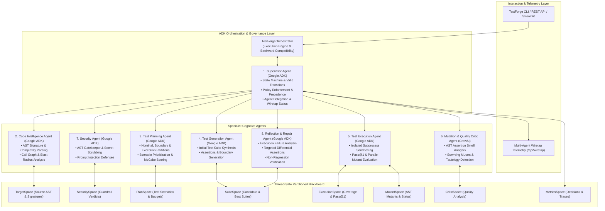
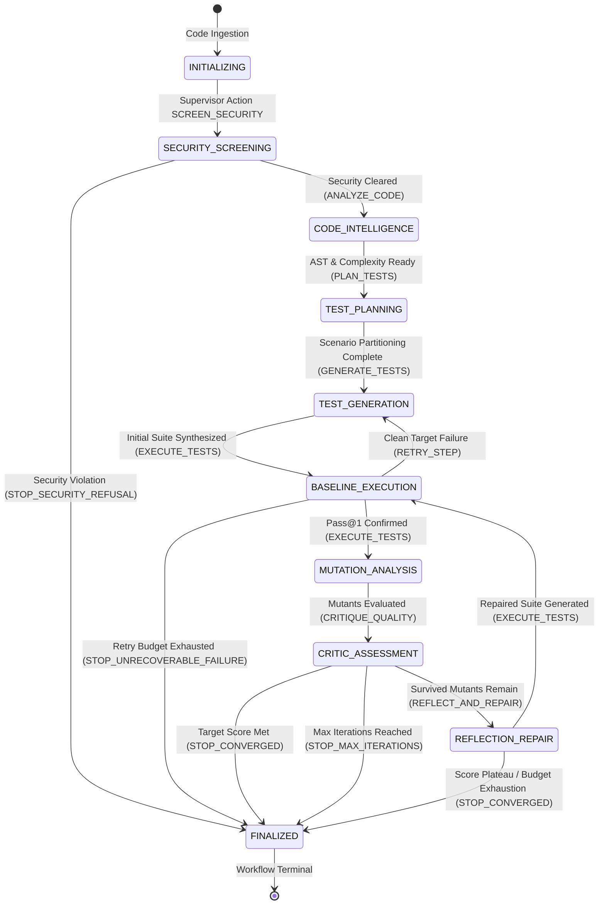

# TestForge: Final Eight-Agent Modular Architecture Reference

**Project:** TestForge — Autonomous Agentic Unit Test Hardening System  
**Version:** 2.0 (Eight-Agent Production Architecture)  
**Date:** November 5, 2026  
**Status:** ARCHITECTURE COMPLETE & EMPIRICALLY VERIFIED  

---

## 1. Executive Architectural Blueprint

TestForge is an autonomous multi-agent software engineering system engineered to synthesize, evaluate, harden, and repair Python unit test suites. The architecture employs an **8-agent cognitive topology** orchestrated under the **Google Agent Development Kit (Google ADK v1.14.1)** with a specialized **CrewAI** critic agent, an in-process thread-safe **Blackboard**, and strongly-typed **Pydantic v2** inter-agent communication contracts.

### Core Architectural Invariants:
1. **Google ADK as the Primary Orchestration Topology:**  
   Google ADK (`google.adk.agents.llm_agent.LlmAgent`, `google.adk.runners.Runner`, `google.adk.sessions.in_memory_session_service.InMemorySessionService`) provides the authoritative top-level coordination and agent communication scaffolding.
2. **Deterministic Safety Rules Supersede Generative Reasoning:**  
   Safety guardrails, AST security policies, cancellation tokens, timeout deadlines, iteration limits, and score convergence criteria are strictly deterministic. Generative LLMs deliberate within policy boundaries but cannot override safety gates or bypass sandbox restrictions.
3. **CrewAI as a Scoped Specialist Critic:**  
   CrewAI is not a top-level orchestrator. It is scoped strictly to the **Mutation & Quality Critic Agent**, performing high-order qualitative assertion analysis and semantic mutant review.
4. **Partitioned In-Memory Blackboard State:**  
   All state transitions, intermediate artifacts, execution payloads, and decision traces flow through eight strongly-typed Blackboard partitions with thread-safe locking and atomic serialization.
5. **Fail-Closed Verification & Non-Regression:**  
   Test candidates are verified via isolated sandboxing before mutation testing. Repaired suites must strictly equal or exceed prior mutation scores (`candidate_score >= best_score`) to be accepted.

---

## 2. Mermaid System Architecture Diagram



---

## 3. Workflow State Machine & Transition Diagram



---

## 4. Comprehensive Eight-Agent Specification Table

| # | Agent Name | Framework | Concrete Class & Path | Primary Responsibilities | Typed Pydantic Contracts | Storage Partition |
|---|---|---|---|---|---|---|
| **1** | **Supervisor Agent** | **Google ADK** | `SupervisorAgent`<br>[`testforge/supervisor_agent.py`](file:///Users/sourabh/TestForge/testforge/supervisor_agent.py) | Coordinates stage transitions, enforces deterministic policies, validates workflow transitions, tracks live agent status. | `SupervisorDecisionPayload`<br>`WorkflowTransitionRecord` | `MetricsSpace` |
| **2** | **Code Intelligence Agent** | **Google ADK + AST** | `CodeIntelligenceAgent`<br>[`testforge/code_intelligence_agent.py`](file:///Users/sourabh/TestForge/testforge/code_intelligence_agent.py) | AST signature parsing, cyclomatic complexity, call graphs, exception paths, blast radius analysis. | `CodeIntelligencePayload` | `TargetSpace` |
| **3** | **Test Planning Agent** | **Google ADK** | `TestPlanningAgent`<br>[`testforge/planning_agent.py`](file:///Users/sourabh/TestForge/testforge/planning_agent.py) | Partitions scenarios (nominal, boundary, negative, exception), calculates McCabe priority scores, allocates budgets. | `TestPlanPayload` | `PlanSpace` |
| **4** | **Test Generation Agent** | **Google ADK + LLM** | `GoogleADKTestGenerator`<br>[`testforge/adk_generator.py`](file:///Users/sourabh/TestForge/testforge/adk_generator.py) | Synthesizes executable pytest suites matching planned scenarios; provides offline deterministic AST fallback. | `GeneratedTestPayload` | `SuiteSpace` |
| **5** | **Test Execution Agent** | **Google ADK + MCP** | `TestExecutionAgent`<br>[`testforge/execution_agent.py`](file:///Users/sourabh/TestForge/testforge/execution_agent.py) | Sandboxed subprocess test execution, pass@1 target validation, pytest-cov measurement, parallel mutant evaluation. | `TestExecutionPayload` | `ExecutionSpace`<br>`MutantSpace` |
| **6** | **Mutation & Quality Critic Agent** | **CrewAI** | `CrewAICriticAgent`<br>[`testforge/crew_critic.py`](file:///Users/sourabh/TestForge/testforge/crew_critic.py) | Analyzes real mutant execution results, flags assertion smells (tautologies, weak asserts), directs targeted killing. | `MutationQualityCriticPayload`<br>`CriticDirectivePayload` | `CriticSpace` |
| **7** | **Security Agent** | **Google ADK** | `SecurityAgent`<br>[`testforge/security_agent.py`](file:///Users/sourabh/TestForge/testforge/security_agent.py) | Ingestion and output code AST security screening, dangerous construct detection, credential redaction, prompt defense. | `SecurityEvaluationPayload` | `SecuritySpace` |
| **8** | **Reflection & Repair Agent** | **Google ADK** | `ReflectionRepairAgent`<br>[`testforge/reflection_agent.py`](file:///Users/sourabh/TestForge/testforge/reflection_agent.py) | Analyzes test failure tracebacks and surviving mutant diffs, formulates discriminating assertions, enforces non-regression. | `RepairDirectivePayload`<br>`RepairResultPayload`<br>`ReflectionDecisionPayload` | `SuiteSpace` |

---

## 5. Blackboard Partitions & Data Contracts

The Blackboard (`testforge/blackboard.py`) is structured into eight synchronized memory partitions:

1. **`TargetSpace`:** Ingested module name, source code, AST tree, cyclomatic complexity, exception paths, and external dependencies.
2. **`SecuritySpace`:** Security verdicts, AST screening findings, detected vulnerabilities, risk levels, and redaction logs.
3. **`PlanSpace`:** Formulated test scenarios (`TestScenario`), priority metrics, parameter specifications, and assertion requirements.
4. **`SuiteSpace`:** Current candidate test code, initial baseline suite, historical test revisions, and verified best suite.
5. **`ExecutionSpace`:** Pass@1 clean target execution status, stdout/stderr, execution duration, and line coverage percentage.
6. **`MutantSpace`:** Generated AST mutants, mutant diffs, execution statuses (`KILLED`, `SURVIVED`, `TIMED_OUT`, `EQUIVALENT`), and mutant survival rates.
7. **`CriticSpace`:** Qualitative test suite critique, assertion smell detections, semantic equivalence assessments, and critic directives.
8. **`MetricsSpace`:** Iteration history, raw & adjusted mutation scores, latency logs, supervisor decision history, and current workflow stage.

---

## 6. Deterministic Guardrail Authority vs. Generative Deliberation

A fundamental principle of TestForge is that **untrusted LLM outputs never make authoritative policy or safety decisions**:

```
                       +-----------------------------------+
                       |    Policy Decision Requested      |
                       +-----------------------------------+
                                         |
                                         v
                     [Deterministic Invariant Check]
                     • Cancellation event set?
                     • Execution timeout expired?
                     • SecurityAgent rejected code?
                     • Mutation score target achieved?
                     • Iteration limit reached?
                     • Step retry budget exceeded?
                                    /         \
                             YES   /           \   NO
                                  v             v
      +---------------------------------+  +---------------------------------+
      | Enforce Deterministic Decision  |  | Invoke Google ADK Deliberation  |
      | • STOP_CANCELLED                |  | • Specialized agent planning    |
      | • STOP_SECURITY_REFUSAL         |  | • Multi-mutant triage           |
      | • STOP_CONVERGED                |  | • Candidate repair synthesis    |
      | • is_deterministic = True       |  | • is_deterministic = False      |
      +---------------------------------+  +---------------------------------+
                                                            |
                                               [Exception or Parse Failure?]
                                                            |
                                                            v
                                           +---------------------------------+
                                           | Fall back to Deterministic Rule |
                                           | • is_deterministic = True       |
                                           +---------------------------------+
```

---

## 7. Wiretap Telemetry & Honest Dashboard Integration

The FastAPI Wiretap API (`server.py: /api/wiretap`) exposes real-time state for observability:

- **Captured Handoffs:** Total count of inter-agent messages routed through the `A2ABroker`.
- **Active Agents:** Exact count of canonical agents with `participating: True` in the active workflow.
- **Dynamic Eight-Agent Status:** Full dictionary mapping each of the 8 canonical agents to their registration, participation, last active timestamp, and current workflow stage.
- **Supervisor Decisions:** Chronological array of `SupervisorDecisionPayload` instances documenting every step transition, rationale, and deterministic vs model attribution.

This guarantees complete empirical transparency, eliminating static placeholder counts and ensuring that academic audits reflect genuine multi-agent execution.

