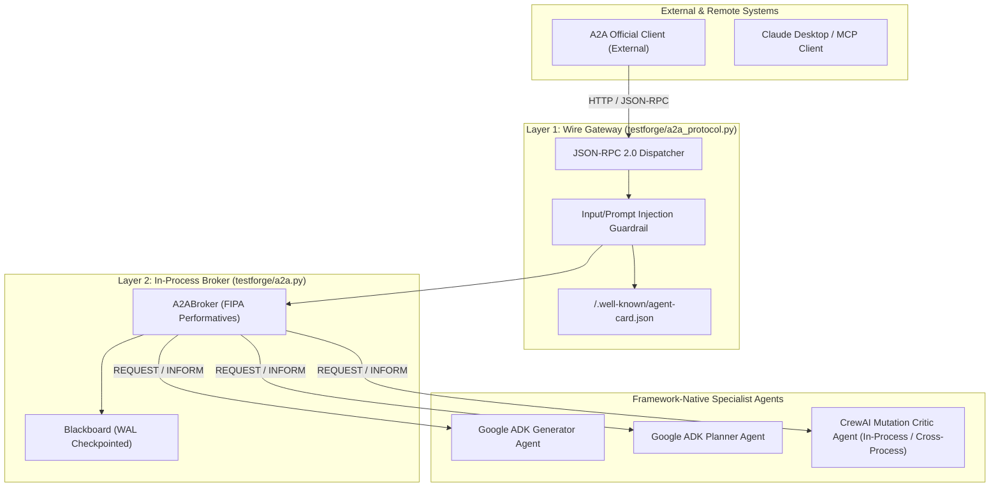
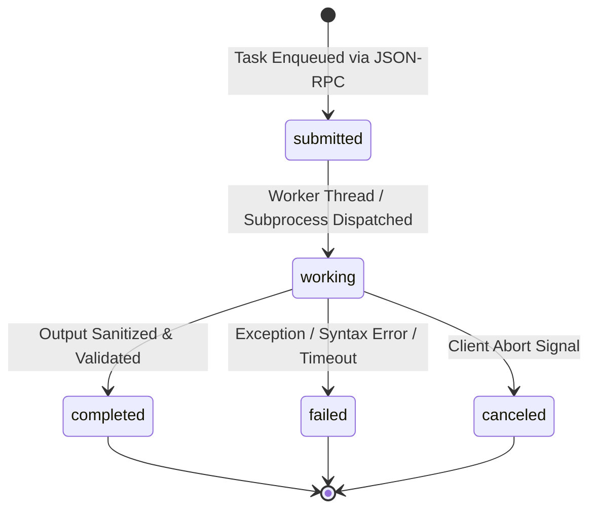

# TestForge Agent2Agent (A2A) Protocol Specification & Architecture

**Document Version**: `2.0.0`  
**Official Protocol Version**: `Agent2Agent (A2A) v0.3.0`  
**Internal Performative Bus**: `FIPA-ACL Envelopes v1.2`  
**Associated Modules**:
- [`testforge/a2a_protocol.py`](file:///Users/sourabh/TestForge/testforge/a2a_protocol.py): Official Wire Protocol Gateway & Server
- [`testforge/a2a.py`](file:///Users/sourabh/TestForge/testforge/a2a.py): In-Process Broker & Historical Compatibility Re-Exports
- [`testforge/a2a_distributed.py`](file:///Users/sourabh/TestForge/testforge/a2a_distributed.py): Cross-Process Distributed Workers & Fallback

---

## 1. Executive Disambiguation: Two Complementary Communication Layers

A common point of ambiguity in agentic multi-agent systems is conflating **in-process performative message passing** with **inter-agent wire protocols**.
TestForge strictly disambiguates and separates these two layers:

| Architectural Dimension | Layer 1: Official A2A Wire Protocol | Layer 2: In-Process FIPA Performative Bus |
| :--- | :--- | :--- |
| **Standard / Origin** | Official Agent2Agent (A2A) Standard (v0.3.0, LF / Google) | FIPA-ACL (Foundation for Intelligent Physical Agents) |
| **Transport** | JSON-RPC 2.0 over HTTP / Server-Sent Events (SSE) | In-memory asyncio event broker (`A2ABroker`) |
| **Discovery** | `AgentCard` at `/.well-known/agent-card.json` | Local registration `broker.register(agent_id, handler)` |
| **Primary Use Case** | Cross-framework (Google ADK <-> CrewAI), cross-process, remote agents | Fast in-memory lifecycle notifications between co-located agents |
| **Task Lifecycle** | Explicit state machine (`submitted` $\rightarrow$ `working` $\rightarrow$ `completed`/`failed`) | Fire-and-forget or request/response performatives |
| **Security Boundary** | Prompt injection guardrails, redaction, Bearer auth | Memory isolation, type enforcement via Pydantic |



---

## 2. Layer 1: Official Agent2Agent (A2A) Protocol

### 2.1. AgentCard Discovery
TestForge exposes its machine-readable capability manifest at both:
- `GET /.well-known/agent-card.json`
- `GET /.well-known/agent.json`

The card declares official skills:
1. `unit-test-generation`: Consumes Python source code and test requirements, returning syntax-validated pytest suites.
2. `mutation-critique`: Consumes surviving mutant AST diffs, returning actionable diagnostic directives.
3. `hardening-workflow`: Coordinates the end-to-end multi-turn hardening pipeline.

### 2.2. Task State Transitions
Every A2A task follows the deterministic state machine:



---

## 3. Layer 2: In-Process FIPA-ACL Performative Bus

Within a single OS process or during local test execution, agents exchange strongly-typed `A2AMessage` envelopes:

```python
class A2APerformative(str, Enum):
    REQUEST = "REQUEST"           # Requesting action execution (e.g. plan_tests)
    INFORM = "INFORM"             # Transmitting results (e.g. generated_tests)
    PROPOSE = "PROPOSE"           # Proposing candidate test assertions
    REFUSE = "REFUSE"             # Declining unsafe request (security policy)
    FAILURE = "FAILURE"           # Action failed during execution
    ACCEPT_PROPOSAL = "ACCEPT_PROPOSAL"
```

---

## 4. Layer 3: Distributed Cross-Process A2A Architecture

As implemented in `testforge/a2a_distributed.py`:
- The **MutationQualityCriticAgent** can be deployed in a dedicated, isolated OS daemon (`testforge/scripts/run_critic_service.py`).
- Communications occur over localhost HTTP REST/JSON-RPC.
- The parent process and child worker maintain **distinct OS PIDs**, proven in audit logs.
- **Fail-Safe In-Process Fallback**: If the external daemon process is killed, the `DistributedCriticClient` seamlessly falls back to local in-process critique within the caller PID with zero pipeline disruption.
