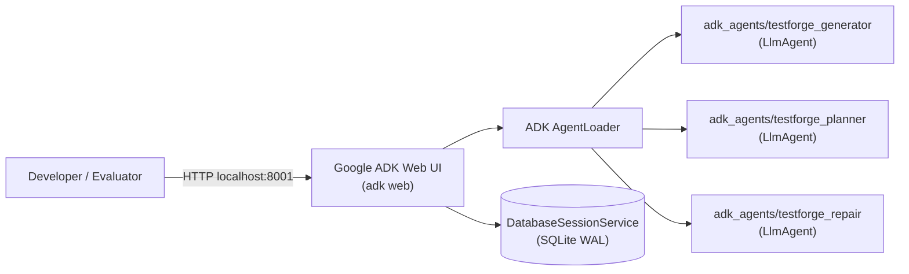

# Google ADK Web UI & CLI Operational Guide

**Handout Reference**: Handout Feature F4 (Google Agent Development Kit native tooling & visualization)  
**CLI Command**: `adk web [OPTIONS] [AGENTS_DIR]`  
**Agents Root Directory**: `adk_agents/`  
**Default Port**: `8001` (to avoid collision with TestForge Dashboard on `8000`)  

---

## 1. Overview & Capability

TestForge packages its core specialist agents in the standardized Google ADK agent directory format (`adk_agents/`), enabling direct integration with the official Google ADK Web UI (`adk web`), CLI runner (`adk run`), and evaluation engine (`adk eval`).

The ADK Web UI provides:
1. **Interactive Chat Playground**: Direct conversational testing against TestForge Generator, Planner, and Reflection Repair agents.
2. **Session State Inspector**: Live inspection of ADK session variables, scoped partitions (`app:`, `user:`, `temp:`), and event journals.
3. **A2A Endpoint Discovery**: Dynamic AgentCard discovery and direct A2A task messaging.
4. **Trajectory & Tool Calling Visualizer**: Step-by-step audit of FunctionTool invocations and model responses.



---

## 2. Directory Layout & Agent Structure

Google ADK's `AgentLoader` discovers agents from `adk_agents/` where each sub-directory contains `__init__.py` and `agent.py` exposing a `root_agent`:

```
adk_agents/
├── testforge_generator/
│   ├── __init__.py
│   └── agent.py          # Exports root_agent (test synthesis)
├── testforge_planner/
│   ├── __init__.py
│   └── agent.py          # Exports root_agent (complexity & budget allocation)
└── testforge_repair/
    ├── __init__.py
    └── agent.py          # Exports root_agent (reflection repair on survivors)
```

---

## 3. How to Launch `adk web`

### Option A: Standalone ADK Web Server (Recommended)
```bash
.venv-release/bin/adk web adk_agents --port 8001 --a2a
```
Open [http://127.0.0.1:8001](http://127.0.0.1:8001) in your browser to interact with the visual playground.

### Option B: With Persistent SQLite Session Service
To link session history with TestForge's SQLite database:
```bash
.venv-release/bin/adk web adk_agents \
  --port 8001 \
  --session_service_uri sqlite:///qa_artifacts/testforge_adk_sessions.db \
  --a2a
```

### Option C: Interactive Terminal Mode (`adk run`)
To run a specialist agent directly in your terminal:
```bash
.venv-release/bin/adk run adk_agents/testforge_generator
```

---

## 4. Verification & Automated Testing

TestForge includes automated regression tests verifying that all `adk_agents` packages load without errors and that the FastAPI server initializes with all 46 native routes:

```bash
.venv-release/bin/python3 -m pytest tests/test_adk_web_compatibility.py -v
```
