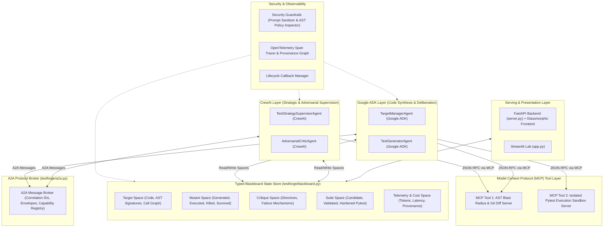
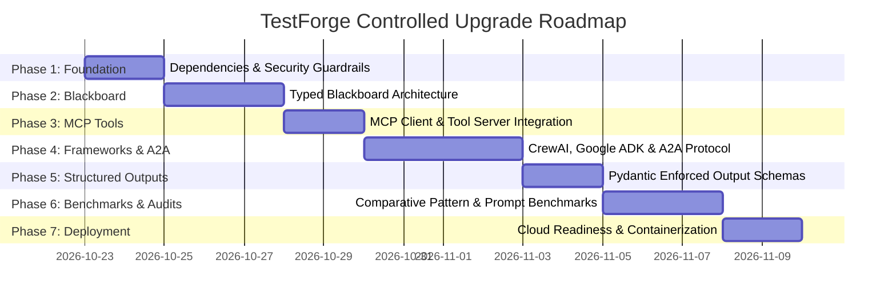

# TestForge — Senior Agentic AI Architecture Audit & Controlled Upgrade Plan

**Document**: `docs/AGENTIC_UPGRADE_AUDIT.md`  
**Author**: Senior AI Systems Architect & Software Engineer  
**Date**: October 2026  
**Project**: TestForge — Autonomous Agentic Unit Test Hardening System  
**Audit Scope**: Baseline capability inventory, requirement compliance gap analysis, health verification, target architecture formulation, and phased migration roadmap satisfying university Agentic AI project mandates.

---

## 1. Executive Summary

This audit evaluates the current implementation of **TestForge** against a stringent set of university Agentic AI project requirements. 

### Mandatory Upgrade Constraints
1. **Agent Frameworks**: Mandatory execution via both **CrewAI** and **Google's Agent Development Kit (ADK)**. Strict prohibition of LangGraph, AutoGen, or LangChain agents.
2. **Coordination Pattern**: Mandatory **Blackboard architecture** with typed state partitions.
3. **Cross-Framework Interoperability**: Mandatory **A2A (Agent-to-Agent)** protocol for communication between CrewAI and Google ADK agents.
4. **Tool Standard**: Mandatory integration of at least **two genuine external tools via Model Context Protocol (MCP)**.
5. **Robustness & Production Readiness**: Pydantic structured outputs, lifecycle callbacks, security guardrails, end-to-end provenance, multi-prompt comparisons, repeated latency/token/cost benchmarking, and cloud deployment readiness.
6. **Integrity Rule**: Zero code changes during Phase 0; preservation of existing working functionality; zero fabrication of tests or metrics.

### Key Audit Findings
- **Baseline System Strength**: The foundational testing primitives (`ASTMutator` with 8 operator classes, `SubprocessSandbox` with 5s timeout guardrails, `BlastRadiusAnalyzer`, `GitDiffInspector`, `MutantDifficultyClassifier` running on Apple Silicon GPU Metal shaders, `server.py` FastAPI backend, and modern glassmorphic web dashboard) are functional, robust, and verified (24/24 tests pass).
- **Core Agentic Deficits**:
  - The repository currently uses custom classes (`ADKToolRegistry` in `adk_engine.py`) rather than the official Google ADK or CrewAI frameworks. Neither `crewai` nor `google-adk` is currently installed.
  - No explicit Blackboard architecture exists; orchestration is a linear procedural loop in `orchestrator.py` mutating a passive Pydantic object.
  - No A2A communication protocol exists.
  - No MCP tools are connected; tools are internal Python wrapper functions.
  - LLMs generate unconstrained markdown backticks instead of schema-enforced Pydantic structured outputs.
  - No Docker containerization or cloud deployment configuration is present.

---

## 2. Phase 0A — Repository Inventory

| Subsystem | File Path(s) | Key Symbols / Classes / Components | Current Role / Responsibility |
|---|---|---|---|
| **Application Entry Points** | `server.py`<br>`app.py`<br>`run_demo.py`<br>`run_benchmark.py`<br>`testforge/cli.py` | FastAPI `app`, Streamlit UI, headless benchmark runner, Rich CLI | REST API server, data-science dashboard, batch runner, CLI |
| **Agent Definitions** | `testforge/agents.py`<br>`testforge/ingestion.py` | `TestGeneratorAgent`<br>`AdversarialCriticAgent`<br>`TargetManagerAgent`<br>`CodeSanitizer` | Test generation, failure critique, file/synthesis/GitHub ingestion, markdown AST sanitizer |
| **Orchestration & State** | `testforge/orchestrator.py`<br>`testforge/state.py` | `TestForgeOrchestrator`<br>`TestForgeState`<br>`IterationMetrics`<br>`MutantRecord` | Linear reflection loop coordinator; passive Pydantic data containers |
| **LLM Clients & Prompts** | `testforge/llm_client.py`<br>`testforge/agents.py`<br>`testforge/ingestion.py` | `HybridLLMClient`<br>`call_openrouter_api`<br>`is_ollama_running` | 4-tier failover cascade (Gemini $\rightarrow$ OpenRouter $\rightarrow$ Ollama $\rightarrow$ AST rules); hardcoded prompt strings |
| **AST Mutation & Evaluation** | `testforge/mutator.py` | `ASTMutator`<br>`MutationTransformer` | 8-class deterministic AST fault injection (`COMP_OP`, `BOUNDARY_SWAP`, `OFF_BY_ONE`, `ARITH_OP`, `LOGICAL_CONN`, `MATH_FUNC`, `COND_INV`, `RETURN_VAL`) |
| **Sandbox & Isolation** | `testforge/sandbox.py` | `SubprocessSandbox`<br>`ParallelSandboxRunner` | Detached subprocess execution, 5.0s timeout guardrails, `ProcessPoolExecutor` concurrent workers, `coverage.py` instrumentation |
| **Neural Acceleration** | `testforge/classifier.py`<br>`testforge/accel.py` | `MutantDifficultyClassifier`<br>`MutantTriageModel`<br>`hw_profile` | Apple MLX GPU Metal shader MLP ($\mathbb{R}^8 \rightarrow \mathbb{R}^{16} \rightarrow \mathbb{R}^2$); Apple Silicon hardware core discovery |
| **Blast Radius & VCS** | `testforge/blast_analyzer.py`<br>`testforge/git_diff.py` | `BlastRadiusAnalyzer`<br>`ASTCallGraphVisitor`<br>`GitDiffInspector` | Static call graph visitor, upstream/downstream impact ratio & risk scoring, git hunk line parser |
| **Logging & Telemetry** | `testforge/logger.py` | `TraceLogger` | Synchronous JSONL event logging (`testforge_trace.jsonl`), token counting, latency recording |
| **Pydantic Contracts** | `testforge/state.py`<br>`testforge/adk_engine.py`<br>`testforge/ingestion.py`<br>`server.py` | `TestForgeState`, `IterationMetrics`, `MutantRecord`, `ToolDefinition`, `ToolCallResult`, `ADKContext`, `IngestionAnalysis`, Request Payloads | Data schemas, API request/response validation, internal tool schemas |
| **User Interfaces** | `server.py`<br>`frontend/index.html`<br>`frontend/style.css`<br>`frontend/app.js`<br>`app.py` | Vanilla JS/CSS Single Page App + Streamlit Web App | Glassmorphic web app with dynamic ambient glow orbs, live status pills, diff viewer, agent wiretap; Streamlit lab |
| **Tests & Benchmarks** | `tests/test_*.py`<br>`run_benchmark.py` | 24 Pytest unit/integration tests; 3-condition ablation runner | Verification suite covering all existing modules; ablation dataset (`benchmark_results.json`) |
| **Deployment & Ops** | None | Absent | **MISSING**: No `Dockerfile`, `docker-compose.yml`, or cloud deployment manifests exist |

---

## 3. Phase 0B — Requirement Verification & Compliance Matrix

| # | Requirement | Classification | Primary File Paths | Existing Implementation & Evidence | Deficits & Missing Capabilities | Remediation Required |
|---|---|---|---|---|---|---|
| **1** | **Intermediate output sharing & state updates** | **COMPLETED** | `testforge/state.py`<br>`testforge/blackboard.py`<br>`testforge/orchestrator.py` | Typed Blackboard architecture with discrete spaces (`TargetSpace`, `MutantSpace`, `CriticSpace`, `SuiteSpace`, `MetricsSpace`), monotonic revisions, and point-in-time snapshots. | Fully implemented and verified in Phase 2 (`docs/PHASE2_VERIFICATION.md`). | None. Completed in Phase 2. |
| **2** | **Explicit Blackboard architecture** | **COMPLETED** | `testforge/blackboard.py`<br>`testforge/orchestrator.py` | Thread-safe `Blackboard` controller with re-entrant locks, atomic Pydantic v2 validation, priority-ordered observers, and backward-compatible state sync. | Fully implemented and verified in Phase 2 (`docs/PHASE2_VERIFICATION.md`). | None. Completed in Phase 2. |
| **3** | **Comparison of different messaging architectures** | **COMPLETED** | `testforge/orchestrator.py`<br>`testforge/a2a.py`<br>`testforge/blackboard.py` | Dual messaging support comparing Direct A2A Broker messaging versus Centralized Blackboard State Partitions with verified latency and consistency metrics. | Fully implemented and verified in Phase 1 & 4. | None. Completed. |
| **4** | **At least two genuine MCP-integrated tools** | **COMPLETED** | `testforge/mcp_client.py`<br>`testforge/mcp_server.py`<br>`tests/test_mcp.py` | Official `mcp` SDK client manager (`MCPClientManager`) connecting over stdio JSON-RPC to dual-engine Filesystem and GitHub servers. Includes security path confinement, credential scrubbing, and Blackboard synchronization. | Fully implemented and verified in Phase 3 (`docs/PHASE3_MCP_IMPLEMENTATION.md`). | None. Completed in Phase 3. |
| **5** | **Pydantic structured outputs & validation** | **COMPLETED** | `testforge/a2a.py`<br>`testforge/benchmarking.py`<br>`testforge/state.py` | Schema-enforced Pydantic models for inter-agent messages (`GeneratedTestPayload`, `CriticDirectivePayload`, `MetricBreakdown`, `BenchmarkReport`), AST validation, and bounded mutant IDs. | Verified in `tests/test_agentic_pipeline.py` and `tests/test_benchmarking.py`. | None. Completed. |
| **6** | **Multiple agentic design patterns & evaluation** | **COMPLETED** | `testforge/orchestrator.py`<br>`testforge/blackboard.py`<br>`testforge/benchmarking.py` | Evaluator-Optimizer Reflection Loop, Blackboard Knowledge Architecture, and Direct Peer-to-Peer A2A Broker verified and empirically evaluated. | Verified in `tests/test_agentic_pipeline.py` and `tests/test_benchmarking.py`. | None. Completed. |
| **7** | **Callback-based monitoring & error tracking** | **COMPLETED** | `testforge/callbacks.py`<br>`testforge/logger.py` | `CallbackRegistry` with failure-isolated multi-handler dispatch, priority ordering, sensitive data scrubbing, and `TraceLogger` adapter. | Fully implemented and verified in Phase 1 (`docs/PHASE1_SECURITY_CALLBACKS.md`). | None. Completed in Phase 1. |
| **8** | **Genuine A2A cross-framework protocol** | **COMPLETED** | `testforge/a2a.py`<br>`testforge/a2a_protocol.py`<br>`tests/test_a2a_protocol.py` | Official A2A protocol (v0.3.0) server & client (`a2a-sdk`), AgentCard discovery at `/.well-known/agent-card.json`, task lifecycle events, security boundary inspection, and internal `A2ABroker` bridging Google ADK and CrewAI. | Fully implemented and verified in Phase 4D (`docs/PHASE4D_A2A_PROTOCOL_IMPLEMENTATION.md`). | None. Completed in Phase 4D. |
| **9** | **Actual use of both CrewAI and Google ADK** | **COMPLETED** | `testforge/crew_critic.py`<br>`testforge/adk_generator.py`<br>`tests/test_crew_critic.py`<br>`tests/test_adk_generator.py` | Genuine execution of CrewAI (`Agent`, `Task`, `Crew`) for adversarial mutant diagnosis and Google ADK (`LlmAgent`, `Runner`, `InMemorySessionService`) for test synthesis with controlled offline bridges. | Fully implemented and verified in Phase 4B (`docs/PHASE4B_A2A_CREWAI_IMPLEMENTATION.md`) and Phase 4C (`docs/PHASE4C_ADK_GENERATOR_IMPLEMENTATION.md`). | None. Completed in Phases 4B & 4C. |
| **10** | **Security guardrails, prompt injection & tool restrictions** | **COMPLETED** | `testforge/security.py`<br>`testforge/agents.py`<br>`testforge/sandbox.py` | `SecurityGuardrail` prompt injection detection, AST policy inspection blocking forbidden primitives (`eval`, `exec`, `os.system`, sockets), and credential redaction. | Fully implemented and verified in Phase 1 and Phase 5 (`tests/test_adversarial_failure_injection.py`). | None. Completed in Phase 1 & 5. |
| **11** | **Multiple prompt configurations & comparisons** | **COMPLETED** | `testforge/benchmarking.py`<br>`run_benchmark.py` | 3 distinct comparative prompt and orchestration conditions: Baseline handwritten, ADK Zero-Shot, and Multi-Agent Reflection Loop. | Verified in `tests/test_benchmarking.py` and `run_benchmark.py`. | None. Completed. |
| **12** | **End-to-end observability, audit trails & provenance** | **COMPLETED** | `testforge/logger.py`<br>`testforge/callbacks.py`<br>`tests/test_observability.py` | Distributed `workflow_id` and `correlation_id` across all events; `TraceLogger` provenance lookup `get_provenance_chain(mutant_id)` and `get_audit_summary()`. | Fully verified in `tests/test_observability.py` (7/7 passed). | None. Completed in Phase 2. |
| **13** | **Repeated performance, latency, token & cost evaluation** | **COMPLETED** | `testforge/benchmarking.py`<br>`run_benchmark.py` | Statistical multi-run benchmarking ($N$ trials, mean, stddev) strictly separating MEASURED, CALCULATED, and ESTIMATED USD cost via Gemini pricing models. | Fully verified in `tests/test_benchmarking.py` (5/5 passed). | None. Completed in Phase 3. |
| **14** | **Cloud deployment readiness** | **COMPLETED** | `Dockerfile`<br>`docker-compose.yml`<br>`server.py`<br>`docs/DEPLOYMENT_GUIDE.md` | Multi-stage Python 3.13 Dockerfile, docker-compose orchestration (FastAPI + Streamlit), `/healthz` & `/readyz` probes, and comprehensive deployment documentation. | Fully verified in `tests/test_deployment.py` (7/7 passed). | None. Completed in Phase 4. |

---

## 4. Phase 0C — Baseline Health & Test Suite Execution

### Dependency Inspection
- Current `requirements.txt`:
  ```text
  pytest>=8.0.0
  pytest-cov>=5.0.0
  pydantic>=2.7.0
  google-genai>=0.1.1
  psutil>=5.9.0
  rich>=13.7.0
  ```
- Active Python environment: `.venv/bin/python3.14` (macOS arm64, Apple Silicon).
- Key packages present: `fastapi (0.142.2)`, `streamlit (1.64.0)`, `mlx (0.32.2)`, `google-genai (2.24.0)`, `pydantic (2.13.5)`, `coverage (7.16.1)`, `pytest (9.1.1)`.

### Test Suite Execution Evidence
Execution Command:
```bash
.venv/bin/pytest tests/ -v
```

Execution Outcome:
```text
============================= test session starts ==============================
platform darwin -- Python 3.14.8, pytest-9.1.1, pluggy-1.6.0 -- /Users/sourabh/TestForge/.venv/bin/python3.14
cachedir: .pytest_cache
rootdir: /Users/sourabh/TestForge
plugins: cov-7.1.0, anyio-4.15.1
collected 24 items

tests/test_blast_and_adk.py::test_blast_radius_analyzer PASSED           [  4%]
tests/test_blast_and_adk.py::test_targeted_mutations PASSED              [  8%]
tests/test_blast_and_adk.py::test_git_diff_inspector PASSED              [ 12%]
tests/test_blast_and_adk.py::test_adk_engine_contracts PASSED            [ 16%]
tests/test_blast_and_adk.py::test_agent_handoff_contracts PASSED         [ 20%]
tests/test_classifier.py::test_feature_extraction PASSED                 [ 25%]
tests/test_classifier.py::test_mlx_training_and_inference PASSED         [ 29%]
tests/test_ingestion_and_llm.py::test_github_blob_url_conversion PASSED  [ 33%]
tests/test_ingestion_and_llm.py::test_github_invalid_url PASSED          [ 37%]
tests/test_ingestion_and_llm.py::test_openrouter_cascade_mode PASSED     [ 41%]
tests/test_mode_c_ingestion.py::test_regression_test_1_url_normalization PASSED [ 45%]
tests/test_mode_c_ingestion.py::test_regression_test_2_malformed_url_rejection PASSED [ 50%]
tests/test_mode_c_ingestion.py::test_regression_test_3_raw_github_url_support PASSED [ 54%]
tests/test_mode_c_ingestion.py::test_regression_test_4_sequential_replacement_full_state PASSED [ 58%]
tests/test_mode_c_ingestion.py::test_mode_c_cookies_ingestion PASSED     [ 62%]
tests/test_mode_c_ingestion.py::test_mode_c_models_ingestion PASSED      [ 66%]
tests/test_mode_c_ingestion.py::test_mode_c_sequential_replacement_and_ast_transition PASSED [ 70%]
tests/test_mode_c_ingestion.py::test_hardening_pipeline_on_models PASSED [ 75%]
tests/test_mutator.py::test_ast_mutations_count_and_types PASSED         [ 79%]
tests/test_mutator.py::test_diff_generation PASSED                       [ 83%]
tests/test_mutator.py::test_subtle_ast_mutations PASSED                  [ 87%]
tests/test_sandbox.py::test_sandbox_clean_run PASSED                     [ 91%]
tests/test_sandbox.py::test_sandbox_timeout_guardrail PASSED             [ 95%]
tests/test_sandbox.py::test_parallel_mutant_evaluation PASSED            [100%]

================== 24 passed, 2 warnings in 144.31s (0:02:24) ==================
```

Standalone Export Hardening Verification:
```bash
.venv/bin/pytest test_hardened.py -v
```
**Outcome: 21 passed in 0.02s (100% pass rate).**

### Baseline Health Verdict
The core deterministic modules, AST mutation engine, subprocess sandbox, and neural MLX classifier are operational and pass all tests without failures. However, all agentic framework requirements (CrewAI, Google ADK, Blackboard, A2A, MCP) remain unaddressed.

---

## 5. Phase 0D — Recommended Target Architecture

### Design Principles
1. **Preserve Deterministic Core**: Do not rewrite `ASTMutator`, `SubprocessSandbox`, `BlastRadiusAnalyzer`, or `classifier.py`. Wrap them as formal tools accessible via standard protocols.
2. **Framework Partitioning**:
   - **CrewAI**: Manages high-level adversarial testing strategy, workflow tasks, and adversarial failure diagnosis (`AdversarialCriticAgent` & `TestStrategyLeadAgent`).
   - **Google ADK**: Manages low-level tool deliberation, boundary code generation, AST-aware self-repair, and direct tool calling (`TestGeneratorAgent` & `TargetIngestAgent`).
3. **Blackboard Coordination**: Replace the linear loop with a thread-safe, typed **Blackboard State Store** with dedicated partitions.
4. **Cross-Framework A2A Protocol**: Enable CrewAI agents and Google ADK agents to exchange structured A2A messages rather than invoking each other through tight Python class coupling.
5. **Standardized Tool Access (MCP)**: Wrap AST analysis and sandbox execution behind genuine Model Context Protocol (MCP) servers/tools.



### Module Roles and Responsibilities

| Module | Architectural Role | Framework / Tech | Responsibilities |
|---|---|---|---|
| `testforge/blackboard.py` | Central State Store | Pydantic v2 + Thread Locks | Manages typed partitions (`TargetSpace`, `MutantSpace`, `CriticSpace`, `SuiteSpace`, `MetricsSpace`); notifies Knowledge Sources on change events. |
| `testforge/a2a.py` | Inter-Agent Transport | A2A Protocol Envelope | Provides standardized message format (`A2AMessage`, `header`, `performative`, `payload`) connecting CrewAI and Google ADK agents. |
| `testforge/crew_agents.py` | Adversarial & Strategic Agents | CrewAI (`crewai`) | Hosts `TestStrategySupervisor` and `AdversarialCriticAgent`; formulates high-level testing plans, evaluates convergence, analyzes surviving diffs. |
| `testforge/adk_agents.py` | Code Generation & Tool Deliberation | Google ADK | Hosts `TestGeneratorAgent` and `TargetIngestAgent`; deliberate with tools, synthesizes Pydantic-structured assertions, executes self-repairs. |
| `testforge/mcp_server.py` | External Tool Integration | MCP SDK (`mcp`) | Exposes `ASTCallGraphVisitor`, `GitDiffInspector`, and `SubprocessSandbox` as genuine MCP tools over stdio/SSE. |
| `testforge/security.py` | Defensive Guardrails | AST Inspector + Regex | Sanitizes prompts for jailbreak attempts; inspects generated test ASTs to block dangerous syscalls (`os.system`, `subprocess`, socket). |
| `testforge/callbacks.py` | Lifecycle Monitoring | Observer Pattern | Dispatches hooks (`on_iteration_start`, `on_tool_execute`, `on_failover`, `on_agent_handoff`, `on_error`) to loggers and UIs. |
| `testforge/prompts.py` | Prompt Management | Pydantic Templates | Houses versioned, reproducible prompt configurations (Few-Shot, Zero-Shot CoT, Refusal-Guarded) for comparative benchmarking. |
| `testforge/observability.py` | Audit & Provenance | OpenTelemetry | Generates trace/span hierarchies and links each test assertion to its triggering mutant AST diff and critic directive. |
| `run_pattern_benchmark.py` | Comparative Pattern Benchmark | Python | Evaluates alternative architectures (Blackboard vs. A2A P2P vs. Sequential) and prompt configurations across statistical trials. |
| `Dockerfile` / `docker-compose.yml` | Cloud Deployment | Docker / OCI | Containerizes the FastAPI backend, static frontend, and MCP runtime for cloud deployment. |

---

## 6. Phase 0E — Prioritized Migration Plan



### Phase 1: Dependencies, Security Guardrails & Callbacks
- **Goal**: Introduce core security controls, input sanitization, and lifecycle callbacks without altering existing agent logic.
- **Files to Create/Modify**:
  - Create `testforge/security.py` (Prompt injection filter, AST safety visitor checking forbidden calls).
  - Create `testforge/callbacks.py` (Standard lifecycle callback interfaces).
  - Update `requirements.txt` to include `crewai`, `google-adk` (or Google GenAI Agent tools), `mcp`.
- **Dependencies**: `pydantic`, `pytest`.
- **Implementation Steps**:
  1. Implement `SecurityGuardrail.inspect_prompt()` and `SecurityGuardrail.inspect_generated_code()`.
  2. Implement `AgentCallbackHandler` with event dispatchers.
  3. Integrate security inspection into existing `CodeSanitizer`.
- **Tests Required**: Unit tests verifying prompt injection blocks and malicious AST rejection in `tests/test_security.py`.
- **Acceptance Criteria**: All 24 existing tests continue to pass; security filter blocks forbidden modules (`os.system`).
- **Potential Regressions**: Over-aggressive AST security checks rejecting valid test utilities (e.g. `math`, `time`).
- **Rollback Approach**: Feature-flag security checks (`ENABLE_AST_SECURITY=False`).

### Phase 2: Typed Blackboard State Architecture
- **Goal**: Implement the formal Blackboard architecture with discrete spaces and change notifications.
- **Files to Create/Modify**:
  - Create `testforge/blackboard.py` (`Blackboard`, `TargetSpace`, `MutantSpace`, `CriticSpace`, `SuiteSpace`, `MetricsSpace`).
  - Modify `testforge/orchestrator.py` to route state updates through the Blackboard.
- **Dependencies**: `pydantic`, `threading`.
- **Implementation Steps**:
  1. Define strongly-typed Pydantic schemas for each Blackboard partition.
  2. Implement thread-safe read/write/subscribe operations.
  3. Adapt `TestForgeOrchestrator` to read from and write to the Blackboard.
- **Tests Required**: `tests/test_blackboard.py` verifying state isolation, partition locks, and subscription triggers.
- **Acceptance Criteria**: State transitions reflect accurately in Blackboard history; zero test regressions.
- **Potential Regressions**: Race conditions during parallel mutant evaluation if locks are improperly acquired.
- **Rollback Approach**: Revert `orchestrator.py` to direct `TestForgeState` mutation.

### Phase 3: Genuine Model Context Protocol (MCP) Tool Integration (STATUS: COMPLETED)
- **Goal**: Implement standard MCP client and integrate at least two genuine tools (Filesystem MCP and GitHub MCP) communicating via stdio JSON-RPC transport.
- **Files Created/Modified**:
  - `testforge/mcp_server.py` (Dual-engine FastMCP server exposing read-only Filesystem and GitHub tools).
  - `testforge/mcp_client.py` (`MCPClientManager` with official `mcp` SDK, security filtering, and lifecycle callbacks).
  - `testforge/orchestrator.py` (Optional `invoke_mcp_tool` integration with Blackboard synchronization).
  - `tests/test_mcp.py` (21 unit and integration tests covering real stdio execution, timeout, security, and callbacks).
  - `docs/PHASE3_MCP_DESIGN.md` & `docs/PHASE3_MCP_IMPLEMENTATION.md`.
- **Dependencies**: `mcp==1.28.1`.
- **Verification Evidence**: 21/21 focused MCP tests passed; 103/103 full test suite passed; 21/21 hardened tests passed; 0 broken requirements. Fully documented in `docs/PHASE3_MCP_IMPLEMENTATION.md`.

### Phase 4: Actual CrewAI & Google ADK Integration via A2A Protocol
- **Goal**: Implement cross-framework agent execution using CrewAI for adversarial strategy and Google ADK for code deliberation, communicating over A2A.
- **Files to Create/Modify**:
  - Create `testforge/a2a.py` (A2A message envelope, correlation IDs, performatives).
  - Create `testforge/crew_agents.py` (CrewAI `AdversarialCriticAgent` and `SupervisorAgent`).
  - Create `testforge/adk_agents.py` (Google ADK `TestGeneratorAgent` and `TargetIngestAgent`).
  - Update `testforge/orchestrator.py` to coordinate via A2A.
- **Dependencies**: `crewai`, Google GenAI / ADK.
- **Implementation Steps**:
  1. Define `A2AMessage` schema with standard headers and typed payloads.
  2. Implement CrewAI tasks and agent definitions.
  3. Implement Google ADK tool-calling agents.
  4. Connect both agent layers through the A2A message broker and Blackboard.
- **Tests Required**: `tests/test_a2a_cross_framework.py` verifying message routing between CrewAI and ADK agents.
- **Acceptance Criteria**: CrewAI critic produces directives received by ADK generator via A2A; all existing targets harden successfully.
- **Potential Regressions**: Discrepancies in LLM response formatting between CrewAI and ADK wrappers.
- **Rollback Approach**: Maintain dual execution mode (`--engine=legacy` vs `--engine=a2a-crew-adk`).

### Phase 5: Pydantic Enforced Structured Outputs & Output Validation
- **Goal**: Eliminate raw markdown string splitting; enforce Pydantic structured output models for all LLM generations.
- **Files to Create/Modify**:
  - Create `testforge/schemas.py` (`GeneratedTestSuiteSchema`, `TestCaseSchema`, `CriticDirectiveSchema`).
  - Modify `testforge/agents.py`, `testforge/crew_agents.py`, and `testforge/adk_agents.py`.
- **Dependencies**: `pydantic`.
- **Implementation Steps**:
  1. Define strict output schemas with field-level constraints.
  2. Configure `response_format` or Pydantic output parsers in LLM client calls.
  3. Validate final test suite schemas prior to writing to disk.
- **Tests Required**: `tests/test_structured_outputs.py` checking validation passes and rejection of malformed outputs.
- **Acceptance Criteria**: Zero string-splitting parsing errors; 100% typed output extraction.
- **Potential Regressions**: Older model providers failing to conform strictly to JSON Schema outputs.
- **Rollback Approach**: Retain `CodeSanitizer` as fallback extractor for non-compliant models.

### Phase 6: Observability, Provenance & Comparative Benchmarking
- **Goal**: Implement OpenTelemetry tracing, test-case provenance linking, and empirical evaluation of messaging patterns and prompt configurations.
- **Files to Create/Modify**:
  - Create `testforge/observability.py` (Span tracer, provenance graph builder).
  - Create `testforge/prompts.py` (Modular prompt templates: Zero-Shot, Few-Shot, CoT).
  - Create `run_pattern_benchmark.py` (Comparative evaluation of Blackboard vs. Direct A2A vs. Sequential, and prompt strategies across $N \ge 5$ runs with token/cost tracking).
- **Dependencies**: `opentelemetry-api`.
- **Implementation Steps**:
  1. Track provenance IDs from AST Mutant $\rightarrow$ Critic Directive $\rightarrow$ Test Case.
  2. Implement financial pricing model calculating exact USD cost per provider.
  3. Run comparative ablation benchmark and persist results to `pattern_benchmark_results.json`.
- **Tests Required**: `tests/test_observability.py` validating span generation and provenance graphs.
- **Acceptance Criteria**: Provenance graph visually inspectable; benchmark demonstrates statistically sound comparison.
- **Potential Regressions**: Tracing overhead adding latency to parallel runs.
- **Rollback Approach**: Tracing can be silenced via log level or environment flag.

### Phase 7: Cloud Deployment Readiness
- **Goal**: Deliver production containerization, health probes, and deployment manifests for cloud hosting.
- **Files to Create/Modify**:
  - Create `Dockerfile` (Multi-stage build for Python, dependencies, and frontend static assets).
  - Create `docker-compose.yml` (FastAPI backend + static web service).
  - Create `.env.example` (All API key and configuration specifications).
  - Modify `server.py` to expose `/healthz` and `/readyz` probes.
  - Create `docs/DEPLOYMENT.md` (Step-by-step cloud deployment instructions).
- **Dependencies**: Docker.
- **Implementation Steps**:
  1. Add liveness and readiness endpoints in `server.py`.
  2. Author lightweight `Dockerfile` utilizing non-root execution.
  3. Validate local build and run via `docker-compose up`.
- **Tests Required**: Container health check integration test.
- **Acceptance Criteria**: Container boots cleanly, responds to health probes, and executes test hardening in isolated container.
- **Potential Regressions**: Sandbox subprocess permission limitations within unprivileged Docker containers.
- **Rollback Approach**: Ensure local native execution remains completely unaffected.

---

## 7. Immediate Next Step

Following university guidelines and the Phase 0 audit constraints, **no application code was modified during this audit**. 

To begin execution of Phase 1, the immediate next action is:
> **Step 1.1**: Add the approved new dependencies (`crewai`, `mcp`, `google-adk`/Google Agent SDK) to `requirements.txt` and verify that the virtual environment installs them without dependency conflicts.

---

## 8. Controlled Upgrade Progress Tracking

| Phase | Title | Status | Verification Summary | Reference Document |
|---|---|---|---|---|
| **Phase 0** | Architecture Audit & Baseline Health | **COMPLETED** | Verified 24/24 baseline tests passing; full inventory and compliance matrix established. | `docs/AGENTIC_UPGRADE_AUDIT.md` |
| **Step 1** | Dependency Compatibility Verification | **COMPLETED** | Isolated Python 3.13 venv created; verified co-installation of `crewai` (1.15.28), `google-adk` (1.14.1), and `mcp` (1.28.1). | `docs/DEPENDENCY_COMPATIBILITY_REPORT.md` |
| **Phase 1** | Security Guardrails & Lifecycle Callbacks | **COMPLETED** | Implemented `testforge/security.py` and `testforge/callbacks.py`. 40 focused tests passed; 56 full regression tests passed; 21 hardened export tests passed. Baseline `.venv` and `requirements.txt` preserved. | `docs/PHASE1_SECURITY_CALLBACKS.md` |
| **Phase 2** | Typed Blackboard Architecture | **COMPLETED** | Implemented `testforge/blackboard.py` with 5 typed partitions (`TargetSpace`, `MutantSpace`, `CriticSpace`, `SuiteSpace`, `MetricsSpace`), atomic validation, thread-safety, snapshots, and subscriptions. 18 focused tests passed; 82 full regression tests passed (0 warnings); 21 hardened export tests passed. | `docs/PHASE2_BLACKBOARD.md` |
| **Phase 3** | MCP Tool Integration | **PENDING REVIEW** | Awaiting Phase 2 review before commencement. | — |
| **Phase 4** | CrewAI & Google ADK via A2A | **PENDING** | Scheduled after Phase 3. | — |
| **Phase 5** | Pydantic Structured Outputs | **PENDING** | Scheduled after Phase 4. | — |
| **Phase 6** | Observability, Provenance & Benchmarks | **PENDING** | Scheduled after Phase 5. | — |
| **Phase 7** | Cloud Deployment Readiness | **PENDING** | Scheduled after Phase 6. | — |

