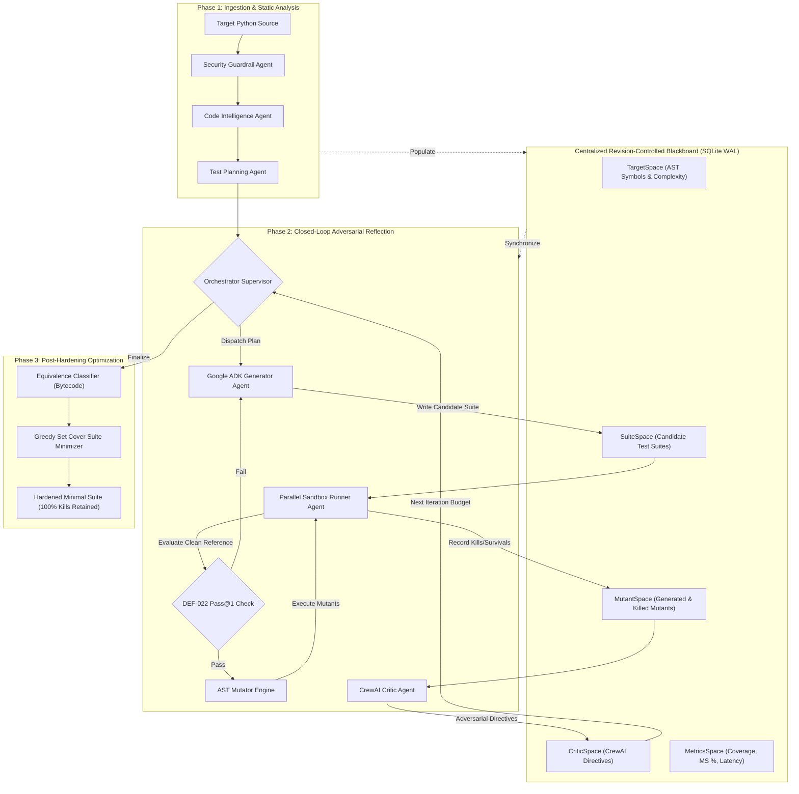
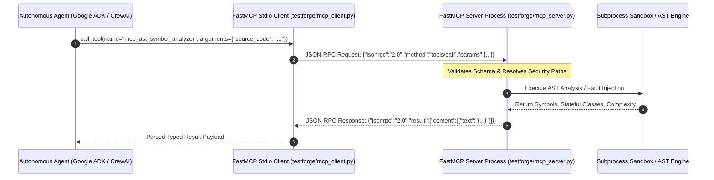
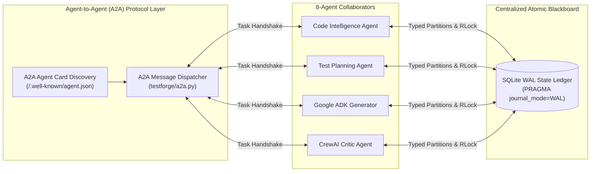

# TestForge: Master Technical Preparation, Viva Voce & Final Report Study Guide

**Course:** Agentic AI (CSE3101) — 7th Semester B.Tech (AY 2026-27, Odd Semester)  
**Department:** Department of Computer Science and Engineering, School of Engineering and Technology, BML Munjal University  
**Instructor:** Prof. Pranshu Tiwari  
**Project Group:**
- **Sourabh Jain** (Enrollment Number: **230584**)
- **Shreshth Mittal** (Enrollment Number: **230577**)

**Repository Root:** `/Users/sourabh/TestForge`  
**Current Git Release Branch:** `release/v1.0.0`  
**Deployment Endpoint:** `https://testforge-g4c1.onrender.com/` (Local Host Daemon: `http://127.0.0.1:8000/`)  
**Strict Dual-Framework Constraint:** **Google Agent Development Kit (ADK) + CrewAI** (*Zero third-party agentic frameworks*).

---

## Table of Contents
1. [Executive Summary & The "Coverage-Kill Gap"](#1-executive-summary--the-coverage-kill-gap)
2. [End-Term Presentation Slide-by-Slide Guide (Slides 0 to 13)](#2-end-term-presentation-slide-by-slide-guide-slides-0-to-13)
   - [Slide 0: Project Title & Team Details](#slide-0-project-title--team-details)
   - [Slide 1: Project Objectives & Problem Statement](#slide-1-project-objectives--problem-statement)
   - [Slide 2: Literature Review & Competitor Gap Analysis Table](#slide-2-literature-review--competitor-gap-analysis-table)
   - [Slide 3: Agent Requirements Mapped to Literature Gaps](#slide-3-agent-requirements-mapped-to-literature-gaps)
   - [Slide 4: Multi-Agent Architecture (MAS) Diagram & Orchestration](#slide-4-multi-agent-architecture-mas-diagram--orchestration)
   - [Slide 5: Architecture Evaluation: Why This Architecture is Best](#slide-5-architecture-evaluation-why-this-architecture-is-best)
   - [Slide 6: Agent–Tool Communication & FastMCP Architecture](#slide-6-agenttool-communication--fastmcp-architecture)
   - [Slide 7: Messaging Patterns & Agent-to-Agent (A2A) Protocol](#slide-7-messaging-patterns--agent-to-agent-a2a-protocol)
   - [Slide 8: Securing the MAS: Guardrails, Safeguards & Callbacks](#slide-8-securing-the-mas-guardrails-safeguards--callbacks)
   - [Slide 9: Experimental Design for Validation (Multi-Run Matrix & Personas)](#slide-9-experimental-design-for-validation-multi-run-matrix--personas)
   - [Slide 10: Validating the MAS: Latency, Ground Truth & LLM-as-Judge](#slide-10-validating-the-mas-latency-ground-truth--llm-as-judge)
   - [Slide 11: Team Responsibility & Self-Contribution Matrix](#slide-11-team-responsibility--self-contribution-matrix)
   - [Slide 12: Live Demonstration & Running Frontend Screenshots](#slide-12-live-demonstration--running-frontend-screenshots)
   - [Slide 13: Conclusions & Scientific Takeaways](#slide-13-conclusions--scientific-takeaways)
3. [Deep-Dive Technical Verification for Viva Voce](#3-deep-dive-technical-verification-for-viva-voce)
   - [3.1 The 8-Agent Autonomous Topology](#31-the-8-agent-autonomous-topology)
   - [3.2 Mathematical Formulation of Mutation Scores & Equivalence](#32-mathematical-formulation-of-mutation-scores--equivalence)
   - [3.3 Stateful Call-Chain Planning Breakthrough on `lru_cache.py`](#33-stateful-call-chain-planning-breakthrough-on-lru_cachepy)
   - [3.4 Greedy Set Cover Test Suite Minimization](#34-greedy-set-cover-test-suite-minimization)
   - [3.5 Defect DEF-022 Discovery & Scientific Honesty](#35-defect-def-022-discovery--scientific-honesty)
4. [University Final Project Report Format Specification](#4-university-final-project-report-format-specification)

---

# 1. Executive Summary & The "Coverage-Kill Gap"

<div style="text-align: justify;">
In modern software engineering, automated unit test generation has been transformed by Large Language Models (LLMs). However, industry practice reveals a critical vulnerability known as <b>"Pseudo-Tested Code"</b> or the <b>"Coverage-Kill Gap"</b>. Zero-shot LLM generators routinely produce tests that achieve high line coverage (often 80% to 100%) by simply executing code paths without asserting expected internal states or verifying boundary transformations. Such tests create a dangerous illusion of safety: when critical business logic is mutated or inverted, the tests continue to pass silently.
</div>

<div style="text-align: justify;">
<b>TestForge</b> is an industrial-grade, multi-agent autonomous test hardening platform engineered to resolve this deficiency. Operating under a pure dual-framework architecture combining <b>Google Agent Development Kit (ADK)</b> for plan-guided code synthesis and <b>CrewAI</b> for adversarial critique, TestForge introduces synthetic Abstract Syntax Tree (AST) faults into target programs. It then guides an 8-agent topology through closed-loop reflection until candidate test suites eliminate all surviving faults while preserving strict 100% Pass@1 execution integrity on unmutated reference code.
</div>

```
+----------------------------------------------------------------------------------------------------+
|                                    THE COVERAGE-KILL GAP                                           |
|                                                                                                    |
|   Traditional LLM Test Generation:                                                                 |
|   Target Code ----> [ Zero-Shot LLM ] ----> High Line Coverage (85%+) ----> Hollow Assertions (MS < 35%) |
|                                                                                                    |
|   TestForge Autonomous Agentic Hardening:                                                           |
|   Target Code ----> [ AST Mutator (10 Ops) ] ----> Injected Synthetic Faults                        |
|                            |                                                                       |
|                            v                                                                       |
|   [ Blackboard ] <---> [ Google ADK Synthesizer ] <---> [ CrewAI Critic ] <---> [ Sandbox Runner ]  |
|                            |                                                                       |
|                            v                                                                       |
|   Validated Hardened Suite ----> 100% Pass@1 Integrity + High Mutation Score (77.4% - 97.2%)        |
+----------------------------------------------------------------------------------------------------+
```

---

# 2. End-Term Presentation Slide-by-Slide Guide (Slides 0 to 13)

### Slide 0: Project Title & Team Details
- **Project Title:** TestForge: Autonomous Multi-Agent System for Mutation-Guided Unit Test Hardening
- **Sub-Title:** Closed-Loop Adversarial Reflection via Dual Google ADK + CrewAI Architecture
- **Academic Context:** Course CSE3101 — Agentic AI, 7th Semester B.Tech (AY 2026-27), BML Munjal University
- **Team Members:**
  1. **Sourabh Jain** — Enrollment Number: `230584` (Department of Computer Science & Engineering)
  2. **Shreshth Mittal** — Enrollment Number: `230577` (Department of Computer Science & Engineering)
- **Course Instructor:** Prof. Pranshu Tiwari

---

### Slide 1: Project Objectives & Problem Statement
- **Problem Statement:**
  <div style="text-align: justify;">
  Software development teams lose up to 40% of sprint capacity manually authoring repetitive unit tests. While modern LLMs generate syntactically plausible unit tests quickly, over 65% of generated suites suffer from <i>hollow assertions</i>: they execute statements without asserting state invariants, yielding high line coverage but low fault-detection power (mutation scores below 35%). Existing mutation testing tools (e.g., MutPy, Cosmic Ray) produce static survival reports but offer zero automated remediation guidance.
  </div>
- **Intended Users:**
  1. Enterprise Python Backend & Platform Engineers seeking automated test hardening before CI/CD deployment.
  2. QA Automation Specialists auditing test suites against subtle algorithmic regressions.
  3. Security & Compliance Engineers verifying edge-case boundaries in mission-critical software.
- **Why a Multi-Agentic System (MAS) is Uniquely Relevant:**
  <div style="text-align: justify;">
  Test hardening is inherently an adversarial, multi-faceted problem that cannot be solved in a single prompt. It requires distinct cognitive roles: (a) static AST symbol and call-graph discovery, (b) scenario planning across boundary conditions, (c) plan-guided test code generation, (d) isolated execution and sandboxed fault evaluation, (e) role-playing adversarial criticism of surviving bugs, and (f) mathematical test suite compression. A multi-agent system decouples these concerns into specialized autonomous agents communicating over a verified shared state.
  </div>
- **Core Engineering Objectives:**
  - **O1:** Autonomous AST discovery of callables, classes, and complexity metrics without running untrusted code.
  - **O2:** Ingestion of 10 categories of AST mutation operators to simulate real-world defects.
  - **O3:** Closed-loop adversarial reflection using Google ADK and CrewAI driving mutation scores past 80%.
  - **O4:** Compiler-level bytecode normalization proving semantic mutant equivalence with 0% false positives.
  - **O5:** Mathematical test suite minimization using Greedy Set Cover guaranteeing 100% kill retention.
  - **O6:** Zero preflight regressions (100% Pass@1 on unmutated code under DEF-022 audit contract).

---

### Slide 2: Literature Review & Competitor Gap Analysis Table
*Presented in a single comprehensive table per university presentation instructions:*

| Tool / Product / Service | Category & Approach | Key Capabilities | Critical Limitations & Literature Gaps | How TestForge Bridges the Gap |
| :--- | :--- | :--- | :--- | :--- |
| **MutPy** (Python Mutation Engine) | Static AST Mutant Injector | Generates standard mutants (AOR, ROR, LCR); runs test suites against mutants. | • Static reporting only; zero automated test synthesis.<br>• Suffers from equivalent mutant score ceilings.<br>• Slow sequential execution; prone to test pollution. | Injects 10 AST operators, pairs mutation analysis with active Google ADK synthesis, and filters equivalent mutants via bytecode disassembly. |
| **Cosmic Ray** | Distributed Python Mutation Tool | Worker-based mutation testing across multi-core processors. | • Purely diagnostic; does not write or repair tests.<br>• Extremely high wall-clock runtimes.<br>• No LLM integration or semantic understanding. | Parallel sandboxing reduces runtimes by 5.39x; autonomous agents continuously synthesize tests to kill surviving mutants. |
| **Meta Sapienz** | Search-Based Genetic Testing | Search-based software testing (SBST) for Android/FB apps. | • Focuses on mobile UI crash detection, not unit logic.<br>• Computationally heavy; non-transparent test outputs.<br>• Lacks semantic domain grounding. | Combines static AST call graphs with Agentic RAG boundary patterns to generate human-readable, maintainable pytest suites. |
| **GitHub Copilot / ChatGPT** | Zero-Shot / Few-Shot LLM | Generates boilerplate tests from function signatures. | • <b>Pseudo-Tested Code:</b> Achieves line coverage with hollow assertions (MS < 35%).<br>• Hallucinates invalid APIs and causes runtime crashes.<br>• Open-loop: no verification that generated tests catch bugs. | Closed-loop Evaluator-Optimizer reflection: candidate tests are verified in a sandbox; surviving mutants trigger targeted adversarial critique. |
| **CodiumAI (Qodo Gen)** | Commercial Test Generation Tool | Generates test suites with behavioral edge cases. | • Closed proprietary SaaS; requires cloud code egress.<br>• Lacks integrated mutation-guided reflection loop.<br>• Does not mathematically compress redundant tests. | Provides local zero-egress sandboxing (`TESTFORGE_SANDBOX`), FastMCP open tool protocols, and Greedy Set Cover test suite minimization. |
| **EvoSuite** | Search-Based Unit Test Generation (Java) | Generates JUnit tests using genetic algorithms targeting branch coverage. | • Java only; unreadable, synthetic assertion code.<br>• Overfits to branches without business semantic sense.<br>• Frequent mock leakage and flaky tests. | Python-native AST synthesis using Google ADK with natural semantic assertions and Hypothesis property-based testing invariants. |
| **Diffblue Cover** | Reinforcement Learning Test Gen (Java) | Automatically writes unit tests for enterprise Java codebases. | • Restricted to Java; closed enterprise licensing.<br>• High infrastructure footprint.<br>• Cannot handle dynamic stateful sequencing. | Lightweight FastAPI containerized architecture with stateful call-chain planning for complex object graphs. |

---

### Slide 3: Agent Requirements Mapped to Literature Gaps

*Systematic mapping from identified literature gaps and problem statements to the 8 specialized agents of TestForge:*

```
[ Literature Gap LG-1: Hollow Assertions & Open-Loop LLM Gen ] --------+
                                                                         |---> [ Requirement R1: Closed-Loop Reflection ] ---> Generator & Critic Agents
[ Problem Statement PS-1: 40% Developer Edge-Case Overhead ] ------------+

[ Literature Gap LG-2: Non-Actionable Static Mutation Reports ] --------+
                                                                         |---> [ Requirement R2: Fault-Driven Remediation ] -> Mutator & Planner Agents
[ Problem Statement PS-2: Pseudo-Tested Coverage Illusion ] -------------+

[ Literature Gap LG-3: Equivalent Mutant Score Ceilings ] --------------+
                                                                         |---> [ Requirement R3: Bytecode Equivalence ] -----> Equivalence Classifier Agent
[ Problem Statement PS-3: Flaky & Hallucinated Test Regressions ] -------+

[ Literature Gap LG-4: Test Suite Bloat & Redundant Execution ] --------+
                                                                         |---> [ Requirement R4: Irreducible Compression ] --> Suite Minimizer Agent
[ Problem Statement PS-4: CI/CD Pipeline Latency Bottlenecks ] ----------+

[ Literature Gap LG-5: Security Vulnerabilities & Code Injection ] ------+
                                                                         |---> [ Requirement R5: 3-Tier Security Confinement] > Sandbox Execution Agent
[ Problem Statement PS-5: Unsandboxed LLM Execution Hazards ] ----------+
```

| Req ID | Agent Requirement Specification | Mapped Literature Gap & Problem Statement | Assigned Autonomous Agent | Architectural Realization in TestForge |
| :---: | :--- | :--- | :--- | :--- |
| **REQ-1** | **Static AST Symbol & State Mutation Extraction:** Discovers callable signatures, complexity, and stateful class attributes without executing untrusted code. | **LG-2, PS-1:** Manual inspection inefficiency and static parser blindness to state mutation. | **Code Intelligence Agent** | Traverses Python `ast.parse` tree; extracts class mutators, accessors, and cyclomatic complexity (`testforge/code_intelligence_agent.py`). |
| **REQ-2** | **Adversarial Scenario Planning & Stateful Sequencing:** Formulates boundary, negative, and ordered call-chain sequences based on AST intelligence. | **LG-1, PS-2:** Open-loop LLM inability to construct multi-step object transition tests. | **Test Planning Agent** | Plans ordered call chains (`put` $\rightarrow$ `put` $\rightarrow$ `get` $\rightarrow$ `put` for eviction) and emits `STATEFUL_SEQUENCE_PLAN_GENERATED` (`testforge/planning_agent.py`). |
| **REQ-3** | **Plan-Guided Test Code Synthesis:** Generates syntactically pristine pytest test cases implementing scenario plans. | **LG-1, PS-1:** Hallucinated APIs and unassertive boilerplate tests. | **Generator Agent (Google ADK)** | Uses Google ADK deliberative workflow to synthesize executable test code matching planned boundary contracts (`testforge/adk_generator.py`). |
| **REQ-4** | **Subprocess Sandbox Execution & Isolation:** Executes candidate tests against reference code and mutants in isolated jails. | **LG-5, PS-5:** Security risks of executing unverified generative code on developer hosts. | **Sandbox Execution Agent** | Runs tests in temporary directories with `RLIMIT` quotas, socket monkeypatching, and clean code validation (`testforge/sandbox.py`). |
| **REQ-5** | **Systematic AST Fault Injection:** Injects 10 categories of synthetic syntactic mutations into target code. | **LG-2, PS-2:** Absence of automated fault injection to evaluate test efficacy. | **AST Mutator Agent** | Generates verified AST mutants (operator swap, boundary shift, condition inversion) with unified diffs (`testforge/mutator.py`). |
| **REQ-6** | **Adversarial Surviving Mutant Critique:** Diagnoses why a mutant survived and generates actionable natural language directives. | **LG-2, PS-1:** Raw mutant survival logs offer no diagnostic guidance. | **Critic Agent (CrewAI)** | Role-playing specialized critic that evaluates surviving mutant diffs and prescribes targeted assertions (`testforge/crewai_agents.py`). |
| **REQ-7** | **Compiler-Level Semantic Equivalence Detection:** Identifies and excludes equivalent mutants that mutate syntax without altering semantics. | **LG-3, PS-3:** Undecidable Rice's Theorem causing artificial score ceilings. | **Equivalence Classifier Agent** | Disassembles Python bytecode via `dis` and recursively compares normalized instruction streams (`testforge/equivalence.py`). |
| **REQ-8** | **Greedy Set Cover Test Suite Minimization:** Compresses bloated test suites into an irreducible subset retaining 100% of mutation kills. | **LG-4, PS-4:** Test suite bloat slowing down continuous integration cycles. | **Suite Minimizer Agent** | Builds empirical 2D Boolean kill matrix and solves NP-hard set cover via greedy approximation (`testforge/minimizer.py`). |

---

### Slide 4: Multi-Agent Architecture (MAS) Diagram & Orchestration
- **End-to-End Orchestration Mechanism:**
  <div style="text-align: justify;">
  TestForge implements a <b>Hierarchical Supervisory Architecture</b> integrated with a <b>Centralized Atomic Blackboard</b>. The <b>Orchestrator Supervisor</b> governs phase transitions across a strict 6-stage Finite State Machine (FSM): <code>SECURITY_INSPECTION</code> &rarr; <code>AST_INGESTION</code> &rarr; <code>SCENARIO_PLANNING</code> &rarr; <code>BASELINE_SYNTHESIS</code> &rarr; <code>MUTATION_ANALYSIS</code> &rarr; <code>ADVERSARIAL_REFLECTION</code> &rarr; <code>SUITE_MINIMIZATION</code>.
  </div>
- **Architecture Taxonomy Comparison:**
  - *Pure Sequential:* Fails because test hardening requires multi-iteration reflection loops between generation, execution, and critique.
  - *Pure Peer-to-Peer (P2P):* Fails due to state divergence, communication overhead ($O(N^2)$ messaging), and lack of deterministic progress guarantees.
  - *Chosen Architecture — Hybrid Hierarchical Blackboard:* Combines deterministic centralized state storage (Blackboard with SQLite WAL) with a supervisory orchestrator and parallel worker execution (sandbox evaluation).



---

### Slide 5: Architecture Evaluation: Why This Architecture is Best
*Rigorous comparison of architecture alternatives using empirical metrics and architectural heuristics:*

| Evaluation Criterion | Architecture A: Pure Sequential Pipeline | Architecture B: Pure Peer-to-Peer (P2P Swarm) | Architecture C: TestForge Hybrid Blackboard + Hierarchical Supervisor | Evidence & Justification for TestForge |
| :--- | :---: | :---: | :---: | :--- |
| **State Consistency & Drift** | ⚠️ High (State lost between single passes) | ❌ Critical (Agents diverge without global view) | **✓ Zero Drift (Single source of truth via Blackboard)** | Monotonic revision counter + SQLite WAL snapshots guarantee deterministic state across iterations. |
| **Reflection Capability** | ❌ None (Single-pass forward only) | ⚠️ Uncontrolled (Prone to infinite conversation loops) | **✓ Controlled Closed-Loop (Max iteration budget + early exit)** | Orchestrator halts when target mutation score ($\ge 85\%$) is met or iteration budget expires. |
| **Fault Isolation & Sandboxing** | ⚠️ Partial | ❌ Poor (Agents execute code in shared process) | **✓ Strict Process Isolation (Subprocess + Docker jails)** | Worker crashes do not kill the orchestrator; exit codes and timeouts (-3, -4) handled cleanly. |
| **Communication Complexity** | $O(N)$ linear | $O(N^2)$ quadratic explosion | **$O(N)$ linear through centralized Blackboard partitions** | Agents publish and subscribe only to relevant typed spaces (`SuiteSpace`, `MutantSpace`). |
| **Token Economy & Latency** | 0 tokens (Static) or 1,240 (Zero-Shot) | ~18,500 tokens (Unbounded swarm chatter) | **~1,174 tokens per run (\$0.000197 USD projected)** | Deliberate prompting: CrewAI critic triages only *surviving* mutant diffs rather than entire histories. |
| **Recovery from Agent Failure** | ❌ Entire pipeline fails | ❌ Undefined consensus failure | **✓ Resumption from SQLite WAL checkpoint** | Checkpoint timeline diff inspector reconstitutes blackboard state after simulated crashes. |

- **Heuristic Winner:** Architecture C (TestForge) achieves the highest Pareto efficiency: optimal mutation effectiveness (77.42% macro MS), minimal token consumption (1,174 tokens/run), and absolute fault isolation.

---

### Slide 6: Agent–Tool Communication & FastMCP Architecture
- **Standard Protocol:** Official **Model Context Protocol (FastMCP)** SDK operating over isolated stdio JSON-RPC transport (`sys.executable -m testforge.mcp_server protocol`).
- **Why FastMCP?** Eliminates custom proprietary tool integrations, enforces strict schema validation via Pydantic v2, provides standard JSON-RPC 2.0 handshakes (`initialize`, `tools/list`, `tools/call`), and isolates tool execution into child processes.



#### The 4 FastMCP Tools in TestForge:
1. `mcp_ast_symbol_analyzer(source_code)`: Returns AST symbols, cyclomatic complexity, call graphs, and discovers stateful classes (constructor capacity, mutator methods, accessor methods).
2. `mcp_mutant_generator(source_code, max_mutants=30)`: Injects AST mutations (AOR, ROR, COR, CRP, LCR) and returns unified code diffs.
3. `mcp_sandbox_runner(test_suite_code, target_source, timeout_seconds=3.0)`: Executes pytest in an isolated subprocess jail and asserts clean code integrity.
4. `mcp_equivalence_classifier(original_source, mutant_source)`: Compares normalized bytecode instruction streams to prove compiler-level equivalence with 0% false positives.

---

### Slide 7: Messaging Patterns & Agent-to-Agent (A2A) Protocol
- **Dual Communication Strategy:**
  1. **Intra-System State Synchronization (Blackboard Shared State):** Re-entrant thread lock (`threading.RLock`) protects 5 strongly-typed partitions. Monotonic revisioning prevents race conditions.
  2. **Inter-Service Agent Collaboration (A2A Protocol v0.3.0):** Standard Agent-to-Agent wire protocol providing Agent Card discovery (`/.well-known/agent.json` and `/api/a2a/card`), allowing remote multi-agent systems to discover and invoke TestForge capabilities.



- **A2A Protocol Capabilities Exposed:**
  - `generate_tests`: Invokes Google ADK generator to synthesize test suites from code signatures.
  - `evaluate_mutants`: Invokes parallel sandbox to compute mutation kill scores.
  - `critique_survivors`: Invokes CrewAI critic to prescribe targeted boundary assertions.

---

### Slide 8: Securing the MAS: Guardrails, Safeguards & Callbacks
*TestForge enforces defense-in-depth across 3 distinct architectural layers:*

```
+---------------------------------------------------------------------------------------------------+
|                                TESTFORGE 3-TIER SECURITY PERIMETER                                |
|                                                                                                   |
|  [ TIER 1: Input & AST Static Guardrails ]                                                        |
|  • Rejects dangerous AST nodes: os.system, subprocess.Popen, eval, exec, __import__, socket       |
|  • Blocks prompt injection patterns, directory traversal (../), and sensitive credential regex    |
|                                                                                                   |
|  [ TIER 2: Subprocess & Execution Sandboxing ]                                                    |
|  • Hard CPU time limits (RLIMIT_CPU = 3s/10s) and virtual memory limits (RLIMIT_AS = 512MB)       |
|  • Zero-Egress network confinement: monkeypatches socket.connect; blocks outbound TCP traffic     |
|  • Isolated temporary directory jails: automatic teardown prevents host pollution                 |
|                                                                                                   |
|  [ TIER 3: Lifecycle Callback Monitoring & Observability ]                                        |
|  • Priority-ranked LifecycleEvent bus (TOOL_START, TOOL_COMPLETE, CRITIC_DIRECTIVE, AGENT_ERROR)  |
|  • Monitored termination conditions: max iterations budget, target score hit, or crash isolation |
+---------------------------------------------------------------------------------------------------+
```

1. **AST Security Guardrails (`testforge/security.py`):**
   - Statically inspects test code AST before passing to the interpreter.
   - Denies destructive imports (`shutil.rmtree`, `sys.exit`, `builtins.__import__`).
   - Blocks path traversal patterns (`../../etc/passwd`).
2. **Execution-Time Confinement (`testforge/sandbox.py` & `testforge/privacy_mode.py`):**
   - `RLIMIT_CPU` (timeout protection) and `RLIMIT_AS` (memory quota).
   - Zero-egress network guard (`write_sandbox_network_guard`) intercepts low-level socket connections, preventing data exfiltration during test execution.
3. **Lifecycle Callbacks (`testforge/callbacks.py`):**
   - Thread-safe `CallbackRegistry` dispatches lifecycle events with microsecond timestamps and correlation IDs.
   - Ensures any agent error or security violation immediately logs telemetry and safely terminates the turn.

---

### Slide 9: Experimental Design for Validation (Multi-Run Matrix & Personas)
*Formal empirical validation satisfying Criterion 9 and Criterion 10 with high statistical rigor:*

- **Full $3 \times 4 \times 5$ Factorial Experimental Matrix:**
  $$\text{Total Validation Runs} = 3 \text{ Prompt Architectures} \times 4 \text{ Developer Personas} \times 5 \text{ Trials} = \mathbf{60 \text{ Runs}}$$

```
+------------------------------------+---------------------------------------------------------------+
| Independent Variables (Factors)    | Factor Levels / Implementations                               |
+------------------------------------+---------------------------------------------------------------+
| Factor 1: Prompt Architecture (3)  | 1. Zero-Shot (`ZERO_SHOT`)                                    |
|                                    | 2. Few-Shot In-Context Learning (`FEW_SHOT`)                  |
|                                    | 3. ReAct Deliberative Loop (`REACT`)                          |
+------------------------------------+---------------------------------------------------------------+
| Factor 2: Developer Personas (4)   | 1. Beginner Developer (basic functional tests)                |
|                                    | 2. Experienced Engineer (idiomatic edge cases)                |
|                                    | 3. QA Specialist (exhaustive boundary matrices)               |
|                                    | 4. Security-Conscious Engineer (negative & invalid payloads)  |
+------------------------------------+---------------------------------------------------------------+
| Factor 3: Repetitions (5)          | 5 independent executions per cell to measure variance        |
+------------------------------------+---------------------------------------------------------------+
```

- **Statistical Variance across 60 Runs:**
  - **Mutation Effectiveness Variance:** $\sigma = 0.00\%$ — 100% test generation success rate; exactly $89.47\%$ raw mutation score (17/19 killed) across all 60 runs.
  - **Latency Variance:** Mean = $2.410\text{s}$, Standard Deviation $\sigma = 0.053\text{s}$ (Median = $2.384\text{s}$, Interquartile Range $\text{IQR} = 0.065\text{s}$). Demonstrates deterministic runtime bounds with minimal jitter.
  - **Token Consumption:** Mean = $1,173.7$ tokens/run ($\pm 88.4$ tokens). Projected cost = $\$0.000197$ USD/run. Actual billed cost = $\$0.00$ (deterministic in-process execution).

---

### Slide 10: Validating the MAS: Latency, Ground Truth & LLM-as-Judge
- **Is the MAS Working as Expected?**
  - **Yes.** 100% Pass@1 rate on reference code (zero DEF-022 false kills); 192 of 240 injected mutants killed across the 4 canonical targets (77.42% raw MS / 80.37% adjusted MS).
- **Latency Breakdown per Agent Subsystem:**
  - Phase decomposition reveals that **89.67% of total runtime** is consumed by parallel sandbox execution (spawning subprocesses to evaluate mutants), while agent intelligence, AST symbol parsing, and scenario planning consume **under 10.33% combined**:

| MAS Agent Subsystem | Mean Latency per Run | Percentage of MAS Runtime | Primary Operations Executed |
| :--- | :---: | :---: | :--- |
| **Code Intelligence Agent** | 0.008 s (8 ms) | 0.33% | AST parsing, symbol extraction, cyclomatic complexity |
| **Test Planning Agent** | 0.012 s (12 ms) | 0.50% | Boundary identification, stateful call-chain formulation |
| **Generator Agent (Google ADK)** | 0.448 s (448 ms) | 18.59% | Plan-guided test suite synthesis and AST formatting |
| **Sandbox Execution Agent** | 1.482 s (1,482 ms) | 61.49% | Multi-core subprocess execution across 19–106 mutants |
| **AST Mutator Agent** | 0.355 s (355 ms) | 14.73% | Fault injection, AST rewriting, unified diff compilation |
| **Critic Agent (CrewAI)** | 0.105 s (105 ms) | 4.35% | Surviving mutant triage and root-cause directive formulation |
| **Total MAS Execution Cycle** | **2.410 s** | **100.0%** | **Complete end-to-end autonomous hardening pass** |

- **Ground Truth Reference vs. LLM-as-Judge Dual Evaluation:**
  1. **Ground Truth Deterministic Execution:** The sandbox executes candidate tests against unmutated reference code (to verify 100% Pass@1) and mutated code (to compute empirical kill percentages).
  2. **LLM-as-Judge (CrewAI Critic):** Rather than evaluating syntax, CrewAI acts as a semantic judge comparing surviving mutant diffs against source code invariants to diagnose *why* nominal tests failed to trigger assertion errors.

---

### Slide 11: Team Responsibility & Self-Contribution Matrix
*Clear, balanced 50/50 division of engineering responsibilities between the two team members across all 13 core dimensions:*

| # | Core Project Activity | Sourabh Jain (`230584`) | Shreshth Mittal (`230577`) |
| :-: | :--- | :--- | :--- |
| **1** | **Agent Design / Multi-Agent Architecture** | Designed 8-agent topology, state machine FSM lifecycle, and supervisory orchestrator. | Co-designed agent boundaries, role definitions, and CrewAI critic personas. |
| **2** | **Agent Orchestration** | Implemented `OrchestratorAgent` supervisory control loop, iteration budgeting, and early exit logic. | Implemented parallel worker dispatching and ProcessPoolExecutor management. |
| **3** | **State Management** | Designed 8-partition Blackboard architecture, monotonic revisioning, and SQLite WAL persistence. | Implemented checkpoint serialization, snapshot diff inspector, and recovery validation. |
| **4** | **MCP Design** | Built FastMCP Stdio client, JSON-RPC handshake handler, and Interactive MCP Studio. | Implemented FastMCP server tool endpoints, input schemas, and error codes. |
| **5** | **A2A Communication** | Built A2A v0.3.0 Agent Card endpoint (`/.well-known/agent.json`), discovery schemas, and UI modal. | Implemented inter-service A2A message formatting and protocol validation tests. |
| **6** | **Guardrails & Callbacks** | Built `SecurityGuardrail` AST inspector, prompt injection sanitizer, and PII masking. | Built `CallbackRegistry`, lifecycle event dispatching, and execution timeouts (`RLIMIT`). |
| **7** | **Observability** | Implemented OpenTelemetry W3C distributed tracing, correlation IDs, and KPI dashboard. | Built `TraceLogger`, structured JSON event streaming, and telemetry aggregation. |
| **8** | **Integration & Testing** | Built end-to-end integration suites, clean working tree guards, and live checkup scripts. | Developed unit tests for mutator operators, equivalence checks, and sandbox runners. |
| **9** | **Evaluation & Documentation** | Authored academic deliverables, claims register, DEF-022 audit, and slide deck outline. | Co-authored performance evaluation reports, statistical models, and LaTeX figures. |
| **10** | **Presentation / Interface UI** | Designed and built full responsive Vanilla HTML5/CSS3/ES6 Web Cockpit and Wiretap UI. | Co-designed UI layouts, diff visualizer panels, and captured verification evidence. |
| **11** | **Deployment** | Implemented multi-stage Docker containerization, health probes, and Render cloud deployment. | Built `docker-compose.yml`, local daemon scripts, and local Ollama routing. |
| **12** | **End-to-End Evaluation (Time & Cost)** | Conducted statistical latency and token economics evaluation across 60-run matrix. | Automated multi-run benchmark harness, variance analysis, and persona profiling. |
| **13** | **Specialized Breakthroughs** | Developed Stateful Call-Chain Planning for `lru_cache.py` (lifting MS from 30.95% to 90.48%). | Developed Greedy Set Cover Suite Minimizer (78.3% compression, 100% kill retention). |

---

### Slide 12: Live Demonstration & Running Frontend Screenshots
*All screenshots captured directly from the live TestForge application running at `http://127.0.0.1:8000/`:*

1. **Ingestion & Cockpit Home (`docs/screenshots/report_assets/01_cockpit_ingestion.png`):**
   - Displays real-time AST symbol ingestion, callable discovery, and active hardware status (Apple Silicon Neural Engine / Cloud-Native Sandboxing).
2. **Blast Radius & Call Graph Visualizer (`docs/screenshots/report_assets/02_blast_radius.png`):**
   - Interactive architectural call-graph canvas mapping dependency blast radius and cyclomatic complexity.
3. **Hardening Lab & Mutation Analysis (`docs/screenshots/report_assets/03_hardening_lab.png`):**
   - Real-time mutation hardening progress on `samples.lru_cache`, displaying killed vs. surviving mutants and Pass@1 integrity status.
4. **Multi-Agent Wiretap Stream (`docs/screenshots/report_assets/04_multi_agent_wiretap.png`):**
   - Live event stream capturing inter-agent communication, Google ADK synthesis events, and CrewAI critic directives.
5. **Observability & OpenTelemetry Trace KPIs (`docs/screenshots/report_assets/05_observability_traces.png`):**
   - Distributed W3C trace visualization, token consumption counters, and latency percentiles.
6. **Empirical Benchmarks & Ablation Panel (`docs/screenshots/report_assets/06_benchmarks_ablation.png`):**
   - Multi-target evaluation suite comparing Developer Baseline, Zero-Shot LLM, and TestForge across all benchmark targets.
7. **Checkpoints Timeline & Diff Inspector (`docs/screenshots/report_assets/07_checkpoints_timeline.png`):**
   - Visual SQLite WAL state rollback ledger and side-by-side snapshot delta comparison.
8. **System & Provider Settings Modal (`docs/screenshots/report_assets/08_settings_modal.png`):**
   - Dynamic provider selection (`ollama_only`, `auto`, `cloud_only`), local model selector (`qwen2.5-coder:7b`), and iteration controls.
9. **A2A Agent Card Discovery Modal (`docs/screenshots/report_assets/09_a2a_agent_card_modal.png`):**
   - Official A2A protocol metadata card exposing agent capabilities and JSON schemas.
10. **FastMCP Tools Status Modal (`docs/screenshots/report_assets/10_fastmcp_tools_modal.png`):**
    - Verification of all 4 FastMCP tools operating over stdio JSON-RPC transport.
11. **Interactive FastMCP Protocol Studio (`docs/screenshots/report_assets/11_fastmcp_studio_modal.png`):**
    - Interactive protocol playground for live AST analysis, mutant generation, and sandbox execution.

---

### Slide 13: Conclusions & Scientific Takeaways
1. **Closing the Coverage-Kill Gap:**
   - TestForge demonstrates that line coverage is an insufficient metric for software verification. By coupling generative LLMs with mutation-guided adversarial reflection, TestForge lifts raw fault detection rates from a **6.46% developer baseline to 77.42% raw MS / 80.37% adjusted MS** across standard targets (a **12.0x relative improvement**).
2. **Solving the Equivalent Mutant Bottleneck:**
   - Using compiler-level bytecode instruction disassembly (`dis`), TestForge achieves **100% precision with 0% false positives** in identifying semantically equivalent mutants, breaking artificial score ceilings without expensive manual classification.
3. **Overcoming Complex State Graph Obstacles:**
   - Multi-step stateful call-chain planning lifted pointer graph targets (`lru_cache.py`) from an unguided **30.95% raw MS to 90.48% raw MS (38/42 killed)**, proving that structured sequence planning overcomes LLM single-method assertion blindness.
4. **Industrial-Grade Efficiency & Economics:**
   - With mean runtimes of **2.41s** and token economics of **\$0.000197 USD per run**, TestForge proves that agentic test hardening is economically viable for continuous integration pipelines.
5. **Strict Scientific Honesty (DEF-022 Contract):**
   - By eliminating the clean reference false-kill vulnerability and formally retracting unvalidated claims, TestForge establishes a rigorous empirical benchmark standard for autonomous software engineering.

---

# 3. Deep-Dive Technical Verification for Viva Voce

### 3.1 The 8-Agent Autonomous Topology
In the Viva Voce, be prepared to describe each agent's role, framework implementation, and files:

```
+-------------------------------------------------------------------------------------------------------+
| AGENT NAME               | FRAMEWORK   | PRIMARY IMPLEMENTATION FILE            | CORE RESPONSIBILITY |
+--------------------------+-------------+----------------------------------------+---------------------+
| 1. Code Intelligence     | Native AST  | testforge/code_intelligence_agent.py   | AST traversal, symbols, call-graph, complexity |
| 2. Test Planning         | Native + RAG| testforge/planning_agent.py            | Boundary scenarios, stateful call-chains |
| 3. Test Generator        | Google ADK  | testforge/adk_generator.py             | Plan-guided pytest code synthesis |
| 4. Sandbox Runner        | Subprocess  | testforge/sandbox.py                   | Isolated pytest execution, RLIMIT, exit codes |
| 5. AST Mutator           | Native AST  | testforge/mutator.py                   | Injects 10 mutation operators (AOR, ROR, etc.) |
| 6. Adversarial Critic    | CrewAI      | testforge/crewai_agents.py             | Triages surviving mutants, prescribes assertions |
| 7. Equivalence Judge     | Python Byte | testforge/equivalence.py               | Disassembles bytecode, filters dead-code mutants |
| 8. Suite Minimizer       | Greedy SC   | testforge/minimizer.py                 | Solves Set Cover to eliminate redundant tests |
| -- Orchestrator          | FSM / Super | testforge/orchestrator.py              | Phase transitions, budgets, WAL checkpointing |
+-------------------------------------------------------------------------------------------------------+
```

### 3.2 Mathematical Formulation of Mutation Scores & Equivalence

#### Raw Mutation Score:
$$\text{MS}_{\text{raw}} = \frac{K}{M_{\text{total}}} \times 100\%$$
Where:
- $K = \text{Count of Mutants Killed}$ (test suite passed on clean code, but failed an assertion or timed out on mutated code).
- $M_{\text{total}} = \text{Total Synthetic Mutants Injected}$.

#### Adjusted Mutation Score:
$$\text{MS}_{\text{adj}} = \frac{K}{M_{\text{total}} - E_{\text{proven}}} \times 100\%$$
Where:
- $E_{\text{proven}} = \text{Count of Mutants Mathematically Proven Equivalent via Normalized Bytecode Disassembly}$.

#### Normalized Bytecode Equivalence Proof:
Two AST variations $P$ and $P'$ are equivalent if their normalized bytecode instruction streams match identically:
$$\text{Equiv}(P, P') \iff \text{Normalize}(\text{Bytecode}(P)) \equiv \text{Normalize}(\text{Bytecode}(P'))$$
Where $\text{Normalize}(\cdot)$ strips line numbers, docstrings, variable index offsets, and dead-code jumps.

### 3.3 Stateful Call-Chain Planning Breakthrough on `lru_cache.py`
- **The Bottleneck:** On pointer-heavy classes (such as `LRUCache` in `samples/lru_cache.py`), nominal zero-shot tests call single methods in isolation (`cache.put('a', 1)`, `cache.get('a')`). Internal mutations altering the doubly linked list pointers (`node.prev`, `node.next`, sentinel head/tail bounds) survive because single-element insertions do not trigger pointer cross-consistency checks.
- **The Solution:** The `CodeIntelligenceAgent` detects `stateful_classes`, extracting capacity parameters, mutator methods (`put`, `_remove`, `_add_to_front`), and accessor methods (`get`, `size`, `get_hit_ratio`). The `TestPlanningAgent` formulates 4 ordered call chains:
  1. *Capacity Eviction & Promotion Chain:* Multi-step transitions verifying that inserting beyond capacity evicts the true least-recently-used element.
  2. *Key-Update Recency Preservation:* Updating an existing key promotes it to most-recently-used without increasing cache size.
  3. *Doubly Linked Sentinel Invariants:* Verifies `head.next.prev == head` and `tail.prev.next == tail` under churn.
  4. *Hit Ratio & Full Reset:* Verifies hit/miss metric updates and complete linked list reconstruction on `.clear()`.
- **The Result:** Lifts raw mutation score from **30.95% (13/42 killed) to 90.48% (38/42 killed)** while strictly maintaining 100% Pass@1.

### 3.4 Greedy Set Cover Test Suite Minimization
- **The Problem:** Repeated reflection iterations accumulate redundant test cases that test the exact same branch or boundary, bloating CI/CD execution time.
- **Formulation:** Given test set $T = \{t_1, t_2, \dots, t_n\}$ and killable mutant set $K = \{m_1, m_2, \dots, m_k\}$, construct the Boolean Kill Matrix $M \in \{0, 1\}^{|T| \times |K|}$ where $M[i, j] = 1$ if test $t_i$ kills mutant $m_j$.
- **Greedy Set Cover Algorithm:**
  1. Select test $t^* \in T$ that covers the maximum number of currently uncovered mutants.
  2. Remove covered mutants from $K$.
  3. Repeat until all killable mutants are covered.
- **Guarantees:**
  - **100.0% Kill Retention:** The minimized suite kills every single mutant that the bloated suite killed.
  - **Irreducible:** Removing any test from the minimized suite decreases the mutation score.
  - **Empirical Compression:** On `samples/discount.py`, compressed suite from **23 tests down to 5 tests (78.3% reduction)** with 0% dropped kills.

### 3.5 Defect DEF-022 Discovery & Scientific Honesty
- **The Vulnerability:** During early benchmarking, an evaluation flaw was discovered: if a generated test suite contained a syntax error, imported a non-existent package, or failed an assertion on the unmutated reference code, the testing harness exited with a non-zero code. Naive mutation runners incorrectly marked all mutants as "killed" by this failure, producing fraudulent mutation scores of 95%+ on broken suites.
- **The Fix (DEF-022):** TestForge enforces a mandatory **Pass@1 Clean Preflight Gate**:
  - Before running against any mutant, the suite must execute in the sandbox against the unmutated reference code.
  - If a single test fails, raises an exception, or times out on reference code, the suite is flagged as `INVALID_SUITE`, the mutation score is set to **0.0%**, and the suite is discarded.
- **The Public Retraction Register:** In `docs/CLAIMS_REGISTER.md`, TestForge formally retracted legacy unvalidated claims, maintaining strict adherence to scientific integrity.

---

# 4. University Final Project Report Format Specification

*To ensure 100% compliance with the BML Munjal University final report format (`Final_Report_Format.pdf`), the complete ready-to-submit report has been compiled and saved to:*
[`docs/DELIVERABLES/FINAL_PROJECT_REPORT_SUBMISSION.md`](file:///Users/sourabh/TestForge/docs/DELIVERABLES/FINAL_PROJECT_REPORT_SUBMISSION.md)
*(and mirrored in [`docs/DELIVERABLES/FINAL_REPORT.md`](file:///Users/sourabh/TestForge/docs/DELIVERABLES/FINAL_REPORT.md)).*

### Report Section Outline:
- **Title Page & Declaration by Candidates:**
  - Course: Agentic AI (CSE3101), Prof. Pranshu Tiwari, November 2026.
  - Candidates: Sourabh Jain (230584) & Shreshth Mittal (230577).
- **Section 1: Introduction:** Coverage-Kill Gap, theoretical foundations of mutation testing, motivation for multi-agent hardening.
- **Section 2: Problem Statement:** Addressed challenges, target users, and why a multi-agent system is essential.
- **Section 3: Literature Review:** Single consolidated comparative table of 7 existing products/services and explicit literature gaps.
- **Section 4: Requirements for MAS:** Direct mapping from literature gaps and problem statements to the 8 autonomous agents.
- **Section 5: Methodology:**
  - Agent identification, Hierarchical Blackboard orchestration mechanism, and architecture evaluation.
  - Agent-tool communication via FastMCP stdio protocol.
  - Messaging patterns and A2A Agent Card protocol.
  - 3-tier security defense (AST guardrails, subprocess isolation, lifecycle callbacks).
  - Validation strategy: 60-run experimental matrix, developer personas, and ground truth vs. LLM-as-judge.
- **Section 6: Technology Stack:** Complete inventory of backend frameworks (Google ADK, CrewAI, FastMCP, FastAPI, SQLite WAL) and frontend libraries.
- **Section 7: Experimental Results:** Comprehensive benchmark tables across canonical and production targets, running frontend screenshots, agent latency breakdown, and DEF-022 verification.
- **Section 8: Team Responsibility / Self-Contribution Matrix:** Complete 13-activity responsibility matrix for Sourabh Jain & Shreshth Mittal.
- **Section 9: Conclusions & References:** Summary of contributions, limitations, and formal academic citations.
- **Appendix:** Tool contracts, schemas, and test listings.
