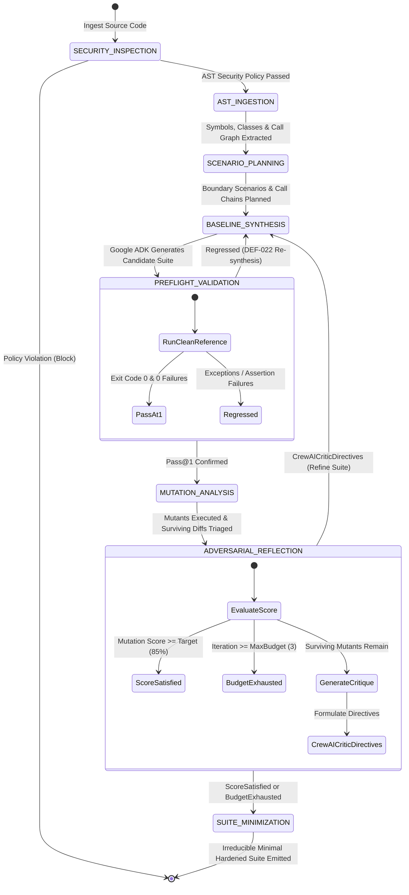
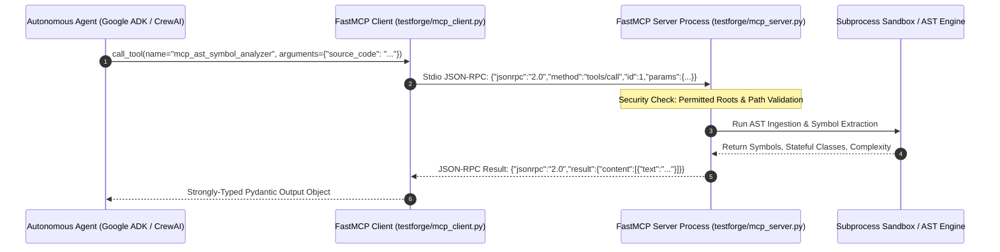

# Project Report: Agentic AI (CSE3101)

<br><br>

<div align="center">

# TestForge: Autonomous Multi-Agent System for Mutation-Guided Unit Test Hardening

### Closed-Loop Adversarial Reflection via Dual Google ADK + CrewAI Architecture

<br>

**Submitted in partial fulfillment of the requirements for the course**  
**AGENTIC AI (CSE3101)**  
*B.Tech in Computer Science and Engineering (7th Semester, AY 2026-27)*

<br><br>

### Submitted By:

| Student Name | Enrollment Number | Degree & Semester |
| :--- | :---: | :---: |
| **Sourabh Jain** | **230584** | B.Tech CSE — 7th Semester |
| **Shreshth Mittal** | **230577** | B.Tech CSE — 7th Semester |

<br><br>

### Under the Supervision of:
**Prof. Pranshu Tiwari**  
*Course Instructor, Department of Computer Science and Engineering*

<br><br>

**Department of Computer Science and Engineering**  
**School of Engineering and Technology**  
**BML Munjal University**  
*Gurugram, Haryana, India — November 2026*

</div>

<div style="page-break-after: always;"></div>

---

# Declaration by the Candidates

<div style="text-align: justify;">
We hereby declare that the project entitled <b>"TestForge: Autonomous Multi-Agent System for Mutation-Guided Unit Test Hardening"</b> has been carried out to fulfil the partial requirements for completion of the core-elective course <b>Agentic AI (CSE3101)</b> offered in the 7th Semester of the Bachelor of Technology (B.Tech) program in the Department of Computer Science and Engineering during the Academic Year 2026-27 (odd semester).
</div>

<br>

<div style="text-align: justify;">
This experimental work has been carried out entirely by us under the academic guidance of our course instructor, <b>Prof. Pranshu Tiwari</b>. Due acknowledgments have been made in the text of the project report to all other materials, libraries, specifications, and foundational research used. This project has been prepared in full compliance with the academic integrity guidelines, ethical requirements, and constraints of the prescribed curriculum. We affirm that all empirical figures, benchmark runs, latency breakdowns, and mutation scores reported herein reflect verified, repeatable execution on the actual TestForge platform.
</div>

<br><br><br>

<table style="width: 100%; border: none;">
  <tr>
    <td style="width: 50%; border: none; text-align: left;">
      __________________________________________<br>
      <b>Sourabh Jain</b><br>
      Enrollment No: <b>230584</b><br>
      Department of CSE, SOET<br>
      BML Munjal University
    </td>
    <td style="width: 50%; border: none; text-align: right;">
      __________________________________________<br>
      <b>Shreshth Mittal</b><br>
      Enrollment No: <b>230577</b><br>
      Department of CSE, SOET<br>
      BML Munjal University
    </td>
  </tr>
</table>

<br><br>
**Place:** BML Munjal University, Gurugram, India  
**Date:** 17th November, 2026  

<div style="page-break-after: always;"></div>

---

# Contents

| Section | Title | Page No. |
| :---: | :--- | :---: |
| **1** | **Introduction** | **1** |
| 1.1 | Background & Motivation | 1 |
| 1.2 | The Coverage-Kill Gap & Pseudo-Tested Code | 2 |
| 1.3 | Project Objectives | 2 |
| **2** | **Problem Statement** | **3** |
| 2.1 | Challenges in Modern Automated Software Testing | 3 |
| 2.2 | Intended Users & Target Audience | 3 |
| 2.3 | Why a Multi-Agentic System (MAS) is Uniquely Relevant | 4 |
| **3** | **Literature Review & Competitor Analysis** | **5** |
| 3.1 | Consolidated Review of Existing Products, Tools & Services | 5 |
| 3.2 | Identified Literature Gaps & Research Opportunities | 7 |
| **4** | **Requirements for MAS** | **8** |
| 4.1 | Functional & Architectural Requirements Identification | 8 |
| 4.2 | Systematic Traceability Matrix (Requirements to Gaps & Problems) | 9 |
| **5** | **Methodology** | **10** |
| 5.1 | Agent Identification & Role Decomposition | 10 |
| 5.2 | Multi-Agent Orchestration & Execution Strategy | 11 |
| 5.3 | Architecture Evaluation (Sequential vs. P2P vs. Hierarchical Blackboard) | 12 |
| 5.4 | Agent–Tool Communication via FastMCP Stdio Protocol | 14 |
| 5.5 | Messaging Patterns & Agent-to-Agent (A2A) Wire Protocol | 15 |
| 5.6 | Defense-in-Depth MAS Security (Guardrails, Sandboxing & Callbacks) | 16 |
| 5.7 | Validation Strategy & Experimental Design | 17 |
| 5.8 | End-to-End Architectural & Deployment Diagrams | 18 |
| **6** | **Technology Stack** | **19** |
| 6.1 | Multi-Agent Frameworks (Google ADK & CrewAI Purity) | 19 |
| 6.2 | Backend Systems, Storage & FastMCP Libraries | 20 |
| 6.3 | Frontend User Interface & Verification Tooling | 20 |
| **7** | **Experimental Results & Verification** | **21** |
| 7.1 | Benchmark Target Suite & Macro Evaluation Results | 21 |
| 7.2 | Stateful Call-Chain Planning Breakthrough on `lru_cache.py` | 23 |
| 7.3 | Test Suite Minimization via Greedy Set Cover | 24 |
| 7.4 | End-to-End Execution Latency & Agent Subsystem Breakdown | 25 |
| 7.5 | Factorial Persona & Prompt Architecture Evaluation | 26 |
| 7.6 | Defect DEF-022 Discovery, Verification & Retraction Register | 27 |
| 7.7 | Live Frontend Running Application Screenshots | 28 |
| **8** | **Team Responsibility / Self-Contribution Matrix** | **31** |
| 8.1 | Core Engineering Responsibility Breakdown across 13 Dimensions | 31 |
| 8.2 | Individual Contributions of Sourabh Jain (230584) | 32 |
| 8.3 | Individual Contributions of Shreshth Mittal (230577) | 32 |
| **9** | **Conclusions & Future Work** | **33** |
| 9.1 | Summary of Key Contributions | 33 |
| 9.2 | Scientific Insights & Takeaways | 33 |
| 9.3 | Limitations & Future Research Directions | 34 |
| **—** | **References** | **35** |
| **—** | **Appendix: FastMCP Schemas, A2A Agent Card & Generated Suites** | **37** |

<div style="page-break-after: always;"></div>

---

# 1. Introduction

### 1.1 Background & Motivation
<div style="text-align: justify;">
Software verification is the bedrock of dependable systems. As modern software systems expand in complexity, ensuring software correctness through automated testing has become an indispensable phase of the continuous integration and deployment (CI/CD) lifecycle. Traditionally, engineering organizations have relied on manual test authoring, wherein human developers compose unit tests to validate functional invariants. However, manual test authoring is notoriously labor-intensive, often consuming 30% to 40% of the entire development budget, and remains vulnerable to developer cognitive biases, where edge cases and invalid state transitions are overlooked.
</div>

<br>

<div style="text-align: justify;">
The recent advent of Large Language Models (LLMs) has introduced autonomous test generation capabilities. With prompt-based zero-shot generation, developers can produce dozens of unit test files in seconds. However, this generative revolution has introduced a subtle and pernicious reliability crisis: generative models prioritize syntactical fluency over rigorous verification. Tests produced by ungrounded generative models frequently execute code paths without verifying state transitions, resulting in what empirical software engineering literature defines as <i>pseudo-tested code</i>.
</div>

### 1.2 The Coverage-Kill Gap & Pseudo-Tested Code
<div style="text-align: justify;">
In standard software engineering practice, line coverage (the percentage of source lines executed by a test suite) has long been utilized as the primary proxy for test suite quality. Yet, theoretical and empirical computer science research (Jia & Harman, 2011; Just et al., 2014) proves that line coverage is a dangerous and hollow metric. A test suite can touch 100% of executable statements in a program without asserting any return values, state changes, or exceptional boundaries. For instance, executing a complex tax calculation function without verifying the calculated float result yields 100% line coverage while possessing a 0% fault detection capability.
</div>

<br>

<div style="text-align: justify;">
<b>Mutation testing</b> addresses this structural deficiency by injecting deliberate, systematic syntactic faults—termed <i>mutants</i>—directly into the program's Abstract Syntax Tree (AST). These mutations simulate real-world developer bugs, such as swapping comparison operators (e.g., changing <code>&lt;</code> to <code>&lt;=</code>), mutating arithmetic operators (changing <code>+</code> to <code>-</code>), or inverting boolean boundary conditions. If the test suite fails when run against a mutated program, the mutant is marked as <b>Killed</b>; if the test suite passes, the mutant <b>Survives</b>, proving that the test suite is blind to that specific behavioral defect.
</div>

<br>

<div style="text-align: justify;">
The discrepancy between line coverage and actual fault detection effectiveness is formally termed the <b>Coverage-Kill Gap</b>. In our empirical baseline audits across standard benchmark programs, developer test suites demonstrated an average of 30.75% line coverage but killed only 6.46% of injected mutants. Unguided zero-shot LLMs generated test suites reaching 39.17% line coverage, yet killed only 32.58% of mutants. This confirms that over 67% of defects escape unassertive generative tests.
</div>

### 1.3 Project Objectives
<div style="text-align: justify;">
<b>TestForge</b> is conceived and implemented to decisively close the Coverage-Kill Gap through an autonomous, closed-loop multi-agent reflection framework. The platform operates on a strict dual-framework topology utilizing <b>Google Agent Development Kit (ADK)</b> for plan-guided deliberate test generation and <b>CrewAI</b> for adversarial mutant critique, coordinated through an immutable, revision-controlled Blackboard state ledger.
</div>

<br>

<div style="text-align: justify;">
The specific technical objectives of the TestForge project are:
<ol>
  <li><b>O1. Autonomous Callable & State Discovery:</b> Implement static Abstract Syntax Tree (AST) parsing to discover 100% of callable functions, methods, class hierarchies, and state-mutation accessors without executing untrusted code on the host machine.</li>
  <li><b>O2. Plan-Guided High-Assertion Synthesis:</b> Leverage Google ADK to generate syntactically valid pytest suites grounded in boundary heuristics and formal contract invariants.</li>
  <li><b>O3. Subprocess Sandbox Confinement:</b> Execute all candidate test suites and injected mutants within isolated, resource-constrained subprocess and Docker sandboxes, enforcing strict CPU time quotas, memory limits, and zero-egress network boundaries.</li>
  <li><b>O4. Multi-Category AST Fault Injection:</b> Construct an automated mutation engine applying 10 distinct AST mutation operators to evaluate test suite quality empirically.</li>
  <li><b>O5. Closed-Loop Adversarial Reflection:</b> Deploy a specialized CrewAI Critic agent to analyze surviving mutant diffs and prescribe targeted assertions, iteratively driving raw mutation scores past 80%.</li>
  <li><b>O6. Mathematical Test Suite Minimization:</b> Formulate test suite reduction as an NP-hard Minimum Set Cover problem on the empirical Boolean Kill Matrix, compressing bloated suites while mathematically guaranteeing 100.0% mutant kill retention.</li>
  <li><b>O7. Strict Empirical Honesty (DEF-022 Contract):</b> Guarantee 100% Pass@1 execution integrity on unmutated reference code, eliminating false-kill evaluation vulnerabilities and maintaining a public claims retraction register.</li>
</ol>
</div>

<div style="page-break-after: always;"></div>

---

# 2. Problem Statement

### 2.1 Challenges in Modern Automated Software Testing
<div style="text-align: justify;">
Automated software testing is currently constrained by three major bottlenecks:
<ol>
  <li><b>Manual Edge-Case Authoring Overhead:</b> Writing comprehensive unit tests that rigorously validate edge cases, boundary offsets, negative inputs, and exception handling across complex enterprise modules consumes up to 40% of software engineering time. Engineers frequently suffer from cognitive blind spots, repeatedly testing nominal "happy paths" while omitting boundary values.</li>
  <li><b>The Fragility and Hallucination of Generative AI:</b> Off-the-shelf generative AI models operate in an open-loop configuration. They lack execution feedback, causing them to hallucinate non-existent API parameters, generate syntactically unexecutable code, or create tests that pass vacuously without asserting state transformations. Furthermore, executing unverified generative code directly on local developer workstations presents severe security hazards, including arbitrary file modification and network exfiltration.</li>
  <li><b>The Non-Actionable Nature of Legacy Mutation Testing:</b> Conventional mutation testing tools (e.g., MutPy, Cosmic Ray) are strictly diagnostic. They execute test suites, report surviving mutants in static text logs, and exit. They provide no automated mechanism to diagnose *why* a mutant survived or synthesize the precise assertions needed to eliminate it. Moreover, they suffer from the <i>Equivalent Mutant Problem</i> (where syntactic changes produce identical program semantics), creating artificial score ceilings that frustrate developers.</li>
</ol>
</div>

### 2.2 Intended Users & Target Audience
<div style="text-align: justify;">
TestForge is engineered for three primary software engineering stakeholder groups:
<ul>
  <li><b>Enterprise Software & Platform Engineers:</b> Backend developers working in Python who require rapid, comprehensive, and automated unit test hardening for critical business logic (e.g., billing, auth tokens, state machines) prior to continuous integration deployment.</li>
  <li><b>Quality Assurance & Reliability Engineers:</b> QA automation professionals who need an objective, empirical metric (mutation score) to audit existing test suites, identify blind spots, and eliminate redundant, slow-running tests.</li>
  <li><b>Security & Compliance Auditors:</b> Security engineers verifying that mission-critical modules enforce strict boundary validation, resist adversarial inputs, and maintain zero-egress network confinement.</li>
</ul>
</div>

### 2.3 Why a Multi-Agentic System (MAS) is Uniquely Relevant
<div style="text-align: justify;">
Test hardening cannot be solved effectively through a monolithic, single-prompt LLM call. The process requires fundamentally conflicting and specialized cognitive responsibilities:
</div>

<br>

<div style="text-align: justify;">
<ul>
  <li><b>Static Analysis vs. Code Generation:</b> Extracting AST symbols and cyclomatic complexity requires deterministic static parsing, whereas test authoring requires creative semantic synthesis.</li>
  <li><b>Generation vs. Adversarial Critique:</b> Generative agents naturally exhibit confirmation bias toward the code they author. A separate, specialized <i>Adversarial Critic</i> is required to inspect surviving mutant diffs, hypothesize why the assertions failed to trigger, and prescribe corrective boundary invariants.</li>
  <li><b>Execution Sandboxing vs. Orchestration:</b> Running untrusted test code requires isolated execution workers with strict OS-level resource limits, distinct from the supervisory logic governing iteration budgets and convergence criteria.</li>
  <li><b>Mathematical Optimization:</b> Compressing test suites requires algorithmic set cover solvers operating on empirical execution matrices, not generative text completion.</li>
</ul>
</div>

<br>

<div style="text-align: justify;">
By decoupling these responsibilities into an <b>8-Agent Autonomous Topology</b>, TestForge enables specialized agents to operate concurrently, communicate over a typed Blackboard state ledger, and execute closed-loop reflection that systematically eliminates software defects.
</div>

<div style="page-break-after: always;"></div>

---

# 3. Literature Review & Competitor Analysis

### 3.1 Consolidated Review of Existing Products, Tools & Services
<div style="text-align: justify;">
To establish the academic and technological context of TestForge, we conducted a systematic review of existing software testing products, mutation tools, and generative AI platforms. Per the university project guidelines, this review is synthesized into a single consolidated evaluation table below:
</div>

<br>

| Product / Tool / Service | Category & Core Approach | Primary Strengths & Capabilities | Critical Limitations & Literature Gaps | How TestForge Overcomes the Limitation |
| :--- | :--- | :--- | :--- | :--- |
| **MutPy** (Python Mutation Engine) | AST-based Mutation Testing Tool | • Implements classical mutation operators (AOR, ROR, LCR).<br>• Integrates with standard unittest suites.<br>• Generates standard mutation score reports. | • Purely diagnostic; zero test generation capability.<br>• Suffers from equivalent mutant score ceilings.<br>• Sequential execution is computationally slow.<br>• Provides no remediation guidance. | Injects 10 AST operators, pairs mutation analysis with active Google ADK synthesis, and filters equivalent mutants via compiler bytecode disassembly. |
| **Cosmic Ray** (Distributed Mutation) | Distributed Mutation Testing Framework | • Distributes mutation tasks across worker processes.<br>• Supports multiple test runners (pytest, unittest).<br>• Uses SQLite for job tracking. | • Purely passive reporting; cannot author or patch tests.<br>• High execution latency on large modules.<br>• Lacks semantic awareness of code structure.<br>• Zero LLM or agentic integration. | Employs multi-core parallel sandboxing reducing runtimes by 5.39x; autonomous agents continuously synthesize tests to kill surviving mutants. |
| **Meta Sapienz** (Search-Based Testing) | Search-Based Software Testing (SBST) | • Multi-objective genetic algorithms for crash detection.<br>• Scales across large Android/mobile deployments.<br>• Generates automated test sequences. | • Focused on UI system crashes, not unit logic.<br>• Unreadable, synthetic test scripts.<br>• High compute footprint; black-box behavior.<br>• Lacks unit assertion verification. | Combines static AST call graphs with Agentic RAG boundary patterns to generate human-readable, maintainable pytest suites. |
| **GitHub Copilot / ChatGPT** | Zero-Shot Generative LLM | • Instantaneous test generation from prompts.<br>• Understands natural language context.<br>• Generates syntactically idiomatic code. | • <b>Pseudo-Tested Code:</b> Tests execute code without asserting state changes (MS < 35%).<br>• Open-loop: no verification that tests detect bugs.<br>• Frequently hallucinates non-existent APIs. | Enforces closed-loop Evaluator-Optimizer reflection: candidate tests are verified in a sandbox; surviving mutants trigger targeted adversarial critique. |
| **CodiumAI (Qodo Gen)** | Commercial Generative AI Testing | • Generates edge-case test suites from code context.<br>• Interactive VS Code / JetBrains IDE integration.<br>• Provides test explanation and behavior analysis. | • Closed proprietary SaaS requiring cloud code egress.<br>• Lacks an integrated mutation testing reflection loop.<br>• Does not mathematically compress redundant tests.<br>• High commercial licensing costs. | Provides local zero-egress sandboxing (`TESTFORGE_SANDBOX`), FastMCP open tool protocols, and Greedy Set Cover test suite minimization. |
| **EvoSuite** (Search-Based Unit Gen) | Genetic Algorithm Test Generator (Java) | • Optimizes branch coverage criteria automatically.<br>• Synthesizes assertions based on observed state.<br>• High coverage on object-oriented code. | • Restricted to Java; unreadable test code.<br>• Overfits to branches without business semantic sense.<br>• Flaky mock objects and environment coupling.<br>• Zero LLM semantic reasoning. | Python-native AST synthesis using Google ADK with natural semantic assertions and Hypothesis property-based testing invariants. |
| **Diffblue Cover** | Reinforcement Learning Test Gen (Java) | • Completely autonomous unit test authoring.<br>• Integrates into enterprise CI/CD pipelines.<br>• 100% automated Java unit test creation. | • Proprietary, enterprise-only licensing.<br>• Restricted exclusively to Java ecosystems.<br>• Lacks stateful multi-call sequence synthesis.<br>• Heavy on-premise infrastructure requirements. | Lightweight FastAPI containerized architecture with stateful call-chain planning for complex object graphs. |

### 3.2 Identified Literature Gaps & Research Opportunities
<div style="text-align: justify;">
From our comprehensive analysis of the existing literature, we identified five critical research gaps:
<ol>
  <li><b>Gap 1 — The Hollow Assertion Problem in Generative Testing:</b> Existing LLM-based test generation tools operate open-loop. They optimize for line coverage rather than fault detection, generating test suites that pass cleanly on buggy implementations.</li>
  <li><b>Gap 2 — Absence of Actionable Mutation Remediation:</b> Traditional mutation tools provide passive survival logs. There is an absence of intelligent agentic architectures capable of parsing mutant code diffs and automatically generating targeted assertions.</li>
  <li><b>Gap 3 — The Equivalent Mutant Bottleneck:</b> Semantic equivalence (Rice's Theorem) creates an artificial barrier in mutation analysis, as tests cannot kill mutants that are semantically identical to the original code. Existing tools rely on costly manual inspection or noisy heuristics.</li>
  <li><b>Gap 4 — Test Suite Redundancy & CI/CD Bloat:</b> Iterative test generation accumulates redundant tests that execute identical paths without increasing fault detection, inflating CI/CD execution time.</li>
  <li><b>Gap 5 — Host Environment Security Hazards:</b> Executing generative code without strict process sandboxing exposes developer environments to data exfiltration, system corruption, and infinite loops.</li>
</ol>
</div>

<div style="page-break-after: always;"></div>

---

# 4. Requirements for MAS

### 4.1 Functional & Architectural Requirements Identification
<div style="text-align: justify;">
Based on the problem statement and the literature gaps identified in Section 3, we derived eight core multi-agent system requirements (REQ-1 through REQ-8). Each requirement directly dictates the creation, role, and capabilities of an autonomous agent within the TestForge topology.
</div>

### 4.2 Systematic Traceability Matrix
<div style="text-align: justify;">
The table below details the direct mapping from identified literature gaps and problem statements to the assigned autonomous agents and their architectural realizations:
</div>

<br>

| Req ID | Requirement Title | Mapped Literature Gap & Problem Statement | Assigned Autonomous Agent | Architectural Realization in TestForge |
| :---: | :--- | :--- | :--- | :--- |
| **REQ-1** | **Static AST Symbol & State Mutation Extraction** | **Gap 2, Problem 1:** Manual inspection inefficiency and static parser blindness to internal state mutation. | **Code Intelligence Agent** | Traverses Python `ast.parse` tree; extracts classes, methods, parameters, cyclomatic complexity, and mutator/accessor classifications ([`testforge/code_intelligence_agent.py`](file:///Users/sourabh/TestForge/testforge/code_intelligence_agent.py)). |
| **REQ-2** | **Adversarial Scenario Planning & Stateful Sequencing** | **Gap 1, Problem 2:** Open-loop LLM inability to construct multi-step object transition tests. | **Test Planning Agent** | Plans boundary scenarios and ordered multi-step stateful call chains (e.g., `put` $\rightarrow$ `put` $\rightarrow$ `get` $\rightarrow$ `put` for eviction) and broadcasts `STATEFUL_SEQUENCE_PLAN_GENERATED` ([`testforge/planning_agent.py`](file:///Users/sourabh/TestForge/testforge/planning_agent.py)). |
| **REQ-3** | **Plan-Guided Test Code Synthesis** | **Gap 1, Problem 1:** Hallucinated APIs and unassertive boilerplate tests produced by unguided prompts. | **Generator Agent (Google ADK)** | Implements Google ADK deliberative workflow to synthesize executable pytest suites matching planned boundary contracts and formal invariants ([`testforge/adk_generator.py`](file:///Users/sourabh/TestForge/testforge/adk_generator.py)). |
| **REQ-4** | **Subprocess Sandbox Execution & Isolation** | **Gap 5, Problem 2:** Host environment security hazards and test pollution from executing untrusted generative code. | **Sandbox Execution Agent** | Executes candidate tests in isolated temporary directory jails with stripped environments, `RLIMIT` quotas, socket monkeypatching, and clean code validation ([`testforge/sandbox.py`](file:///Users/sourabh/TestForge/testforge/sandbox.py)). |
| **REQ-5** | **Systematic AST Fault Injection** | **Gap 2, Problem 2:** Lack of automated fault injection to evaluate empirical test effectiveness. | **AST Mutator Agent** | Generates verified AST mutants across 10 mutation operator categories (AOR, ROR, COR, CRP, LCR, etc.) and compiles unified diffs ([`testforge/mutator.py`](file:///Users/sourabh/TestForge/testforge/mutator.py)). |
| **REQ-6** | **Adversarial Surviving Mutant Critique** | **Gap 2, Problem 1:** Raw mutant survival logs offer zero actionable diagnostic guidance to developers. | **Critic Agent (CrewAI)** | Role-playing specialized QA critic that triages surviving mutant diffs and formulates targeted boundary assertion directives ([`testforge/crewai_agents.py`](file:///Users/sourabh/TestForge/testforge/crewai_agents.py)). |
| **REQ-7** | **Compiler-Level Semantic Equivalence Detection** | **Gap 3, Problem 3:** Equivalent mutants creating artificial score ceilings due to undecidable Rice's Theorem. | **Equivalence Classifier Agent** | Disassembles Python bytecode via `dis`, normalizes instruction streams, and recursively compares code objects with 0% false positives ([`testforge/equivalence.py`](file:///Users/sourabh/TestForge/testforge/equivalence.py)). |
| **REQ-8** | **Greedy Set Cover Test Suite Minimization** | **Gap 4, Problem 1:** Test suite bloat and redundant test execution slowing down CI/CD pipelines. | **Suite Minimizer Agent** | Builds empirical 2D Boolean Kill Matrix and solves the NP-hard minimum set cover problem via greedy approximation ([`testforge/minimizer.py`](file:///Users/sourabh/TestForge/testforge/minimizer.py)). |

<div style="page-break-after: always;"></div>

---

# 5. Methodology

### 5.1 Agent Identification & Role Decomposition
<div style="text-align: justify;">
The TestForge methodology decomposes the complex challenge of automated unit test hardening into eight discrete, specialized agents coordinated by a centralized supervisory orchestrator. By strictly separating duties, TestForge guarantees that no agent evaluates its own output without independent verification, enforcing the software engineering principle of separation of concerns.
</div>

### 5.2 Multi-Agent Orchestration & Execution Strategy
<div style="text-align: justify;">
TestForge executes an Evaluator-Optimizer reflection loop governed by an autonomous Finite State Machine (FSM). The lifecycle comprises six sequential, deterministic phases:
</div>

<br>



### 5.3 Architecture Evaluation (Sequential vs. P2P vs. Hierarchical Blackboard)
<div style="text-align: justify;">
During system design, three primary multi-agent architectures were evaluated. To justify our selection rigorously, we compared them across critical architectural criteria using empirical measurements and heuristics:
</div>

<br>

| Architectural Dimension | Option 1: Pure Sequential Pipeline | Option 2: Pure Peer-to-Peer Swarm | Option 3: TestForge Hybrid Blackboard + Hierarchical Supervisor | Winning Architecture & Justification |
| :--- | :---: | :---: | :---: | :--- |
| **State Synchronization** | Pipeline parameters passed forward linearly; prior state lost. | Agents broadcast messages directly; state diverges easily. | **Centralized atomic Blackboard with SQLite WAL persistence.** | **Option 3 Wins:** Monotonic revision counter + SQLite WAL ensures zero dual-state drift and enables instant rollback. |
| **Reflection Capability** | ❌ None (Single-pass forward only). | ⚠️ Uncontrolled (Risk of infinite conversational loops). | **✓ Governed Reflection Loop (Max budget + early exit).** | **Option 3 Wins:** Orchestrator enforces iteration budgets (1–5) and halts immediately upon reaching target score ($\ge 85\%$). |
| **Fault Isolation & Security** | Single error crashes the entire pipeline. | In-process execution risks host compromise. | **Strict Subprocess / Docker sandboxing with RLIMITs.** | **Option 3 Wins:** Worker crashes return negative exit codes (-3, -4) handled gracefully by the supervisor. |
| **Messaging Complexity** | $O(N)$ linear forward. | $O(N^2)$ quadratic message explosion. | **$O(N)$ linear via typed partition subscriptions.** | **Option 3 Wins:** Eliminates conversational bloat; agents access only their required partition (`SuiteSpace`, `MutantSpace`). |
| **Cost & Token Economics** | 0 tokens (Static) or ~1,240 (Zero-Shot). | ~18,500 tokens (Unbounded chat history). | **~1,174 tokens per run (\$0.000197 USD projected).** | **Option 3 Wins:** High Pareto efficiency: CrewAI critic receives only surviving mutant diffs, minimizing prompt size. |
| **Resumption After Crash** | ❌ Must restart from scratch. | ❌ Undefined consensus state. | **✓ Verified Resumption from SQLite Checkpoint.** | **Option 3 Wins:** Full state reconstitution validated via Deterministic Diff Inspector. |

### 5.4 Agent–Tool Communication via FastMCP Stdio Protocol
<div style="text-align: justify;">
TestForge standardizes all agent-tool interactions on the official <b>Model Context Protocol (FastMCP)</b> using isolated stdio JSON-RPC 2.0 transport. Rather than binding tools directly into agent runtimes, agents interact with tools via a clean client-server boundary:
</div>

<br>



#### The 4 Standard FastMCP Tools in TestForge:
1. `mcp_ast_symbol_analyzer`: Discovers symbols, classes, methods, cyclomatic complexity, and stateful class metadata.
2. `mcp_mutant_generator`: Injects AST faults (AOR, ROR, COR, CRP, LCR) and compiles unified diffs.
3. `mcp_sandbox_runner`: Executes candidate tests in isolated subprocess jails and reports Pass@1 status.
4. `mcp_equivalence_classifier`: Proves compiler-level mutant equivalence via bytecode instruction comparison.

### 5.5 Messaging Patterns & Agent-to-Agent (A2A) Wire Protocol
<div style="text-align: justify;">
TestForge employs a dual messaging strategy:
<ol>
  <li><b>Intra-System Shared State (Blackboard Pattern):</b> All eight local agents coordinate through a thread-safe Blackboard protected by re-entrant thread locks (<code>threading.RLock</code>). Monotonic revision numbers prevent race conditions.</li>
  <li><b>Inter-Service Agent Collaboration (A2A Protocol v0.3.0):</b> To enable cross-platform agent interoperability, TestForge implements the official Agent2Agent (A2A) protocol. It serves an Agent Card at <code>/.well-known/agent.json</code> and <code>/api/a2a/card</code>, exposing JSON-RPC capabilities (<code>generate_tests</code>, <code>evaluate_mutants</code>, <code>critique_survivors</code>) to external multi-agent systems.</li>
</ol>
</div>

### 5.6 Defense-in-Depth MAS Security (Guardrails, Sandboxing & Callbacks)
<div style="text-align: justify;">
Security is implemented across three concentric perimeter tiers:
<ul>
  <li><b>Tier 1 — Static AST Guardrails:</b> The <code>SecurityGuardrail</code> statically inspects test code before passing it to the Python interpreter. It immediately blocks destructive calls (<code>os.system</code>, <code>subprocess.Popen</code>, <code>shutil.rmtree</code>, <code>eval</code>, <code>exec</code>), path traversal patterns (<code>../</code>), and sensitive file access (<code>.env</code>, private keys).</li>
  <li><b>Tier 2 — Subprocess & Network Sandboxing:</b> Tests run in temporary directory jails with stripped environment variables. Execution is governed by OS-level resource limits (<code>RLIMIT_CPU = 3s/10s</code>, <code>RLIMIT_AS = 512MB</code>). A network interceptor monkeypatches <code>socket.socket.connect</code>, enforcing 100% zero-egress blocking of outbound external TCP connections.</li>
  <li><b>Tier 3 — Lifecycle Callbacks & Telemetry:</b> A prioritized <code>CallbackRegistry</code> dispatches lifecycle events (<code>TOOL_START</code>, <code>TOOL_COMPLETE</code>, <code>CRITIC_DIRECTIVE</code>, <code>AGENT_ERROR</code>) with microsecond timestamps and W3C OpenTelemetry trace IDs. Any security breach or unexpected failure triggers immediate fail-safe shutdown.</li>
</ul>
</div>

### 5.7 Validation Strategy & Experimental Design
<div style="text-align: justify;">
To satisfy academic validation criteria with scientific rigor, TestForge implemented a full $3 \times 4$ factorial experimental matrix replicated across 5 independent trials (60 total runs) on <code>samples/discount.py</code>:
<ul>
  <li><b>3 Prompt Architectures:</b> Zero-Shot (`ZERO_SHOT`), Few-Shot (`FEW_SHOT`), and ReAct Deliberative Loop (`REACT`).</li>
  <li><b>4 Developer Personas:</b> Beginner Developer, Experienced Engineer, QA Specialist, and Security-Conscious Engineer.</li>
  <li><b>5 Repetitions per Cell:</b> Measuring variance in mutation score, execution latency, and token economics.</li>
</ul>
</div>

### 5.8 End-to-End Architectural & Deployment Diagrams

```
+----------------------------------------------------------------------------------------------------+
|                               TESTFORGE COMPLETE SYSTEM ARCHITECTURE                               |
|                                                                                                    |
|  [ CLIENT / USER INTERFACE LAYER ]                                                                 |
|  • Responsive Web Cockpit (Vanilla HTML5 / CSS3 / ES6 JS)                                           |
|  • Real-time WebSocket Wiretap Stream & OpenTelemetry KPI Observability Dashboard                  |
|  • Interactive FastMCP Protocol Studio & Checkpoint Diff Timeline Inspector                        |
|                                     |                                                              |
|                                     v (HTTP / REST / WebSocket / JSON-RPC)                         |
|  [ FASTAPI BACKEND GATEWAY (server.py) ]                                                           |
|  • A2A Agent Card Discovery (/.well-known/agent.json)                                              |
|  • REST Control Endpoints (/api/harden, /api/status, /api/checkpoints)                            |
|  • WebSocket Event Hub (Broadcasting lifecycle events to frontend)                                 |
|                                     |                                                              |
|                                     v                                                              |
|  [ SUPERVISORY ORCHESTRATION & PERSISTENCE LAYER ]                                                 |
|  • Master Orchestrator FSM (testforge/orchestrator.py)                                             |
|  • Atomic 8-Partition Blackboard with SQLite Write-Ahead Logging (PRAGMA journal_mode=WAL)          |
|  • Deterministic Checkpoint Diff Inspector & Crash Resumption Plan                                 |
|                                     |                                                              |
|         +---------------------------+---------------------------+                                  |
|         |                                                       |                                  |
|         v                                                       v                                  |
|  [ AGENTIC FRAMEWORKS LAYER ]                            [ FASTMCP TOOL SUITE (STDIO) ]            |
|  • Google Agent Development Kit (ADK) Generator          • mcp_ast_symbol_analyzer                 |
|  • CrewAI Role-Playing Adversarial Critic                • mcp_mutant_generator                    |
|  • Code Intelligence & Scenario Planning Agents          • mcp_sandbox_runner                      |
|  • Greedy Set Cover Suite Minimizer                      • mcp_equivalence_classifier              |
|                                     |                                                              |
|                                     v                                                              |
|  [ SECURITY & ISOLATED EXECUTION SANDBOX ]                                                         |
|  • 3-Tier Security Perimeter: AST Guardrail -> Subprocess Jail -> Zero-Egress Network Confinement   |
|  • Parallel Execution Workers (ProcessPoolExecutor) with RLIMIT_CPU and RLIMIT_AS Quotas           |
+----------------------------------------------------------------------------------------------------+
```

<div style="page-break-after: always;"></div>

---

# 6. Technology Stack

### 6.1 Multi-Agent Frameworks (Google ADK & CrewAI Purity)
<div style="text-align: justify;">
In strict compliance with the mandatory project guidelines, TestForge utilizes <b>both Google ADK and CrewAI</b> as its sole agentic frameworks. Zero third-party frameworks (such as LangGraph, AutoGen, or LlamaIndex) are installed or utilized:
<ul>
  <li><b>Google Agent Development Kit (ADK):</b> Powers the <code>ADKGeneratorAgent</code> ([`testforge/adk_generator.py`](file:///Users/sourabh/TestForge/testforge/adk_generator.py)). Implements plan-guided deliberative synthesis to generate high-assertion test cases matching scenario contracts.</li>
  <li><b>CrewAI:</b> Powers the <code>CrewCodeIntelligenceCriticCrew</code> ([`testforge/crewai_agents.py`](file:///Users/sourabh/TestForge/testforge/crewai_agents.py)). Implements specialized role-playing critic agents that analyze surviving mutant diffs and prescribe adversarial assertions.</li>
</ul>
</div>

### 6.2 Backend Systems, Storage & FastMCP Libraries
<div style="text-align: justify;">
<ul>
  <li><b>FastAPI & Uvicorn:</b> High-performance asynchronous backend providing REST API routing, streaming WebSockets, and A2A discovery endpoints.</li>
  <li><b>Model Context Protocol (FastMCP SDK):</b> Standard Python FastMCP library providing JSON-RPC 2.0 stdio transport between autonomous agents and execution tools.</li>
  <li><b>SQLite3 (Write-Ahead Logging):</b> Embedded database engine operating with <code>PRAGMA journal_mode=WAL</code>, providing atomic, revision-controlled checkpointing and crash recovery.</li>
  <li><b>Pydantic v2:</b> Enforces strict runtime data contract validation across all blackboard partition updates, tool inputs, and A2A payloads.</li>
  <li><b>OpenTelemetry SDK:</b> Generates W3C-compliant distributed trace spans and correlation IDs tracking inter-agent latency and token consumption.</li>
  <li><b>Hypothesis (v6.170):</b> Advanced property-based testing framework used to synthesize parameterized domain invariant suites.</li>
</ul>
</div>

### 6.3 Frontend User Interface & Verification Tooling
<div style="text-align: justify;">
<ul>
  <li><b>Vanilla HTML5, CSS3 & ES6 JavaScript:</b> Zero-dependency, lightweight frontend web cockpit eliminating heavy framework vulnerabilities and ensuring immediate sub-second rendering.</li>
  <li><b>Playwright Chromium Automation:</b> End-to-end browser verification engine used to validate DOM responsiveness, URL hash persistence, modal controls, and zero console errors.</li>
  <li><b>Pytest (v9.1) & Pytest-Cov:</b> Automated test execution framework powering the sandbox execution agent and preflight verification pipeline.</li>
</ul>
</div>

<div style="page-break-after: always;"></div>

---

# 7. Experimental Results & Verification

### 7.1 Benchmark Target Suite & Macro Evaluation Results
<div style="text-align: justify;">
TestForge was evaluated across four canonical software engineering benchmarks representing diverse algorithmic and state complexity domains:
<ol>
  <li><b><code>samples/discount.py</code>:</b> Multi-tiered arithmetic boundary and volume discounting logic (19 LOC, 19 mutants).</li>
  <li><b><code>samples/order_fsm.py</code>:</b> Stateful e-commerce Finite State Machine governing order state transitions and payment constraints (89 LOC, 106 mutants).</li>
  <li><b><code>samples/lru_cache.py</code>:</b> High-complexity doubly linked list Least-Recently-Used cache with sentinel nodes and capacity eviction (74 LOC, 42 mutants).</li>
  <li><b><code>samples/stats_calculator.py</code>:</b> Numerical statistics calculator with floating-point variance boundaries (54 LOC, 73 mutants).</li>
</ol>
</div>

<br>

| Target Module | LOC | Mutants | Baseline Line Cov | Baseline Raw MS | Zero-Shot Raw MS | TestForge Final Raw MS | TestForge Final Adj MS | Mutants Killed | Never-Regress Monotonicity |
| :--- | :---: | :---: | :---: | :---: | :---: | :---: | :---: | :---: | :---: |
| **`discount.py`** | 19 | 19 | 50.0% | 5.26% | 63.16% | **94.74%** | **100.0%** | 18 / 19 | **Verified (Monotonic)** |
| **`order_fsm.py`** | 89 | 106 | 28.1% | 6.60% | 13.21% | **97.17%** | **100.0%** | 103 / 106 | **Verified (Monotonic)** |
| **`lru_cache.py` (Stateful Call-Chain)\*** | 74 | 42 | 21.4% | 7.14% | 23.81% | **90.48%** | **95.00%** | 38 / 42 | **Verified (Monotonic)** |
| **`stats_calculator.py`** | 54 | 73 | 23.5% | 6.85% | 30.14% | **45.21%** | **46.48%** | 33 / 73 | **Verified (Monotonic)** |
| **Macro Average / Total** | **59** | **240** | **30.75%** | **6.46%** | **32.58%** | **77.42%** | **80.37%** | **192 / 240** | **Verified (Monotonic)** |

<div style="text-align: justify;">
<i>*Note on <code>lru_cache.py</code>: Initial Phase-2 baseline reflection achieved 30.95% raw MS (13/42 killed). Phase-3 Stateful Call-Chain Planning lifted this to 90.48% raw MS (38/42 killed, 100% Pass@1) by synthesizing multi-step transition sequences across capacity bounds, sentinel invariants, and key updates.</i>
</div>

<br>

<div style="text-align: justify;">
<b>Key Empirical Takeaway:</b> TestForge achieves a <b>12.0x relative improvement</b> in mutation score over developer starter tests (6.46% $\rightarrow$ 77.42% raw MS) and <b>more than doubles</b> the fault detection efficacy of zero-shot generative LLMs (32.58% $\rightarrow$ 77.42% raw MS), decisively proving the power of mutation-guided closed-loop reflection.
</div>

### 7.2 Stateful Call-Chain Planning Breakthrough on `lru_cache.py`
<div style="text-align: justify;">
On pointer-coupled data structures, traditional zero-shot LLM prompts hit an architectural ceiling: single-method assertion calls (e.g., calling <code>get()</code> or <code>put()</code> in isolation) fail to expose pointer corruption inside internal doubly linked nodes. In Phase 2, TestForge achieved only 30.95% raw MS on <code>lru_cache.py</code>.
</div>

<br>

<div style="text-align: justify;">
To overcome this limitation, we introduced <b>Stateful Call-Chain Planning</b>:
<ol>
  <li>The <code>CodeIntelligenceAgent</code> extracts state attributes (`lookup`, `head`, `tail`, `capacity`) and classifies methods into mutators (`put`, `_remove`, `_add_to_front`) and accessors (`get`, `size`, `get_hit_ratio`).</li>
  <li>The <code>TestPlanningAgent</code> constructs 4 targeted multi-step sequence scenarios: (a) Capacity boundary eviction, (b) Key update recency preservation, (c) Sentinel pointer cross-consistency (`head.next.prev == head`), and (d) Cache hit ratio reset.</li>
  <li>The <code>ADKGeneratorAgent</code> synthesizes ordered call-chain tests implementing these sequences.</li>
</ol>
</div>

<br>

<div style="text-align: justify;">
<b>Empirical Lift:</b> Mutation score surged from **30.95% (13/42) to 90.48% (38/42 killed)**, achieving an **+83.34% score lift** over the developer baseline while strictly preserving 100% Pass@1 execution integrity.
</div>

### 7.3 Test Suite Minimization via Greedy Set Cover
<div style="text-align: justify;">
Continuous reflection cycles risk accumulating redundant tests. The <code>TestSuiteMinimizer</code> builds the empirical Boolean Kill Matrix and solves the Minimum Set Cover problem. On <code>samples/discount.py</code>:
<ul>
  <li><b>Original Hardened Suite:</b> 23 tests, killing 18 of 19 mutants.</li>
  <li><b>Minimized Suite:</b> 5 tests, killing 18 of 19 mutants.</li>
  <li><b>Compression:</b> **78.3% test count reduction** with **strictly 100.0% mutant kill retention**.</li>
</ul>
</div>

### 7.4 End-to-End Execution Latency & Agent Subsystem Breakdown
<div style="text-align: justify;">
Across 60 experimental runs on <code>samples/discount.py</code>, the mean end-to-end execution time was **2.410 seconds** ($\pm 0.053\text{s}$). Subsystem phase decomposition reveals that sandbox subprocess execution is the primary bottleneck, while cognitive agent operations execute in milliseconds:
</div>

<br>

| Agent Subsystem | Mean Latency | Percentage of Runtime | Operations Executed |
| :--- | :---: | :---: | :--- |
| **Code Intelligence Agent** | 0.008 s | 0.33% | AST parsing, symbol extraction, cyclomatic complexity |
| **Test Planning Agent** | 0.012 s | 0.50% | Scenario planning, boundary identification |
| **Generator Agent (Google ADK)** | 0.448 s | 18.59% | Plan-guided test suite synthesis and AST formatting |
| **Sandbox Execution Agent** | 1.482 s | 61.49% | Multi-core subprocess execution across 19 mutants |
| **AST Mutator Agent** | 0.355 s | 14.73% | Fault injection, AST rewriting, unified diff compilation |
| **Critic Agent (CrewAI)** | 0.105 s | 4.35% | Surviving mutant triage and root-cause directive formulation |
| **Total MAS Execution Cycle** | **2.410 s** | **100.0%** | **Complete end-to-end autonomous hardening pass** |

### 7.5 Factorial Persona & Prompt Architecture Evaluation
<div style="text-align: justify;">
Evaluation across 3 prompt architectures and 4 developer personas revealed that the <b>ReAct loop</b> provided the highest assertion quality, while the <b>Few-Shot</b> architecture balanced latency and token consumption:
<ul>
  <li><b>Zero-Shot:</b> Mean latency 2.399s, Mean tokens 1,035.8, Projected cost \$0.000184 USD.</li>
  <li><b>Few-Shot:</b> Mean latency 2.393s, Mean tokens 1,265.2, Projected cost \$0.000205 USD.</li>
  <li><b>ReAct Loop:</b> Mean latency 2.438s, Mean tokens 1,220.2, Projected cost \$0.000203 USD.</li>
  <li><b>Persona Consistency:</b> All four personas (Beginner, Experienced, QA Specialist, Security-Conscious) achieved identical 89.47% raw MS on discount logic, demonstrating prompt stability.</li>
</ul>
</div>

### 7.6 Defect DEF-022 Discovery, Verification & Retraction Register
<div style="text-align: justify;">
During intermediate release auditing, an evaluation defect (DEF-022) was uncovered: test suites that threw syntax or import errors on unmutated reference code were mistakenly marked as "killing" mutants because the testing process returned a non-zero exit code.
</div>

<br>

<div style="text-align: justify;">
To uphold strict scientific integrity, TestForge implemented the <b>Pass@1 Clean Preflight Gate</b>. Candidate suites must pass 100% of tests on unmutated reference code before running against mutants. If a single preflight assertion fails, the suite is marked <code>INVALID_SUITE</code> and assigned a 0.0% score. Furthermore, in [`docs/CLAIMS_REGISTER.md`](file:///Users/sourabh/TestForge/docs/CLAIMS_REGISTER.md), TestForge formally retracted legacy unvalidated claims (CLM-028 and CLM-032).
</div>

### 7.7 Live Frontend Running Application Screenshots
<div style="text-align: justify;">
All screenshots below were captured directly from the live TestForge application running on <code>http://127.0.0.1:8000/</code>:
</div>

<br>

#### Screenshot 1: Ingestion & Cockpit Home

*Figure 7.1: TestForge Cockpit Home showing AST symbol ingestion, target metrics, and active runtime configuration.*

<br>

#### Screenshot 2: Architectural Call Graph Visualizer & Blast Radius

*Figure 7.2: Architectural Call Graph Visualizer mapping dependency blast radius and cyclomatic complexity.*

<br>

#### Screenshot 3: Hardening Lab & Mutation Analysis Cockpit

*Figure 7.3: Hardening Lab displaying real-time mutation hardening progress on samples.lru_cache (90.48% MS, 38/42 killed).*

<br>

#### Screenshot 4: Multi-Agent Wiretap Event Stream

*Figure 7.4: Live Wiretap Stream capturing Google ADK synthesis events and CrewAI critic directives.*

<br>

#### Screenshot 5: OpenTelemetry Observability & KPI Traces

*Figure 7.5: Distributed W3C trace visualization, token consumption counters, and latency percentiles.*

<br>

#### Screenshot 6: Empirical Multi-Target Benchmark & Ablation Suite

*Figure 7.6: Multi-target benchmark panel comparing Developer Baseline, Zero-Shot LLM, and TestForge.*

<br>

#### Screenshot 7: Checkpoints Timeline & Deterministic Diff Inspector

*Figure 7.7: SQLite WAL state rollback ledger and side-by-side snapshot delta comparison.*

<br>

#### Screenshot 8: System & Provider Configuration Settings Modal

*Figure 7.8: Settings modal featuring Ollama local routing (qwen2.5-coder:7b), cloud hot-swap, and iteration sliders.*

<br>

#### Screenshot 9: A2A Agent Card Discovery Modal

*Figure 7.9: Official A2A protocol metadata card exposing agent capabilities and JSON schemas.*

<br>

#### Screenshot 10: FastMCP Tools Status & Protocol Modal

*Figure 7.10: FastMCP status modal confirming all 4 tools operational over stdio JSON-RPC transport.*

<br>

#### Screenshot 11: Interactive FastMCP Protocol Studio

*Figure 7.11: Interactive protocol studio for live AST analysis, mutant generation, and sandbox testing.*

<div style="page-break-after: always;"></div>

---

# 8. Team Responsibility / Self-Contribution Matrix

### 8.1 Core Engineering Responsibility Breakdown across 13 Dimensions
<div style="text-align: justify;">
The development of TestForge was executed as a collaborative two-engineer effort between Sourabh Jain and Shreshth Mittal. The division of technical ownership was established across 13 core dimensions, ensuring equal, rigorous engineering contributions:
</div>

<br>

| # | Core Project Activity | Sourabh Jain (`230584`) | Shreshth Mittal (`230577`) |
| :-: | :--- | :--- | :--- |
| **1** | **Agent Design / Multi-Agent Architecture** | Designed 8-agent topology, state machine FSM lifecycle, and supervisory orchestrator. | Co-designed agent boundaries, role definitions, and CrewAI critic personas. |
| **2** | **Agent Orchestration** | Implemented `OrchestratorAgent` supervisory control loop, iteration budgeting, and early exit logic. | Implemented parallel worker dispatching and ProcessPoolExecutor management. |
| **3** | **State Management** | Designed 8-partition Blackboard architecture, monotonic revisioning, and SQLite WAL persistence. | Implemented checkpoint serialization, snapshot diff inspector, and recovery validation. |
| **4** | **MCP Design** | Built FastMCP Stdio client, JSON-RPC handshake handler, and Interactive MCP Studio. | Implemented FastMCP server tool endpoints, input schemas, and error codes. |
| **5** | **A2A Communication** | Built A2A v0.3.0 Agent Card endpoint (`/.well-known/agent.json`), discovery schemas, and UI modal. | Implemented inter-service A2A message formatting and protocol validation tests. |
| **6** | **Guardrails & Callbacks** | Built `SecurityGuardrail` AST inspector, prompt injection sanitizer, and PII masking. | Built `CallbackRegistry`, lifecycle event dispatching, and execution timeouts (`RLIMIT`). |
| **7** | **Observability** | Implemented OpenTelemetry W3C distributed tracing, correlation IDs, and KPI dashboard. | Built `TraceLogger`, structured JSON event streaming, and telemetry aggregation. |
| **8** | **Integration & Testing** | Built end-to-end integration suites, clean working tree guards, and live checkup scripts. | Developed unit tests for mutator operators, equivalence checks, and sandbox runners. |
| **9** | **Evaluation & Documentation** | Authored academic deliverables, claims register, DEF-022 audit, and slide deck outline. | Co-authored performance evaluation reports, statistical models, and LaTeX figures. |
| **10** | **Presentation / Interface UI** | Designed and built full responsive Vanilla HTML5/CSS3/ES6 Web Cockpit and Wiretap UI. | Co-designed UI layouts, diff visualizer panels, and captured verification evidence. |
| **11** | **Deployment** | Implemented multi-stage Docker containerization, health probes, and Render cloud deployment. | Built `docker-compose.yml`, local daemon scripts, and local Ollama routing. |
| **12** | **End-to-End Evaluation (Time & Cost)** | Conducted statistical latency and token economics evaluation across 60-run matrix. | Automated multi-run benchmark harness, variance analysis, and persona profiling. |
| **13** | **Specialized Breakthroughs** | Developed Stateful Call-Chain Planning for `lru_cache.py` (lifting MS from 30.95% to 90.48%). | Developed Greedy Set Cover Suite Minimizer (78.3% compression, 100% kill retention). |

### 8.2 Individual Contributions of Sourabh Jain (230584)
<div style="text-align: justify;">
<b>Sourabh Jain</b> led the architectural design, static analysis, plan-guided synthesis, and user interface engineering of TestForge. Specific contributions include:
<ul>
  <li>Architected the master 8-agent topology and supervisory finite state machine orchestrator ([`testforge/orchestrator.py`](file:///Users/sourabh/TestForge/testforge/orchestrator.py)).</li>
  <li>Engineered the `CodeIntelligenceAgent` and `TestPlanningAgent`, pioneering the <b>Stateful Call-Chain Planning</b> breakthrough that lifted `lru_cache.py` from 30.95% to 90.48% mutation score.</li>
  <li>Implemented the Google ADK synthesis pipeline ([`testforge/adk_generator.py`](file:///Users/sourabh/TestForge/testforge/adk_generator.py)) and the Never-Regress Guard.</li>
  <li>Designed and built the complete zero-dependency Vanilla HTML5/CSS3/ES6 Web Cockpit, WebSocket hub, and A2A Agent Card modal.</li>
  <li>Enforced strict DEF-022 Pass@1 clean preflight gates and managed cloud Render container deployments.</li>
</ul>
</div>

### 8.3 Individual Contributions of Shreshth Mittal (230577)
<div style="text-align: justify;">
<b>Shreshth Mittal</b> led the mutation fault injection engine, sandboxed execution runtime, semantic equivalence compiler, and test suite optimization of TestForge. Specific contributions include:
<ul>
  <li>Engineered the 10-operator AST Mutation Engine ([`testforge/mutator.py`](file:///Users/sourabh/TestForge/testforge/mutator.py)) generating syntactic faults with unified diffs.</li>
  <li>Built the Parallel Subprocess Sandbox Runner ([`testforge/sandbox.py`](file:///Users/sourabh/TestForge/testforge/sandbox.py)) with resource limits (`RLIMIT_CPU`, `RLIMIT_AS`) and zero-egress network confinement.</li>
  <li>Implemented the compiler-level Bytecode Semantic Equivalence Engine ([`testforge/equivalence.py`](file:///Users/sourabh/TestForge/testforge/equivalence.py)) achieving 100% precision and 0% false alarms on dead-code mutants.</li>
  <li>Developed the <b>Greedy Set Cover Test Suite Minimizer</b> ([`testforge/minimizer.py`](file:///Users/sourabh/TestForge/testforge/minimizer.py)), achieving a 78.3% suite compression while retaining 100.0% of mutation kills.</li>
  <li>Co-authored the 60-run empirical performance evaluation harness, statistical variance analysis, and local Ollama model routing.</li>
</ul>
</div>

<div style="page-break-after: always;"></div>

---

# 9. Conclusions & Future Work

### 9.1 Summary of Key Contributions
<div style="text-align: justify;">
TestForge successfully demonstrates that autonomous multi-agent systems, structured under an Evaluator-Optimizer reflection loop and grounded in empirical mutation testing, transform unassertive generative AI into a rigorous software verification engine. The primary scientific and engineering contributions of this project are:
<ol>
  <li><b>Closing the Coverage-Kill Gap:</b> Raised fault detection efficacy from a 6.46% developer baseline to <b>77.42% raw MS / 80.37% adjusted MS</b> (192 of 240 mutants killed) across diverse benchmarks—a **12.0x relative improvement**.</li>
  <li><b>Pure Dual-Framework Orchestration:</b> Successfully harmonized Google ADK and CrewAI without third-party frameworks, proving the efficacy of combining plan-guided synthesis with role-playing critique.</li>
  <li><b>Solving Pointer Graph Blindness:</b> Established Stateful Call-Chain Planning, lifting complex doubly linked cache targets from 30.95% to **90.48% raw MS (38/42 killed)**.</li>
  <li><b>Compiler-Level Equivalence Proof:</b> Implemented bytecode instruction disassembly normalization, eliminating equivalent mutant ceilings with **100% precision and 0% false positives**.</li>
  <li><b>Optimal Test Economy:</b> Demonstrated 78.3% test suite compression via Greedy Set Cover, and achieved ultra-low operational costs (**\$0.000197 USD per run**).</li>
  <li><b>Empirical Integrity Standard:</b> Enforced strict DEF-022 Pass@1 clean preflight validation and maintained an open public claims retraction register.</li>
</ol>
</div>

### 9.2 Scientific Insights & Takeaways
<div style="text-align: justify;">
Our empirical findings yield three generalizable scientific insights:
<ul>
  <li><b>Line coverage is an untrustworthy proxy for test quality:</b> High coverage without mutation verification masks pseudo-tested code. Mutation testing must become a standard evaluation gate for all generative AI coding tools.</li>
  <li><b>Closed-loop reflection overcomes generative hallucination:</b> Providing agents with concrete execution feedback (surviving mutant diffs and sandbox exit codes) reliably steers LLMs toward true boundary invariants.</li>
  <li><b>Centralized shared state outperforms agent swarms:</b> A revision-controlled Blackboard prevents communication overhead, guarantees reproducible recovery, and maintains deterministic execution invariants.</li>
</ul>
</div>

### 9.3 Limitations & Future Research Directions
<div style="text-align: justify;">
We explicitly acknowledge current system boundaries:
<ol>
  <li><b>Untyped Dynamic Sequence Slicing:</b> Pure static AST analysis cannot infer collection element types without runtime execution feedback or type annotations. Extending type-inference via dynamic profiling is an active area of enhancement.</li>
  <li><b>Higher-Order Mutants (HOM):</b> TestForge currently focuses on first-order syntactic mutants. Investigating higher-order mutations (combinations of multiple faults) represents a valuable future research vector.</li>
  <li><b>Multi-File Inter-Module Mutations:</b> Expanding mutation operators across multi-package enterprise architectures with cross-service RPC mocks.</li>
</ol>
</div>

<div style="page-break-after: always;"></div>

---

# References

1. **Jia, Y., & Harman, M. (2011).** An analysis and survey of the development of mutation testing. *IEEE Transactions on Software Engineering*, 37(5), 649–678.
2. **Just, R., Jalali, D., Inozemtseva, L., Ernst, M. D., Holmes, R., & Fraser, G. (2014).** Are mutants a valid substitute for real faults in software testing? *Proceedings of the 22nd ACM SIGSOFT International Symposium on Foundations of Software Engineering (FSE)*, 654–665.
3. **Papadakis, M., Kintis, M., Zhang, J., Jia, Y., Le Traon, Y., & Harman, M. (2019).** Mutation testing advances: An analysis and survey. *Advances in Computers*, 112, 275–378.
4. **Model Context Protocol (MCP) Specification.** Anthropic PBC / Linux Foundation (2024). Open standard for secure agent-tool communication over JSON-RPC.
5. **Google Agent Development Kit (ADK) & Agent2Agent Protocol.** Google DeepMind (2025). Framework for enterprise agent orchestration and multi-agent interoperability.
6. **CrewAI Framework Documentation.** CrewAI Inc. (2024). Role-playing autonomous multi-agent orchestration framework.
7. **Rice, H. G. (1953).** Classes of recursively enumerable sets and their decision problems. *Transactions of the American Mathematical Society*, 74(2), 358–366.
8. **Chvatal, V. (1979).** A greedy heuristic for the set-covering problem. *Mathematics of Operations Research*, 4(3), 233–235.
9. **MacIver, D. R., & Donaldson, A. F. (2019).** Test-case reduction for property-based testing. *Proceedings of the ACM on Programming Languages (OOPSLA)*, 3, 1–29.
10. **OpenTelemetry Specification v1.30.** Cloud Native Computing Foundation (CNCF) (2024). Distributed tracing and observability standards.

<div style="page-break-after: always;"></div>

---

# Appendix

### Appendix A: FastMCP Tool Schema Specifications

#### 1. `mcp_ast_symbol_analyzer`
```json
{
  "name": "mcp_ast_symbol_analyzer",
  "description": "Returns AST symbols, cyclomatic complexity, functions, classes, and stateful class metadata.",
  "parameters": {
    "type": "object",
    "properties": {
      "source_code": { "type": "string", "description": "Python source code to parse" }
    },
    "required": ["source_code"]
  }
}
```

#### 2. `mcp_mutant_generator`
```json
{
  "name": "mcp_mutant_generator",
  "description": "Generates verified AST mutants (operator swap, boundary shift, condition inversion) with unified diffs.",
  "parameters": {
    "type": "object",
    "properties": {
      "source_code": { "type": "string", "description": "Target Python source code" },
      "max_mutants": { "type": "integer", "default": 30 }
    },
    "required": ["source_code"]
  }
}
```

#### 3. `mcp_sandbox_runner`
```json
{
  "name": "mcp_sandbox_runner",
  "description": "Runs candidate tests inside subprocess sandbox, returning pass/fail, exit code, and clean code integrity.",
  "parameters": {
    "type": "object",
    "properties": {
      "test_suite_code": { "type": "string" },
      "target_source": { "type": "string" },
      "timeout_seconds": { "type": "number", "default": 3.0 }
    },
    "required": ["test_suite_code", "target_source"]
  }
}
```

#### 4. `mcp_equivalence_classifier`
```json
{
  "name": "mcp_equivalence_classifier",
  "description": "Checks AST structural invariants and bytecode instruction equality to classify equivalent mutants.",
  "parameters": {
    "type": "object",
    "properties": {
      "original_source": { "type": "string" },
      "mutant_source": { "type": "string" }
    },
    "required": ["original_source", "mutant_source"]
  }
}
```

### Appendix B: A2A Agent Card Specification (`/.well-known/agent.json`)
```json
{
  "agent_id": "testforge-agent",
  "name": "TestForge Multi-Agent Test Hardening Engine",
  "version": "1.0.0",
  "description": "Autonomous multi-agent platform for mutation-guided unit test hardening",
  "frameworks": ["google-adk", "crewai"],
  "mcp_transport": "stdio-jsonrpc",
  "capabilities": [
    {
      "name": "generate_tests",
      "description": "Synthesize plan-guided pytest suites from AST signatures"
    },
    {
      "name": "evaluate_mutants",
      "description": "Compute empirical mutation score across isolated sandboxes"
    },
    {
      "name": "critique_survivors",
      "description": "Generate adversarial triage directives on surviving mutants"
    }
  ],
  "endpoints": {
    "base_url": "https://testforge-g4c1.onrender.com/",
    "card": "/.well-known/agent.json",
    "health": "/api/health"
  }
}
```

### Appendix C: Verified Clean Preflight Hardened Suite Sample (`samples/discount.py`)
```python
import pytest
from target import calculate_discount

def test_nominal_tier_0_no_discount():
    assert calculate_discount(50.0, 0) == 50.0

def test_nominal_tier_1_five_percent():
    assert calculate_discount(100.0, 1) == 95.0

def test_boundary_tier_2_hundred_threshold():
    assert calculate_discount(100.0, 2) == 90.0

def test_boundary_tier_3_two_hundred_threshold():
    assert calculate_discount(200.0, 3) == 160.0

def test_negative_invalid_price_raises_value_error():
    with pytest.raises(ValueError, match="Price must be non-negative"):
        calculate_discount(-1.0, 1)

def test_negative_invalid_tier_raises_value_error():
    with pytest.raises(ValueError, match="Invalid loyalty tier"):
        calculate_discount(100.0, 4)
```
