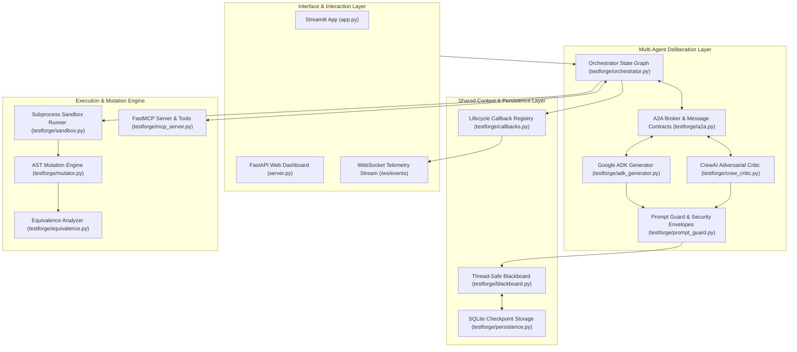

# TestForge — System Architecture & Multi-Agent Design

**Course:** CSE3101 - Agentic AI  
**Document ID:** TF-ARCH-EVAL-001  
**Date:** October 30, 2026  
**Status:** Evaluation Baseline  

---

## 1. High-Level Architecture Overview

TestForge is structured into four decoupled layers:
1. **Presentation & Interface Layer:** Streamlit GUI (`app.py`), FastAPI REST / WebSocket Server (`server.py`), and real-time dashboard (`/`).
2. **Multi-Agent Orchestration & Deliberation Layer:** Orchestrator state graph (`testforge/orchestrator.py`), Google ADK Generator (`testforge/adk_generator.py`), CrewAI Critic (`testforge/crew_critic.py`), and A2A Message Broker (`testforge/a2a.py`).
3. **Shared Context & Persistence Layer:** Thread-safe Blackboard partition system (`testforge/blackboard.py`) backed by SQLite checkpoint storage (`testforge/persistence.py`).
4. **Execution & Evaluation Layer:** Subprocess Sandbox runner (`testforge/sandbox.py`), AST Mutator (`testforge/mutator.py`), Equivalence Analyzer (`testforge/equivalence.py`), and FastMCP Tool Server (`testforge/mcp_server.py`).

---

## 2. Architectural Diagram

---

## 3. Detailed Component Architecture

### 3.1 Multi-Agent Reflection Loop
The core hardening workflow follows an iterative reflection loop:
1. **Target Ingestion:** `TargetManagerAgent` ingests Python source code and computes SHA-256 hash. Code is tagged `is_untrusted: True` and stored in Blackboard `TargetSpace`.
2. **Initial Test Synthesis:** `GoogleADKTestGenerator` or `TestGeneratorAgent` synthesizes baseline Pytest test cases. System instructions enforce strict passivity over untrusted code.
3. **Pass@1 Baseline Check:** `SubprocessSandbox` validates candidate tests against the unmutated target code. If tests fail, the orchestrator triggers an automatic self-repair reflection.
4. **AST Mutation Generation:** `ASTMutator` visits the AST and injects deterministic faults (comparison, arithmetic, conditional, return mutations).
5. **Parallel Mutation Execution:** `ParallelSandboxRunner` evaluates the candidate test suite concurrently across CPU cores against each mutant.
6. **Mutation Score Calculation:** `calculate_mutation_scores` tallies killed vs. surviving mutants, filtering static equivalents.
7. **Adversarial Critique & Reflection:** If surviving mutants remain, `CrewAICriticAgent` diagnoses the AST diffs, identifies untested boundary conditions, and generates a structured `CriticDirectivePayload`.
8. **Directive Sanitization:** `sanitize_critic_directive()` defuses any prompt-injection payloads in the critique before writing to `CriticSpace` or passing to the generator.
9. **Hardening Iteration:** The generator incorporates the critique to synthesize new assertions, repeating until the mutation score target (e.g. 85%) or iteration ceiling is met.

### 3.2 Blackboard Architecture (`testforge/blackboard.py`)
State is organized into 5 thread-safe Pydantic partitions:
- **`TargetSpace`**: Target module path, source code, functions, classes, `is_untrusted` flag, and injection findings.
- **`MutantSpace`**: Total mutants, surviving mutants, killed mutants, unified diffs.
- **`CriticSpace`**: Latest directive, reflection history, failure mechanisms, semantic guidance.
- **`SuiteSpace`**: Baseline, current, and hardened Pytest test suites.
- **`MetricsSpace`**: Mutation score, line coverage, duration, tokens, cost.

All partition updates are atomic, revision-tracked, and audited via `CallbackRegistry`.

### 3.3 Security & Boundary Layer
- **Network Security (`testforge/network_security.py`)**: Hostname whitelist, SSRF redirect validator (`SafeGitHubRedirectHandler`), credential stripper, bounded streaming reader.
- **Prompt Guard (`testforge/prompt_guard.py`)**: Delimiter wrapping (`<untrusted_content>`), AST comment/docstring defusing, defensive system instruction preambles, and tool call whitelisting.
- **Sandbox Security (`testforge/security.py`)**: AST pre-execution scanner forbidding `os.system`, `subprocess`, socket operations, and `os.environ` attribute access.

### 3.4 MCP & A2A Integration
- **Model Context Protocol (MCP)**: Exposes FastMCP tools for filesystem navigation and GitHub repository inspection, enforced by path boundaries and bounded download streaming.
- **Agent-to-Agent (A2A)**: Implements structured performatives (`REQUEST`, `INFORM`, `REFUSE`, `FAILURE`) with typed Pydantic payloads (`GeneratedTestPayload`, `CriticDirectivePayload`), eliminating unstructured string parsing between agents.

