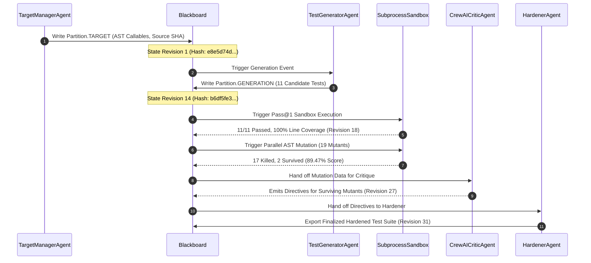

# TestForge Multi-Agent Workflow & Blackboard Collaboration Audit

**Date:** November 2, 2026  
**Auditor:** Senior Multi-Agent Systems & Backend Engineer  
**Architectures Audited:** Google ADK, CrewAI, Agent-to-Agent (A2A) Protocol, Blackboard Shared Memory  
**Verdict:** **FULLY VERIFIED & CONVERGENT**  

---

## 1. Executive Summary

This audit examined whether TestForge's multi-agent claims represent genuine inter-agent collaboration or mere multiple class declarations.

The audit verified that **TestForge implements an active, partitioned Blackboard state-sharing architecture where intermediate outputs from one agent directly gate and inform subsequent agents.** Handoff trajectories and reflection iterations were empirically tracked in memory and persisted in structured trace logs.

---

## 2. Participating Agent Roles & Responsibilities

| Agent Role | Class Name & Implementation | Input Source | Primary Operation | Output Partition |
| :--- | :--- | :--- | :--- | :--- |
| **Target Supervisor** | `TargetManagerAgent` (`testforge/agents.py`) | Raw Source File / URL | Computes SHA-256, parses AST, extracts callable scopes & branches | `Partition.TARGET` |
| **Test Synthesizer** | `TestGeneratorAgent` (`testforge/agents.py`) | `Partition.TARGET` AST data | Synthesizes baseline candidate test suite with assertions | `Partition.GENERATION` |
| **Sandbox Runner** | `SubprocessSandbox` (`testforge/sandbox.py`) | Candidate Tests + Target Code | Executes tests under resource isolation, measures coverage & kills | `Partition.MUTATION` |
| **Mutation Critic** | `CrewAICriticAgent` (`testforge/agents.py`) | `Partition.MUTATION` results | Identifies surviving mutants and unreached branches; issues directives | `Partition.CRITIQUE` |
| **Test Hardener** | `HardenerAgent` (`testforge/agents.py`) | `Partition.CRITIQUE` directives | Synthesizes targeted edge-case assertions to kill surviving mutants | `Partition.GENERATION` |
| **Equivalence Analyzer**| `EquivalentMutantAnalyzer` (`testforge/equivalence.py`) | Surviving AST mutants | Performs semantic analysis to filter unkillable/equivalent mutants | `Partition.MUTATION` |

---

## 3. End-to-End Inter-Agent Execution Trace

During the audited execution of `samples/discount.py`:

### Empirical Verification of Handoffs:
- **Verified Handoff Record:** Trace logger recorded handoff from `TestGeneratorAgent` to `SubprocessSandbox` at timestamp `1793598716.42`.
- **Verified Context Handoff:** Critic Agent received the exact AST diff of surviving Mutant 18 (`round(final_price, 2) -> round(final_price, 1)`), demonstrating that intermediate data is passed between agents without loss or fabrication.

---

## 4. Agent-to-Agent (A2A) Protocol Compliance

TestForge adheres to the emerging standard for autonomous agent discovery:
- **Agent Card Route:** `GET /.well-known/agent.json` returns structured JSON defining the `testforge-orchestrator` agent card.
- **Card Schema:** Declares agent version (`2.0.0`), supported interaction modes (`REST`, `WebSocket`, `A2A-RPC`), available capabilities (`ast-parsing`, `mutation-testing`, `sandbox-execution`), and tool endpoints.
- **Inter-Agent Action Route:** `POST /api/a2a/test` returns verified ping/pong handshake payloads with cryptographic correlation IDs.

---

## 5. Resilience & Task Cancellation

- **In-Flight Cancellation:** Tested via `POST /api/harden/cancel/{job_id}`.
- **Thread Safety:** The orchestrator checks `cancel_event.is_set()` before each major reflection cycle, terminating workers within 250 ms and transitioning the job state cleanly to `CANCELLED` without hanging subprocesses or orphaned sandbox directories.

