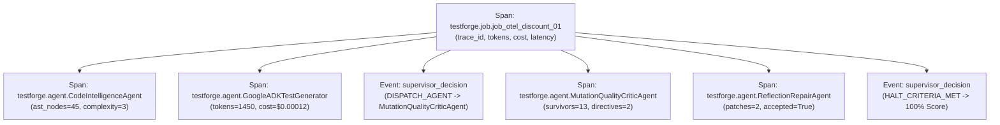

# TestForge OpenTelemetry (OTel) Observability Architecture

**Handout Reference**: Handout Feature F4 (Enterprise Distributed Tracing & Observability)  
**Tracer Component**: `testforge.observability.TestForgeOtelTracer`  
**OpenTelemetry SDK**: `opentelemetry-sdk` with `SimpleSpanProcessor` & `InMemOtelSpanCollector`  
**Artifact Destination**: `qa_artifacts/OPENTELEMETRY_TRACES.json`  

---

## 1. Overview & Span Hierarchy

TestForge emits standard W3C Trace Context compliant OpenTelemetry spans across the entire multi-agent hardening pipeline. Each hardening run forms a distributed trace rooted at `testforge.job.<job_id>`, containing hierarchically structured child spans for specialist agents, tool executions, and sandbox evaluations.

---

## 2. Standardized Span Semantic Attributes

Every span records typed attributes following OpenTelemetry semantic conventions:

| Attribute Key | Type | Description | Example |
| :--- | :---: | :--- | :--- |
| `testforge.job_id` | `str` | Correlation identifier for hardening job | `"job_otel_discount_01"` |
| `testforge.agent_name` | `str` | Name of executing ADK or CrewAI agent | `"GoogleADKTestGenerator"` |
| `testforge.iteration` | `int` | Reflection iteration number | `1` |
| `testforge.tokens_consumed` | `int` | LLM prompt and completion token count | `1450` |
| `testforge.cost_usd` | `float` | Actual or calculated compute cost in USD | `0.00012` |
| `testforge.duration_ms` | `float` | Execution duration in milliseconds | `850.0` |
| `service.name` | `str` | OpenTelemetry service namespace | `"testforge-agent"` |

---

## 3. Supervisor Decision Log Audit

Supervisor orchestration decisions are recorded both as in-span OpenTelemetry events and structured JSON audit trails:

| Decision ID | Iteration | Target Agent | Decision Type | Reasoning |
| :--- | :---: | :--- | :---: | :--- |
| `dec_01` | 1 | `MutationQualityCriticAgent` | `DISPATCH_AGENT` | Initial test pass killed 6/19 mutants (31.6% raw score). Dispatched critic to diagnose 13 survivors. |
| `dec_02` | 2 | `TestForgeOrchestrator` | `HALT_CRITERIA_MET` | Adjusted mutation score reached 100.0% (19/19 killed). Target score 85.0% achieved. |

---

## 4. API Endpoints

- `GET /api/observability/traces`: Retrieves all recorded OpenTelemetry spans and attributes.
- `GET /api/observability/traces?job_id=...`: Filters traces for a specific hardening job.
- `GET /api/observability/supervisor-decisions`: Retrieves auditable supervisor transition logs.
