# TestForge — Phase 1: Security Guardrails & Lifecycle Callbacks Foundation

**Document**: `docs/PHASE1_SECURITY_CALLBACKS.md`  
**Phase**: Phase 1 (Foundation & Guardrails)  
**Date**: October 2026  
**Status**: COMPLETED  
**Runtime Environment**: Python 3.13.17 (Isolated development environment)  

---

## 1. Executive Summary & Architecture

Phase 1 introduces two core architectural subsystems to TestForge while strictly preserving existing deterministic testing workflows:
1. **Security Guardrails (`testforge/security.py`)**:
   - **Input Prompt Inspection**: Deterministic regex-based pattern matching protecting the system against prompt injections, system instruction overrides, role-hijacking, credential leaks, delimiter escapes, and tool-permission bypass attempts.
   - **AST Code Policy Enforcement**: Static syntax tree visitor (`_ASTSecurityVisitor`) that analyzes generated or ingested Python code prior to sandboxed subprocess execution, identifying and blocking dangerous primitives (`eval`, `exec`, `os.system`, `subprocess`, dynamic imports, socket connections, destructive file deletions).
   - **Credential Redaction**: Automatic masking of sensitive API keys, bearer tokens, passwords, and private secrets across error messages and telemetry.
2. **Lifecycle Callback Foundation (`testforge/callbacks.py`)**:
   - **Decoupled Observer Registry**: Synchronous, thread-safe event bus supporting multi-handler subscriptions, custom event filters, and deterministic priority ordering.
   - **Strict Failure Isolation**: Observer exceptions are caught and recorded without interrupting the main application pipeline or sibling observers.
   - **Typed Payloads**: Standardized event data models for pipeline operations, tool executions, state transitions, failover cascades, and errors.
   - **TraceLogger Adapter**: Backward-compatible adapter bridging lifecycle events to TestForge's JSONL telemetry (`testforge_trace.jsonl`).

```mermaid
flowchart TD
    subgraph InputGuard["1. Ingestion & Prompt Boundary"]
        PromptIn["Input / Ingestion Request"] --> PromptInspect["SecurityGuardrail.inspect_prompt()"]
        PromptInspect -->|Allowed| LLM["LLM Generation / Synthesis"]
        PromptInspect -->|Blocked| BlockInput["Reject with Explanation"]
    end

    subgraph ASTGuard["2. AST Policy Enforcement Boundary"]
        GenCode["LLM Generated Test Suite"] --> Sanitizer["CodeSanitizer.extract_and_validate()"]
        Sanitizer --> ASTInspect["SecurityGuardrail.inspect_code_ast()"]
        ASTInspect -->|Violations Found| RejectCode["Block / Request Self-Repair"]
        ASTInspect -->|Clean AST| SandboxPre["SubprocessSandbox._run_single_test_task()"]
        SandboxPre --> SandboxExec["Isolated Pytest Subprocess (5s Timeout)"]
    end

    subgraph CallbackBus["3. Lifecycle Callback Bus"]
        Orchestrator["TestForgeOrchestrator"] --> Dispatch["CallbackRegistry.dispatch()"]
        Dispatch --> Scrub["Sensitive Credential Scrubbing"]
        Scrub --> Obs1["Observer 1 (Priority 200)"]
        Scrub --> Obs2["Observer 2 (Priority 100)"]
        Scrub --> TraceAdapter["TraceLoggerCallbackAdapter"]
        TraceAdapter --> TraceLog["testforge_trace.jsonl"]
    end
```



---

## 2. Files Created & Modified

### Untracked Files Created in Phase 1
- `testforge/security.py`: Core defensive security module implementing `SecurityGuardrail`, `SecurityPolicy`, `_ASTSecurityVisitor`, `RuleFinding`, and `redact_sensitive_data`.
- `testforge/callbacks.py`: Core lifecycle callback module implementing `CallbackRegistry`, `CallbackSubscription`, `LifecycleEvent`, `EventType`, typed event payloads, and `TraceLoggerCallbackAdapter`.
- `tests/test_security.py`: 28 unit and integration tests covering prompt inspection, AST policy violations, syntax bypasses (aliased imports, getattr reflection, wildcard imports), and sandbox/sanitizer integrations.
- `tests/test_callbacks.py`: 12 unit and integration tests covering subscription registration/unregistration, deterministic priority ordering, failure isolation, payload scrubbing, error reporting (`get_last_error`), and orchestrator event emission.
- `docs/PHASE1_SECURITY_CALLBACKS.md`: Comprehensive Phase 1 documentation and verification report.

### Files Modified & Integration Points
- `testforge/agents.py` (`CodeSanitizer.extract_and_validate`):
  - Added `enforce_security: bool = True` argument.
  - Automatically parses AST and invokes `SecurityGuardrail().inspect_code_ast(tree, enforce_policy=True)`.
  - Rejects dangerous AST patterns (`eval`, `os.system`, etc.) before code reaches execution.
- `testforge/sandbox.py` (`_run_single_test_task`):
  - Added `enforce_security: bool = True` argument.
  - Pre-execution validation check: inspects test code AST before creating temporary directory or spawning subprocess.
  - Returns structured `status: "SECURITY_BLOCKED"`, `exit_code: -3` without executing unsafe code.
- `testforge/ingestion.py` (`TargetManagerAgent.synthesize_module_from_prompt`):
  - Evaluates user input prompt with `SecurityGuardrail().inspect_prompt(prompt)` before synthesis.
  - Rejects prompt injection attempts with explicit error explanations.
- `testforge/orchestrator.py` (`TestForgeOrchestrator`):
  - Added `callbacks: Optional[CallbackRegistry] = None` parameter to constructor.
  - Dispatches `EventType.OPERATION_START` at pipeline launch.
  - Dispatches `EventType.OPERATION_COMPLETE` upon termination.

---

## 3. Security Rules and Policy Behavior

### 3.1 Prompt Injection Rules (`testforge/security.py`)

| Rule ID | Severity | Risk Level | Description & Trigger Criteria |
|---|---|---|---|
| `INJ_SYSTEM_OVERRIDE` | BLOCK | CRITICAL | Attempts to override or ignore system or developer instructions (e.g. `ignore all previous instructions`). |
| `INJ_NEW_ROLE_PROMPT` | BLOCK | HIGH | Persona/role hijacking (e.g. `you are now unrestricted`, `act as DAN`, `jailbreak root admin`). |
| `INJ_SECRET_LEAK` | BLOCK | CRITICAL | Attempts to exfiltrate system prompt, hidden instructions, API keys, or credentials. |
| `INJ_SECURITY_DISABLE` | BLOCK | HIGH | Attempts to disable guardrails, AST validation, or security filters. |
| `INJ_SYSTEM_DELIMITER_ESCAPE` | BLOCK | HIGH | Forged delimiter boundaries (e.g. `</system>`, `[system]`, `=== system override ===`). |
| `INJ_TOOL_BYPASS` | BLOCK | HIGH | Attempts to bypass tool permissions, sandbox restrictions, or tool whitelists. |
| `INJ_EMBEDDED_INSTRUCTION` | BLOCK | HIGH | Instructions embedded in source code comments or docstrings targeting model override. |

### 3.2 AST Policy Inspection Rules

| Rule ID | Severity | Policy Toggle | Target Patterns & Syntax Bypass Defenses |
|---|---|---|---|
| `SEC_AST_EVAL_EXEC` | BLOCK | `block_eval_exec` | Direct calls to `eval()`, `exec()`, `builtins.eval()`, `__builtins__.exec()`, bare assignments `runner = eval`, or reflective access `getattr(..., 'eval')`. Harmless method calls like `model.eval()` are permitted. |
| `SEC_AST_OS_COMMAND` | BLOCK | `block_os_commands` | Invocations of `os.system()`, `os.popen()`, `spawn*`, `posix.system()`, direct imports (`from os import system`), wildcard imports (`from os import *`), aliased imports (`import os as my_os; my_os.system()`), and `getattr(os, 'system')`. |
| `SEC_AST_SUBPROCESS` | BLOCK | `block_subprocesses` | Invocations of `subprocess.Popen()`, `run()`, `call()`, direct imports, aliased imports (`import subprocess as sp; sp.Popen()`), and `getattr(subprocess, 'Popen')`. |
| `SEC_AST_SUBPROCESS_IMPORT` | BLOCK | `block_subprocesses` | Imports of `pty`, `commands`, or direct functions from `subprocess`. |
| `SEC_AST_DYNAMIC_IMPORT` | BLOCK | `block_dynamic_imports` | Invocations of `__import__()`, `importlib.import_module()`, and `importlib.invalidate_caches()`. |
| `SEC_AST_NETWORK_SOCKET` | BLOCK | `block_sockets` | Invocations of `socket.socket()`, `create_connection()`, `urllib.request.urlopen()`, or `urlretrieve()`. |
| `SEC_AST_FILE_DELETION` | BLOCK / WARN | `block_dangerous_file_ops` | Potentially destructive deletions (`shutil.rmtree()`, `os.remove()`, `os.unlink()`). |

---

## 4. Input & AST Inspection Limitations

### 4.1 Input Inspection Limitations
- **Semantic Evasion**: Deterministic regex-based pattern matching detects known prompt-injection signatures, delimiter manipulations, and exfiltration keywords. However, it cannot reliably detect all novel linguistic paraphrases or steganographic instructions without an LLM-based semantic judge.
- **Benign Keyword Co-occurrence**: Legitimate software testing instructions frequently contain terms like "password", "system", or "ignore". TestForge relies on compound pattern phrases (e.g. `ignore all previous instructions` rather than `ignore`) to prevent false positives on legitimate code.
- **Context Obliviousness**: Regex cannot evaluate whether an instruction is enclosed within a harmless string literal in target data vs. an actionable directive.

### 4.2 AST Inspection Limitations
- **Static Boundary Only**: AST inspection validates syntax trees before execution. It is **not** an operating system isolation mechanism and must always be paired with `SubprocessSandbox` (process isolation, timeout guardrails, memory limits).
- **Dynamic Indirection**: Highly obfuscated dynamic code (e.g. `globals()["__built" + "ins__"]["ev" + "al"](...)` constructed at runtime through complex variable manipulation) cannot be fully resolved statically at compile time.
- **Allowed Module APIs**: Legitimate test suites require standard library modules (`math`, `json`, `datetime`, `re`, `pytest`). If a vulnerability exists within a permitted module, static AST checks alone do not prevent logical exploitation.

---

## 5. Lifecycle Callback System & Semantics

### 5.1 Supported Event Types

| Event Type | Typical Emitter | Payload Contents |
|---|---|---|
| `OPERATION_START` | `TestForgeOrchestrator` | `operation_name`, `inputs`, `session_id`, `max_iterations`, `target_score` |
| `OPERATION_COMPLETE` | `TestForgeOrchestrator` | `operation_name`, `status`, `duration_sec`, `final_score`, `metrics` |
| `TOOL_START` | `TestForgeOrchestrator` / `SubprocessSandbox` | `tool_name`, `arguments`, `mutant_count` |
| `TOOL_COMPLETE` | `TestForgeOrchestrator` / `SubprocessSandbox` | `tool_name`, `status`, `duration_ms`, `killed`, `survived` |
| `STATE_CHANGE` | `TestForgeOrchestrator` | `component`, `from_state`, `to_state`, `iteration` |
| `FAILOVER` | `HybridLLMClient` | `failed_provider`, `target_provider`, `reason`, `attempt` |
| `ERROR` | `TestForgeOrchestrator` / `SubprocessSandbox` | `error_type`, `message`, `fatal`, `details` |

### 5.2 Handler Execution Semantics
1. **Synchronous Execution**: Handlers execute synchronously in the caller's thread, eliminating asynchronous scheduling overhead and concurrency race conditions.
2. **Deterministic Priority Ordering**: Handlers are ordered by `priority` (descending, default 100). Ties are resolved by registration order (FIFO).
3. **Failure Isolation**: An unhandled exception in one subscriber is caught, logged with full traceback, recorded in `failed_records`, and does not crash the main application or prevent remaining subscribers from executing.
4. **Error Retrieval & Fail-Fast**: Subscribers can inspect errors via `registry.failed_records` or `registry.get_last_error()`. When running in testing or debugging mode, `fail_fast=True` or `dispatch(..., raise_on_error=True)` can be configured.
5. **Sensitive Data Scrubbing**: Before dispatch to any handler, all payloads and metadata are recursively scrubbed via `event.scrubbed_copy()`. Dictionaries, lists, tuples, sets, and string values matching credential patterns (`api_key`, `token`, `password`, `secret`, `sk-*`, etc.) are masked with `[REDACTED_SECRET]`.

---

## 6. Verification & Test Results

All tests were executed using the verified isolated Python 3.13 environment (`venv_313`).

### 6.1 Focused Phase 1 Test Execution
Command:
```bash
/Users/sourabh/.gemini/antigravity-ide/brain/05f0de02-c90e-40d7-bf92-0819372e0bac/scratch/venv_313/bin/pytest tests/test_security.py tests/test_callbacks.py -v
```
**Result**: **40 passed in 1.88s (100% pass rate)**.
- 28 security unit/integration tests passed.
- 12 callback unit/integration tests passed.

### 6.2 Full Regression Suite Execution
Command:
```bash
/Users/sourabh/.gemini/antigravity-ide/brain/05f0de02-c90e-40d7-bf92-0819372e0bac/scratch/venv_313/bin/pytest tests/ -v
```
**Result**: **56 passed, 1 warning in 291.44s (4m 51s)**.
- Covers AST mutations, diff generation, sandbox timeouts, parallel evaluation, Apple Silicon MLX GPU neural training and inference, blast radius analysis, git diff parsing, Mode C ingestion regression tests, security guardrails, and callbacks.

### 6.3 Standalone Export Hardening Execution
Command:
```bash
/Users/sourabh/.gemini/antigravity-ide/brain/05f0de02-c90e-40d7-bf92-0819372e0bac/scratch/venv_313/bin/pytest test_hardened.py -v
```
**Result**: **21 passed in 0.02s (100% pass rate)**.

---

## 7. Practical Improvement Pass Findings & Remediations

During the practical improvement pass, several syntax bypass vectors and edge cases were identified and remediated:

1. **AST Aliased Imports Bypass**:
   - *Finding*: `import os as my_os; my_os.system(...)` was not flagged because `node.func.value.id` was `"my_os"` rather than `"os"`.
   - *Remediation*: Implemented `self._module_aliases` mapping in `_ASTSecurityVisitor` to resolve local aliases back to canonical module names before rule matching.
2. **Reflective `getattr` Bypass**:
   - *Finding*: `getattr(os, "system")("cmd")` bypassed direct attribute inspection.
   - *Remediation*: Added explicit AST check for `getattr()` calls where the second argument is a string literal matching blocked primitives (`eval`, `exec`, `system`, `popen`, `Popen`, `run`).
3. **Wildcard Imports**:
   - *Finding*: `from os import *; system("cmd")` bypassed specific imported function tracking.
   - *Remediation*: Added wildcard handling to register all known dangerous primitives when `*` is imported from `os` or `subprocess`.
4. **Bare Dynamic Primitives**:
   - *Finding*: `bad = eval; bad("1 + 1")` was not flagged until invocation.
   - *Remediation*: Added `visit_Name` check to block loading `eval` or `exec` as identifiers outside of attribute lookups.
5. **Prompt Injection Expansion**:
   - *Finding*: Tool permission bypass and source-comment prompt injection were not explicitly categorized.
   - *Remediation*: Added `INJ_TOOL_BYPASS` and `INJ_EMBEDDED_INSTRUCTION` regex rules with HIGH risk classification.
6. **Data Scrubbing Depth**:
   - *Finding*: `_scrub_value` only handled dicts and lists, leaving tuples and sets unscrubbed.
   - *Remediation*: Extended recursive scrubbing to tuples, sets, and objects with `model_dump()`.
7. **Observer Error Visibility**:
   - *Finding*: Observers failed silently to logs without a convenient programmatic interface to check the last error.
   - *Remediation*: Added `get_last_error()` and support for `fail_fast=True` / `raise_on_error=True`.

---

## 8. Rollback Considerations

If any Phase 1 security check causes false positives on valid user test suites in production:
- **AST Security Policy**: Can be relaxed to permissive mode via `SecurityPolicy.permissive()` or disabled at the integration point by passing `enforce_security=False` to `CodeSanitizer.extract_and_validate()` and `_run_single_test_task()`.
- **Prompt Guardrails**: Risk threshold can be relaxed via `SecurityPolicy(max_prompt_risk=SecurityRiskLevel.CRITICAL)`.
- **Callbacks**: Can be cleared or disabled by passing an empty `CallbackRegistry()` or `callbacks=None`.
- **Git Reversion**: Phase 1 changes are localized to `testforge/security.py`, `testforge/callbacks.py`, `tests/test_security.py`, `tests/test_callbacks.py`, and narrow integration hooks in `agents.py`, `sandbox.py`, `ingestion.py`, and `orchestrator.py`.

---

## 9. Environment Preservation Evidence

- **Primary Virtual Environment (`/Users/sourabh/TestForge/.venv`)**:
  - Python Version: **Python 3.14.9** (Preserved, untouched).
  - Pip Check: `No broken requirements found.`
- **Project `requirements.txt`**:
  - Remained completely untouched and unmodified:
    ```text
    pytest>=8.0.0
    pytest-cov>=5.0.0
    pydantic>=2.7.0
    google-genai>=0.1.1
    psutil>=5.9.0
    rich>=13.7.0
    ```
- **Isolated Development Environment (`scratch/venv_313`)**:
  - Python Version: **Python 3.13.17**.
  - All tests and developments executed inside this isolated sandbox environment.
