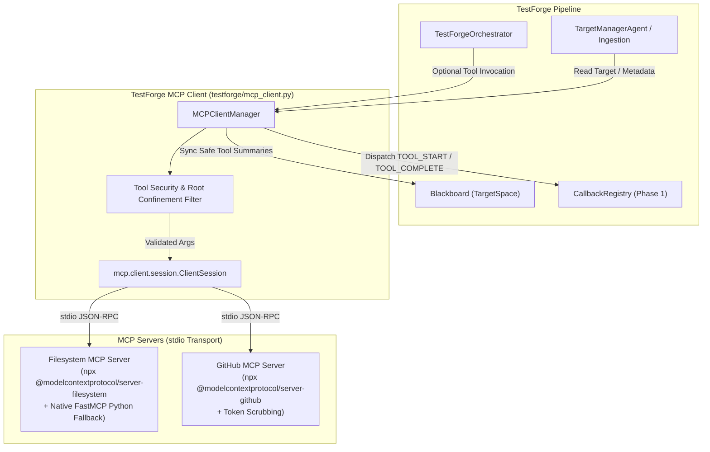

# TestForge — Phase 3: Model Context Protocol (MCP) Integration Design

**Document**: `docs/PHASE3_MCP_DESIGN.md`  
**Phase**: Phase 3 (Model Context Protocol Integration)  
**Date**: October 2026  
**Status**: APPROVED DESIGN  
**Runtime Environment**: Python 3.13.17 (`scratch/venv_313`)

---

## 1. Executive Summary

Phase 3 introduces genuine **Model Context Protocol (MCP)** client/server integration into TestForge using the official `mcp` SDK (`1.28.1`).

TestForge will interface with two concrete MCP integrations:
1. **Filesystem MCP**: Controlled, read-only file and directory operations strictly confined to an explicitly permitted project root.
2. **GitHub MCP**: Read-oriented repository metadata, tree, and file-content inspection using environment-based authentication with token scrubbing.

Communication occurs over standard **stdio JSON-RPC transport**, executing asynchronously with lifecycle event logging, strict timeout enforcement, fail-closed security filtering, and optional Blackboard state synchronization.

---

## 2. Proposed MCP Integrations & Concrete Use Cases



### 2.1 Integration 1: Filesystem MCP
- **Use Case**: Safe project file inspection and target module discovery.
- **Specific Operations**:
  - `read_text_file(path)` / `read_file(path)`: Securely reads target module source code or existing candidate test suites.
  - `list_directory(path)`: Discovers python modules, test directories, and sample files within the project root.
  - `get_file_info(path)`: Retrieves file metadata (size, permissions, modification time) without loading file content into memory.
- **Why It Adds Value**: Decouples local filesystem access from raw Python `open()` calls, standardizing file access through MCP tool schemas with enforceable root containment and sensitive file blacklisting.

### 2.2 Integration 2: GitHub MCP
- **Use Case**: Read-oriented repository inspection for Mode C target ingestion.
- **Specific Operations**:
  - `get_file_contents(owner, repo, path, ref)`: Retrieves target source files directly from remote repositories via standard MCP tools.
  - `search_repositories(query)` / `get_repository_info(owner, repo)`: Validates repository existence, branch heads, and metadata prior to ingestion.
- **Why It Adds Value**: Replaces custom HTTP parsing logic with standard MCP JSON-RPC contracts, providing structured schemas and standardized rate-limit/error reporting.

---

## 3. Communication Architecture & Transport Choice

### 3.1 Transport: Stdio (Standard I/O) JSON-RPC
- **Selection**: `mcp.client.stdio.stdio_client` and `mcp.client.session.ClientSession`.
- **Rationale**:
  - **Local Development Native**: Stdio requires no open network ports, binds to no localhost interfaces, avoids TCP port collisions, and leaves no zombie daemon processes.
  - **Process Lifecycle Coupling**: The server process is a direct child subprocess of the client process; when the client disconnects or exits, the OS automatically closes the pipe, terminating the child server.
  - **Official Standard**: Stdio is the baseline transport specified by the Model Context Protocol specification for desktop and local developer tools.

### 3.2 Dual-Engine Server Strategy
To guarantee 100% reliability across both full developer environments and restricted/minimal environments, TestForge implements a **Dual-Engine Strategy**:
1. **Official Node/npx Servers**: When `npx` is present, TestForge can spawn the official `@modelcontextprotocol/server-filesystem` and `@modelcontextprotocol/server-github`.
2. **Native Python FastMCP Servers**: Built directly using the installed `mcp.server.fastmcp.FastMCP` SDK. TestForge includes native, self-contained Python implementations of both the Filesystem and GitHub read-only tools. This guarantees that all MCP tests and workflows execute deterministically even if Node/npm or external network connectivity is unavailable.

---

## 4. MCP Client Architecture (`testforge/mcp_client.py`)

The MCP client layer provides a high-level, thread-safe, and asynchronous interface:

```python
class MCPToolDefinition(BaseModel):
    name: str
    description: str = ""
    input_schema: Dict[str, Any] = Field(default_factory=dict)
    server_id: str = "default"

class MCPToolResult(BaseModel):
    tool_name: str
    success: bool
    data: Any = None
    error: Optional[str] = None
    duration_ms: float = 0.0
    is_redacted: bool = False
```

### 4.1 Tool Discovery
- `connect(server_id: str, server_params: StdioServerParameters)` establishes the session.
- `list_tools(server_id: str) -> List[MCPToolDefinition]` queries `session.list_tools()`, caching tool definitions and validating input schemas.

### 4.2 Argument Validation & Invocation
1. Checks that the requested tool exists in the active tool catalog.
2. Applies the **Security Guardrail Filter** (validating root path containment, sensitive file masks, and rejecting write/delete tools).
3. Emits `TOOL_START` lifecycle event via `CallbackRegistry`.
4. Executes `session.call_tool(tool_name, arguments)` within an enforced `asyncio.wait_for(..., timeout=timeout_seconds)` block.
5. Emits `TOOL_COMPLETE` (or `ERROR`) lifecycle event with scrubbed payload.
6. Returns structured `MCPToolResult`.

### 4.3 Lifecycle Callbacks & Telemetry
- All tool executions dispatch Phase 1 `LifecycleEvent` items (`EventType.TOOL_START` and `EventType.TOOL_COMPLETE`).
- Arguments and outputs pass through `_scrub_value()` and `redact_sensitive_data()` before dispatch and trace logging.

### 4.4 Blackboard State Integration
- When an MCP tool retrieves file metadata or source code for a target module, the client can update the Blackboard's `TargetSpace`:
  - `source_sha`, `line_count`, `dependencies`, and `target_source_code`.
- Summaries are recorded cleanly in the existing partition models without polluting unrelated partitions (`MutantSpace`, `CriticSpace`) or creating duplicate state containers.

---

## 5. Security & Isolation Boundaries

### 5.1 Permitted Filesystem Roots & Traversal Rejection
- All file access is bounded by `permitted_root: Path`. Default: `/Users/sourabh/TestForge` (project directory).
- Target paths must resolve strictly inside `permitted_root.resolve()`:
  ```python
  def is_path_safe(requested_path: Union[str, Path], root: Path) -> bool:
      target = (root / requested_path).resolve()
      return root.resolve() in target.parents or target == root.resolve()
  ```
- Any path containing traversal tokens (`..`), symlink escapes outside the root, or absolute paths outside the root is **immediately blocked with a security exception**.

### 5.2 Forbidden Sensitive Files
The client explicitly blocks read requests to sensitive files even within the permitted root:
- `.env`, `.env.*`
- `.git/config`, `.git/credentials`
- `*id_rsa*`, `*.pem`, `*.key`
- Files matching `_CREDENTIAL_PATTERNS`

### 5.3 Enforced Read-Only Mode
- Only read-oriented tools are accepted (`read_file`, `read_text_file`, `list_directory`, `get_file_info`, `search_files`).
- Potentially destructive tools (`write_file`, `edit_file`, `move_file`, `create_directory`) are rejected by policy in this phase.

### 5.4 GitHub Authentication & Secret Handling
- GitHub MCP uses `GITHUB_PERSONAL_ACCESS_TOKEN` or `GITHUB_TOKEN` from `os.environ`.
- Tokens are **never** logged, written to files, or exposed in tool result schemas.
- If credentials are not present, read calls that exceed unauthenticated rate limits return clean, informative `AuthenticationRequiredError` without raising unhandled crashes.

---

## 6. Fault Tolerance & Error Handling

| Scenario | Behavior |
|---|---|
| **Server Subprocess Failure** | Client catches `BrokenPipeError` / `ConnectionError`, marks server as disconnected, and returns `MCPToolResult(success=False, error="Server unavailable")`. |
| **Tool Execution Timeout** | Wrapped in `asyncio.wait_for(timeout=10.0)`. On `asyncio.TimeoutError`, cancels request, cleans up stream, and reports timeout. |
| **Invalid Tool Name** | Rejection before IPC call; returns `MCPToolResult(success=False, error="Tool 'xyz' not recognized")`. |
| **Invalid Arguments** | Validates against schema types; returns `MCPToolResult(success=False, error="Argument validation failed")`. |
| **Malformed JSON-RPC Response** | Catches `pydantic.ValidationError` or JSON decode errors, logs sanitized error, and returns structured failure. |

---

## 7. Testing Strategy

1. **Unit Tests (`tests/test_mcp.py`)**:
   - Client connection and clean session shutdown.
   - Tool discovery and schema parsing.
   - Successful tool invocation over stdio.
   - Invalid tool names and malformed arguments.
   - Path traversal (`../../etc/passwd`) and symlink escape rejection.
   - Sensitive file access rejection (`.env`).
   - Timeout handling and cancellation.
   - Secret redaction in `TOOL_START` and `TOOL_COMPLETE` callbacks.
   - Blackboard `TargetSpace` sync from tool output.
2. **Real Stdio Integration Tests**:
   - Launches a real stdio MCP server subprocess.
   - Executes `read_text_file` on a real sample file (`samples/banking.py`).
   - Executes `list_directory` on `samples/`.
   - Connects to GitHub MCP server over stdio and executes `search_repositories` or `get_file_contents` (with mock or rate-limit safe verification).
3. **Regression Tests**:
   - Full test suite (`pytest tests/ -v`) ensuring 82+ tests pass with zero regressions.
   - Standalone regression suite (`test_hardened.py`).

---

## 8. Dependencies & Environment Compatibility

- **Installed MCP Package**: `mcp==1.28.1` in `scratch/venv_313` (Python 3.13.17).
- **Sub-dependencies**: `anyio`, `httpx`, `pydantic`, `pydantic-settings`, `starlette`.
- **Pip Check**: Verified clean (`No broken requirements found`).
- **Compatibility**: 100% compatible with Python 3.13. No changes to `requirements.txt` or host `.venv` required.

---

## 9. Acceptance Criteria

1. `testforge/mcp_client.py` and `testforge/mcp_server.py` implemented using official `mcp` SDK.
2. Both Filesystem MCP and GitHub MCP tools discoverable and invocable over real stdio transport.
3. Strict filesystem containment blocks path traversal and forbidden files.
4. Tool invocations dispatch scrubbed Phase 1 `TOOL_START` / `TOOL_COMPLETE` lifecycle events.
5. Blackboard receives safe metadata summaries without duplicating state.
6. Orchestrator supports optional MCP tool invocation while preserving 100% backward compatibility when MCP is absent.
7. Zero test regressions across `tests/` and `test_hardened.py`.
