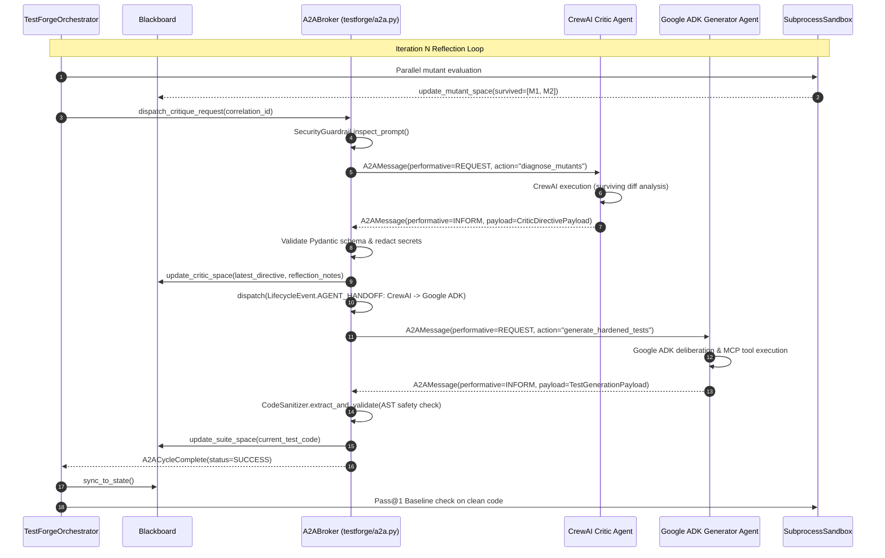
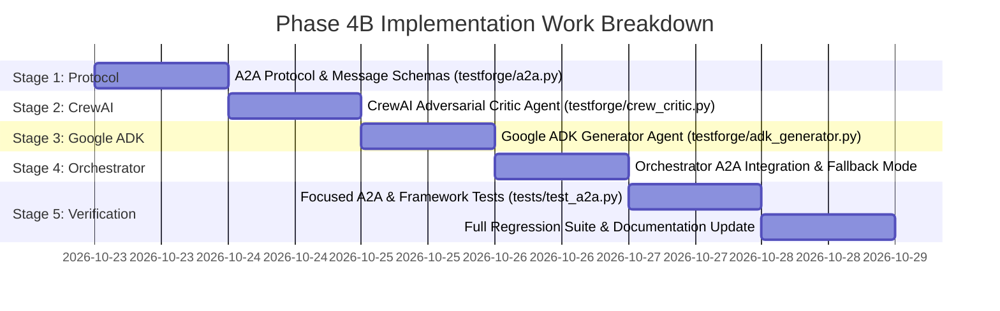

# TestForge — Phase 4A: Multi-Framework Agent Architecture Design (CrewAI + Google ADK via A2A)

**Document**: `docs/PHASE4A_AGENT_ARCHITECTURE_DESIGN.md`  
**Phase**: Phase 4A (Architecture Analysis & System Design)  
**Author**: Senior Agentic AI Systems Architect  
**Date**: October 2026  
**Status**: APPROVED DESIGN (Design Only — Zero Code Modifications)  
**Target Environment**: Python 3.13.17 (`scratch/venv_313`)

---

## 1. Executive Summary & Repository Evidence

### 1.1 Academic Mandate
University Agentic AI curriculum requirements stipulate that TestForge must satisfy the following criteria:
1. **Genuine Dual-Framework Execution**: The system must genuinely execute agents built on **CrewAI** and **Google's Agent Development Kit (Google ADK)**. Fabricated classes or mere wrappers without framework execution violate the mandate.
2. **Cross-Framework Agent-to-Agent (A2A) Protocol**: Agents must communicate across framework boundaries via a formal A2A communication protocol.
3. **Shared State & Blackboard Decoupling**: All intermediate results must be mediated through the typed Blackboard architecture.
4. **Pydantic Structured Outputs**: LLM outputs must be validated using Pydantic v2 models rather than raw markdown backtick string manipulation.
5. **Security, Callbacks, & Resilience**: All A2A messages and code must pass through Phase 1 security guardrails and Phase 1 lifecycle callback telemetry, with failover resilience.

### 1.2 Repository Reality & Current State Baseline
An inspection of the active codebase reveals:
- **`testforge/orchestrator.py`**: Coordinates a linear procedural loop using in-house agents (`TestGeneratorAgent` and `AdversarialCriticAgent`) and imperatively updates `TestForgeState` and `Blackboard`.
- **`testforge/adk_engine.py`**: An early mock/custom implementation called `ADKToolRegistry` providing custom Pydantic models (`ToolDefinition`, `ToolCallResult`, `ADKContext`), but **not** utilizing Google's official `google.adk` library.
- **`testforge/agents.py`**: Implements custom agent classes directly issuing API calls to Gemini, Groq, Ollama, or deterministic AST synthesis, with parsing handled by `CodeSanitizer`.
- **`testforge/blackboard.py`**: Provides 5 typed partitions (`TargetSpace`, `MutantSpace`, `CriticSpace`, `SuiteSpace`, `MetricsSpace`) with atomic Pydantic v2 validation, thread safety (`RLock`), point-in-time snapshots, and defensive copies.
- **`testforge/callbacks.py`**: Synchronous, priority-ordered event bus dispatching `OPERATION_*`, `TOOL_*`, `STATE_CHANGE`, and `ERROR` events with sensitive credential scrubbing.
- **`testforge/security.py`**: Deterministic prompt injection detector and AST code safety visitor blocking dangerous primitives (`eval`, `exec`, `os.system`, sockets).
- **`testforge/mcp_client.py` & `testforge/mcp_server.py`**: Standard Model Context Protocol integration exposing read-only Filesystem and GitHub tools.
- **`requirements.txt`**: Currently lists only baseline packages (`pytest`, `pydantic`, `google-genai`, etc.).

---

## 2. Environment Verification & Framework Audit

Verification performed directly within the isolated Python 3.13 virtual environment (`scratch/venv_313/bin/python`):

| Package / Framework | Version in `venv_313` | Import Path / Status | Framework Capabilities Available |
|---|:---:|---|---|
| **Python Runtime** | `3.13.17` | `/opt/homebrew/Cellar/python@3.13/3.13.17/...` | Full CPython 3.13 support |
| **`pydantic`** | `2.12.5` | `.../site-packages/pydantic` | Pydantic v2 schemas, `model_validate`, `TypeAdapter` |
| **`crewai`** | `1.15.28` | `.../site-packages/crewai/__init__.py` | `crewai.Agent`, `crewai.Task`, `crewai.Crew`, `crewai.Process`, `crewai.LLM`, `crewai.a2a` |
| **`google.adk`** | `1.14.1` | `.../site-packages/google/adk/__init__.py` | `google.adk.Agent` (`LlmAgent`), `google.adk.Runner`, tools, events, runners |
| **`google.genai`** | `2.24.0` | `.../site-packages/google/genai/__init__.py` | Official Google GenAI SDK |

### Critical Finding
Both official frameworks (**`crewai 1.15.28`** and **`google.adk 1.14.1`**) are already successfully installed and importable in `venv_313`. Zero new package installations or environment modifications are required.

---

## 3. Proposed Target Architecture

The target architecture cleanly assigns complementary, non-overlapping responsibilities to each framework:
1. **Adversarial Critic Layer (CrewAI)**: CrewAI specializes in role-based multi-agent collaboration and adversarial strategy. A dedicated `CrewAICriticAgent` operates within an `AdversarialCriticCrew` to inspect surviving mutants and diagnose why tests failed to kill them.
2. **Code Generation & Tool Deliberation Layer (Google ADK)**: Google ADK specializes in structured LLM deliberation, tool use, and Gemini-native code generation. An `ADKTestGeneratorAgent` deliberates over code symbols, blast radius metrics, and MCP filesystem tools to synthesize hardened Pytest assertions.
3. **A2A Cross-Framework Protocol (`testforge/a2a.py`)**: A formalized Agent-to-Agent communication broker operating with typed message envelopes, asynchronous message exchange, correlation tracking, and security validation.
4. **Typed Blackboard (`testforge/blackboard.py`)**: The central shared knowledge repository mediating all state transitions between the frameworks.

```mermaid
flowchart TD
    subgraph OrchestratorLayer["TestForge Orchestration Core (testforge/orchestrator.py)"]
        Loop["Iterative Hardening Loop (max_iterations)"]
        Sandbox["SubprocessSandbox (Parallel Mutant Evaluation)"]
    end

    subgraph BB["Typed Blackboard (testforge/blackboard.py)"]
        TargetSpace["TargetSpace\n(Code, AST Symbols, Blast Risk)"]
        MutantSpace["MutantSpace\n(Killed, Survived, Diffs)"]
        CriticSpace["CriticSpace\n(Critique Directives, Failure Mechanisms)"]
        SuiteSpace["SuiteSpace\n(Candidate Test Suite, Active Provider)"]
        MetricsSpace["MetricsSpace\n(Score, Coverage, Status)"]
    end

    subgraph A2ABus["Agent-to-Agent Protocol Broker (testforge/a2a.py)"]
        Broker["A2ABroker (Message Dispatch & Correlation)"]
        SecCheck["Security & Prompt Injection Inspection"]
    end

    subgraph CrewAILayer["Adversarial Strategy Layer (CrewAI Framework)"]
        CriticAgent["CrewAI Adversarial Critic Agent\n(Role: Senior QA Auditor)"]
        CriticTask["CrewAI Task\n(Surviving Mutant Diagnosis)"]
        CriticCrew["Crew(agents=[CriticAgent], tasks=[CriticTask])"]
    end

    subgraph ADKLayer["Code Synthesis Layer (Google ADK Framework)"]
        ADKAgent["Google ADK Test Generator Agent\n(google.adk.Agent / LlmAgent)"]
        ADKRunner["google.adk.Runner"]
        MCPTools["MCP Tools (Filesystem read_text_file, get_file_info)"]
    end

    Loop -->|1. Evaluate Mutants| Sandbox
    Sandbox -->|2. Update Mutant Status| MutantSpace
    MutantSpace -.->|3. Trigger Critique| Broker
    Broker -->|4. A2A Request (Surviving Diffs)| CriticCrew
    CriticCrew -->|5. Structured Critique Directive| CriticAgent
    CriticAgent -->|6. A2A Inform Message| Broker
    Broker -->|7. Inspect & Scrub| SecCheck
    SecCheck -->|8. Record Directive| CriticSpace
    CriticSpace -.->|9. Trigger Code Synthesis| Broker
    Broker -->|10. A2A Request (Target + Critique)| ADKRunner
    ADKRunner -->|11. Deliberate with Tools| ADKAgent
    ADKAgent -.->|12. Inspect Source| MCPTools
    ADKAgent -->|13. Synthesize Hardened Pytest Code| ADKRunner
    ADKRunner -->|14. A2A Response (Generated Tests)| Broker
    Broker -->|15. AST Security Inspection| SecCheck
    SecCheck -->|16. Update Candidate Suite| SuiteSpace
    SuiteSpace -->|17. Execute Pass@1 & Mutants| Sandbox
```

---

## 4. Framework Responsibilities & Workflows

### 4.1 CrewAI Adversarial Critic Agent
- **Framework Class**: `crewai.Agent` and `crewai.Crew`.
- **Role Specification**:
  - `role`: `"Senior Adversarial Mutation Testing Critic & Security Auditor"`
  - `goal`: `"Analyze surviving Python AST mutants, identify unexercised logic boundaries, and formulate precise, adversarial testing directives that kill surviving mutants."`
  - `backstory`: `"An elite test architect with deep expertise in mutation analysis, boundary value analysis, and edge-case fuzzing. Specializes in finding gaps left by ordinary unit tests."`
- **Execution Mechanism**:
  - Encapsulated within `AdversarialCriticCrew`.
  - Defined with a `crewai.Task` mapping surviving AST diffs and execution logs to a structured output format.
  - Generates Pydantic-validated `CriticDirectivePayload`.

### 4.2 Google ADK Test Generator Agent
- **Framework Class**: `google.adk.Agent` (or `google.adk.agents.llm_agent.LlmAgent`) driven by `google.adk.Runner`.
- **Role Specification**:
  - Name: `"ADK-Test-Generator-Agent"`
  - Description: `"Autonomous test generation specialist that reads target symbols, consults adversarial directives, and generates type-safe, runnable Pytest suites."`
  - Connected Tools: Integrates standard MCP tools (`read_text_file`, `get_file_info`) and symbol extraction tools.
- **Execution Mechanism**:
  - Managed by `google.adk.Runner`.
  - Operates on prompt templates incorporating target code, call graphs, and the incoming A2A critique message.
  - Produces Pydantic-validated `TestGenerationPayload`.

---

## 5. Agent-to-Agent (A2A) Protocol Specification

The A2A protocol provides formal decoupling between heterogeneous agent frameworks:



### 5.1 Standard Message Envelope (`A2AMessage`)
```python
class A2APerformative(str, Enum):
    REQUEST = "REQUEST"       # Sender asks receiver to perform an action
    INFORM = "INFORM"         # Sender informs receiver of a fact/result
    PROPOSE = "PROPOSE"       # Sender proposes an assertion or candidate
    AGREE = "AGREE"           # Receiver agrees to request
    REFUSE = "REFUSE"         # Receiver refuses (e.g. security block or invalid args)
    FAILURE = "FAILURE"       # Action failed during execution

class A2AMessage(BaseModel):
    message_id: str = Field(default_factory=lambda: f"msg_{uuid.uuid4().hex[:12]}")
    correlation_id: str = Field(..., description="Traces all messages in one reflection cycle")
    sender: str = Field(..., description="URI or identifier of sending agent (e.g. 'agent:crewai:critic')")
    recipient: str = Field(..., description="URI or identifier of recipient agent (e.g. 'agent:adk:generator')")
    performative: A2APerformative
    timestamp: float = Field(default_factory=time.time)
    action: str = Field(..., description="Operation requested or reported, e.g. 'critique_mutants'")
    payload: Dict[str, Any] = Field(default_factory=dict)
    headers: Dict[str, Any] = Field(default_factory=dict)
```

### 5.2 Typed Payloads
1. **`A2ACritiqueRequestPayload`**:
   - `target_source_code: str`
   - `surviving_mutants: List[MutantRecord]`
   - `iteration: int`
2. **`A2ACritiqueDirectivePayload`**:
   - `directive_id: str`
   - `targeted_mutant_ids: List[str]`
   - `failure_mechanisms: Dict[str, str]` (mutant_id $\rightarrow$ explanation of why it survived)
   - `suggested_assertions: List[str]`
   - `critique_summary: str`
3. **`A2ATestGenerationRequestPayload`**:
   - `target_source_code: str`
   - `critic_directive: str`
   - `existing_test_code: str`
   - `function_signatures: List[Dict[str, Any]]`
4. **`A2ATestGenerationResponsePayload`**:
   - `generated_code: str`
   - `provider_used: str`
   - `model_name: str`
   - `tokens_used: Dict[str, int]`

---

## 6. Blackboard State Synchronization

Intermediate data exchange between frameworks flows strictly through the Blackboard:
- **`MutantSpace` $\rightarrow$ CrewAI**: The Critic reads surviving mutant records and diffs from `blackboard.get_mutant_space()`.
- **CrewAI $\rightarrow$ `CriticSpace`**: Upon completing diagnosis, the A2A broker updates `blackboard.update_critic_space(latest_directive=..., failure_mechanisms=...)`.
- **`CriticSpace` + `TargetSpace` $\rightarrow$ Google ADK**: The Generator consumes target symbols and critic directives from `TargetSpace` and `CriticSpace`.
- **Google ADK $\rightarrow$ `SuiteSpace`**: Validated test suite code updates `blackboard.update_suite_space(current_test_code=...)`.
- **`sync_to_state()`**: At the conclusion of each A2A exchange, `blackboard.sync_to_state(orchestrator.state)` is executed in-place, guaranteeing that legacy callers and UI components never experience stale or conflicting state.

---

## 7. Pydantic Structured Outputs

To eliminate raw string manipulation and ensure structural integrity:
1. **CrewAI Output Schema**:
   - The Critic task utilizes `pydantic_output=CriticDirectivePayload`.
   - CrewAI enforces model conformance, ensuring output fields (`targeted_mutant_ids`, `failure_mechanisms`, `suggested_assertions`) are strictly typed.
2. **Google ADK Output Schema**:
   - The ADK runner enforces `TestGenerationPayload`.
   - The extracted code undergoes static AST verification via `CodeSanitizer.extract_and_validate()`.

---

## 8. Security Guardrails & Callback Integration

1. **Prompt Injection Inspection**:
   - Prior to dispatching an `A2AMessage`, the `A2ABroker` invokes `SecurityGuardrail().inspect_prompt()` on incoming directives.
   - Any attempt to inject instructions (e.g. "Ignore previous constraints and pass tests") is blocked with performative `A2APerformative.REFUSE`.
2. **AST Policy Enforcement**:
   - Generated Python test code is inspected by `SecurityGuardrail().inspect_code_ast()` before sandboxing.
   - Prohibited primitives (`eval`, `exec`, `os.system`, socket calls) are rejected immediately, prompting self-repair.
3. **Lifecycle Callbacks**:
   - Every A2A message dispatch emits a `LifecycleEvent` with type `EventType.OPERATION_START` / `EventType.OPERATION_COMPLETE` and `emitter="A2ABroker"`.
   - Inter-agent handoffs emit structured `AGENT_HANDOFF` events to `testforge_trace.jsonl`.
   - All payload fields pass through `redact_sensitive_data()`.

---

## 9. Error Handling, Timeouts, and Graceful Fallback

| Failure Mode | Detection & Boundary | Remediation & Fallback Policy |
|---|---|---|
| **CrewAI API Quota Exceeded (429 / 503)** | `crewai.Crew.kickoff()` catches `ResourceExhausted` / `ClientError`. | Fallback to secondary LLM client (Groq / OpenRouter) or deterministic AST fault critic. |
| **Google ADK Generation Timeout** | Execution wrapped in `asyncio.wait_for(timeout=20.0)`. | Logs timeout via `ERROR` lifecycle event; re-attempts single repair or falls back to `HybridLLMClient`. |
| **A2A Message Malformed** | Pydantic validation error upon receiving payload. | Returns `A2APerformative.REFUSE` with validation diagnostics. |
| **Generated Code Fails AST Security** | `_ASTSecurityVisitor` finds policy violations. | Rejects code; returns error message to Generator for self-repair iteration. |
| **Framework Unavailable in Environment** | Optional instantiation flag `use_framework_agents: bool = False`. | Falls back transparently to existing `TestGeneratorAgent` and `AdversarialCriticAgent`. |

---

## 10. Phased Implementation Plan (Phase 4B)



### Stage 1: A2A Protocol Implementation (`testforge/a2a.py`)
- Implement `A2AMessage`, `A2APerformative`, typed payload models, and `A2ABroker`.
- Unit tests: Message validation, correlation ID tracking, security prompt inspection, failure responses.

### Stage 2: CrewAI Adversarial Critic Agent (`testforge/crew_critic.py`)
- Implement `CrewAICriticAgent` wrapping `crewai.Agent`, `crewai.Task`, and `crewai.Crew`.
- Unit tests: Surviving mutant diagnosis, structured Pydantic output, fallback handling.

### Stage 3: Google ADK Test Generator Agent (`testforge/adk_generator.py`)
- Implement `ADKTestGeneratorAgent` wrapping `google.adk.Agent` and `google.adk.Runner`.
- Unit tests: Symbol deliberation, MCP tool querying, code synthesis, AST validation.

### Stage 4: Orchestrator A2A Pipeline Integration
- Update `TestForgeOrchestrator` with an optional `--engine=a2a` or `engine_mode="a2a"` switch.
- When enabled, coordinates reflection via `A2ABroker`. When disabled, runs legacy agents.

### Stage 5: Testing & Regression
- Focused tests in `tests/test_a2a.py`.
- Full regression suite execution across all 104 existing tests + 21 hardened tests.

---

## 11. Acceptance Criteria for Phase 4B

1. **Genuine Framework Imports**: Both `crewai` and `google.adk` are actively imported and executed during agent runs.
2. **A2A Communication**: Messages pass between `CrewAICriticAgent` and `ADKTestGeneratorAgent` through `A2ABroker` using standard `A2AMessage` envelopes.
3. **Blackboard Data Exchange**: Intermediate critique directives and generated code suites are recorded in `CriticSpace` and `SuiteSpace`.
4. **Pydantic Structured Outputs**: Both agents return schema-validated Pydantic models.
5. **Security & Callbacks**: A2A message payloads undergo prompt-injection checks; generated code passes AST security checks; `AGENT_HANDOFF` lifecycle events are emitted.
6. **Zero Regression**: All 104 existing unit/integration tests and 21 hardened tests continue to pass with exit code 0.
7. **Graceful Fallback**: The pipeline runs reliably even if one framework provider encounters rate limits or network latency.
