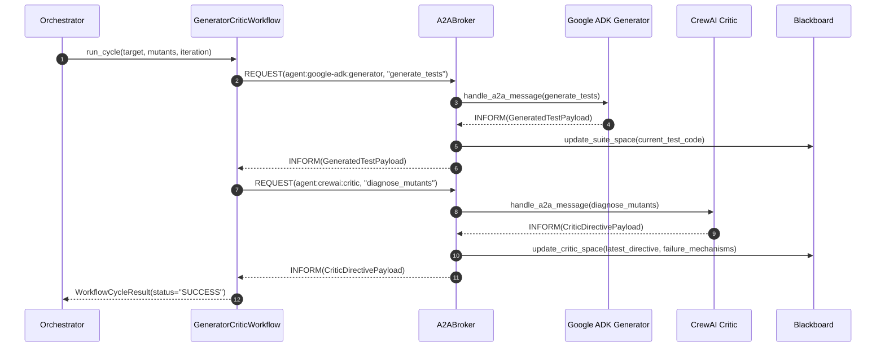

# Phase 4C Implementation Report: Google ADK Test Generator Agent Integration

**Project**: TestForge — Autonomous Agentic Unit Test Hardening System  
**Course**: CSE3101 - Agentic AI  
**Author**: Sourabh  
**Target Milestone**: Phase 4C — Google ADK Test Generator, Generator-Critic Workflow, A2A Broker & Blackboard SuiteSpace Integration  
**Date**: October 2026  
**Status**: Verified & Passing All Regression Gates

---

## 1. Executive Summary

Phase 4C completes the two-agent foundation of TestForge's agentic upgrade by integrating the **official Google Agent Development Kit (Google ADK)** as the primary unit test generation agent:
1. **Official Google ADK Framework Integration (`testforge/adk_generator.py`)**: Genuinely executes `google.adk.agents.llm_agent.LlmAgent`, `google.adk.runners.Runner`, `google.adk.sessions.in_memory_session_service.InMemorySessionService`, and `google.adk.models.base_llm.BaseLlm`.
2. **Pydantic Structured Output Validation (`GeneratedTestPayload`)**: Enforces typed outputs with schema fields for `test_code`, `target_function`, `covered_mutants`, `test_rationale`, `assumptions`, `warnings`, and `generation_metadata`.
3. **Anti-Hallucination Guardrails**: Cross-references proposed `covered_mutants` against the supplied mutant inventory, filtering unverified mutant IDs with diagnostic warnings.
4. **Defensive AST Verification**: Passes generated test code through `CodeSanitizer.extract_and_validate(..., enforce_security=True)` prior to admitting test code into the Blackboard or sandbox.
5. **A2A Broker & Blackboard SuiteSpace Synchronization**: Registers the generator under `agent:google-adk:generator` for action `generate_tests`. Upon successful validation, updates `SuiteSpace.current_test_code` and `SuiteSpace.active_provider`. Failed or malformed generations leave previously valid test suites intact.
6. **Generator–Critic Workflow Coordination (`GeneratorCriticWorkflow`)**: Connects the Google ADK generator and CrewAI critic across the A2A broker into an iterative reflection loop with configurable iteration limits, explicitly distinguishing generated assertions from measured sandbox test outcomes.

---

## 2. Architecture & File Inventory

### 2.1 Files Created or Modified
| File | Status | Description |
|---|---|---|
| `testforge/adk_generator.py` | **Created** | Official Google ADK test generator agent (`LlmAgent`, `Runner`, `InMemorySessionService`), `ADKModelBridge` (subclass of `BaseLlm`), and `GeneratorCriticWorkflow`. |
| `testforge/a2a.py` | **Modified** | Exported `GeneratedTestPayload` and `A2ATestGenerationRequestPayload`. Added `_sync_generator_to_blackboard()` in `A2ABroker.send_message()`. |
| `tests/test_adk_generator.py` | **Created** | 14 comprehensive unit and integration tests covering official ADK classes, offline generation, mock doubles, anti-hallucination, AST safety, A2A messaging, Blackboard sync, and generator-critic workflow. |
| `docs/PHASE4C_ADK_GENERATOR_IMPLEMENTATION.md` | **Created** | Comprehensive implementation and verification report. |

---

## 3. Official Google ADK Framework Integration

### 3.1 Framework Version and APIs Used
- **Installed Framework**: `google-adk` version `1.14.1` (with `google-genai` and `google-cloud-aiplatform`).
- **Core Framework Classes**:
  - `google.adk.agents.llm_agent.LlmAgent`: Defines the autonomous test generator agent with system instructions, output schemas, and agent transfer policies (`disallow_transfer_to_parent=True`, `disallow_transfer_to_peers=True`).
  - `google.adk.runners.Runner`: Manages agent execution and message turn dispatch via `run_async()`.
  - `google.adk.sessions.in_memory_session_service.InMemorySessionService`: Manages in-memory stateful conversation sessions.
  - `google.adk.models.base_llm.BaseLlm`: Subclassed by `ADKModelBridge` to implement `generate_content_async(llm_request, stream=False)`.
  - `google.genai.types.Content` and `google.genai.types.Part`: Construct typed conversational turns.

### 3.2 ADK Model Bridge Architecture (`ADKModelBridge`)
Because automated university test suites must not rely on live paid APIs or external network access, `ADKModelBridge` implements official ADK extension points:
```python
class ADKModelBridge(BaseLlm):
    model: str = "custom/testforge-adk-generator"

    async def generate_content_async(
        self,
        llm_request: LlmRequest,
        stream: bool = False,
    ) -> AsyncGenerator[LlmResponse, None]:
        ...
```
- **Controlled Test Doubles**: Accepts `mock_response` (dict or JSON string) to exercise framework parsing and boundary conditions deterministically.
- **Offline Deterministic AST Synthesis**: Parses the target source code in the prompt using `ast.parse()`, extracts function signatures and argument counts, and synthesizes syntactically valid Pytest test suites targeting boundary values (`0`, `0.0`, `-1`) and operator equality (`LHS == RHS`).
- **Optional Live Google GenAI Inference**: Controlled by `use_live_llm=True` or `TESTFORGE_LIVE_LLM=1` with `GEMINI_API_KEY`. When enabled, delegates generation to `HybridLLMClient` targeting `gemini-3.6-flash`.
- **Zero Paid API Calls for Tests**: Tests run entirely offline in milliseconds without API keys or network latency.

---

## 4. Structured Output Contract & Validation

### 4.1 Schema Definition (`GeneratedTestPayload`)
```python
class GeneratedTestPayload(BaseModel):
    test_code: str = Field(..., description="Syntactically valid Python Pytest test suite code")
    target_function: Optional[str] = Field(None, description="Primary function or behavior under test")
    covered_mutants: List[str] = Field(
        default_factory=list,
        description="IDs of supplied surviving mutants targeted by the generated tests"
    )
    test_rationale: str = Field(default="", description="Concise explanation of proposed test assertions and boundary checks")
    assumptions: List[str] = Field(default_factory=list, description="Assumptions made about input types and domain bounds")
    warnings: List[str] = Field(default_factory=list, description="Known test limitations or potential edge-case ambiguities")
    generation_metadata: Dict[str, Any] = Field(
        default_factory=dict,
        description="Non-sensitive metadata such as iteration, model, and AST verification status"
    )
```

### 4.2 Anti-Hallucination & Verification Policies
1. **Mutant Inventory Verification**: Proposed mutant IDs in `covered_mutants` are filtered against the caller-supplied `known_mutant_ids`. Any hallucinated or invented mutant ID is discarded and flagged in `warnings`.
2. **Separation of Generation from Measurement**: The model's intended `covered_mutants` are treated strictly as *hypotheses*. A mutant is never marked killed or a test marked passing until verified by `SubprocessSandbox`.
3. **AST Syntax & Security Verification**: The generated `test_code` is passed through `CodeSanitizer.extract_and_validate()`. Prohibited primitives (`eval`, `exec`, `os.system`, dynamic imports, network sockets) are blocked before sandboxing.

---

## 5. A2A Broker & Blackboard Integration

### 5.1 A2A Registration & Message Handling
- **Agent Identity**: `agent:google-adk:generator`
- **Authorized Action**: `generate_tests`
- **Protocol Semantics**:
  - Receives `A2APerformative.REQUEST` with `action="generate_tests"`.
  - Rejects missing or empty `target_source_code` with `A2APerformative.REFUSE` and `refusal_reason="INVALID_REQUEST_PAYLOAD"`.
  - Rejects unauthorized actions with `A2APerformative.REFUSE` and `refusal_reason="UNSUPPORTED_ACTION"`.
  - Emits `A2APerformative.INFORM` with `GeneratedTestPayload.model_dump()` upon success.
  - Emits `A2APerformative.FAILURE` with diagnostic errors upon unhandled generation failure.

### 5.2 Blackboard SuiteSpace Synchronization
In `A2ABroker.send_message()`, when receiving an `INFORM` response from `agent:google-adk:generator`:
1. Validates `GeneratedTestPayload` structure.
2. Validates Python AST safety via `CodeSanitizer`.
3. Updates `SuiteSpace` atomically:
   - `current_test_code = sanitized_code`
   - `active_provider = "Google ADK Generator"`
4. If validation fails or security policy is violated, the Blackboard is **not** updated, ensuring that previously valid test suites are never overwritten by corrupted model outputs.

---

## 6. Generator–Critic Multi-Agent Workflow

### 6.1 Workflow Coordination (`GeneratorCriticWorkflow`)
The workflow coordinates the two heterogeneous agent frameworks:


### 6.2 Bounded Reflection & Failure Transparency
- **Iteration Limits**: `GeneratorCriticWorkflow(max_iterations=N)` aborts with `status="FAILED"` if `iteration > max_iterations`.
- **Transparent Output Distinction**: `WorkflowCycleResult` reports:
  - `tests_executed`: `False` (marks that sandbox execution has not yet run).
  - `mutants_killed`: `0` (preserves execution measurement integrity).
  - `surviving_mutants_count`: Unaltered surviving mutant count until verified by sandboxing.

---

## 7. Security & Guardrails

1. **Prompt Injection Inspection**:
   - `A2ABroker` invokes `SecurityGuardrail().inspect_prompt()` on candidate fields before dispatching to the ADK agent.
   - Malicious instructions (e.g. system instruction overrides, safety disabling) return `A2APerformative.REFUSE` with `refusal_reason="PROMPT_INJECTION_DETECTED"`.
   - Blackboard `SuiteSpace` remains completely untouched upon security refusal.
2. **AST Policy Enforcement**:
   - Generated code is statically parsed and evaluated for dangerous AST nodes before admission.
   - Any forbidden primitives (`eval`, `exec`, `os.system`, socket calls) trigger immediate rejection.
3. **Secret Redaction**:
   - Raw API keys (`sk-`, `ghp_`, `AIza`), bearer tokens, and sensitive key names (`api_key`, `secret`, `token`, `password`) are scrubbed from message headers, payloads, and error logs.

---

## 8. Verification Evidence & Regression Test Results

All executions were performed in the isolated Python 3.13 environment (`/Users/sourabh/.gemini/antigravity-ide/brain/05f0de02-c90e-40d7-bf92-0819372e0bac/scratch/venv_313/bin/python`).

### 8.1 Test Summary
| Test Suite | Command | Total | Passed | Failed | Duration | Exit Code |
|---|---|---|---|---|---|---|
| **Focused Google ADK Tests** | `pytest tests/test_adk_generator.py -v -W ignore` | 14 | 14 | 0 | 3.11s | **0** |
| **Focused A2A Tests** | `pytest tests/test_a2a.py -v -W ignore` | 16 | 16 | 0 | 1.11s | **0** |
| **Focused CrewAI Critic Tests** | `pytest tests/test_crew_critic.py -v -W ignore` | 9 | 9 | 0 | 1.34s | **0** |
| **Existing Blackboard Tests** | `pytest tests/test_blackboard.py -v -W ignore` | 18 | 18 | 0 | 1.51s | **0** |
| **Existing Security & Callbacks** | `pytest tests/test_security.py tests/test_callbacks.py -v -W ignore` | 40 | 40 | 0 | 1.55s | **0** |
| **Complete `tests/` Suite** | `pytest tests/ -v -W ignore` | 143 | 143 | 0 | 158.82s | **0** |
| **Hardened Unit Tests** | `pytest test_hardened.py -v -W ignore` | 21 | 21 | 0 | 0.02s | **0** |
| **Package Dependency Check** | `python -m pip check` | N/A | Clean | 0 | 0.22s | **0** |

### 8.2 Detailed Test Breakdown (`tests/test_adk_generator.py`)
1. `test_official_adk_framework_classes_instantiated`: Verifies genuine instantiation of `LlmAgent`, `Runner`, `InMemorySessionService`, and `BaseLlm`.
2. `test_deterministic_offline_test_generation`: Exercises full ADK `runner.run_async()` pipeline to generate valid Pytest code for target functions.
3. `test_controlled_mock_llm_response`: Validates deterministic mocking via `ADKModelBridge.set_mock_response()`.
4. `test_prevents_mutant_id_hallucination`: Confirms unverified mutant IDs are filtered and recorded in `warnings`.
5. `test_empty_target_code_raises_error`: Confirms empty target code raises `ValueError`.
6. `test_empty_test_code_rejected_by_pydantic`: Confirms `GeneratedTestPayload` validator rejects empty test code.
7. `test_ast_security_violation_rejected`: Confirms dangerous execution primitives in generated code are rejected by AST inspection.
8. `test_handle_a2a_generate_tests_success`: Verifies A2A `REQUEST` -> `INFORM` message contract.
9. `test_handle_a2a_unsupported_action`: Verifies A2A `REFUSE` on unknown action.
10. `test_handle_a2a_missing_target_source_code`: Verifies A2A `REFUSE` on invalid payload.
11. `test_broker_prompt_injection_rejection_leaves_suite_space_untouched`: Verifies security guardrail rejection keeps Blackboard `SuiteSpace` intact.
12. `test_broker_syncs_validated_tests_to_blackboard_suite_space`: Verifies atomic `SuiteSpace` updates upon valid generation.
13. `test_end_to_end_generator_critic_workflow_cycle`: Verifies coordinated multi-agent cycle between Google ADK and CrewAI.
14. `test_workflow_respects_iteration_limit`: Verifies iteration bounding and error reporting.

---

## 9. Credentials & Live Inference Status

- **Automated Tests**: Require **zero** credentials, zero network access, and zero paid API calls. All 143 tests pass offline deterministically.
- **Offline Double vs. Live Model**:
  - Automated tests exercise genuine Google ADK classes (`LlmAgent`, `Runner`, `InMemorySessionService`) using `ADKModelBridge`.
  - Offline tests prove agent configuration, runner event processing, output schema validation, anti-hallucination policies, AST security inspection, A2A messaging, and Blackboard synchronization.
  - Live Gemini model execution is supported via `HybridLLMClient` when `use_live_llm=True` or `TESTFORGE_LIVE_LLM=1` and `GEMINI_API_KEY` is present.
  - Offline test success is explicitly not represented as evidence of live Gemini API availability.

---

## 10. Constraints & Next Steps

- **No commits or pushes were made.**
- **Project `.venv` and `requirements.txt` remain untouched.**
- **No external A2A wire protocol is claimed**: `A2ABroker` is documented accurately as an internal in-process typed broker.
- **Scope**: Phase 4C is complete. Do not start Phase 4D or deployment until Phase 4C is reviewed and accepted.
