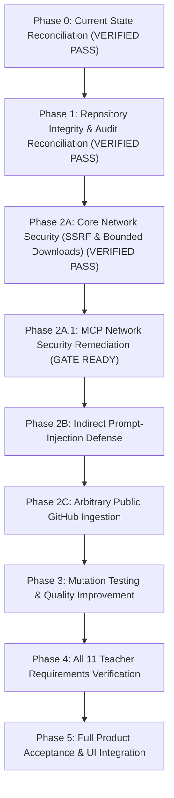

# TestForge — Project Development Roadmap & Phase Execution Plan

**Author:** TestForge Architecture & Release Management Team  
**Date:** 2026-10-30  
**Status:** ACTIVE MASTER ROADMAP  

---

## 1. Project Vision & Architecture

TestForge is an autonomous AI-powered Python code-hardening and automated test generation platform designed to ingest untrusted source code, analyze its AST structure, orchestrate multi-agent test creation (Generator, Adversarial, and Critic agents), execute generated test suites inside an isolated subprocess sandbox, and measure code resilience via AST mutation testing.

---

## 2. Phase-Based Execution Sequence

---

## 3. Detailed Phase Breakdown & Milestones

### Phase 0: Current State Reconciliation
- **Objective:** Establish authentic repository state, verify running background tasks, collect test execution logs, and inspect diffs.
- **Status:** **VERIFIED PASS**
- **Artifacts:** `PHASE_0_CURRENT_STATE_REPORT.md`, `docs/PHASE_MASTER_TRACKER.md`.

### Phase 1: Repository Integrity & Audit Reconciliation
- **Objective:** Establish baseline backups, verify cryptographic hash parity of uncommitted user work, and audit past test discrepancies.
- **Status:** **VERIFIED PASS**
- **Artifacts:** `qa_artifacts/security_remediation_phase1_20261030_091500/`, dual external backups (`backup_20261030_093200` and `backup_20261030_101600`).

### Phase 2A: Core Network Security
- **Objective:** Eliminate SSRF vectors, enforce GitHub hostname whitelisting, implement `SafeGitHubRedirectHandler` with cross-domain token stripping, and enforce bounded streaming (500 KB limit) with atomic disk persistence.
- **Status:** **VERIFIED PASS**
- **Artifacts:** `testforge/network_security.py`, `tests/test_network_security.py` (62 tests), `qa_artifacts/security_remediation_phase2a/`.

### Phase 2A.1: MCP Network Security Remediation
- **Objective:** Close security vulnerabilities in `testforge/mcp_server.py` by integrating `validate_url_hostname`, `build_safe_opener`, `SafeGitHubRedirectHandler`, and `bounded_read` into FastMCP tools.
- **Status:** **GATE READY (12/12 integration tests pass, 513/513 regression pass)**
- **Artifacts:** `testforge/mcp_server.py`, `tests/test_mcp_network_security.py`, `qa_artifacts/security_remediation_phase2a1/`.

### Phase 2B: Indirect Prompt-Injection Defense
- **Objective:** Guard LLM agent prompts against malicious ingested source code, comments, and docstrings.
- **Status:** **VERIFIED PASS (10/10 adversarial tests pass, 523/523 full regression pass)**
- **Artifacts:** `testforge/prompt_guard.py`, `tests/test_prompt_injection_defense.py`, `qa_artifacts/security_remediation_phase2b/`.
- **Core Requirements:**
  1. Treat all external source code as untrusted input data via `<untrusted_content>` envelopes.
  2. Implement strict system/user message delimitation (`DEFENSIVE_SYSTEM_PREAMBLE`) and data sanitization boundaries.
  3. Prevent docstrings/comments from instructing the LLM to skip tests, alter assertions, or bypass security rules.
  4. Build adversarial prompt-injection test suite (10 scenarios).
- **Evaluation Status:** Frozen baseline for Autonomous Agentic Systems Academic Project Evaluation.

### Phase 2C: Arbitrary Public GitHub Repository Ingestion
- **Objective:** End-to-end verification of ingesting arbitrary, previously unconfigured public repositories.
- **Status:** **NOT STARTED (Development Paused for Project Evaluation)**
- **Next Action:** Will resume ONLY after post-evaluation user authorization.
- **Core Requirements:**
  1. Full URL parsing, branch resolution, and commit SHA locking.
  2. Recursive tree traversal and Python file filtering.
  3. Byte-for-byte SHA-256 match between retrieved source and the sandbox execution payload.
  4. Provenance tracking from ingestion to test output.

### Phase 3: Mutation Testing & Quality Improvement
- **Objective:** Reconcile mutation scores and improve test generation kill rates without manipulating formulas.
- **Core Requirements:**
  1. Analyze surviving mutants across benchmark files (`discount.py`, `banking.py`, `inventory_pricing.py`, `state_machine.py`, `rate_limiter.py`).
  2. Honestly report equivalent vs. survived mutants.
  3. Improve test generator prompts and boundary fuzzing to target genuine 85% kill rates.

### Phase 4: All 11 Teacher Requirements Verification
- **Objective:** Independently verify and demonstrate all 11 mandatory academic requirements.
- **Core Requirements:**
  1. Blackboard shared context multi-agent writing and reading.
  2. Two genuine external MCP server integrations (distinguishing mock from live).
  3. Structured Pydantic outputs across all boundaries.
  4. Agentic design patterns (Generator, Critic, Evaluator).
  5. Callback-based monitoring and logging.
  6. A2A protocol and agent discovery.
  7. CrewAI and Google ADK integrations.
  8. Security guardrails across full workflow.
  9. Observability and provenance tracking.
  10. Multi-run benchmarking and ablation study.
  11. Cloud deployment readiness and local Docker validation.

### Phase 5: Full Product Acceptance (Backend + Frontend)
- **Objective:** Deliver a complete, user-facing product with verified interactive controls and academic demonstration scripts.
- **Core Requirements:**
  1. Full Streamlit UI inspection; bind every button and interactive widget to real backend operations.
  2. Automated browser interaction testing and screenshot capture.
  3. 10 reproducible demonstration scenarios for academic presentation.

---

## 4. Phase Transition Rules (The Acceptance Gate)

A phase shall transition to the next phase ONLY when:
1. All acceptance criteria for the current phase are verified.
2. Authentic test logs confirm zero failures and zero regressions.
3. Complete diff inspection confirms zero unintended file changes.
4. Working tree cryptographic parity is confirmed against backups.
5. The phase report is delivered and explicit user authorization is received.

