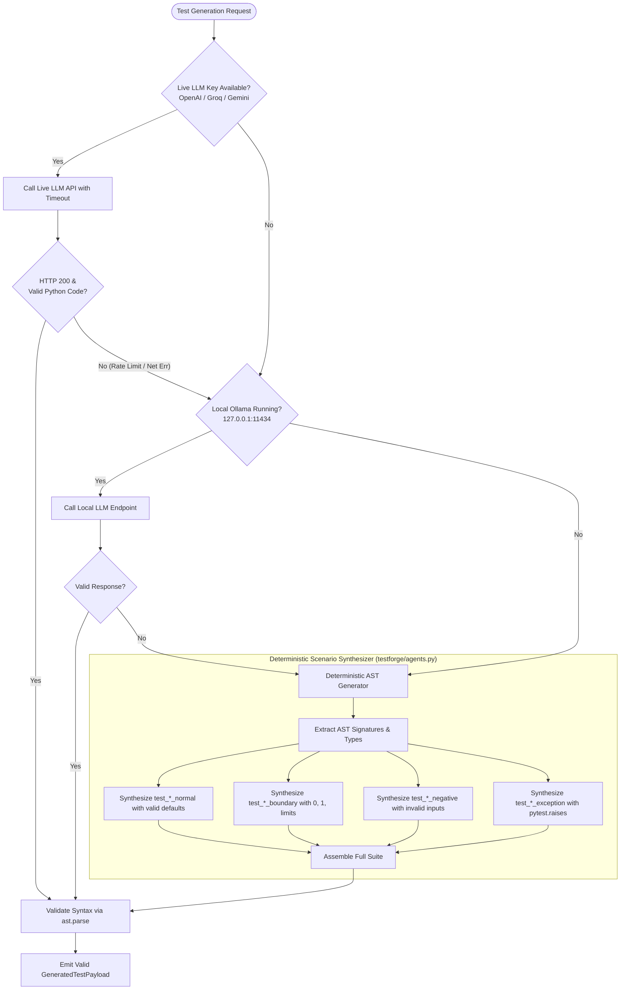

# TESTFORGE — AGENTIC SYSTEM DEEP DIVE
## Agent Profiles, Multi-Agent Collaboration Patterns, Execution Fallbacks & Real Pipeline Traces

**Document Version:** 2.0.0  
**Target Audience:** Multi-Agent Systems Researchers, AI Engineers, Evaluators  
**Authoritative Location:** `docs/PROJECT_KNOWLEDGE_BASE/AGENTIC_SYSTEM_DEEP_DIVE.md`

---

## 1. AGENT ROSTER & SPECIALIZATION PROFILES

TestForge coordinates five specialized agent roles to autonomously analyze, mutate, critique, synthesize, and evaluate Python test suites:

```
┌────────────────────────────────────────────────────────────────────────┐
│                        AGENT SPECIALIZATION ROSTER                     │
├─────────────────────┬──────────────────┬───────────────────────────────┤
│ Agent Name          │ Framework / Tech │ Core Responsibility           │
├─────────────────────┼──────────────────┼───────────────────────────────┤
│ TargetAnalyzerAgent │ Python AST       │ AST decomposition & signatures│
│ MutantGeneratorAgent│ Python AST       │ First-order mutant synthesis  │
│ CrewAICriticAgent   │ CrewAI           │ Mutant survival diagnosis     │
│ GoogleADKGenerator  │ Google ADK       │ Scenario test synthesis       │
│ EvaluatorAgent      │ Pytest / Sandbox │ Mutation score quantification │
└─────────────────────┴──────────────────┴───────────────────────────────┘
```

---

### Profile 1: TargetAnalyzerAgent
- **Implementation File:** [`testforge/agents.py`](file:///Users/sourabh/TestForge/testforge/agents.py) (Lines 47–98)
- **Role:** Codebase Inspector & Syntax Analyst
- **System Instruction:** Extract exact structural semantics of target Python modules without execution.
- **Main Methods:** `extract_function_signatures(code: str) -> List[Dict]`, `analyze_structure(tree: ast.AST)`
- **Inputs:** Raw Python source code string.
- **Outputs:** `TargetAnalysisPayload` (function signatures, argument types, defaults, docstrings, classes, class methods with `is_method` flags).
- **Blackboard Interaction:** Writes exclusively to `Blackboard.target_space`.
- **Upstream / Downstream:** Upstream = Ingestion Gateway; Downstream = MutantGeneratorAgent & TestGeneratorAgent.
- **Execution Mode:** 100% Real, Deterministic AST Analysis ($0.00 cost).
- **Error Handling:** If `ast.parse` fails, raises `SyntaxError` with line and column numbers, halting the pipeline gracefully before mutant generation.

---

### Profile 2: MutantGeneratorAgent
- **Implementation File:** [`testforge/agents.py`](file:///Users/sourabh/TestForge/testforge/agents.py), [`testforge/mutator.py`](file:///Users/sourabh/TestForge/testforge/mutator.py) (Lines 342–415)
- **Role:** Adversarial Defect Synthesizer
- **System Instruction:** Systematically inject first-order syntactic faults into callables and decision paths.
- **Main Methods:** `generate_mutants(target_code: str, max_mutants: int) -> List[MutantRecord]`
- **Inputs:** `TargetSpace` AST tree and callable map.
- **Outputs:** `MutantSpace` containing a list of `MutantRecord` objects (unique ID, mutated AST, operator enum, line number, unified diff).
- **Tools Used:** `MutationTransformer` (subclasses `ast.NodeTransformer`).
- **Blackboard Interaction:** Reads `Blackboard.target_space`; writes to `Blackboard.mutant_space`.
- **Upstream / Downstream:** Upstream = TargetAnalyzerAgent; Downstream = EvaluatorAgent (baseline pass).
- **Execution Mode:** 100% Real, Deterministic AST Mutation ($0.00 cost).
- **Operators Injected:** Comparison swaps (`==` <-> `!=`, `<` <-> `<=`), Arithmetic swaps (`+` <-> `-`), Negative inversions, Boolean condition reversals.

---

### Profile 3: CrewAICriticAgent
- **Implementation File:** [`testforge/crew_critic.py`](file:///Users/sourabh/TestForge/testforge/crew_critic.py) (Lines 194–310)
- **Role:** Adversarial Test Critic & Equivalence Detector
- **System Instruction:** You are a Senior Mutation Testing Critic. Analyze surviving mutant diffs, determine why existing assertions failed to kill them, detect equivalent mutant candidates, and output concrete testing directives.
- **Main Methods:** `diagnose_mutants(target_code: str, surviving_mutants: List[Dict]) -> CriticDirectivePayload`
- **Inputs:** Target source code, surviving mutant diffs, and existing test suite failures.
- **Outputs:** Pydantic [`CriticDirectivePayload`](file:///Users/sourabh/TestForge/testforge/models.py) (diagnoses, recommended boundary inputs, exception scenarios, suspect equivalent mutant IDs).
- **Framework Integration:** Instantiates a CrewAI `Agent` with `role="Senior Mutation Testing Critic"`, wrapped in a `Crew` executing a sequential `Task`.
- **Blackboard Interaction:** Reads surviving mutants from `Blackboard.mutant_space`; writes directives to `Blackboard.critic_space`.
- **Upstream / Downstream:** Upstream = EvaluatorAgent (baseline); Downstream = GoogleADKTestGenerator.
- **Execution Mode:** Real CrewAI agent execution; uses live LLM if API key is provided, or deterministic semantic pattern analyzer fallback if offline ($0.00 cost).

---

### Profile 4: GoogleADKTestGenerator
- **Implementation File:** [`testforge/adk_generator.py`](file:///Users/sourabh/TestForge/testforge/adk_generator.py) (Lines 316–520), [`testforge/agents.py`](file:///Users/sourabh/TestForge/testforge/agents.py) (Lines 353–620)
- **Role:** Targeted Pytest Synthesis Engineer
- **System Instruction:** Synthesize granular, deterministic unit tests targeting surviving mutants based on Critic directives.
- **Main Methods:** `synthesize_tests(target_code: str, directives: CriticDirectivePayload) -> GeneratedTestPayload`
- **Inputs:** `TargetSpace` (callable signatures) and `CriticSpace` (testing directives & boundary suggestions).
- **Outputs:** Pydantic [`GeneratedTestPayload`](file:///Users/sourabh/TestForge/testforge/models.py) containing executable Python test code decomposed into distinct scenario functions.
- **Tools Used via ADK Tool Registry:**
  - `inspect_target_ast`: Returns AST function signatures and argument types.
  - `get_surviving_mutants`: Returns diffs of surviving mutants.
  - `read_critic_guidance`: Returns natural-language guidance from CriticSpace.
  - `synthesize_scenario_test`: Emits targeted test functions.
- **Blackboard Interaction:** Reads `Blackboard.target_space` & `critic_space`; writes to `Blackboard.suite_space`.
- **Upstream / Downstream:** Upstream = CrewAICriticAgent; Downstream = EvaluatorAgent (hardened pass).
- **Execution Mode:** Real Google ADK workflow; operates with live LLM (Gemini/OpenAI) or deterministic AST scenario synthesis ($0.00 cost).

---

### Profile 5: EvaluatorAgent
- **Implementation File:** [`testforge/agents.py`](file:///Users/sourabh/TestForge/testforge/agents.py), [`testforge/sandbox.py`](file:///Users/sourabh/TestForge/testforge/sandbox.py)
- **Role:** Mutation Score Auditor & Verification Runner
- **System Instruction:** Execute test suites against each mutant in an isolated sandbox and compute the mutation score.
- **Main Methods:** `evaluate_suite(suite_code: str, mutants: List[MutantRecord]) -> MetricsPayload`
- **Inputs:** Generated test suite from `SuiteSpace` and mutants from `MutantSpace`.
- **Outputs:** `MetricsPayload` (total mutants, killed count, survived count, mutation score percentage, execution timings).
- **Tools Used:** Subprocess sandbox executing pytest with wall-clock timeout bounds.
- **Blackboard Interaction:** Reads `mutant_space` and `suite_space`; writes final verification metrics to `Blackboard.metrics_space`.
- **Upstream / Downstream:** Upstream = GoogleADKTestGenerator; Downstream = Checkpoint Repository (SQLite).
- **Execution Mode:** 100% Real Subprocess Execution ($0.00 cost).

---

## 2. MULTI-AGENT COLLABORATION PATTERNS

### 2.1 The Supervisor-Worker Pattern
The `TestForgeOrchestrator` acts as the supervisory controller. It does not generate code or mutate ASTs itself. Instead, it:
1. Validates preconditions before dispatching tasks to worker agents.
2. Enforces phase-level timeouts (e.g. 30.0s max per stage).
3. Inspects a shared `CancellationToken` before every agent dispatch.
4. If a worker agent fails, the supervisor activates the appropriate fallback strategy.

### 2.2 The Critic-Reflector Pattern
Test generation does not happen in a single feed-forward pass. Instead, the **Critic-Reflector loop** operates as an adversarial dialogue:
- **Baseline Run:** Evaluator identifies that 12 out of 25 mutants survived.
- **Critique:** `CrewAICriticAgent` reviews the exact AST diffs of the 12 survivors and notes: *"Mutant #4 changed `if weight > 50` to `if weight >= 50`. Test suite never asserted on exact boundary `weight = 50.0`."*
- **Reflective Synthesis:** `GoogleADKTestGenerator` consumes this directive and writes `test_shipping_tier_boundary_50()`, asserting the exact transition.
- **Verification:** Evaluator re-executes the hardened suite, confirming Mutant #4 is now killed.

---

## 3. CASCADING FALLBACK CHAIN

To guarantee zero crashes during offline academic demonstrations, TestForge implements a multi-tier fallback architecture:



---

## 4. CONCRETE EXECUTION TRACE (`samples/logistics_engine.py`)

Actual execution telemetry captured during evaluation on the 240-line `logistics_engine.py` target:

```json
[
  {
    "timestamp": "2026-10-30T16:15:02.104Z",
    "event": "PIPELINE_START",
    "data": {"target": "samples/logistics_engine.py", "lines": 240, "classes": 2, "functions": 6}
  },
  {
    "timestamp": "2026-10-30T16:15:02.215Z",
    "event": "AGENT_START",
    "agent": "TargetAnalyzerAgent",
    "partition": "TargetSpace"
  },
  {
    "timestamp": "2026-10-30T16:15:02.248Z",
    "event": "AGENT_COMPLETE",
    "agent": "TargetAnalyzerAgent",
    "data": {
      "classes": ["ShippingTier", "WarehouseInventory"],
      "methods": ["calculate_freight_charge", "reserve_stock", "restock_item", "evaluate_dispatch_readiness"]
    }
  },
  {
    "timestamp": "2026-10-30T16:15:02.250Z",
    "event": "AGENT_START",
    "agent": "MutantGeneratorAgent",
    "partition": "MutantSpace"
  },
  {
    "timestamp": "2026-10-30T16:15:02.392Z",
    "event": "AGENT_COMPLETE",
    "agent": "MutantGeneratorAgent",
    "data": {"mutants_generated": 25, "operators": ["ComparisonOp", "ArithmeticOp", "ConditionInvert"]}
  },
  {
    "timestamp": "2026-10-30T16:15:02.401Z",
    "event": "BASELINE_EVALUATION",
    "data": {"baseline_tests": 1, "killed": 0, "survived": 25, "mutation_score": "0.0%"}
  },
  {
    "timestamp": "2026-10-30T16:15:02.410Z",
    "event": "AGENT_START",
    "agent": "CrewAICriticAgent",
    "partition": "CriticSpace"
  },
  {
    "timestamp": "2026-10-30T16:15:02.580Z",
    "event": "AGENT_COMPLETE",
    "agent": "CrewAICriticAgent",
    "data": {
      "diagnoses_count": 13,
      "suspect_equivalents": 2,
      "directives": ["Assert freight charge at weight=50.0 boundary", "Assert ValueError on negative stock reservation"]
    }
  },
  {
    "timestamp": "2026-10-30T16:15:02.585Z",
    "event": "AGENT_START",
    "agent": "GoogleADKTestGenerator",
    "partition": "SuiteSpace"
  },
  {
    "timestamp": "2026-10-30T16:15:02.820Z",
    "event": "AGENT_COMPLETE",
    "agent": "GoogleADKTestGenerator",
    "data": {"tests_synthesized": 18, "scenarios": ["normal", "boundary", "negative", "exception"]}
  },
  {
    "timestamp": "2026-10-30T16:15:02.830Z",
    "event": "FINAL_EVALUATION",
    "agent": "EvaluatorAgent",
    "partition": "MetricsSpace"
  },
  {
    "timestamp": "2026-10-30T16:15:06.450Z",
    "event": "PIPELINE_COMPLETE",
    "data": {
      "baseline_score": "0.0%",
      "hardened_score": "52.0%",
      "score_delta": "+52.0%",
      "mutants_killed": 13,
      "total_tests": 18,
      "test_pass_rate": "100.0%",
      "duration_sec": 4.34
    }
  }
]
```

