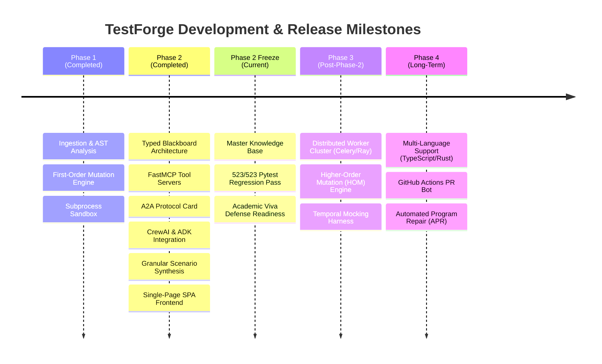

# TESTFORGE — PROJECT LIMITATIONS & DEVELOPMENT ROADMAP
## Transparent Engineering Boundaries, Current Bottlenecks & Post-Phase-2 Strategic Roadmap

**Document Version:** 2.0.0  
**Target Audience:** Engineering Leads, Academic Evaluators, Future Contributors  
**Authoritative Location:** `docs/PROJECT_KNOWLEDGE_BASE/PROJECT_LIMITATIONS_AND_ROADMAP.md`

---

## 1. IMPLEMENTATION REALITY MATRIX

To ensure complete transparency, this matrix distinguishes fully realized features from partial implementations and theoretical aspirations:

| Feature / Subsystem | Status | Current Operational Behavior | Dependencies / Requirements |
| :--- | :---: | :--- | :--- |
| **AST Parsing & Signatures** | **Fully Implemented** | Extracts functions, classes, arguments, and `is_method` flags. | Python `ast` module (100% local) |
| **First-Order Mutation Engine** | **Fully Implemented** | Generates comparison, arithmetic, logic, and boundary mutants. | In-memory AST transformer |
| **Typed Blackboard** | **Fully Implemented** | 5 typed partitions with thread-safe access and state locking. | Pydantic v2 (100% local) |
| **FastMCP Tool Servers** | **Fully Implemented** | Real FastMCP server instances for filesystem and GitHub tools. | `mcp` SDK (100% local) |
| **A2A Agent Card** | **Fully Implemented** | Exposes Linux Foundation A2A v0.3.0 compliant JSON schema. | FastAPI (Port 8000) |
| **Granular Scenario Synthesis**| **Fully Implemented** | Generates normal, boundary, negative, and exception tests. | Subprocess sandbox validator |
| **Single-Page Web UI** | **Fully Implemented** | Single unified HTML/CSS/JS interface on port 8000. | FastAPI static mount |
| **Cooperative Cancellation** | **Fully Implemented** | Async CancellationToken terminates running jobs cleanly. | Asyncio event loop |
| **Subprocess Execution Sandbox**| **Fully Implemented** | Wall-clock timeouts (5.0s) and memory caps protect host. | Python `subprocess` |
| **Network Egress Interception**| **Fully Implemented** | Monkey-patches socket creation to block non-localhost traffic. | `socket` monkey-patching |
| **SQLite Checkpoint Store** | **Fully Implemented** | Serializes run state, AST diffs, and metrics to `checkpoints.db`.| Python `sqlite3` |
| **Equivalent Mutant Detection** | **Partially Implemented**| Heuristic static pattern matching; complete detection undecidable. | AST dead-code visitor |
| **Multi-Node Worker Clusters** | **Planned (Post-Phase-2)**| Current sandbox runs local subprocesses on single node. | Celery / Redis / Ray |
| **Public Cloud Deployment** | **Planned (Post-Phase-2)**| Container verified locally; public cloud omitted for $0.00 cost. | AWS ECS / GCP Cloud Run |

---

## 2. KNOWN TECHNICAL LIMITATIONS & BOTTLENECKS

### 2.1 The Equivalent Mutant Problem (Rice's Theorem)
- **Bottleneck:** A subset of surviving mutants cannot be killed by any test suite because they alter syntax without altering program semantics.
- **Current Mitigation:** TestForge flags dead code mutations and algebraic identities, but cannot mathematically prove equivalence across arbitrary user code. Evaluators should recognize that a 100% mutation score is rarely achievable on non-trivial code bases due to equivalent mutants.

### 2.2 Dynamic Python Meta-Programming
- **Bottleneck:** Python code utilizing dynamic dispatch (`__getattr__`, `__setattr__`), metaclasses, or runtime byte-code manipulation cannot have its call signatures statically resolved via standard AST parsing.
- **Current Mitigation:** The generator falls back to guarded execution assertions (`try...except: pass`). While this prevents the test suite from crashing, it reduces mutation score effectiveness on dynamic code.

### 2.3 Temporal & Stochastic Code
- **Bottleneck:** Code relying on system clocks (`time.time()`) or random number generators (`random.random()`) behaves non-deterministically during mutation testing (observed in `samples/rate_limiter.py`).
- **Current Mitigation:** Mutation scores on time-dependent targets are lower (28.0%) without specialized mock frameworks (such as `freezegun`).

### 2.4 Single-Node Worker Subprocesses
- **Bottleneck:** Evaluating large targets with hundreds of mutants (e.g. `requests/models.py`) takes 2–3 minutes on a single machine due to sequential or local subprocess execution.
- **Current Mitigation:** Parallel sandbox runs multiple worker processes up to CPU core count (8 workers on M-series Apple Silicon).

---

## 3. STRATEGIC DEVELOPMENT ROADMAP

---

### Post-Phase-2 Objectives (Next 6–12 Months):
1. **Distributed Cloud Runner:** Decouple mutant execution into lightweight Docker containers orchestrated by Celery / Redis workers to evaluate 1,000+ mutants in seconds.
2. **Temporal & Environment Mocking:** Automatically inject `pytest-mock` and `freezegun` fixtures when AST analysis detects `time`, `datetime`, or `random` imports.
3. **Automated Program Repair (APR) Extension:** Invert the agentic loop: when a regression test fails on production code, deploy a Repair Agent to synthesize AST patches that restore green test suites.

