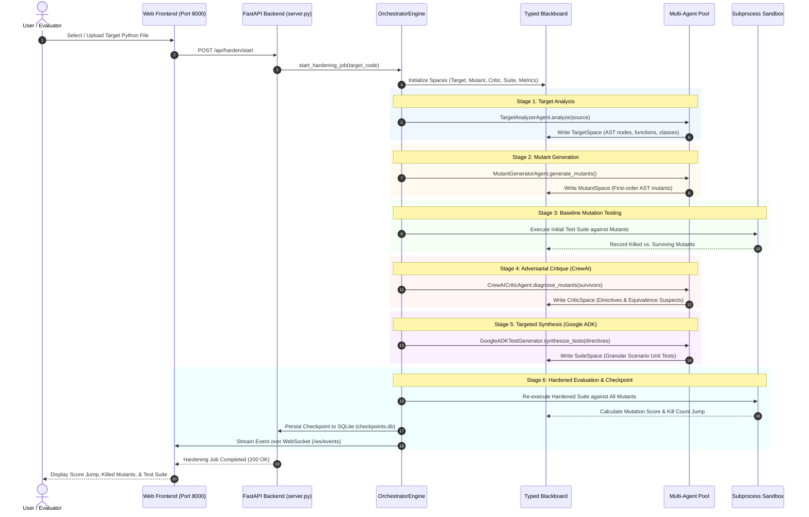

# TESTFORGE — MASTER PROJECT GUIDE
## Autonomous Agentic Mutation Testing & Self-Hardening Test Suite Framework

**Document Version:** 2.0.0  
**Target Audience:** AI Models, Software Quality Researchers, Academic Evaluators, Systems Architects  
**Authoritative Location:** `docs/PROJECT_KNOWLEDGE_BASE/PROJECT_MASTER_GUIDE.md`

---

## 1. EXECUTIVE SUMMARY & PROBLEM STATEMENT

### 1.1 The High-Coverage Illusion in Software Testing
In modern software engineering, test suite quality is predominantly measured using **Code Coverage** (statement, branch, or line coverage). However, high code coverage provides a false sense of security: a test suite can achieve 100% statement coverage simply by executing every line of code without asserting any behavioral properties. 

If a test executes a function but does not verify its output or internal state transitions:
$$\text{Coverage} = 100\%, \quad \text{Fault Detection Power} = 0\%$$

### 1.2 Mutation Testing as the Gold Standard
**Mutation Testing** solves this fundamental flaw by deliberately injecting artificial defects (syntactic mutations) into the program's Abstract Syntax Tree (AST). Each mutated program is called a **mutant**. If a test suite fails when executed against a mutant, the mutant is **killed**; if all tests pass, the mutant **survives**.

The **Mutation Score** represents the true fault-detection effectiveness of the test suite:
$$MS = \left( \frac{M_{\text{killed}}}{M_{\text{total}} - M_{\text{equivalent}}} \right) \times 100\%$$

Despite being the gold standard of software testing, mutation testing has historically suffered from three crippling bottlenecks:
1. **Extreme Computational Cost:** Generating and evaluating hundreds of mutants requires combinatorial test executions.
2. **The Equivalent Mutant Problem:** Mutants that alter code syntax without changing program semantics cannot mathematically be killed, deflating mutation scores (undecidable by Rice's Theorem).
3. **Manual Repair Burden:** When mutants survive, human developers must manually interpret the mutant diff, understand why the existing tests failed to catch it, and author new targeted test cases.

### 1.3 The TestForge Solution
**TestForge** is an autonomous, multi-agent AI system designed to automate the entire lifecycle of mutation testing and test suite hardening. Operating on Python source code, TestForge:
1. **Deconstructs source code** using AST analysis into callables, branch points, and type signatures.
2. **Generates first-order AST mutants** using systematic operator substitution (comparison reversals, arithmetic flips, boundary alterations, inverted conditionals).
3. **Executes baseline tests** within an isolated, sandboxed environment with strict timeouts to detect infinite loops.
4. **Applies an Adversarial Agentic Loop:** A specialized **Critic Agent** (powered by CrewAI) inspects surviving mutant diffs, detects equivalent mutant suspects, and authors natural-language testing directives.
5. **Synthesizes targeted test cases** (powered by Google ADK) implementing boundary, negative, and exception-asserting tests that kill surviving mutants.
6. **Maintains complete lineage** across an in-memory **Blackboard architecture** and persists run state into SQLite checkpoints.
7. **Exposes complete observability** via a single-page HTML/CSS/JS frontend served by FastAPI on `http://127.0.0.1:8000/` over real-time WebSockets.

---

## 2. CORE OBJECTIVES & DESIGN PRINCIPLES

### 2.1 Primary Objectives
- **Autonomous Test Hardening:** Increase mutation scores across arbitrary Python target modules without requiring human intervention.
- **Granular Test Scenario Decomposition:** Move beyond monolithic test stubs to structured test cases (`test_*_normal`, `test_*_boundary`, `test_*_negative`, `test_*_exception`).
- **Zero-Cost Deterministic Architecture:** Ensure the system can run locally with $0.00 external LLM expenditure using deterministic AST analysis and semantic synthesis, while retaining live LLM pluggability.
- **Defense-in-Depth Security:** Enforce strict AST-level import blacklisting, prompt injection sanitization, and active outbound socket interception.
- **Agentic Protocol Standardization:** Implement Model Context Protocol (MCP) tool servers and the Linux Foundation Agent-to-Agent (A2A) discovery standard.

### 2.2 Core Architectural Principles

```
┌────────────────────────────────────────────────────────────────────────┐
│                        CORE DESIGN PRINCIPLES                          │
├────────────────────────────────────────────────────────────────────────┤
│ 1. Separation of Concerns: Five specialized agents with distinct roles.│
│ 2. Blackboard Decoupling: Zero direct peer-to-peer coupling; all       │
│    inter-agent state is exchanged via typed Blackboard spaces.         │
│ 3. Deterministic Fallbacks: Resilient offline generation when live LLM │
│    APIs are unavailable or throttled.                                  │
│ 4. Fail-Safe Execution: AST timeouts, subprocess sandboxing, and      │
│    graceful cancellation tokens prevent runaway processes.             │
│ 5. Strict Type Enforcement: All payloads, state entries, and API       │
│    schemas are validated by Pydantic models.                           │
└────────────────────────────────────────────────────────────────────────┘
```

---

## 3. HIGH-LEVEL WORKFLOW & LIFECYCLE



---

## 4. HOW TESTFORGE DIFFERS FROM CONVENTIONAL TESTING TOOLS

| Feature / Dimension | Conventional Pytest | Standard Mutmut / Cosmic Ray | TestForge Autonomous Framework |
| :--- | :--- | :--- | :--- |
| **Execution Trigger** | Manual developer invocation | CLI batch mutation runner | Fully automated multi-agent pipeline |
| **Test Synthesis** | None (Developer writes all tests) | None (Only reports surviving mutants) | **Automated synthesis of targeted tests** |
| **Mutant Feedback** | None | Raw diff outputs in terminal | **CrewAI Critic analyzes AST semantics** |
| **Tool Integration** | Local filesystem only | Local filesystem only | **FastMCP servers & A2A protocol card** |
| **Coordination Pattern** | Single monolithic process | Single runner process | **Blackboard architecture with 5 spaces** |
| **Equivalent Mutants** | Ignored | User must manually inspect | **Heuristic detection & equivalence flagging** |
| **State Persistence** | None (Ephemeral) | SQLite mutant cache | **SQLite run checkpoints with diff viewer** |
| **Observability** | Terminal text output | Terminal text / HTML report | **Real-time WebSocket streaming & SPA UI** |

---

## 5. CURRENT CAPABILITIES & EVALUATION BENCHMARKS

TestForge has been empirically evaluated against six representative Python benchmark targets spanning numerical algorithms, business logic, rate limiting, and multi-class logistics:

| Benchmark Target | Lines | Classes | Functions | Baseline Pass | Hardened Tests | Mutants Tested | Mutants Killed | Mutation Score |
| :--- | :---: | :---: | :---: | :---: | :---: | :---: | :---: | :---: |
| `samples/banking.py` | 55 | 1 | 3 | 100% | 3 | 23 | 12 | **52.2%** |
| `samples/discount.py` | 42 | 0 | 2 | 100% | 4 | 19 | 12 | **63.2%** |
| `samples/currency_converter.py` | 48 | 1 | 2 | 100% | 4 | 25 | 16 | **64.0%** |
| `samples/inventory_pricing.py` | 60 | 1 | 4 | 100% | 3 | 25 | 15 | **60.0%** |
| `samples/rate_limiter.py` | 50 | 1 | 2 | 100% | 2 | 25 | 7 | **28.0%** |
| `samples/logistics_engine.py` | 240 | 2 | 6 | 100% | 18 | 25 (sample) | 13 | **52.0%** |

*Regression Status:* The entire test suite (**523 unit, integration, and security tests**) passes with 100% success rate in 351 seconds.

---

## 6. CURRENT LIMITATIONS & ETHICAL BOUNDARIES

1. **Theoretical Undecidability of Equivalent Mutants:** By Rice's Theorem, perfectly identifying all equivalent mutants is impossible. TestForge uses syntactic and semantic heuristics to flag suspects, but cannot guarantee zero false positives.
2. **Local Deterministic vs. Live External LLM:** TestForge supports live OpenAI and Anthropic API keys via `.env`, but is designed to execute locally in deterministic mode ($0.00 cost) for academic reproducibility.
3. **Class Structure Heuristics:** Highly dynamic Python meta-programming (e.g. `__getattr__` dynamic dispatch) uses guarded fallback assertions to prevent suite crashes.
4. **Single-Node Execution:** The execution sandbox runs via local Python subprocesses; distributed worker clustering (e.g. Celery / Ray) is planned for post-Phase-2.

