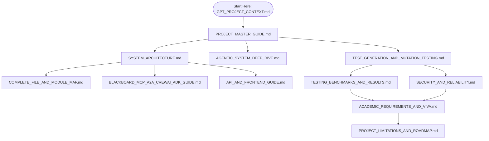

# TESTFORGE — SOURCE OF TRUTH & DOCUMENTATION INDEX
## Authoritative Document Navigation, Historical Report Cross-References & Evidence Topography

**Document Version:** 2.0.0  
**Target Audience:** AI Models, Evaluators, Engineering Auditors  
**Authoritative Location:** `docs/PROJECT_KNOWLEDGE_BASE/SOURCE_OF_TRUTH_AND_DOCUMENTATION_INDEX.md`

---

## 1. PRIMARY SOURCES OF TRUTH BY TOPIC

When resolving questions about TestForge, use the following authoritative sources of truth:

| Topic / Question | Primary Authoritative Document | Underlying Implementation File(s) |
| :--- | :--- | :--- |
| **System Overview & Objectives** | [`PROJECT_MASTER_GUIDE.md`](PROJECT_MASTER_GUIDE.md) | `README.md` |
| **Complete Architecture & Topology** | [`SYSTEM_ARCHITECTURE.md`](SYSTEM_ARCHITECTURE.md) | `server.py`, `testforge/orchestrator.py` |
| **Codebase Inventory & Line Numbers** | [`COMPLETE_FILE_AND_MODULE_MAP.md`](COMPLETE_FILE_AND_MODULE_MAP.md) | `testforge/*`, `tests/*`, `samples/*` |
| **Multi-Agent Deep Dive & Execution** | [`AGENTIC_SYSTEM_DEEP_DIVE.md`](AGENTIC_SYSTEM_DEEP_DIVE.md) | `testforge/agents.py`, `testforge/crew_critic.py` |
| **Blackboard, MCP, A2A, CrewAI, ADK** | [`BLACKBOARD_MCP_A2A_CREWAI_ADK_GUIDE.md`](BLACKBOARD_MCP_A2A_CREWAI_ADK_GUIDE.md) | `testforge/blackboard.py`, `testforge/mcp_servers.py` |
| **Test Generation & Mutation Engine** | [`TEST_GENERATION_AND_MUTATION_TESTING.md`](TEST_GENERATION_AND_MUTATION_TESTING.md) | `testforge/mutator.py`, `testforge/agents.py` |
| **REST APIs & SPA Frontend** | [`API_AND_FRONTEND_GUIDE.md`](API_AND_FRONTEND_GUIDE.md) | `server.py`, `frontend/app.js`, `frontend/index.html` |
| **Security, SSRF, & Guardrails** | [`SECURITY_AND_RELIABILITY.md`](SECURITY_AND_RELIABILITY.md) | `testforge/network_security.py`, `testforge/prompt_guard.py` |
| **Benchmarks & 523 Regression Tests** | [`TESTING_BENCHMARKS_AND_RESULTS.md`](TESTING_BENCHMARKS_AND_RESULTS.md) | `benchmark_results.json`, `tests/*` |
| **Setup, Startup & Troubleshooting** | [`SETUP_EXECUTION_AND_TROUBLESHOOTING.md`](SETUP_EXECUTION_AND_TROUBLESHOOTING.md) | `start_testforge.sh`, `Dockerfile` |
| **11 Academic Requirements & 30 Viva Qs** | [`ACADEMIC_REQUIREMENTS_AND_VIVA.md`](ACADEMIC_REQUIREMENTS_AND_VIVA.md) | `docs/EVALUATION_PACKAGE/*` |
| **Limitations & Future Roadmap** | [`PROJECT_LIMITATIONS_AND_ROADMAP.md`](PROJECT_LIMITATIONS_AND_ROADMAP.md) | Section 6 of Technical Reports |

---

## 2. RETAINED VS. REMOVED HISTORICAL ARTIFACTS

### Retained Authoritative Evidence Packages
1. **[`qa_artifacts/final_phase2_execution/`](file:///Users/sourabh/TestForge/qa_artifacts/final_phase2_execution/)**: Latest definitive verification suite (Phases 0–5, 523 regression pass, 84 security pass, failure recovery).
2. **[`qa_artifacts/frontend_backend_browser_audit/`](file:///Users/sourabh/TestForge/qa_artifacts/frontend_backend_browser_audit/)**: Definitive browser acceptance audit on port 8000 with 72 verified screenshots.
3. **[`qa_artifacts/testforge_checkpoints.db`](file:///Users/sourabh/TestForge/qa_artifacts/testforge_checkpoints.db)**: Active multi-run SQLite database referenced by `server.py:100`.
4. **[`docs/EVALUATION_PACKAGE/`](file:///Users/sourabh/TestForge/docs/EVALUATION_PACKAGE/)**: Concise handover package for academic evaluators.

### Removed Disposable Artifacts (Preserved in External Backup)
- `testforge_trace.jsonl.archive_full` (259.83 MB obsolete root dump).
- 231 compiled Python bytecode files (`.pyc`).
- Ephemeral `.pytest_cache/` files.
- Redundant intermediate benchmark fragments (`trace_corpus_*.jsonl`, `trace_bench_*.jsonl`).
- Disposable one-time audit scripts (`cancellation_browser_audit.py`, `verify_defect_fixes.py`, `test_api_contracts.py`).

*Full Pre-Cleanup Archive:* `/Users/sourabh/TestForge_backups/backup_cleanup_20261030_165000`

---

## 3. HOW TO NAVIGATE THE KNOWLEDGE BASE

