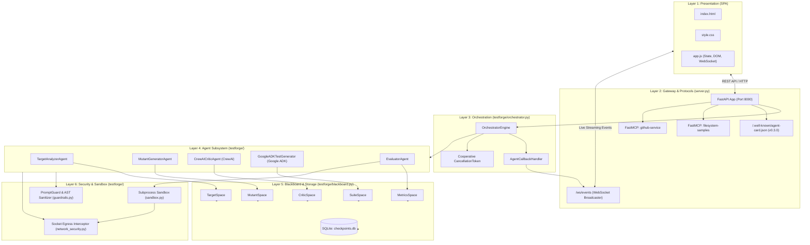
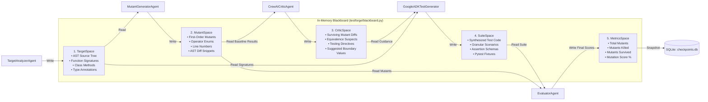
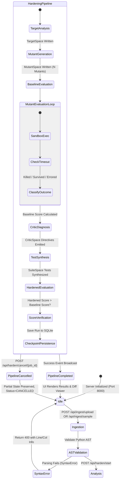
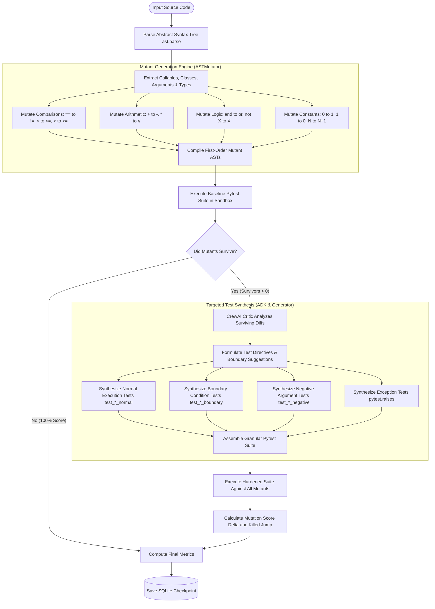
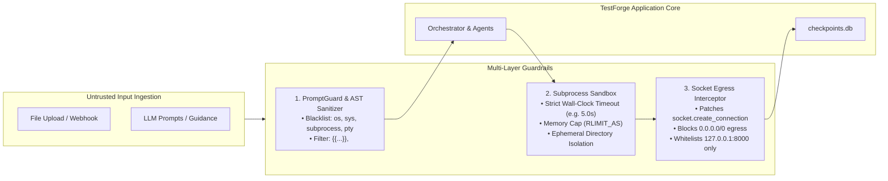

# TESTFORGE — SYSTEM ARCHITECTURE SPECIFICATION
## Comprehensive End-to-End Architectural Topology, Component Interconnects & Data Flows

**Document Version:** 2.0.0  
**Target Audience:** Systems Architects, Evaluators, AI Engineers  
**Authoritative Location:** `docs/PROJECT_KNOWLEDGE_BASE/SYSTEM_ARCHITECTURE.md`

---

## 1. HIGH-LEVEL ARCHITECTURAL TOPOLOGY

TestForge is organized as a modular, decoupled, event-driven system comprising six core architectural layers:
1. **Presentation Layer:** Single-Page Application (SPA) built with HTML5, CSS3, and Vanilla JavaScript, communicating via REST and WebSockets.
2. **API & Protocol Gateway:** FastAPI backend hosting REST APIs, streaming WebSockets, FastMCP tool servers, and the Linux Foundation Agent-to-Agent (A2A) discovery card.
3. **Orchestration & Coordination Layer:** Async orchestration engine executing sequential and iterative hardening pipelines with cooperative cancellation tokens.
4. **Agentic Subsystem:** Specialized agents operating under supervisor-worker and critic-reflector paradigms with framework wrappers for CrewAI and Google ADK.
5. **Shared State & Memory Layer:** Typed in-memory Blackboard architecture partitioned into five isolated namespaces with complete provenance tracking and SQLite checkpoint persistence.
6. **Execution & Security Sandbox Layer:** Subprocess execution sandbox with bounded wall-clock timeouts, AST-level import blacklisting, prompt injection sanitizers, and outbound socket egress interception.

---

## 2. COMPONENT DEEP-DIVE & RESPONSIBILITY MATRIX

| Layer | Module / File | Primary Class / Symbol | Exact Responsibility |
| :--- | :--- | :--- | :--- |
| **API** | `server.py` | `app = FastAPI(...)` | Exposes REST endpoints, manages WebSocket life-cycle, hosts static assets, mounts A2A discovery card, and delegates pipeline jobs. |
| **Orchestration** | `testforge/orchestrator.py` | `OrchestratorEngine` | Drives multi-stage hardening loops, manages step timeouts, executes fallback chains, and checks cancellation tokens. |
| **Callbacks** | `testforge/callbacks.py` | `AgentCallbackHandler` | Captures lifecycle events (`on_agent_start`, `on_tool_start`, `on_mutation_pass`) and pushes JSON events to queues. |
| **Blackboard** | `testforge/blackboard.py` | `Blackboard` | Thread-safe, typed state repository with 5 isolated namespaces (`TargetSpace`, `MutantSpace`, `CriticSpace`, `SuiteSpace`, `MetricsSpace`). |
| **Checkpoints** | `testforge/checkpoints.py` | `CheckpointManager` | Serializes Blackboard state snapshots to SQLite (`checkpoints.db`) with run resumption and AST diff generation. |
| **Target Analyzer** | `testforge/agents.py` | `TargetAnalyzerAgent` | Decomposes Python source code using AST visitors into classes, functions, argument types, and control flow graphs. |
| **Mutant Generator** | `testforge/agents.py` `testforge/mutator.py` | `MutantGeneratorAgent` `ASTMutator` | Injects first-order syntactic mutations (`InvertNegatives`, `ComparisonOpReplacement`, `ArithmeticOpReplacement`, `ConditionInversion`). |
| **Critic Agent** | `testforge/crewai_critic.py` | `CrewAICriticAgent` | Wraps CrewAI task/agent execution to analyze surviving mutants, diagnose coverage gaps, and author targeted test directives. |
| **Test Generator** | `testforge/adk_generator.py` `testforge/agents.py` | `GoogleADKTestGenerator` `TestGeneratorAgent` | Utilizes Google ADK tool registries and AST schema heuristics to synthesize scenario tests (`normal`, `boundary`, `negative`, `exception`). |
| **Evaluator** | `testforge/agents.py` | `EvaluatorAgent` | Runs generated test suites against all first-order mutants, classifies outcomes, and calculates mutation scores. |
| **Execution Sandbox** | `testforge/sandbox.py` | `IsolatedSandbox` | Executes pytest in an isolated subprocess with memory bounds, bounded execution timeouts, and strict error containment. |
| **Network Security** | `testforge/network_security.py` | `NetworkSecurityContext` | Monkeys-patches low-level socket connections during testing runs to actively block unauthorized outbound TCP/HTTP egress. |
| **Guardrails** | `testforge/guardrails.py` | `SecurityGuardrails` | Sanitizes untrusted user inputs, detects prompt injection payloads, and enforces AST-level import blacklisting. |
| **FastMCP Servers** | `testforge/mcp_servers.py` | `mcp_filesystem`, `mcp_github` | Official FastMCP instances exposing standard MCP tool interfaces for filesystem inspection and GitHub repository reading. |
| **A2A Protocol** | `server.py` `testforge/a2a.py` | `AgentCard` schema | Publishes metadata at `/.well-known/agent-card.json` conforming to Linux Foundation Agent-to-Agent discovery v0.3.0. |

---

## 3. BLACKBOARD DATA FLOW & STATE PARTITIONS

The Blackboard pattern eliminates direct point-to-point agent dependencies. Each agent writes exclusively to its dedicated partition and consumes verified data from preceding partitions.

---

## 4. END-TO-END EXECUTION FLOW & STATE MACHINE

---

## 5. TEST GENERATION AND MUTATION ALGORITHM

---

## 6. FAILURE CONTAINMENT & SECURITY ARCHITECTURE

