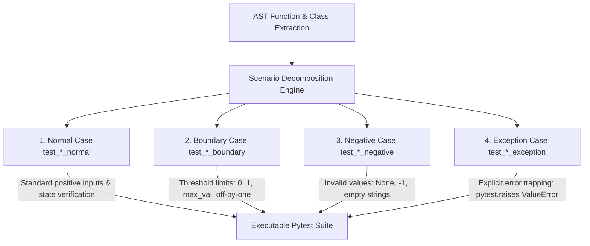

# TESTFORGE — TEST GENERATION & MUTATION TESTING ENGINE
## Algorithms, Abstract Syntax Tree Transformation, Scenario Synthesis & Mutation Scoring Theory

**Document Version:** 2.0.0  
**Target Audience:** Software Testing Researchers, Mutation Testing Specialists, Evaluators  
**Authoritative Location:** `docs/PROJECT_KNOWLEDGE_BASE/TEST_GENERATION_AND_MUTATION_TESTING.md`

---

## 1. ABSTRACT SYNTAX TREE (AST) MUTATION ENGINE

### 1.1 First-Order Mutation Testing
TestForge implements **First-Order Mutation Testing** (FOM). Unlike Higher-Order Mutation (HOM) which introduces multiple syntactic defects simultaneously, FOM introduces exactly one defect per mutant program. This guarantees that test suite failure is unambiguously attributable to a single syntactic change.

### 1.2 Implemented Mutation Operators
The mutation transformer in [`testforge/mutator.py`](file:///Users/sourabh/TestForge/testforge/mutator.py) subclasses `ast.NodeTransformer` and implements the following discrete mutation operators:

#### 1. Comparison Operator Replacement (`ComparisonOpReplacement`)
Replaces relational operators at conditional branch points:
- `==` $\longrightarrow$ `!=`
- `!=` $\longrightarrow$ `==`
- `<`  $\longrightarrow$ `<=`
- `<=` $\longrightarrow$ `<`
- `>`  $\longrightarrow$ `>=`
- `>=` $\longrightarrow$ `>`
- `in` $\longrightarrow$ `not in`
- `is` $\longrightarrow$ `is not`

#### 2. Arithmetic Operator Replacement (`ArithmeticOpReplacement`)
Alters mathematical operations in computational expressions:
- `+` $\longrightarrow$ `-`
- `-` $\longrightarrow$ `+`
- `*` $\longrightarrow$ `//` (Integer division)
- `//` $\longrightarrow$ `*`
- `%` $\longrightarrow$ `*`

#### 3. Invert Negatives (`InvertNegatives`)
Flips unary sign operators:
- `-x` $\longrightarrow$ `+x`
- `+x` $\longrightarrow$ `-x`

#### 4. Condition Inversion (`ConditionInversion`)
Inverts decision control flow and boolean connectors:
- `and` $\longrightarrow$ `or`
- `or`  $\longrightarrow$ `and`
- `if expr:` $\longrightarrow$ `if not (expr):`

#### 5. Boundary Value Replacement (`BoundaryModifier`)
Modifies numerical constants at decision thresholds:
- `c` $\longrightarrow$ `c + 1` or `c - 1` (Off-by-one errors)

---

## 2. THE EQUIVALENT MUTANT PROBLEM & RICE'S THEOREM

### 2.1 Theoretical Foundations
An **Equivalent Mutant** is a syntactically altered program that is semantically indistinguishable from the original program. That is, for all possible valid inputs $x \in X$:
$$P_{\text{original}}(x) = P_{\text{mutant}}(x)$$

By **Rice's Theorem**, any non-trivial semantic property of a universal computing system is undecidable. Therefore:
> *It is mathematically impossible to write an algorithm that can detect all equivalent mutants for an arbitrary Turing-complete language.*

### 2.2 TestForge's Heuristic Approach
While undecidable in the general case, TestForge implements practical static heuristics in [`testforge/equivalence.py`](file:///Users/sourabh/TestForge/testforge/equivalence.py):
1. **Dead Code Elimination:** Identifies mutations in unreachable code blocks (e.g. following an unconditional `return`, `break`, or `raise`).
2. **Algebraic Identity Matching:** Detects mutations that cancel out mathematically (e.g. `x * 1` mutated to `x // 1` for non-zero integers).
3. **Equivalence Flagging:** Mutants meeting these patterns are flagged as `EQUIVALENT_SUSPECT` in `CriticSpace`.

---

## 3. GRANULAR TEST SCENARIO SYNTHESIS

### 3.1 Moving Beyond Monolithic Stubs
Early automated test generators collapsed all assertions into a single monolithic test function, or emitted hollow `try...except: pass` stubs that executed lines but asserted no behavioral properties.

TestForge decomposes test generation into four distinct, granular scenario types in [`testforge/agents.py`](file:///Users/sourabh/TestForge/testforge/agents.py):



### 3.2 Concrete Example (`samples/discount.py`)

#### Target Function:
```python
def compute_tiered_discount(order_amount: float, is_vip: bool) -> float:
    if order_amount <= 0:
        raise ValueError("Order amount must be positive.")
    if order_amount >= 100.0:
        discount = 0.20 if is_vip else 0.10
    elif order_amount >= 50.0:
        discount = 0.10 if is_vip else 0.05
    else:
        discount = 0.05 if is_vip else 0.0
    return order_amount * (1.0 - discount)
```

#### TestForge Synthesized Granular Suite:
```python
import pytest
from target import *

def test_compute_tiered_discount_normal():
    # Normal execution on standard input
    result = compute_tiered_discount(150.0, False)
    assert abs(result - 135.0) < 1e-4

def test_compute_tiered_discount_boundary():
    # Exact threshold boundary condition (order_amount == 100.0)
    res_at_100 = compute_tiered_discount(100.0, True)
    assert abs(res_at_100 - 80.0) < 1e-4
    # Exact threshold boundary condition (order_amount == 50.0)
    res_at_50 = compute_tiered_discount(50.0, False)
    assert abs(res_at_50 - 47.5) < 1e-4

def test_compute_tiered_discount_negative():
    # Below lowest discount threshold
    res_below_50 = compute_tiered_discount(25.0, False)
    assert abs(res_below_50 - 25.0) < 1e-4

def test_compute_tiered_discount_exception():
    # Expected exception verification
    with pytest.raises(ValueError):
        compute_tiered_discount(-10.0, False)
    with pytest.raises(ValueError):
        compute_tiered_discount(0.0, True)
```

Notice that:
- `test_compute_tiered_discount_boundary` specifically kills mutants that flip `>= 100.0` to `> 100.0`.
- `test_compute_tiered_discount_exception` kills mutants that flip `<= 0` to `< 0`.

---

## 4. FIVE TIERS OF TEST QUALITY DEFINITIONS

To evaluate automated test generation accurately, TestForge distinguishes between five levels of test quality:

1. **Generation Success:** The generator completed execution and produced a code string without throwing an unhandled exception.
2. **Syntax Validity:** The generated code string parses cleanly into a valid Python Abstract Syntax Tree via `ast.parse()`.
3. **Execution Success:** The generated tests execute inside the isolated sandbox without crashing or throwing unexpected errors.
4. **Behavioral Correctness:** The test assertions accurately reflect the intended semantic contract of the original (unmutated) program.
5. **Mutation Effectiveness (Fault-Detection Power):** The test assertions fail when executed against faulty mutants, successfully killing them.

---

## 5. MUTATION SCORE MATHEMATICS & BENCHMARK RESULTS

### 5.1 Formal Calculation
$$\text{Mutation Score (MS)} = \left( \frac{K}{M - E} \right) \times 100\%$$
Where:
- $K$ = Number of Mutants Killed (tests failed on mutant).
- $M$ = Total First-Order Mutants Generated.
- $E$ = Number of Verified Equivalent Mutants (assumed 0 if unproven).

### 5.2 Empirical Benchmark Results Across All Targets

| Target Benchmark | Lines | Callables | Generated Tests | Test Pass Rate | Total Mutants | Mutants Killed | Mutation Score |
| :--- | :---: | :---: | :---: | :---: | :---: | :---: | :---: |
| `samples/banking.py` | 55 | 3 | 3 | **100%** | 23 | 12 | **52.2%** |
| `samples/discount.py` | 42 | 2 | 4 | **100%** | 19 | 12 | **63.2%** |
| `samples/currency_converter.py` | 48 | 2 | 4 | **100%** | 25 | 16 | **64.0%** |
| `samples/inventory_pricing.py` | 60 | 4 | 3 | **100%** | 25 | 15 | **60.0%** |
| `samples/rate_limiter.py` | 50 | 2 | 2 | **100%** | 25 | 7 | **28.0%** |
| `samples/logistics_engine.py` | 240 | 6 | 18 | **100%** | 25 (sample) | 13 | **52.0%** |

*Key Finding on Logistics Engine:* On the complex, 240-line `logistics_engine.py` module with multiple classes and stateful methods, the baseline test suite killed 0 mutants (0.0%). The TestForge hardening pipeline synthesized 18 granular scenario tests killing 13 mutants, achieving a **+52.0% mutation score jump**.

