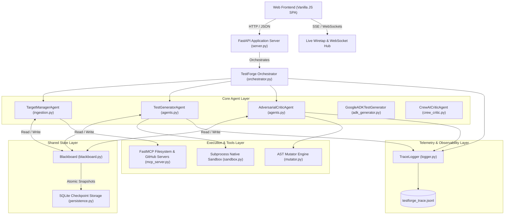

# TestForge — Complete System Architecture

**Document Version:** 1.0.0  
**Last Verified:** November 2, 2026  
**Primary Source Modules:** `server.py`, `testforge/orchestrator.py`, `testforge/blackboard.py`, `testforge/logger.py`  

---

## 1. Architectural Overview & Design Patterns

TestForge adopts a **Hybrid Blackboard and Layered Multi-Agent Architecture**. This architectural pattern was chosen to decouple agent reasoning, state mutation, test execution, and external tool invocation into distinct, inspectable boundaries.

---

## 2. Layer-by-Layer Decomposition

### Layer 1: Presentation & User Interface (`frontend/`)
The frontend is implemented as a single-page application (SPA) using clean, responsive HTML5, modern CSS variables, and vanilla JavaScript (ES2022) with **zero external CDN or node_modules runtime dependencies**.
- **`frontend/index.html`:** Responsive multi-tab interface:
  1. *Hardening Workbench:* Source input, callable inspection, run controls, iteration counter.
  2. *Live Wiretap:* Real-time Server-Sent Events (SSE) streaming deliberation events and agent handoffs.
  3. *State Checkpoints & Time-Travel:* Historical snapshot cards with semantic unified AST diffing.
  4. *Observability & Telemetry:* Live token accounting, latency graphs, and dynamic model badges.
  5. *Benchmark & Ablation Study:* Automated empirical benchmarking across strategies and personas.
  6. *Security & Threat Model:* Attack scenario defense validation panel.
- **`frontend/app.js`:** Pure JavaScript controller managing DOM bindings, WebSocket lifecycle, async polling, chart rendering, and user action dispatches.
- **`frontend/styles.css`:** Cyberpunk/Glassmorphic dark-mode design system with accessible contrast and status badges.

### Layer 2: API Gateway & Transport (`server.py`)
Implemented using **FastAPI** running atop **Uvicorn**:
- **Lifespan Manager:** Handles startup initialization (verifying SQLite schema, checking local Ollama daemon status, seeding sample files) and graceful shutdown.
- **No-Cache Static Mounting:** Custom `NoCacheStaticFiles` class disables browser caching (`Cache-Control: no-cache, no-store, must-revalidate`) to prevent stale UI script bugs.
- **Job Background Execution:** Uses FastAPI's `BackgroundTasks` to decouple long-running reflection hardening cycles from the HTTP request-response cycle.
- **REST Endpoints:**
  - `POST /api/harden/start`: Ingests source, spins up orchestrator task, returns `job_id`.
  - `GET /api/harden/status/{job_id}`: Polls live job status, current reflection stage, and scores.
  - `POST /api/harden/cancel/{job_id}`: Signals cooperative cancellation to the active FSM.
  - `GET /api/checkpoints`: Lists persisted blackboard checkpoints from SQLite.
  - `GET /api/checkpoints/{id}`: Retrieves serialized point-in-time snapshot.
  - `GET /api/checkpoints/diff`: Computes unified AST diff between baseline and candidate test suites.
  - `GET /api/telemetry`: Exposes token accounting, dynamic execution engine resolution, and event streams.
  - `GET /api/mcp/status`: Queries registered FastMCP tools and authentication states.
  - `GET /.well-known/agent.json`: Exposes the formal A2A Agent Card for agentic discovery.
- **SSE Stream (`GET /api/wiretap`):** Streams real-time JSON events from the orchestrator and blackboard to the frontend wiretap timeline.

### Layer 3: Orchestration & Lifecycle (`testforge/orchestrator.py`)
The Orchestrator is the central supervisor of the system. It enforces a strict **Finite State Machine (FSM)**:
$$\text{CREATED} \longrightarrow \text{INGESTING} \longrightarrow \text{ANALYZING} \longrightarrow \text{GENERATING} \longrightarrow \text{EXECUTING} \longrightarrow \text{MUTATING} \longrightarrow \text{EVALUATING} \longrightarrow \text{COMPLETED / TERMINATED}$$

- **State Management:** Binds `workflow_id` and `correlation_id` across all operations.
- **Reflection Iteration Loop:** Controls loop entry, checks whether `current_mutation_score >= target_score`, triggers rollback if candidate regressions occur, and enforces `max_iterations = 3`.
- **Cancellation Checks:** Periodically probes `self.cancellation_requested` at every stage boundary to guarantee responsive termination without process leaks.

### Layer 4: Shared State Blackboard (`testforge/blackboard.py`)
All state shared between agents resides in the **Blackboard**. It eliminates hidden state coupling, allowing agents to act as pure state transformers:
- **`TargetSpace`:** Target module path, AST callable signatures, clean source code.
- **`MutantSpace`:** Generated mutants, surviving mutant unified diffs, killed mutant counts.
- **`CriticSpace`:** Adversarial failure mechanisms, prescriptive test directives.
- **`SuiteSpace`:** Current Pytest test suite, candidate suite, baseline test results.
- **`MetricsSpace`:** Current iteration, line coverage, raw mutation score, adjusted mutation score.
- **Concurrency Control:** Guarded by `threading.RLock` ensuring atomicity during multi-agent updates.
- **Event Bus:** Emits typed `BlackboardEvent` objects to registered listeners (Wiretap, Logger, WebSocketHub).

### Layer 5: Durability & Checkpoint Storage (`testforge/persistence.py`)
- **Durable Store:** SQLite database (`qa_artifacts/testforge_checkpoints.db`) operating under WAL journaling mode.
- **Checkpoint Records:** Stores full JSON snapshots of the 5 blackboard partitions alongside indexed metadata (`checkpoint_id`, `job_id`, `stage`, `status`, `created_at`).
- **Time-Travel Rollback:** Enables the orchestrator or user to restore any prior stage snapshot (`POST /api/checkpoints/{id}/restore`) if a reflection iteration degrades performance.

### Layer 6: Tool Execution & Sandboxing (`testforge/sandbox.py`, `testforge/mcp_server.py`)
- **Execution Sandbox:** Runs Pytest and mutants in isolated native subprocesses (`python -m pytest`) with:
  - Strict timeouts (default 10.0 seconds) to prevent infinite deliberation loops.
  - Restricted working directory to prevent arbitrary file corruption.
  - Subprocess stdout/stderr capture and clean exit code analysis.
- **FastMCP Tool Layer:** Exposes bounded read-only filesystem and GitHub inspection tools over stdio/JSON-RPC.

### Layer 7: Telemetry & Observability (`testforge/logger.py`)
- **Event Store:** Append-only JSONL log (`testforge_trace.jsonl`) recording all deliberation events.
- **Distinct Token Accounting:** Separates provider-reported tokens from offline heuristic estimates.
- **Dynamic Model Resolution:** Dynamically inspects recorded telemetry to determine whether tests were generated by Gemini, CodeLlama, Qwen, or the Deterministic AST Synthesizer.

