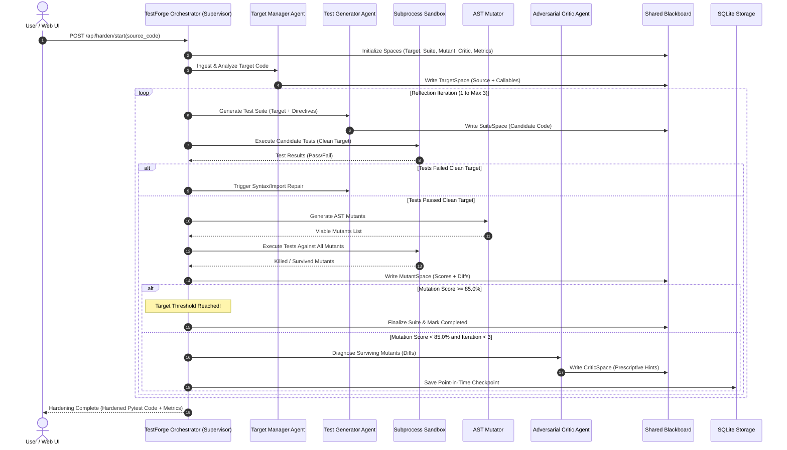

# TestForge — Agent Inventory & Multi-Agent Hierarchical Architecture

**Document Version:** 1.0.0  
**Last Verified:** November 2, 2026  
**Primary Source Modules:** `testforge/orchestrator.py`, `testforge/agents.py`, `testforge/ingestion.py`, `testforge/adk_generator.py`, `testforge/crew_critic.py`, `testforge/a2a_protocol.py`  

---

## 1. Verified Agent Inventory

An exhaustive inspection of the TestForge codebase reveals **5 distinct core autonomous agents** alongside **2 protocol/framework adapters**:

| # | Agent Identifier | Implementation Class | Role & Operational Status | Primary Responsibility | Source File |
| :-: | :--- | :--- | :--- | :--- | :--- |
| **1** | **Orchestrator** | `TestForgeOrchestrator` | **Supervisor / Master Agent** (Active) | FSM lifecycle coordinator, reflection iteration controller, blackboard snapshot trigger, rollback authority. | `testforge/orchestrator.py` |
| **2** | **Target Manager** | `TargetManagerAgent` | **Specialist Worker** (Active) | Source code ingestion (Local, Raw, GitHub), security threat scanning, AST callable discovery, TargetSpace initialization. | `testforge/ingestion.py` |
| **3** | **Test Generator** | `TestGeneratorAgent` | **Specialist Worker** (Active) | Synthesizes baseline Pytest suites, boundary tests, and mutation-killing test cases using hybrid LLM/AST logic. | `testforge/agents.py` |
| **4** | **Adversarial Critic**| `AdversarialCriticAgent`| **Specialist Evaluator** (Active) | Analyzes surviving mutant unified diffs, diagnoses assertion deficiencies, and writes prescriptive reflection directives. | `testforge/agents.py` |
| **5** | **Google ADK Generator**| `GoogleADKTestGenerator` | **Specialist Worker** (Alternative/Active)| Official Google Agent Development Kit (ADK) `LlmAgent` implementation of the generator agent. | `testforge/adk_generator.py` |
| **6** | **CrewAI Critic** | `CrewAICriticAgent` | **Specialist Evaluator** (Alternative/Active)| Official CrewAI `Agent` implementation of the adversarial critic with task-oriented reflection prompts. | `testforge/crew_critic.py` |
| **7** | **A2A Protocol Bridge**| `TestForgeA2AExecutor` | **External Gateway Adapter** (Active) | Implements official A2A `AgentExecutor`, exposing TestForge capabilities to external agent networks. | `testforge/a2a_protocol.py` |

---

## 2. Exhaustive Agent Profiles

### 1. TestForge Orchestrator (`TestForgeOrchestrator`)
- **Objective:** Supervise the end-to-end test hardening lifecycle, manage the blackboard state, control reflection loops, and enforce fault tolerance.
- **Internal Workflow:**
  1. Creates unique `job_id`, `workflow_id`, and `correlation_id`.
  2. Initializes blackboard state partitions (`TargetSpace`, `SuiteSpace`, `MutantSpace`, `CriticSpace`, `MetricsSpace`).
  3. Transitions FSM from `CREATED` $\rightarrow$ `INGESTING` $\rightarrow$ `ANALYZING`.
  4. Invokes `TargetManagerAgent` to ingest and validate target source.
  5. Enters **Reflection Iteration Loop** (Iteration 1 to `max_iterations = 3`):
     - Invokes `TestGeneratorAgent` to produce candidate Pytest code.
     - Executes candidate tests in `NativeSandbox` against clean target code.
     - If baseline tests fail, triggers syntax/import repair.
     - Executes `ASTMutator` to generate viable mutants.
     - Runs candidate tests against every mutant in the sandbox.
     - Computes raw and adjusted mutation scores.
     - If `score >= target_score` (85.0%), transitions to `COMPLETED`.
     - Otherwise, invokes `AdversarialCriticAgent` with surviving mutant diffs.
     - Saves atomic `BlackboardSnapshot` to SQLite.
  6. Finalizes test suite and closes execution lifecycle.
- **Blackboard Interaction:** Full read/write access across all 5 partitions; locks blackboard via `self.blackboard.lock` during atomic transitions.
- **Failure Handling:** Catches `HardeningCancelledError` (user cancellation), `HardeningTimeoutError` (iteration timeout), and runtime exceptions; restores prior validated snapshot on degradation.

---

### 2. Target Manager Agent (`TargetManagerAgent`)
- **Objective:** Safely ingest target Python source code from diverse sources, scan for security threats, validate syntax, and extract structural metadata.
- **Supported Ingestion Modes:**
  - *Mode A (Local File):* Reads local repository file with path-traversal prevention.
  - *Mode B (Raw Code String):* Ingests direct code text submitted via web UI.
  - *Mode C (GitHub Repository):* Fetches remote code via GitHub API with token authentication, URL validation, and size bounding.
- **Security Scans:** Executes `scan_for_injection_attempts()` against untrusted inputs. Wraps raw target code in provenance tags (`<untrusted_content provenance="ingestion">`).
- **AST Parsing:** Discovers top-level functions, classes, instance methods, and parameter signatures using Python's `ast` module.
- **Output:** Populates `TargetSpace` on the blackboard and emits `LIFECYCLE_STATE_CHANGE` telemetry.

---

### 3. Test Generator Agent (`TestGeneratorAgent`)
- **Objective:** Synthesize robust, deterministic Pytest unit tests that maximize statement coverage and kill AST mutants.
- **Execution Architecture:**
  - *Tier 1 (Cloud Gemini):* Formulates rich prompts with callable signatures, type hints, and critic directives.
  - *Tier 2 (OpenRouter Cloud):* Secondary cloud fallback.
  - *Tier 3 (Local Ollama):* Invokes local `codellama:7b` or `qwen2.5-coder:7b` via Ollama REST API.
  - *Tier 4 (Intelligent AST Synthesizer):* Fully deterministic offline AST synthesis. Discovers callables, analyzes parameter boundary values (0, negative, empty string, None, maxint), runs pre-flight reference executions, and formats valid Pytest code.
- **Input Schema:** Clean target source code, callable signatures, surviving mutant diffs (in reflection cycles), and critic directives.
- **Output Schema:** Syntactically valid Python code containing `@pytest.mark.parametrize` tables, boundary assertions, and mock fixtures.

---

### 4. Adversarial Critic Agent (`AdversarialCriticAgent`)
- **Objective:** Analyze surviving mutants to discover assertion blind spots and provide prescriptive guidance to the generator agent.
- **Diagnosis Algorithm:**
  1. Inspects unified diff of each surviving mutant (e.g., `+ if price < 0:` instead of `+ if price <= 0:`).
  2. Identifies the specific mutation operator applied (Relational Comparison Replacement, Arithmetic Swap, Return Value Mutation).
  3. Detects why existing tests failed to kill the mutant (e.g., "Tests tested price = -10, but omitted boundary value price = 0.0").
  4. Synthesizes a structured `CriticDirectivePayload` containing:
     - `analysis`: Technical reason why mutant survived.
     - `prescriptive_hints`: Concrete boundary values and inputs to test.
     - `recommended_assertions`: Specific assert statements required to kill the mutant.
- **Output:** Writes directives to `CriticSpace` and emits `CRITIC_ANALYSIS_COMPLETED` event.

---

### 5. Google ADK Test Generator (`GoogleADKTestGenerator`)
- **Objective:** Provides an official Google Agent Development Kit (ADK) implementation of test generation.
- **Bridge Architecture:** Implements `ADKModelBridge` subclassing official ADK `BaseLlm`. Connects ADK `LlmAgent` and `Runner` to TestForge's hybrid LLM backend.
- **Operational Role:** Fully functional alternative generator agent. Can be selected via orchestration configuration or used in comparative ablation studies.

---

### 6. CrewAI Critic Agent (`CrewAICriticAgent`)
- **Objective:** Provides an official CrewAI implementation of the adversarial critic.
- **Bridge Architecture:** Implements `CrewAILLMBridge` subclassing CrewAI `BaseLLM`. Uses CrewAI's `Agent` and `Task` primitives to evaluate surviving mutants.
- **Operational Role:** Fully functional alternative critic agent. Can be selected via orchestration configuration or used in comparative ablation studies.

---

### 7. A2A Protocol Bridge (`TestForgeA2AExecutor`)
- **Objective:** Standardized communication gateway exposing TestForge's multi-agent capabilities to external agent systems over the Agent-to-Agent (A2A) protocol.
- **Capabilities:** Exposes `testforge-harden-suite` and `testforge-diagnose-mutants` tasks. Publishes formal `AgentCard` at `/.well-known/agent.json`.

---

## 3. The Multi-Agent Hierarchical Model

TestForge implements a **Hybrid Supervisor-Worker with Iterative Reflection Loop** pattern:

---

## 4. Academic Architectural Comparison

To rigorously justify why TestForge implements a **Hybrid Supervisor-Reflection Architecture**, the table below compares the six primary multi-agent coordination architectures:

| Architectural Pattern | Coordination Complexity | Communication Overhead | State Consistency | Fault Recovery | Suitability for Test Generation | Suitability for Mutation Hardening |
| :--- | :---: | :---: | :---: | :---: | :---: | :---: |
| **1. Centralized Supervisor-Worker** | Low | Low | High (Central) | High | High (Task dispatch is clean) | Moderate (Lacks native iterative feedback) |
| **2. Hierarchical Manager-Specialist** | Moderate | Moderate | Moderate | Moderate | High (Modular decomposition)| Moderate (Multi-tier handoff latency) |
| **3. Sequential Pipeline (Linear Chain)**| Very Low | Very Low | Low (Pass-through) | Very Low (Cascades)| Moderate (Simple happy path) | **Poor (Cannot loop back on surviving mutants)**|
| **4. Collaborative Peer-to-Peer** | Very High | High | Low (Drift risks) | Moderate | Moderate (Chatter overhead) | Poor (Prone to non-terminating debate) |
| **5. Pure Reflection (Generator-Critic)** | Moderate | Moderate | Moderate | High | High (Good self-correction)| High (Direct mutant feedback) |
| **6. Hybrid Supervisor-Reflection (TestForge)**| **Moderate** | **Low-Medium** | **Very High (Blackboard)**| **Very High (Snapshots)**| **Optimal (Deterministic dispatch)**| **Optimal (Closed-loop mutation kill refinement)**|

### Why TestForge Selected the Hybrid Supervisor-Reflection Pattern
1. **Mutation Testing Inherently Requires Reflection:** In software hardening, test generation cannot be a one-shot pipeline. A test suite must be generated, executed, subjected to mutation faults, and evaluated. If mutants survive, the system must loop back to author new tests specifically targeting the survived mutations.
2. **Blackboard Eliminates Context Bloat:** In collaborative peer-to-peer architectures, agents pass conversational chat logs back and forth, consuming thousands of tokens in conversational formalities. In TestForge, agents communicate via structured blackboard partitions (`TargetSpace`, `SuiteSpace`, `MutantSpace`, `CriticSpace`), keeping token overhead minimal.
3. **Supervisor Guarantees Termination:** In unconstrained multi-agent debate, agents can enter infinite loops. In TestForge, the `TestForgeOrchestrator` acts as the deterministic supervisor, enforcing strict `max_iterations = 3`, timeouts, and cooperative cancellation.
4. **Time-Travel Rollback Safety:** If Iteration 2 produces tests that fail syntax checks or regress statement coverage, the supervisor discards the candidate suite and rolls back to the Iteration 1 checkpoint stored in SQLite. Pure reflection or peer-to-peer systems lack this persistence guarantee.

