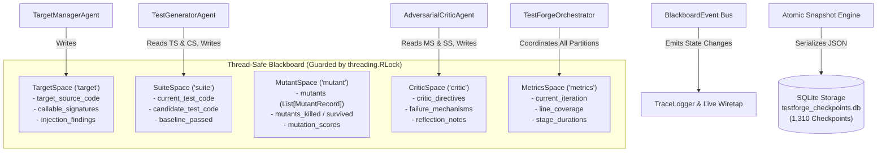

# TestForge — Blackboard State Management & SQLite Persistence

**Document Version:** 1.0.0  
**Last Verified:** November 2, 2026  
**Primary Source Modules:** `testforge/blackboard.py`, `testforge/persistence.py`, `testforge/state.py`  

---

## 1. Blackboard Architectural Pattern

TestForge utilizes the **Blackboard Architectural Pattern** (`testforge/blackboard.py`) to manage all shared state between agents. In a multi-agent system, passing complex state (source code, AST metadata, hundreds of mutants, test suites, execution metrics, and reflection notes) directly through function parameters leads to tight coupling, context bloat, and concurrency race conditions.

The Blackboard acts as a central, thread-safe, typed state repository. Agents act as **Knowledge Sources** that inspect blackboard partitions and publish updates back to the blackboard.



---

## 2. The Five Typed State Partitions

All partitions are strictly defined as **Pydantic v2 BaseModels** enforcing structural and type integrity:

### 1. `TargetSpace` (Partition: `"target"`)
- `target_module_path: str` — Relative path of the target under test (default `"target.py"`).
- `target_source_code: str` — Clean Python source code under test.
- `callable_signatures: List[Dict[str, Any]]` — Extracted signatures of all functions and class methods.
- `injection_findings: List[Dict[str, Any]]` — Threat scanner findings from untrusted ingestion.
- `is_untrusted: bool` — Flag indicating whether the source code originated from untrusted external sources.

### 2. `SuiteSpace` (Partition: `"suite"`)
- `test_module_path: str` — Path of the active Pytest suite (default `"test_target.py"`).
- `current_test_code: str` — Active validated Pytest suite code.
- `candidate_test_code: str` — Candidate suite under evaluation in the current reflection cycle.
- `baseline_test_code: str` — Initial suite produced in Iteration 0.
- `baseline_passed: bool` — Boolean flag confirming whether tests pass clean target code.
- `baseline_tests_passed: int` / `baseline_tests_failed: int` — Raw test execution counts.

### 3. `MutantSpace` (Partition: `"mutant"`)
- `mutants: List[MutantRecord]` — Complete collection of serialized AST mutant records.
- `mutants_generated: int` — Total count of viable mutants produced by `ASTMutator`.
- `mutants_killed: int` — Count of mutants killed by the active test suite.
- `mutants_survived: int` — Count of surviving mutants requiring reflection hardening.
- `equivalent_mutants: int` — Count of verified equivalent mutants.
- `raw_mutation_score: float` — Current raw score: $\frac{\text{killed}}{\text{total}} \times 100$.
- `adjusted_mutation_score: float` — Adjusted score: $\frac{\text{killed}}{\text{total} - \text{equivalent}} \times 100$.
- `surviving_mutant_diffs: List[str]` — Unified AST diffs of all surviving mutants.

### 4. `CriticSpace` (Partition: `"critic"`)
- `critic_directives: List[str]` — Prescriptive directives authored by `AdversarialCriticAgent`.
- `latest_directive: str` — Active guidance for the current reflection iteration.
- `failure_mechanisms: Dict[str, str]` — Mapping of mutant IDs to technical failure causes.
- `semantic_guidance: List[Dict[str, Any]]` — Concrete boundary values and assertion hints.

### 5. `MetricsSpace` (Partition: `"metrics"`)
- `current_iteration: int` — Active reflection cycle index (0 to 3).
- `max_iterations: int` — Ceiling iteration limit (default 3).
- `target_mutation_score: float` — Target threshold to achieve (default 85.0%).
- `baseline_line_coverage: float` — Statement coverage achieved by initial test suite.
- `final_hardening_status: str` — Status string (`"TARGET_SCORE_REACHED"`, `"MAX_ITERATIONS_REACHED"`).
- `task_id: str` / `lifecycle_state: str` — Active FSM operational state.

---

## 3. Concurrency, Locks & Event Bus

### Thread Safety via Re-entrant Locks
The `Blackboard` controller wraps all partition reads and writes with a re-entrant lock (`threading.RLock`):
```python
with self.lock:
    # Partition modification
    setattr(self._spaces[partition_name], field_name, value)
    self._revision += 1
    self._emit_event(partition_name, event_type, metadata)
```
This guarantees:
- **Mutual Exclusion:** Prevents race conditions when background workers write test execution results while API endpoints read metrics.
- **Re-entrancy:** Allows the orchestrator to call multiple nested blackboard methods on the same thread without deadlocking.

### Typed Event Notification Bus
Whenever a partition field is updated, the blackboard increments its atomic `_revision` counter and dispatches a `BlackboardEvent` to registered observer callbacks:
- `event_id`: Unique UUIDv4.
- `revision`: Monotonically increasing state version.
- `partition`: Target partition (`"target"`, `"suite"`, `"mutant"`, `"critic"`, `"metrics"`).
- `event_type`: `"UPDATE"`, `"RESET"`, or `"ROLLBACK"`.
- `timestamp`: Unix epoch float.
- `safe_metadata`: Sanitized audit payload.

The event bus powers the real-time **SSE Live Wiretap** on the web dashboard.

---

## 4. SQLite Checkpoint Storage & Schema

### Active Database Specifications
- **Authoritative Path:** `/Users/sourabh/TestForge/qa_artifacts/testforge_checkpoints.db`
- **File Size:** **214,753,280 bytes (214.75 MB)**
- **Journal Mode:** Write-Ahead Logging (WAL) via `PRAGMA journal_mode=WAL;`
- **Integrity Status:** `PRAGMA integrity_check;` $\rightarrow$ `ok`
- **Total Verified Checkpoint Records:** **1,310 records**

### Relational Schema
```sql
CREATE TABLE IF NOT EXISTS schema_version (
    version INTEGER PRIMARY KEY
);

CREATE TABLE IF NOT EXISTS checkpoints (
    checkpoint_id TEXT PRIMARY KEY,
    schema_version INTEGER NOT NULL,
    job_id TEXT,
    workflow_id TEXT,
    stage TEXT NOT NULL,
    created_at REAL NOT NULL,
    status TEXT NOT NULL,
    metrics_summary TEXT,      -- JSON-encoded dictionary of metrics
    snapshot_json TEXT NOT NULL -- Full JSON-serialized BlackboardSnapshot
);

CREATE INDEX IF NOT EXISTS idx_checkpoints_job_id ON checkpoints (job_id);
CREATE INDEX IF NOT EXISTS idx_checkpoints_created_at ON checkpoints (created_at);
CREATE INDEX IF NOT EXISTS idx_checkpoints_stage ON checkpoints (stage);
```

---

## 5. Time-Travel Rollback & Resumption Lifecycle

TestForge supports non-destructive **Time-Travel Rollback**:
1. At the completion of each stage (`BASELINE_VALIDATED`, `REFLECTION_ITERATION_1`, `REFLECTION_ITERATION_2`), the orchestrator captures an immutable `BlackboardSnapshot` containing all 5 partitions and writes it to SQLite.
2. If in Iteration 2, the generator synthesizes tests that introduce syntax errors, cause infinite timeouts, or regress statement coverage, the orchestrator detects the degradation.
3. The orchestrator calls `restore_checkpoint("chk_xxxx")`:
   - Deserializes the saved `snapshot_json`.
   - Restores the 5 partition states under `self.blackboard.lock`.
   - Emits a `ROLLBACK` event over the SSE wiretap.
   - Rolls back the active test suite in `test_target.py` to the Iteration 1 code.
4. Users can inspect the exact semantic difference between any two historical checkpoints using the web dashboard's **AST Diff Inspector** (`GET /api/checkpoints/diff?base=chk_1&target=chk_2`).

