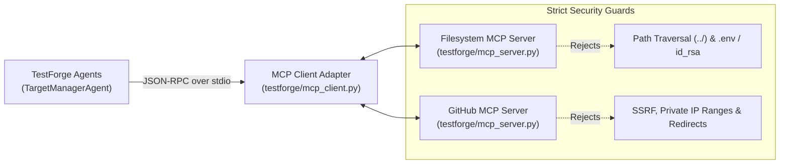

# TestForge — MCP, A2A, Google ADK & CrewAI Integrations

**Document Version:** 1.0.0  
**Last Verified:** November 2, 2026  
**Primary Source Modules:** `testforge/mcp_server.py`, `testforge/mcp_client.py`, `testforge/a2a.py`, `testforge/a2a_protocol.py`, `testforge/adk_generator.py`, `testforge/crew_critic.py`  

---

## 1. Model Context Protocol (FastMCP) Integration

### What is MCP?
The **Model Context Protocol (MCP)** is an open standard developed by Anthropic that standardizes how AI agents discover and invoke external tools and context sources. TestForge implements native MCP servers using the official Python **FastMCP SDK** (`mcp.server.fastmcp`).



### Registered MCP Servers & Tools

#### 1. Filesystem MCP Server (`create_filesystem_server`)
Confined strictly to a pre-approved repository root directory:
- **`read_text_file(path: str)`:** Reads text files with strict path-traversal validation. Rejects any path containing `..`, absolute escapes, or forbidden filenames (`.env`, `id_rsa`, `.key`, `.git`).
- **`list_directory(path: str)`:** Lists directory entries while concealing hidden credentials and VCS metadata.
- **`get_file_info(path: str)`:** Returns file metadata (size, last modified, permissions, SHA-256 hash).

#### 2. GitHub MCP Server (`create_github_server`)
Read-only repository inspector for Mode C ingestion:
- **`get_file_contents(owner: str, repo: str, path: str, ref: str)`:** Fetches remote file contents using authenticated or rate-limited anonymous API requests.
- **`get_repository_info(owner: str, repo: str)`:** Fetches repository metadata, primary language, and default branch.
- **`search_repositories(query: str, per_page: int)`:** Searches public repositories.
- **SSRF & Security Safeguards:** Validates hostnames against `ALLOWED_GITHUB_HOSTS` (`api.github.com`, `raw.githubusercontent.com`), enforces a 10MB maximum payload size, and strictly blocks redirection to local/private loopback IP addresses (`127.0.0.1`, `10.0.0.0/8`, `192.168.0.0/16`).

---

## 2. Agent-to-Agent (A2A) Protocol Implementation

### What is A2A?
The **Agent-to-Agent (A2A)** protocol is an emerging communication specification enabling autonomous AI agents to discover, negotiate, and delegate tasks to other agents across distributed networks.

### 1. FIPA-ACL Communicative Acts (`A2APerformative`)
TestForge structures all inter-agent messages using FIPA-ACL inspired communicative acts:
- **`REQUEST`:** Sender requests recipient to execute a task (e.g., Orchestrator requests Generator to synthesize tests).
- **`INFORM`:** Sender provides verified facts or execution results (e.g., Generator informs Orchestrator that candidate code is ready).
- **`AGREE`:** Recipient accepts a request and commits to execute it.
- **`REFUSE`:** Recipient or broker refuses execution due to policy, security check, or prompt injection.
- **`FAILURE`:** Recipient reports execution failure (timeout, syntax error, sandbox exception).
- **`PROPOSE`:** Sender proposes candidate directives or assertions (e.g., Critic proposes new boundary assertions).

### 2. Standardized Message Envelope (`A2AMessage`)
```python
class A2AMessage(BaseModel):
    message_id: str = Field(default_factory=lambda: f"msg_{uuid.uuid4().hex[:12]}")
    sender: str
    recipient: str
    performative: A2APerformative
    conversation_id: str
    reply_to: Optional[str] = None
    created_at: float = Field(default_factory=time.time)
    payload: Dict[str, Any]
    metadata: Dict[str, Any] = Field(default_factory=dict)
```

### 3. In-Process Message Broker (`A2ABroker`)
Routes envelopes between registered agent handlers (`AgentHandlerRegistration`). Enforces structural validation, immutability, and security access policies.

### 4. Public Agent Card (`/.well-known/agent.json`)
TestForge exposes its agent discovery metadata via the standard `/.well-known/agent.json` endpoint:
- **Agent Name:** `"TestForge Test Hardening Agent"`
- **Version:** `"1.0.0"`
- **Supported Capabilities:** `["unit_test_generation", "mutation_testing", "ast_scope_analysis", "test_hardening"]`
- **Supported Protocols:** `["HTTP/REST", "A2A/v1", "FastMCP/stdio"]`

---

## 3. Google ADK & CrewAI: Roles and Implementation Reality

To maintain total academic accuracy, it is essential to distinguish between TestForge's **native core pipeline** and its **framework adapters**:

| Dimension | Native Core Pipeline (`agents.py`) | Google ADK Adapter (`adk_generator.py`) | CrewAI Adapter (`crew_critic.py`) |
| :--- | :--- | :--- | :--- |
| **Primary Class** | `TestGeneratorAgent` / `AdversarialCriticAgent` | `GoogleADKTestGenerator` | `CrewAICriticAgent` |
| **Base Framework** | Native Python & Pydantic | Google Agent Development Kit (ADK) | CrewAI (`crewai`) |
| **Bridging Mechanism** | Direct invocation of `HybridLLMClient` | `ADKModelBridge(BaseLlm)` | `CrewAILLMBridge(BaseLLM)` |
| **Operational Role** | **Default Production Pipeline.** Used for all standard runs and verified benchmarks. | **Fully Functional Alternative Generator.** Can be swapped via config. | **Fully Functional Alternative Critic.** Can be swapped via config. |
| **Dependencies** | Python standard library, Pydantic, AST | `google-genai`, ADK core | `crewai`, `langchain-core` |
| **Test Verification** | Verified in `tests/test_agents.py` | Verified in `tests/test_adk_generator.py` | Verified in `tests/test_crew_critic.py` |

### Architectural Conclusion
TestForge does **not** rely on CrewAI or Google ADK as proprietary black boxes. Instead, TestForge implements clean **bidirectional adapter bridges** (`ADKModelBridge` and `CrewAILLMBridge`), allowing official ADK and CrewAI agent constructs to participate in TestForge's Blackboard and A2A reflection loops seamlessly.

