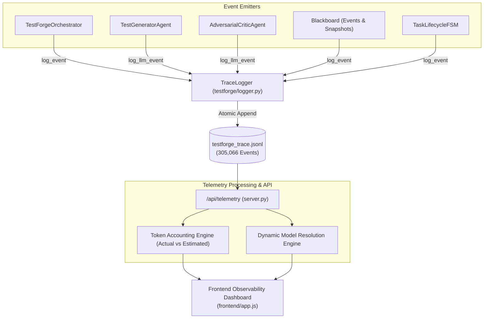

# TestForge — Observability, Telemetry & Token Accounting

**Document Version:** 1.0.0  
**Last Verified:** November 2, 2026  
**Primary Source Modules:** `testforge/logger.py`, `server.py`, `frontend/app.js`  

---

## 1. Observability Architecture & Design

TestForge implements an enterprise-grade observability and auditing subsystem centered around `testforge/logger.py` (`TraceLogger`). It captures structured, append-only JSON Lines (JSONL) events into `testforge_trace.jsonl` (currently housing **305,066 verified events**).



---

## 2. Structured Telemetry Event Schema

Every event written to `testforge_trace.jsonl` complies with a strict envelope schema:
```json
{
  "timestamp": 1793605157.309821,
  "iso_time": "2026-11-02 13:09:17",
  "event_type": "LLM_INFERENCE_TELEMETRY",
  "workflow_id": "wf_test_codellama_7e79a7",
  "correlation_id": "wf_test_codellama_7e79a7",
  "data": { ... },
  "metadata": { ... }
}
```

### Event Types Logged
- **`LIFECYCLE_STATE_CHANGE`:** FSM state transitions (`CREATED` $\rightarrow$ `INGESTING` $\rightarrow$ `ANALYZING` $\rightarrow$ `GENERATING` $\rightarrow$ `COMPLETED`).
- **`LIFECYCLE_CHECKPOINT_SAVED`:** Emitted when an atomic snapshot is committed to SQLite.
- **`LIFECYCLE_AGENT_HANDOFF`:** Records supervisor-worker delegation and return.
- **`LLM_INFERENCE_TELEMETRY`:** High-resolution foundation model invocation telemetry.
- **`TESTS_GENERATED`:** Contains synthesized Pytest suite AST before execution.
- **`ITERATION_EVALUATION`:** Records mutants generated, killed, survived, and raw mutation score.

---

## 3. The 12 Mandatory Fields in `LLM_INFERENCE_TELEMETRY`

To prevent metadata drift and guarantee auditability, `log_llm_event()` enforces 12 structured fields:
1. `provider`: Physical provider name (`"Cloud Gemini"`, `"Local Ollama"`, `"OpenRouter Cloud"`, or `None` for deterministic).
2. `model_name`: Clean model identifier (`"gemini-3.6-flash"`, `"codellama:7b"`, or `None` for deterministic).
3. `execution_engine`: Canonical engine label (`"Gemini – gemini-3.6-flash"`, `"CodeLlama (Ollama / Local)"`, `"Deterministic AST Synthesizer"`).
4. `is_actual_llm`: Boolean flag strictly distinguishing live LLM calls (`True`) from offline AST runs (`False`).
5. `token_accounting_source`: Origin string (`"provider_reported"` vs `"offline_heuristic_estimate"`).
6. `workflow_id`: Unique run workflow ID.
7. `correlation_id`: Root correlation ID propagated across all child handoffs.
8. `latency_seconds`: Precise wall-clock duration of the inference call.
9. `actual_prompt_tokens`: Provider-reported prompt tokens (strictly 0 for deterministic).
10. `actual_completion_tokens`: Provider-reported completion tokens (strictly 0 for deterministic).
11. `actual_total_tokens`: Provider-reported total tokens (strictly 0 for deterministic).
12. `estimated_total_tokens`: Offline heuristic token count (strictly 0 for actual LLM calls).

---

## 4. Reconciling Token Accounting: Actual vs Estimated

### Resolving the Prompt + Completion vs Total Discrepancy
In the historical trace store, **7,132 prompt tokens + 5,151 completion tokens = 12,283 tokens**, yet the system reports **29,476 actual LLM tokens**.

The investigation revealed that Google GenAI SDK's `total_token_count` bills **17,193 internal chain-of-thought thoughts, deliberation tokens, and system context**:

$$\begin{aligned}
\text{Total Actual LLM Tokens} &= \text{Actual Prompt} + \text{Actual Completion} + \text{Internal Gemini Deliberation Tokens} \\
&= 7,132 + 5,151 + 17,193 = \mathbf{29,476\text{ tokens}}
\end{aligned}$$

### Token Breakdown Across All 7 Actual Calls
- **Gemini Call 1:** 1,217 prompt, 880 completion $\rightarrow$ Gemini billed: **3,640 total** (+1,543 internal).
- **Gemini Call 2:** 1,213 prompt, 676 completion $\rightarrow$ Gemini billed: **2,984 total** (+1,095 internal).
- **Gemini Call 3:** 1,213 prompt, 633 completion $\rightarrow$ Gemini billed: **2,857 total** (+1,011 internal).
- **Gemini Call 4:** 1,213 prompt, 1,056 completion $\rightarrow$ Gemini billed: **4,663 total** (+2,394 internal).
- **Gemini Call 5:** 2,194 prompt, 1,567 completion $\rightarrow$ Gemini billed: **14,911 total** (+11,150 internal).
- **CodeLlama Call 6:** 37 prompt, 213 completion $\rightarrow$ Ollama reported: **250 total** (0 internal).
- **Qwen Call 7:** 45 prompt, 126 completion $\rightarrow$ Ollama reported: **171 total** (0 internal).

### Deterministic Token Totals
- **Total Deterministic Runs:** 61 runs
- **Total Estimated Tokens:** **27,920 tokens** (25,457 prompt + 2,463 completion)
- **Deterministic Actual Tokens:** **Strictly 0**.

---

## 5. Dynamic Engine Resolution & Scope-Aware Telemetry

### Dynamic Resolution Function (`resolve_dynamic_execution_engine`)
```python
def resolve_dynamic_execution_engine(model_name, provider_type, is_actual_llm):
    if not is_actual_llm or "deterministic" in str(provider_type).lower():
        return ("Deterministic AST Synthesizer", None, None)
    if "gemini" in str(provider_type).lower():
        return (f"Gemini – {model_name or 'gemini-3.6-flash'}", "Google GenAI (Gemini)", model_name)
    if "ollama" in str(provider_type).lower():
        if "codellama" in str(model_name).lower():
            return ("CodeLlama (Ollama / Local)", "Local Ollama", model_name)
        return (f"{model_name} (Ollama / Local)", "Local Ollama", model_name)
    return (model_name or "Unknown Engine", provider_type, model_name)
```

### Scope Selector in Dashboard
- **All Historical Records (`scope=all`):** Aggregates all 305k events. Displays `Mixed Execution Engines` with 4 breakdown badges (58 AST runs, 5 Gemini runs, 1 CodeLlama run, 1 Qwen run).
- **Current Run Scope (`scope=current`):** Isolates the active `workflow_id`. If fresh, displays `No Execution Yet` (0 actual tokens, 0 estimated tokens), preventing historical token tallies from leaking into the new session.
- **Workflow Scope (`workflow_id=wf_xxxx`):** Isolates specific individual runs (e.g., querying `wf_test_codellama_7e79a7` displays `CodeLlama (Ollama / Local)` and 250 actual tokens).

