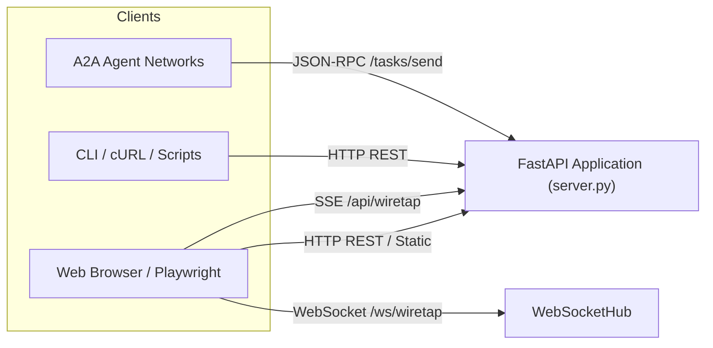

# TestForge — API, Frontend & Backend Reference Manual

**Document Version:** 1.0.0  
**Last Verified:** November 2, 2026  
**Primary Source Modules:** `server.py`, `frontend/app.js`, `frontend/index.html`  

---

## 1. Backend Application Architecture (`server.py`)

TestForge's backend is implemented using **FastAPI** running on the ASGI standard (Uvicorn). It exposes REST endpoints, Server-Sent Events (SSE), and WebSockets to drive the user interface and external agent integrations.



---

## 2. Exhaustive API Endpoint Reference

### 1. Health & Discovery Endpoints

#### `GET /healthz`
- **Description:** Basic liveness probe.
- **Response (200 OK):**
  ```json
  {"status": "ok", "service": "testforge-api", "timestamp": 1793605157.1}
  ```

#### `GET /readyz`
- **Description:** Readiness check verifying SQLite database connectivity and local Ollama daemon status.
- **Response (200 OK):**
  ```json
  {
    "status": "ready",
    "checkpoint_db_accessible": true,
    "ollama_available": true,
    "ollama_models": ["codellama:7b", "qwen2.5-coder:7b"],
    "timestamp": 1793605157.2
  }
  ```

#### `GET /.well-known/agent.json`
- **Description:** Returns the official A2A Agent Card for agentic service discovery.
- **Response (200 OK):** Contains agent name, capabilities, protocols, and input/output schemas.

---

### 2. Hardening Job Control Endpoints

#### `POST /api/harden/start`
- **Description:** Ingests target source code, initializes blackboard partitions, and kicks off the background reflection loop.
- **Request Body:**
  ```json
  {
    "mode": "code",
    "source_code": "def add(a, b): return a + b",
    "target_file": "samples/math_service.py",
    "target_score": 85.0,
    "max_iterations": 3,
    "prompt_strategy": "REACT",
    "persona": "QA_ENGINEER"
  }
  ```
- **Response (200 OK):**
  ```json
  {"job_id": "job_3f4e2d", "workflow_id": "wf_7a8b9c", "status": "STARTED"}
  ```

#### `GET /api/harden/status/{job_id}`
- **Description:** Queries active job progress, current FSM state, and mutation metrics.
- **Response (200 OK):**
  ```json
  {
    "job_id": "job_3f4e2d",
    "lifecycle_state": "EVALUATING",
    "current_iteration": 1,
    "raw_mutation_score": 89.47,
    "adjusted_mutation_score": 94.44,
    "terminated": false
  }
  ```

#### `POST /api/harden/cancel/{job_id}`
- **Description:** Signals cooperative cancellation to the active orchestrator.
- **Response (200 OK):**
  ```json
  {"job_id": "job_3f4e2d", "cancellation_requested": true, "status": "CANCELLING"}
  ```

---

### 3. Checkpoints & Time-Travel Endpoints

#### `GET /api/checkpoints`
- **Description:** Lists saved blackboard snapshots from SQLite (`testforge_checkpoints.db`).
- **Query Parameters:** `limit: int = 50`, `stage: Optional[str]`, `job_id: Optional[str]`.
- **Response (200 OK):** Array of `CheckpointSummary` objects.

#### `GET /api/checkpoints/{id}`
- **Description:** Retrieves the complete serialized snapshot for a specific checkpoint ID.
- **Response (200 OK):** Returns full JSON representation of `BlackboardSnapshot`.

#### `GET /api/checkpoints/diff`
- **Description:** Computes unified semantic AST diff between two checkpoints.
- **Query Parameters:** `base: str` (baseline checkpoint ID), `target: str` (candidate checkpoint ID).
- **Response (200 OK):**
  ```json
  {
    "base_id": "chk_1",
    "target_id": "chk_2",
    "unified_diff": "--- baseline\n+++ candidate\n@@ -5,3 +5,8 @@\n+    assert calculate_discount(100, 10, False) == 90.0",
    "lines_added": 5,
    "lines_removed": 0
  }
  ```

#### `POST /api/checkpoints/{id}/restore`
- **Description:** Restores blackboard state and active test suite to the specified checkpoint snapshot.

---

### 4. Telemetry & MCP Endpoints

#### `GET /api/telemetry`
- **Description:** Returns structured event traces, token accounting, and dynamic execution engine resolution.
- **Query Parameters:** `scope: str = "all"` (`"all"`, `"current"`, or specific `workflow_id`).
- **Response (200 OK):**
  ```json
  {
    "scope": "all",
    "configured_model": "gemini-3.6-flash",
    "active_provider": "Google GenAI (Gemini)",
    "actual_execution_engine": "Mixed Execution Engines",
    "execution_engine_kpi": "Mixed Execution Engines",
    "last_execution_model": "Deterministic AST Synthesizer",
    "execution_engine_breakdown": {
      "Deterministic AST Synthesizer": 61,
      "Gemini – gemini-3.6-flash": 5,
      "CodeLlama (Ollama / Local)": 1,
      "qwen2.5-coder:7b (Ollama / Local)": 1
    },
    "total_logged_events": 305066,
    "actual_llm_tokens_used": 29476,
    "actual_prompt_tokens_used": 7132,
    "actual_completion_tokens_used": 5151,
    "estimated_tokens_used": 27920
  }
  ```

#### `GET /api/mcp/status`
- **Description:** Queries status and tool lists of registered FastMCP servers (Filesystem & GitHub).

#### `GET /api/wiretap` (SSE Stream)
- **Description:** Server-Sent Events stream delivering live blackboard events and agent handoffs to the UI.

---

## 3. Frontend Architecture (`frontend/`)

- **Vanilla JS Architecture (`app.js`):** Modular event-driven architecture organized into functional domains:
  1. *Navigation Controller:* Handles tab switching (`#tab-workbench`, `#tab-wiretap`, `#tab-checkpoints`, `#tab-telemetry`, `#tab-benchmarking`).
  2. *Hardening Controller:* Dispatches run requests, polls job status, and handles cancellation.
  3. *Wiretap Controller:* Connects to `/api/wiretap` SSE stream, dynamically rendering event cards with color-coded stage badges.
  4. *Checkpoints Controller:* Fetches historical snapshots, displays metadata chips, and drives the unified diff modal.
  5. *Telemetry Controller:* Fetches `/api/telemetry`, updates dynamic KPI cards, formats token tables, and handles scope filtering.
  6. *Benchmark Controller:* Drives empirical ablation matrices and displays statistical comparison charts.
- **Zero Build Tooling:** Pure browser-native HTML/JS/CSS. No Webpack, Vite, Node runtime, or external CDN dependencies are required.
- **Disabled Browser Caching:** `server.py` enforces `NoCacheStaticFiles` (`Cache-Control: no-cache, no-store, must-revalidate`), eliminating stale JavaScript cache defects during testing.

