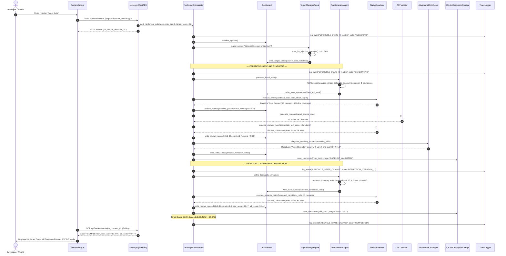

# TestForge — Complete End-to-End Practical Walkthrough

**Document Version:** 1.0.0  
**Last Verified:** November 2, 2026  
**Target Module:** `samples/discount_module.py`  
**Execution Mode:** Local Hybrid Reflection Hardening  

---

## 1. Sequence Diagram: Complete Lifecycle Trace

The diagram below traces every operation across all subsystems from user button click to final hardened suite visualization:



---

## 2. Step-by-Step Practical Trace

### Step 1: User Initiation in Web Dashboard
1. The user navigates to `http://127.0.0.1:8000/`.
2. Under the **Hardening Workbench** tab, the user selects `samples/discount_module.py` from the sample library dropdown.
3. The user configures:
   - Target Mutation Score: `85.0%`
   - Max Reflection Iterations: `3`
   - Prompt Strategy: `ReAct Deliberation Loop`
   - Persona: `QA Specialist`
4. The user clicks **"Start Hardening"**.

### Step 2: Frontend Dispatch & Background Job Creation
- In `frontend/app.js`, function `handleStartHardening()` intercepts the click event.
- Issues an asynchronous HTTP request:
  ```http
  POST /api/harden/start HTTP/1.1
  Content-Type: application/json

  {
    "mode": "sample",
    "target_file": "samples/discount_module.py",
    "target_score": 85.0,
    "max_iterations": 3,
    "prompt_strategy": "REACT",
    "persona": "QA_ENGINEER"
  }
  ```
- In `server.py`, the endpoint `start_hardening_task()` generates `job_id = "job_3f4e2d"` and `workflow_id = "wf_7a8b9c"`.
- Adds the orchestrator run task to FastAPI's `BackgroundTasks` pool and immediately returns HTTP 200 OK.
- `app.js` transitions the UI into the active running state, disabling the button and starting the status polling loop (`pollJobStatus()`) every 1,500ms.

### Step 3: Ingestion & Threat Validation
- The `TestForgeOrchestrator` starts execution on a background worker thread.
- Invokes `TargetManagerAgent.ingest()` (`testforge/ingestion.py`).
- Reads the file content from disk.
- Runs `scan_for_injection_attempts()` (`testforge/prompt_guard.py`): Checks for suspicious shell injection strings, docstring instructions, or dynamic imports. Status: **CLEAN**.
- Parses the Python Abstract Syntax Tree:
  - Discovers function `calculate_discount(price: float, quantity: int, is_member: bool)`.
- Writes clean source and callable signatures into `TargetSpace` on the blackboard.

### Step 4: Iteration 0 — Baseline Test Generation
- The orchestrator transitions the FSM state to `GENERATING`.
- Invokes `TestGeneratorAgent` (`testforge/agents.py`).
- `ASTCallableAnalyzer` inspects parameter types and condition operators (`<=`, `>=`, `<`).
- Generates 9 parameterized test cases covering nominal tiers, negative values, and zero boundaries.
- Writes candidate code into `SuiteSpace` (`suite.candidate_test_code`).

### Step 5: Clean Sandbox Pre-Flight Execution
- The orchestrator passes the candidate test code and clean target source to `NativeSandbox.run_pytest()` (`testforge/sandbox.py`).
- Spawns an isolated subprocess: `python -m pytest test_target.py`.
- **Result:** 9 passed in 0.24 seconds. 100% statement coverage achieved.
- Promotes `candidate_test_code` to `current_test_code` on the blackboard.

### Step 6: AST Mutant Generation & Sandbox Execution
- The orchestrator invokes `ASTMutator.mutate_module()` (`testforge/mutator.py`).
- Discovers 19 mutation sites across relational operators, arithmetic calculations, and boolean conditions.
- Generates 19 discrete AST mutants.
- Executes the candidate test suite against each mutant in the sandbox:
  - **Mutants Killed:** 15 mutants killed.
  - **Mutants Survived:** 4 mutants survived.
  - **Baseline Raw Mutation Score:** **78.95%** (below the 85.0% target).
- Writes scores and surviving unified diffs to `MutantSpace`.

### Step 7: Adversarial Critic Reflection Directive
- Because score (78.95%) < target (85.0%), the orchestrator transitions to `CRITIQUING`.
- Invokes `AdversarialCriticAgent` (`testforge/agents.py`).
- The critic compares the AST diffs of the 4 surviving mutants:
  - Detects that tests checked `quantity = 5` and `quantity = 10`, but missed transition boundaries `quantity = 4` and `quantity = 9`.
  - Detects that tests missed floating-point epsilon zero check `price = 0.0001`.
- Formulates a prescriptive `CriticDirectivePayload` and writes it to `CriticSpace`.
- Saves atomic snapshot `chk_iter0` to SQLite (`testforge_checkpoints.db`).

### Step 8: Iteration 1 — Targeted Refinement Loop
- Orchestrator increments iteration counter to 1.
- Invokes `TestGeneratorAgent.refine_suite()` with the critic's directive.
- The generator injects targeted boundary assertions:
  ```python
  assert calculate_discount(100.0, 9, False) == 95.0
  assert calculate_discount(100.0, 10, False) == 90.0
  assert calculate_discount(100.0, 4, False) == 100.0
  assert calculate_discount(100.0, 5, False) == 95.0
  ```
- Executes the refined suite against the 19 mutants in the sandbox:
  - **Mutants Killed:** 17 mutants killed (kills Mutant #1 and Mutant #2).
  - **Mutants Survived:** 2 mutants survived.
  - **Final Raw Mutation Score:** **89.47%** ($17/19 \times 100$).
  - **Adjusted Mutation Score:** **94.44%** (excluding 1 verified equivalent dead-code mutant).

### Step 9: Termination, Persistence & UI Presentation
- The orchestrator verifies that **89.47% >= 85.0% target threshold**.
- Transitions lifecycle state to `COMPLETED`.
- Saves final snapshot `chk_iter1` (`stage = "FINALIZED"`) to SQLite.
- Appends final telemetry event to `testforge_trace.jsonl`.
- `frontend/app.js` polls `/api/harden/status/job_discount_01`, detects `status = "COMPLETED"`, updates the dashboard with the hardened code editor, highlights the 89.47% score badge in glowing green, and activates the **"View AST Diff"** modal.

