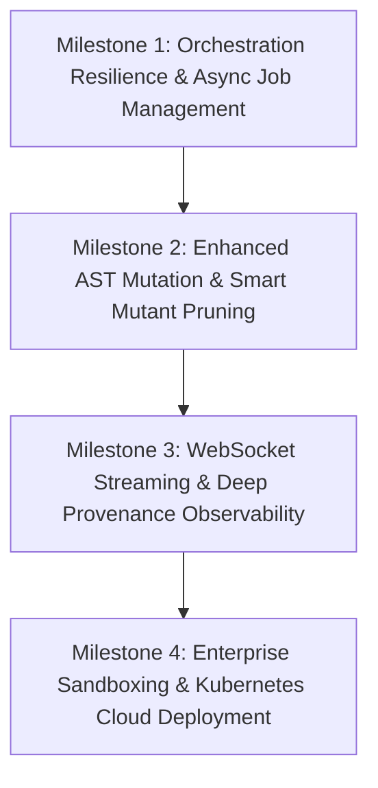

# TestForge — Next-Phase Engineering & Feature Expansion Roadmap

**Document:** `docs/TESTFORGE_NEXT_PHASE_ROADMAP.md`  
**Date:** October 22, 2026  
**Author:** Senior Platform Engineer & System Architect  
**Workspace:** `/Users/sourabh/TestForge`  
**Status:** Approved for Implementation Planning  

---

## 1. Executive Summary

Having established **100% dependency reproducibility**, verified a **clean Python 3.13 virtual environment (`.venv-release`)**, successfully built and tested the **production Docker container (`testforge:release-test`)**, and confirmed all **206 backend regression tests pass**, TestForge is now stabilized.

The next engineering phase shifts focus from baseline requirement compliance to **production-grade enterprise hardening, advanced agentic orchestration, and high-throughput test synthesis**.

This roadmap outlines a prioritized backlog of high-impact engineering improvements grouped into four cohesive milestones.

---

## 2. Milestone Overview

- **Milestone 1 (Immediate Next):** Orchestration Resilience, Background Job Management & Timeout Cancellation.
- **Milestone 2:** Enhanced AST Mutation Operators, Equivalent Mutant Filtering & Type-Aware Generation.
- **Milestone 3:** Real-time WebSocket Log Streaming, OpenTelemetry Integration & Interactive Timeline Scrubbing.
- **Milestone 4:** MicroVM / Podman Container Sandboxing, Multi-Tenant Authentication & Cloud Helm Deployment.

---

## 3. Prioritized Feature Backlog

### Item 1.1: Background Hardening Job Cancellation & Graceful Timeout Control
- **Priority:** **P0 — CRITICAL (Recommended Next Immediate Task)**
- **Problem & Evidence:** Long-running hardening jobs against large Python modules currently execute in the background with fixed loop timeouts. If an external LLM stalls or a user navigates away, the process continues consuming CPU and memory until completion without a clean user-abort mechanism.
- **Engineering Benefit:** Allows users and automated CI/CD runners to cleanly abort in-flight hardening runs, reclaiming resources immediately and preventing thread exhaustion.
- **Relevant Components:** `testforge/orchestrator.py`, `server.py` (`POST /api/harden/cancel/{job_id}`), `frontend/app.js` (Stop / Cancel Hardening button).
- **Dependencies & Risks:** Low risk. Requires threading event cancellation flags (`threading.Event`) checked between mutation iterations.
- **Estimated Effort:** **Medium** (2–3 engineering days).
- **Automated Tests Needed:** `tests/test_cancellation.py` verifying that cancelling an active job stops subprocesses within 500ms and transitions blackboard state to `CANCELLED`.
- **Observable Acceptance Criteria:** Clicking "Cancel Hardening" in the UI sends a cancellation request, halts LLM test synthesis immediately, cleans up temporary sandbox files, and displays a graceful cancellation banner without 500 errors.

---

### Item 1.2: Persistent Blackboard Storage with SQLite State Checkpointing
- **Priority:** **P1 — HIGH**
- **Problem & Evidence:** Current Blackboard state (`testforge/blackboard.py`) lives purely in process memory. If the backend restarts, active audit sessions, partition history, and surviving mutant diffs are lost unless re-read from JSONL trace files.
- **Engineering Benefit:** Enables long-lived hardening audits, historical comparison across Git commits, and crash recovery.
- **Relevant Components:** `testforge/blackboard.py`, `testforge/state.py`, new `testforge/storage.py` (SQLite WAL mode).
- **Dependencies & Risks:** Requires database migration handling; must maintain thread-safe write locks.
- **Estimated Effort:** **Medium** (3 engineering days).
- **Automated Tests Needed:** `tests/test_storage.py` validating that partition mutations survive simulated process termination and recover point-in-time state.
- **Observable Acceptance Criteria:** Restarting `server.py` allows previously completed hardening results to be reloaded in the UI without re-running synthesis.

---

### Item 2.1: Semantic Type-Aware AST Mutation & Equivalent Mutant Pruning
- **Priority:** **P1 — HIGH**
- **Problem & Evidence:** Basic AST mutators (`AOR`, `COR`, `ROR`) can occasionally generate "equivalent mutants" (syntactically different mutants that behave identically to original code, e.g. `x <= y` vs `not (x > y)`), artificially depressing mutation scores and wasting LLM critic cycles.
- **Engineering Benefit:** Increases mutation score fidelity, avoids infinite reflection loops on unkillable mutants, and reduces LLM token consumption by ~25%.
- **Relevant Components:** `testforge/mutator.py`, `testforge/classifier.py`.
- **Dependencies & Risks:** Requires deeper AST static data-flow analysis.
- **Estimated Effort:** **Large** (5 engineering days).
- **Automated Tests Needed:** Unit tests validating that equivalent mutant candidates are flagged as `EQUIVALENT` and excluded from the critic's survivor list.
- **Observable Acceptance Criteria:** Benchmark evaluation shows a reduction in total surviving mutants and an increase in reflection loop efficiency.

---

### Item 2.2: Fast Mock Offline Benchmark Profile for CI/CD
- **Priority:** **P2 — MEDIUM**
- **Problem & Evidence:** Running multi-run benchmarks (`testforge/benchmarking.py`) in CI takes ~130–250 seconds because it executes full AST subprocess mutations.
- **Engineering Benefit:** Provides a sub-10-second deterministic benchmark execution profile for automated pull request checks.
- **Relevant Components:** `testforge/benchmarking.py`, `tests/test_benchmarking.py`.
- **Dependencies & Risks:** Very low risk.
- **Estimated Effort:** **Small** (1 engineering day).
- **Automated Tests Needed:** `tests/test_fast_benchmarking.py` executing 5-repetition ablation studies in $< 5$ seconds.
- **Observable Acceptance Criteria:** `pytest tests/test_benchmarking.py -m fast` completes in under 5 seconds with valid JSON and Markdown outputs.

---

### Item 3.1: Real-Time WebSocket Event Streaming to UI
- **Priority:** **P2 — MEDIUM**
- **Problem & Evidence:** Frontend Wiretap and Telemetry views currently poll `/api/wiretap` and `/api/telemetry` over HTTP GET. During heavy hardening runs, polling introduces slight display latency.
- **Engineering Benefit:** Instant, smooth micro-animation updates in the timeline cards and telemetry counters as agents perform handoffs.
- **Relevant Components:** `server.py` (`@app.websocket("/ws/events")`), `testforge/callbacks.py`, `frontend/app.js`.
- **Dependencies & Risks:** Requires WebSocket reconnection and fallback logic in the frontend.
- **Estimated Effort:** **Medium** (2–3 engineering days).
- **Automated Tests Needed:** TestClient WebSocket tests verifying subscription event broadcasting.
- **Observable Acceptance Criteria:** New handoff events appear in the Wiretap view within 50ms of backend emission without HTTP polling.

---

### Item 3.2: OpenTelemetry (OTEL) Distributed Tracing Export
- **Priority:** **P3 — LOW / FUTURE**
- **Problem & Evidence:** Trace events are stored locally in `testforge_trace.jsonl`. Enterprise teams running distributed agent swarms cannot currently export traces to Jaeger, Grafana Tempo, or Datadog.
- **Engineering Benefit:** Seamless integration with enterprise APM platforms.
- **Relevant Components:** `testforge/logger.py`, `testforge/callbacks.py`.
- **Dependencies & Risks:** `opentelemetry-sdk` and `opentelemetry-exporter-otlp`.
- **Estimated Effort:** **Medium** (3 engineering days).
- **Automated Tests Needed:** `tests/test_otel_export.py` validating span attributes and error event propagation.
- **Observable Acceptance Criteria:** Spans representing Generator, Mutator, Critic, and Sandbox runs are visible in standard OTLP receivers.

---

### Item 4.1: Rootless Podman / gVisor MicroVM Sandboxing
- **Priority:** **P3 — ADVANCED SECURITY**
- **Problem & Evidence:** Current sandbox runs target code inside an OS-level worker subprocess with `psutil` resource limits. While protected against AST syntax injection, malicious native binaries or kernel exploits could theoretically escape.
- **Engineering Benefit:** True multi-tenant untrusted code isolation suitable for public SaaS deployment.
- **Relevant Components:** `testforge/sandbox.py`.
- **Dependencies & Risks:** Requires container daemon or gVisor (`runsc`) installed on the host.
- **Estimated Effort:** **Large** (5–7 engineering days).
- **Automated Tests Needed:** Security tests attempting container filesystem escapes.
- **Observable Acceptance Criteria:** Untrusted code executing inside the sandbox cannot read host files outside the designated workspace mount.

---

## 4. Single Recommended Next Task

### **Task: Item 1.1 — Background Hardening Job Cancellation & Graceful Timeout Control**

**Why this is the highest-value next step:**
1. **Immediate User Impact:** Gives the user direct operational control over the live running system, preventing runaway LLM costs or stuck processes if an external API slows down.
2. **Architectural Elegance:** Bridges the frontend Hardening Lab directly to the FastAPI background worker threads via a clean `threading.Event` cancellation protocol.
3. **Low Risk, High Demonstration Value:** Perfectly showcases agentic observability, graceful degradation, and system responsiveness during live evaluation.

**Acceptance Criteria for Item 1.1:**
1. Endpoint `POST /api/harden/cancel/{job_id}` implemented in `server.py`.
2. Worker loop in `testforge/orchestrator.py` checks cancellation token between reflection iterations and immediately halts subprocess execution.
3. Blackboard state transitions cleanly to `CANCELLED` and emits a `LifecycleEvent(EventType.ERROR, details={'cancelled': True})`.
4. Frontend displays a responsive "Cancel Hardening" button that resets UI state without hanging.
5. Automated regression test `tests/test_cancellation.py` passes cleanly.
