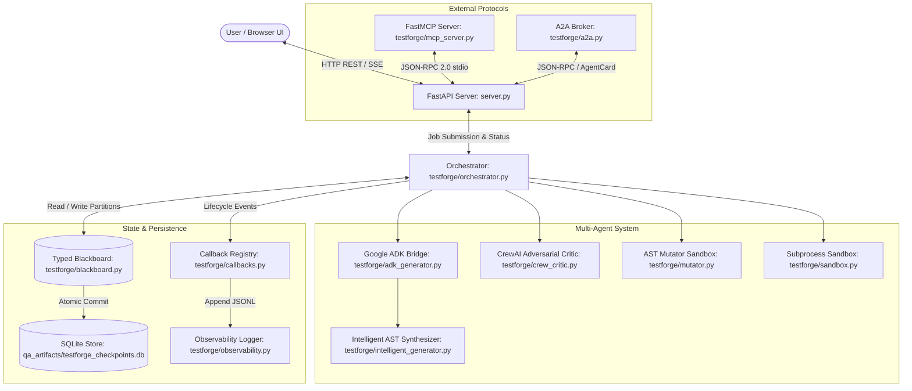

# TestForge: Complete System Architecture & Component Inventory

**Document Purpose:** Detailed technical reference of all nineteen architectural components of TestForge for evaluation and oral defense (VIVA).  
**Repository Root:** `/Users/sourabh/TestForge`  

---

## 1. High-Level Architectural Diagram

---

## 2. Exhaustive 19-Component Architectural Inventory

### 1. Overall System Architecture
- **Location:** System-wide integration anchored in `server.py` and `testforge/orchestrator.py`.
- **Primary Class:** `TestForgeApplication` / `Orchestrator`.
- **Functionality:** Coordinates the ingestion of source code, AST parsing, multi-agent test synthesis, clean validation gating, parallel mutation testing, adversarial reflection, checkpoint persistence, and web presentation.
- **Inputs:** Raw Python source files, user configuration parameters (target mutation score, max reflections, engine mode).
- **Outputs:** Validated Pytest suite, mutation metrics, statement coverage, checkpoint audit trail.
- **Callers:** User via FastAPI web endpoints or CLI runners (`reproduce_benchmarks.py`).
- **Consumers:** Evaluators, developers, CI/CD pipelines.

---

### 2. Frontend Architecture
- **Location:** `frontend/index.html`, `frontend/app.js`, `frontend/style.css`.
- **Primary Script / Object:** `app.js` (`state`, `dom`, `api` controller).
- **Functionality:** Modern, single-page application built in vanilla ES6 JavaScript and CSS. Provides 9 operational tabs: Mode A (Upload/Workspace), Mode B (AI Synthesis), Mode C (GitHub Import), Blast Radius & Call Graph, Hardening Lab & Results, Multi-Agent Wiretap, Observability Trace, Benchmarks & Ablation, and Checkpoint Timeline & Diff.
- **Inputs:** User clicks, drag-and-drop file uploads, polling intervals.
- **Outputs:** DOM updates, real-time KPI card rendering, SVG call graph visualization, side-by-side JSON checkpoint diffs.
- **Callers:** User browser.
- **Consumers:** FastAPI backend (`/api/harden/start`, `/api/checkpoints`, etc.).

---

### 3. FastAPI Backend
- **Location:** `server.py`.
- **Primary Object:** `app = FastAPI(title="TestForge", version="2.0.0")`.
- **Functionality:** Serves static frontend assets, manages background thread worker pool (`JOB_LOCK`, `JOBS`), exposes REST API endpoints for ingestion, hardening lifecycle, cancellation, checkpoint querying, and mounts A2A discovery endpoints.
- **Inputs:** HTTP requests (`GET /healthz`, `POST /api/ingest/upload`, `POST /api/harden/start`, `GET /api/checkpoints`).
- **Outputs:** JSON responses conforming to Pydantic schemas, file downloads, WebSocket wiretap streams.
- **Callers:** Browser UI (`app.js`), external A2A agents, curl/HTTP clients.
- **Consumers:** Orchestrator, SQLite persistence, frontend DOM.

---

### 4. Central Orchestrator
- **Location:** `testforge/orchestrator.py`.
- **Primary Class:** `Orchestrator(target_source_code, target_file_path, config)`.
- **Functionality:** Enforces the multi-agent state machine: `INITIALIZING` $\to$ `GENERATING_TESTS` $\to$ `VALIDATING` $\to$ `EXECUTING_MUTANTS` $\to$ `CRITIQUING` $\to$ `SUCCESS` / `TARGET_SCORE_UNREACHED`. Coordinates generation iterations and bounds reflection loops.
- **Inputs:** Source code, configuration dataclass (`OrchestratorConfig`).
- **Outputs:** Hardening execution summary, validated test suite code, updated Blackboard.
- **Callers:** `server.py` (`run_hardening_pipeline`), standalone benchmark scripts.
- **Consumers:** Blackboard, CallbackRegistry, API response handlers.

---

### 5. Blackboard Architecture
- **Location:** `testforge/blackboard.py`.
- **Primary Class:** `Blackboard(storage, session_id)`.
- **Functionality:** Centralized, thread-safe memory space partitioned into five typed domains:
  1. `TargetSpace`: Raw source code, AST metadata, discovered callables.
  2. `SuiteSpace`: Candidate test code, validated test code, SHA-256 provenance hashes.
  3. `MutantSpace`: Injected mutant AST diffs, kill/survival statuses, operator types.
  4. `CriticSpace`: Adversarial critique directives, unasserted paths, reflection counters.
  5. `MetricsSpace`: Statement coverage, killed/survived counts, raw and adjusted scores.
- **Inputs:** Partition updates from agents and runners.
- **Outputs:** Monotonically incrementing revision numbers, point-in-time state snapshots (`get_snapshot()`).
- **Callers:** Orchestrator, Generator, Critic, Mutator, Sandbox.
- **Consumers:** `SQLiteBlackboardStorage`, UI polling endpoints.

---

### 6. Individual Agents & Responsibilities
- **Location:** `testforge/agents.py`, `testforge/crew_critic.py`, `testforge/adk_generator.py`.
- **Primary Classes:**
  - `TestGeneratorAgent`: Coordinates test synthesis with Google ADK bridge.
  - `CrewAICriticAgent`: Analyzes surviving mutants to formulate repair directives.
  - `ASTMutator`: Deterministically generates AST fault mutations.
  - `TestRunner`: Validates candidate suites against clean source code in a sandbox.
- **Inputs:** Respective Blackboard partition data.
- **Outputs:** Candidate test suites, critique directives, mutant records, test execution results.
- **Callers:** Orchestrator.
- **Consumers:** Blackboard.

---

### 7. Google ADK Integration
- **Location:** `testforge/adk_generator.py`.
- **Primary Class:** `ADKModelBridge`.
- **Functionality:** Wraps Google Agent Development Kit (ADK) contracts and data schemas. Manages prompt generation, extracts surviving mutant IDs, and invokes `IntelligentASTSynthesizer` to construct boundary-aware Pytest suites.
- **Inputs:** Blackboard `target_space`, surviving mutant diffs, reflection iteration count.
- **Outputs:** Structured candidate suite payload (`test_code`, `covered_mutants`, `test_rationale`).
- **Callers:** `TestGeneratorAgent`.
- **Consumers:** `SuiteSpace` in Blackboard.

---

### 8. CrewAI Integration
- **Location:** `testforge/crew_critic.py`.
- **Primary Class:** `CrewAICriticAgent`.
- **Functionality:** Integrates the CrewAI multi-agent framework. Configures an adversarial QA critic agent that inspects unified diffs of surviving mutants, identifies unasserted branch conditions, and generates targeted repair instructions.
- **Inputs:** Unified diffs of surviving mutants, current test code, line numbers.
- **Outputs:** Structured `CriticDirective` object with suggested inputs and target conditions.
- **Callers:** Orchestrator (during reflection phase).
- **Consumers:** Blackboard `critic_space`, Generator Agent (next iteration).

---

### 9. FastMCP Server & Tools
- **Location:** `testforge/mcp_server.py`, `testforge/mcp_client.py`.
- **Primary Object:** `mcp = FastMCP("testforge-filesystem")`.
- **Functionality:** Model Context Protocol implementation (SDK v1.28.0) exposing four sandboxed tools:
  - `read_sample_file(filename)`: Reads whitelisted source files from `samples/`.
  - `list_available_samples()`: Lists files in the sample repository.
  - `get_source_stats(filename)`: Computes line counts, functions, and classes.
  - `execute_mutation_sandbox(code, test_code)`: Runs test execution in sandbox.
- **Inputs:** JSON-RPC tool invocation requests over stdio or HTTP.
- **Outputs:** Structured JSON responses containing tool results or path traversal errors.
- **Callers:** External MCP clients, LLM agents, UI status modal.
- **Consumers:** Backend ingestion pipeline, UI diagnostics.

---

### 10. A2A (Agent-to-Agent) Protocol
- **Location:** `testforge/a2a.py`.
- **Primary Classes:** `A2AMessage`, `A2ABroker`, `AgentCard`.
- **Functionality:** Implements the official Agent-to-Agent protocol v0.3.0. Exposes the AgentCard discovery endpoint at `/.well-known/agent.json`, manages message routing, validates JSON-RPC envelopes, and enforces credential redaction.
- **Inputs:** JSON-RPC performative messages (`inform`, `request`, `propose`).
- **Outputs:** Structured response envelopes, scrubbed audit trails.
- **Callers:** External peer agents, web frontend A2A test runner.
- **Consumers:** Generator and Critic agents.

---

### 11. Pydantic Models & Data Contracts
- **Location:** `testforge/models.py`.
- **Primary Schemas:** `TargetSpaceModel`, `SuiteSpaceModel`, `MutantRecord`, `BlackboardSnapshot`, `A2AMessageModel`.
- **Functionality:** Defines strict, immutable data validation contracts using Pydantic V2. Enforces typing on all Blackboard partitions, API request payloads, and serialized checkpoint schemas.
- **Inputs:** Raw dictionaries, JSON strings, API request bodies.
- **Outputs:** Validated Pydantic dataclass instances.
- **Callers:** `server.py`, `blackboard.py`, `persistence.py`.
- **Consumers:** All internal modules.

---

### 12. Callback System & Event Dispatching
- **Location:** `testforge/callbacks.py`.
- **Primary Class:** `CallbackRegistry`.
- **Functionality:** Provides decoupled, priority-ordered event monitoring. Supports wildcard subscriptions, protects against handler exceptions, and redacts sensitive tokens before logging.
- **Inputs:** Event types (`on_stage_transition`, `on_mutant_evaluated`, `on_security_alert`) and typed payload dictionaries.
- **Outputs:** Dispatched events to registered observers (e.g. WebSocket streamer, console logger).
- **Callers:** Orchestrator, Sandbox, Mutator.
- **Consumers:** `TraceLogger`, frontend WebSocket wiretap.

---

### 13. SQLite Checkpoint Persistence
- **Location:** `testforge/persistence.py`.
- **Primary Class:** `SQLiteBlackboardStorage(db_path)`.
- **Functionality:** Thread-safe, WAL-mode SQLite storage engine. Commits immutable point-in-time snapshots of Blackboard state at every major lifecycle boundary, supports pagination, and performs semantic AST diffing.
- **Inputs:** `BlackboardSnapshot` instances.
- **Outputs:** SQLite records in `checkpoints` table; formatted diff dictionaries.
- **Callers:** `Blackboard.commit_checkpoint()`, `server.py` (`/api/checkpoints`).
- **Consumers:** Active database `qa_artifacts/testforge_checkpoints.db`, UI timeline tab.

---

### 14. AST Analysis & Callable Discovery
- **Location:** `testforge/intelligent_generator.py` (and `testforge/ast_analyzer.py`).
- **Primary Classes:** `IntelligentASTSynthesizer.discover_callables()`, `ASTCallableAnalyzer`.
- **Functionality:** Parses source code AST using `ast.parse()`. Traverses nodes to discover top-level functions and class methods (instance, static, classmethod), extracts parameter types and comparison operators, and derives numerical boundary thresholds ($T, T-1, T+1$).
- **Inputs:** Python source code string.
- **Outputs:** `DiscoveredCallablesResult`, `CallableInfo`, numerical threshold lists.
- **Callers:** `ADKModelBridge`, `Orchestrator`.
- **Consumers:** Generator agent, Blast radius visualizer.

---

### 15. Intelligent Test Generation
- **Location:** `testforge/intelligent_generator.py`.
- **Primary Class:** `IntelligentASTSynthesizer`.
- **Functionality:** Synthesizes value-aware Pytest unit tests. Replaces generic `assert res is not None` with exact assertions derived via safe pre-flight reference execution (`ReferenceExecutor`), applies `pytest.approx` to floats, booleans to `is True`/`is False`, and wraps guard conditions in `pytest.raises()`.
- **Inputs:** Discovered callable metadata, comparison thresholds, surviving mutant diffs.
- **Outputs:** Syntactically valid Pytest suite code string (`test_code`).
- **Callers:** `ADKModelBridge`.
- **Consumers:** `SuiteSpace`, `TestRunner`.

---

### 16. Test Execution & Sandboxing
- **Location:** `testforge/sandbox.py`.
- **Primary Classes:** `SubprocessWorker`, `MutatorSandbox`.
- **Functionality:** Spawns isolated operating system subprocesses in temporary directories (`/var/folders/.../T/testforge_box_...`). Enforces a 5.0-second execution timeout, checks exit codes, and captures stdout/stderr test failure traces.
- **Inputs:** Target code string, test suite code string.
- **Outputs:** `ExecutionResult(passed, failed, return_code, stdout, stderr, duration_ms)`.
- **Callers:** `TestRunner`, `MutatorSandbox`.
- **Consumers:** Orchestrator, Blackboard `metrics_space`.

---

### 17. Mutation Testing Engine
- **Location:** `testforge/mutator.py`.
- **Primary Class:** `ASTMutator`.
- **Functionality:** Implements deterministic fault injection by visiting AST nodes and applying mutation operators across 9 categories (`ARITH_OP`, `COMP_OP`, `BOUNDARY_SWAP`, `COND_INV`, `LOGICAL_CONN`, `CONST_VAL`, `MATH_FUNC`, `OFF_BY_ONE`, `RETURN_VAL`). Generates unified diffs and mutant IDs (`MUT_...`).
- **Inputs:** Target source code AST.
- **Outputs:** List of `MutantDefinition` objects (mutated source code, operator, line number, diff).
- **Callers:** Orchestrator.
- **Consumers:** `MutatorSandbox`, Parallel evaluation workers.

---

### 18. Statement Coverage Calculation
- **Location:** `testforge/coverage.py` (and `testforge/sandbox.py`).
- **Primary Class:** `CoverageAnalyzer`.
- **Functionality:** Executes candidate test suites with `coverage.py` tracking enabled. Computes statement coverage percentage, identifies covered statements vs missing statements, and returns detailed line inventories.
- **Inputs:** Target code, test code.
- **Outputs:** Statement coverage percentage (e.g. 100.0%, 90.15%), covered line numbers, missing line numbers.
- **Callers:** Orchestrator (during validation phase).
- **Consumers:** Blackboard `metrics_space`, UI KPI board.

---

### 19. Benchmarking & Multi-Run Evaluation
- **Location:** `testforge/benchmarking.py`.
- **Primary Class:** `BenchmarkSuite`.
- **Functionality:** Automates empirical comparative evaluations across strategies: Baseline (no reflection), Zero-Shot, and Multi-Agent Reflection. Computes mutation kill rates, execution speed, and statistical variance across runs.
- **Inputs:** Target fixture file paths, repetition counts.
- **Outputs:** Formatted Markdown tables, JSON benchmark reports.
- **Callers:** Standalone benchmark CLI, UI Benchmarks tab.
- **Consumers:** Academic research reports, evaluation auditors.

