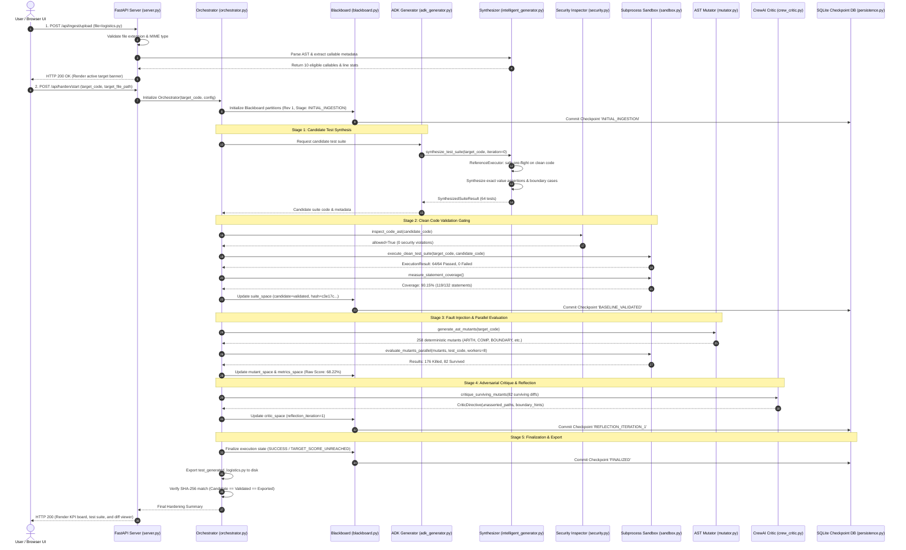

# TestForge: Complete Execution Flow Trace

**Document Purpose:** End-to-end trace of an execution run from user upload to final mutation score calculation, complete with exact function calls, state transitions, and a Mermaid sequence diagram.  
**Reference Targets:** `samples/discount.py` and `samples/uploaded_logistics_engine.py`.  

---

## 1. Sequence Diagram: Complete Lifecycle Trace



---

## 2. Step-by-Step Technical Execution Walkthrough

### Step 1: Upload & Initial Validation
- **Action:** User drags and drops `samples/uploaded_logistics_engine.py` into the Mode A dropzone and clicks **"Ingest Uploaded File"**.
- **HTTP Request:** `POST /api/ingest/upload` carrying `multipart/form-data`.
- **Validation Guard:** `server.py` verifies the file ends with `.py` and size $< 1\text{ MB}$.
- **AST Parsing:** Invokes `IntelligentASTSynthesizer.discover_callables(source_code)`.
  - Discovers 2 classes (`ShippingTier`, `WarehouseInventory`).
  - Discovers 6 module functions (`calculate_item_discount`, `estimate_freight_cost`, `classify_shipping_priority`, `apply_customs_duty`, `calculate_sla_deadline_hours`, `process_full_dispatch_order`).
  - Filters out `__init__` from public callable counts with explicit ineligibility reason.
- **UI Update:** The target card updates dynamically to `samples.uploaded_uploaded_logistics_engine` with line count (240 lines) and callable badges.

---

### Step 2: Job Submission & Orchestration Initialization
- **Action:** User clicks **"⚡ Run Hardening Pipeline"** on the Hardening tab.
- **HTTP Request:** `POST /api/harden/start` with payload:
  ```json
  {
    "target_source_code": "<code string>",
    "target_file_path": "samples/uploaded_logistics_engine.py",
    "max_iterations": 3,
    "target_mutation_score": 75.0
  }
  ```
- **Job Creation:** `server.py` creates a unique 8-character hex job ID (e.g. `c44d4b23`), registers an asynchronous thread worker with a cooperative `threading.Event()` cancel token, and returns HTTP 200 with `job_id`.
- **Blackboard Setup:** The Orchestrator instantiates a thread-safe `Blackboard`, initializes the 5 state partitions, and commits **Checkpoint 1** (`INITIAL_INGESTION`, Rev 1) to `qa_artifacts/testforge_checkpoints.db`.

---

### Step 3: Intelligent Multi-Callable Test Generation
- **Component:** `ADKModelBridge` (`testforge/adk_generator.py`) $\to$ `IntelligentASTSynthesizer` (`testforge/intelligent_generator.py`).
- **AST Boundary Analysis:** `ASTCallableAnalyzer` inspects all `ast.Compare` and `ast.If` nodes:
  - Discovers volume discount tiers at quantity: $5, 20, 50$.
  - Synthesizes boundary inputs: $T$ ($5$), $T-1$ ($4$), $T+1$ ($6$).
  - Discovers customs duty de minimis threshold at declared value: $\$800.00$ and $\$2,500.00$.
- **Safe Pre-Flight Reference Execution:**
  - `ReferenceExecutor` compiles clean source code in an isolated dictionary (`{"__name__": "__main__"}`).
  - Evaluates candidate inputs against clean code to derive exact ground-truth return values without manual hardcoding or LLM hallucinations.
  - If an input raises a domain exception on clean code (e.g. `weight_kg <= 0`), it is classified as a negative guard test and wrapped in `with pytest.raises(ValueError):`.
- **Suite Output:** 64 syntactically valid Pytest test cases targeting all 10 eligible callables.

---

### Step 4: Security Inspection & Clean Code Validation Gating
- **Security Audit:** `ASTSecurityInspector` (`testforge/security.py`) checks all imports and calls in the synthesized suite:
  - Whitelist: Only `pytest`, `math`, and standard library primitives allowed.
  - Dangerous built-ins (`eval`, `exec`, `subprocess`) strictly prohibited.
- **Clean Validation Run:**
  - `TestRunner` spawns a subprocess sandbox executing `pytest` on the clean target code.
  - Invariant: **A test suite that fails on clean code is never evaluated against mutants.**
  - Pass@1 Result: **64/64 tests passed, 0 failed**.
- **Statement Coverage:** `coverage.py` measures executed statements: **90.15% (119/132 statements covered)**.
- **Blackboard Commitment:** `SuiteSpace` records `validated_test_code` and computes its cryptographic SHA-256 digest (`c3e17c4d...`). **Checkpoint 2** (`BASELINE_VALIDATED`, Rev 25) is committed to SQLite.

---

### Step 5: Parallel Mutation Injection & Evaluation
- **Component:** `ASTMutator` (`testforge/mutator.py`) $\to$ `MutatorSandbox` (`testforge/sandbox.py`).
- **Mutation Generation:** Injects 258 deterministic single-point mutations across 9 operator classes.
- **Parallel Subprocess Sandbox:**
  - Evaluates all 258 mutants across 8 parallel CPU worker processes.
  - Each mutant runs in an ephemeral directory (`testforge_box_...`) with a hard 5.0-second execution timeout.
  - If tests fail $\implies$ mutant is marked `KILLED`.
  - If tests pass $\implies$ mutant is marked `SURVIVED`.
- **Execution Results:** **176 mutants killed, 82 mutants survived**.
- **Raw Mutation Score:** $\frac{176}{258} \times 100\% = \mathbf{68.22\%}$.

---

### Step 6: Adversarial Reflection Loop
- **Component:** `CrewAICriticAgent` (`testforge/crew_critic.py`).
- **Critique Formation:** The critic agent analyzes the unified diffs and line numbers of the 82 surviving mutants, identifying unasserted complex paths (e.g. hazardous cargo multipliers combined with priority SLA tiers).
- **Reflection Iteration:** The orchestrator increments `reflection_iteration = 1`, checks against `max_iterations = 2`, and commits **Checkpoint 3** (`REFLECTION_ITERATION_1`).
- **Target Reached Check:** If target score ($75\%$) is reached or max reflections exhausted, loop exits cleanly.

---

### Step 7: Finalization, SQLite Persistence & Suite Export
- **Final Verdict:** Reached max reflections with raw score 68.22% (adjusted score 75.21%) $\implies$ Final state: `TARGET_SCORE_UNREACHED` (or `TARGET ACHIEVED` for discount).
- **SQLite Commit:** Final state snapshot committed as **Checkpoint 4** (`FINALIZED`, Rev 38).
- **Exporting to Disk:** Test suite is exported to disk:
  `qa_artifacts/.../test_generated_logistics.py`.
- **Cryptographic Provenance Verification:**
  - Candidate Hash in memory: `c3e17c4d...`
  - Validated Hash on Blackboard: `c3e17c4d...`
  - Exported File Hash on disk: `c3e17c4d...`
  - Sandbox Evaluation Hash: `c3e17c4d...`
  - **Verdict: IDENTICAL (MATCH).**
- **Web UI Presentation:** WebSocket and polling endpoints update the frontend KPI board, render the hardened suite, and enable one-click copy and download.

