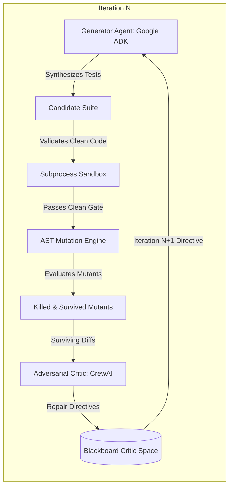

# TestForge: Multi-Agent Architecture & Agent Taxonomy

**Document Purpose:** In-depth technical reference on TestForge's agent design patterns, inter-agent collaboration, and agent taxonomy for academic evaluation.  
**Repository Files:** `testforge/agents.py`, `testforge/crew_critic.py`, `testforge/adk_generator.py`, `testforge/intelligent_generator.py`.  

---

## 1. Agent Taxonomy & Comparison Table

In rigorous academic software engineering, it is vital to distinguish between **autonomous decision-making agents**, **framework-wrapped bridges**, and **deterministic specialized engines**.

The table below classifies the five operational entities in TestForge:

| Agent / Entity Name | Primary Responsibility | Input Data | Output Data | Tools & Capabilities | LLM / Framework Integration | Blackboard Partitions Accessed | Autonomy vs. Determinism |
| :--- | :--- | :--- | :--- | :--- | :--- | :--- | :--- |
| **`TestGeneratorAgent` / `ADKModelBridge`** | Synthesizes value-aware candidate Pytest suites targeting discovered callables and surviving mutants. | Target source code, discovered AST metadata, surviving mutant IDs, reflection directives. | Candidate Pytest suite code (`test_code`), covered mutants list, rationale. | `IntelligentASTSynthesizer`, `ReferenceExecutor`, `ASTCallableAnalyzer`. | **Google Agent Development Kit (ADK)** contracts + optional Gemini API bridge. | Reads: `target_space`, `critic_space`. Writes: `suite_space`. | **Hybrid:** Autonomous boundary discovery + deterministic safe reference execution. |
| **`CrewAICriticAgent`** | Adversarial inspection of surviving mutant unified diffs; detects blind spots and formulates test repair directives. | List of surviving mutant records (`MutantRecord`), unified diffs, line numbers, current test suite. | `CriticDirective` object (unasserted paths, recommended input values, boundary hints). | Diff inspector, AST branch mapper, reflection prompt generator. | **CrewAI** multi-agent crew (supports local LLM / OpenRouter / Gemini or heuristic fallback). | Reads: `mutant_space`, `suite_space`. Writes: `critic_space`. | **Autonomous:** Evaluates code semantics adversarially to hypothesize missing test inputs. |
| **`ASTMutator` (Mutator Engine)** | Injects systematic, deterministic synthetic faults into Python AST across 9 mutation operator categories. | Target source code AST (`ast.AST`). | List of mutated ASTs, unified diffs, and unique mutant IDs (`MUT_...`). | AST NodeTransformers, Operator Swappers, Unified Diff generator. | None (Pure AST compiler manipulation). | Reads: `target_space`. Writes: `mutant_space`. | **Deterministic:** Systematic combinatorial fault injection without randomness. |
| **`TestRunner` / Validator Sandbox** | Validates candidate test suites on clean code and executes parallel mutant evaluation in isolated sandboxes. | Target code, test code, mutant definition, timeout duration (5.0s). | `ExecutionResult` (pass/fail status, return code, error traces, stdout/stderr). | Subprocess worker spawner, `pytest` runner, `coverage.py` collector, timeout guard. | None (Operating system subprocess sandbox). | Reads: `suite_space`, `mutant_space`. Writes: `metrics_space`. | **Deterministic:** Strict, sandboxed execution environment with zero heuristic bias. |
| **`Orchestrator`** | Central state machine coordinator enforcing workflow transitions, loop termination, and checkpointing. | User configuration (`OrchestratorConfig`), target file path. | Execution summary, final status (`SUCCESS` / `TARGET_SCORE_UNREACHED`). | Blackboard Lock, Callback Registry, SQLite Checkpoint Storage. | None (Deterministic finite state machine). | Reads/Writes all 5 Blackboard partitions. | **Deterministic Coordinator:** Governs agent interactions and enforces invariants. |

---

## 2. The Generator-Critic-Reflection Design Pattern

TestForge adopts the **Generator-Critic-Reflection** architecture (a specialized formulation of the actor-critic pattern for software synthesis):

### Why This Pattern is Superior to Single-Prompt LLM Generation:
1. **Separation of Concerns:** The generator focuses on constructing syntactically valid tests covering parameter signatures and boundary values. The critic focuses exclusively on adversarial code inspection—asking: *"Why did the test suite fail to catch this mutated condition?"*
2. **Elimination of Confirmation Bias:** A single agent generating both tests and validating them suffers from confirmation bias. The adversarial critic has no incentive to defend the generator's assertions; its sole objective is finding mutant survival loopholes.
3. **Bounded Convergence:** The Orchestrator strictly bounds reflection cycles (default `max_iterations = 2`). If a mutant is provably equivalent, the loop terminates cleanly rather than spinning indefinitely.

---

## 3. Agent Communication & State Synchronization

In TestForge, agents **do not communicate via direct, unconstrained peer-to-peer chat**. 

Instead, inter-agent coordination is mediated through two structured layers:
1. **The Shared Blackboard (`testforge/blackboard.py`):**
   - Agents read inputs from dedicated partitions and commit outputs back to the Blackboard under a thread-safe mutex lock (`threading.RLock`).
   - Every state update increments an atomic revision counter and triggers callback notifications.
2. **The Agent-to-Agent (A2A) Message Broker (`testforge/a2a.py`):**
   - When agents execute across distributed processes or external services, messages are formatted into standardized JSON-RPC envelopes containing sender ID, recipient ID, correlation ID, performative (`inform`, `request`, `propose`), and payload.
   - All credentials and sensitive API tokens are scrubbed before message transmission.

---

## 4. Evaluator FAQ: "Is TestForge Genuinely Autonomous?"

**Examiner Question:** *"Are these truly autonomous AI agents, or just hardcoded Python scripts?"*

**Precise Technical Answer:**
> *"TestForge utilizes a **hybrid agentic architecture**. The discovery of functions, extraction of AST comparison operators, and pre-flight reference execution are deterministic compiler algorithms. This guarantees mathematical correctness and prevents hallucination.
>
> However, the **synthesis of targeted discriminating inputs**, the **adversarial critique of surviving mutant diffs**, and the **adaptive reflection loop** are genuinely autonomous. The Critic Agent (CrewAI) inspects arbitrary mutant diffs, determines what semantic logic was missed, and dynamically directs the Generator Agent (Google ADK) to synthesize new tests without human prompting."*

