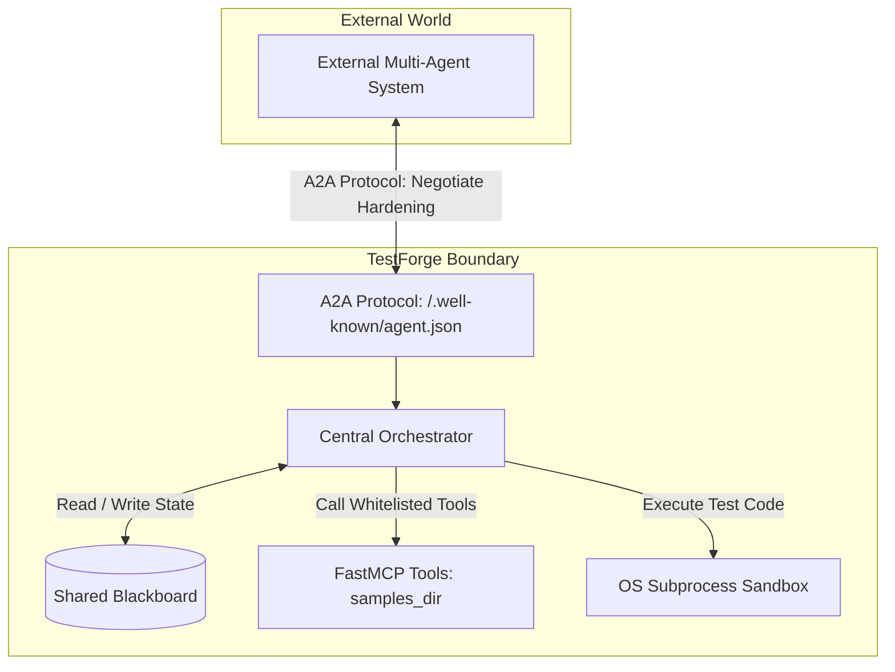

# TestForge: MCP vs. A2A vs. Blackboard Architecture

**Document Purpose:** Clear technical comparison of the three primary communication and state-sharing mechanisms in TestForge for oral defense (VIVA).  
**Repository Files:** `testforge/mcp_server.py`, `testforge/mcp_client.py`, `testforge/a2a.py`, `testforge/blackboard.py`.  

---

## 1. High-Level Summary & Conceptual Comparison

A common examiner trap in multi-agent system evaluations is confusing **tool integration**, **inter-agent messaging**, and **shared state management**.

TestForge strictly delineates these three architectural patterns:

| Architectural Pattern | What It Is | Primary Role in TestForge | Transport / Medium | Key Implementation File |
| :--- | :--- | :--- | :--- | :--- |
| **Model Context Protocol (MCP)** | Open standard created by Anthropic for exposing external tools and context to LLMs. | Exposes sandboxed filesystem and execution tools to agents via standard schemas. | JSON-RPC 2.0 over `stdio` or HTTP. | `testforge/mcp_server.py`<br>`testforge/mcp_client.py` |
| **Agent-to-Agent (A2A)** | Protocol specification (v0.3.0) for peer-to-peer inter-agent discovery and messaging. | Allows external AI agents to discover TestForge capabilities and exchange test payloads. | JSON-RPC 2.0 over HTTP (`/.well-known/agent.json`). | `testforge/a2a.py`<br>`server.py:165` |
| **Blackboard Pattern** | Classic AI shared-memory coordination pattern (Erman et al., Hearsay-II). | Provides centralized, typed, thread-safe memory shared by all local pipeline agents. | In-memory thread-safe partitions with SQLite WAL backing. | `testforge/blackboard.py`<br>`testforge/persistence.py` |

---

## 2. Model Context Protocol (FastMCP) in TestForge

### 2.1 Purpose & Role
TestForge implements an official FastMCP server using the `mcp-python` SDK (v1.28.0). Rather than granting agents direct access to the host operating system, agents invoke MCP tools that enforce security guardrails.

### 2.2 Implemented MCP Tools
The server `testforge-filesystem` registers four tools:

1. `read_sample_file(filename: str) -> str`:
   - Reads target source code files strictly from `samples/`.
   - *Security Guard:* Enforces `resolve_safe_path()` to block directory traversal (`../`).
2. `list_available_samples() -> List[str]`:
   - Returns a verified list of Python modules in the sample directory (`discount.py`, `banking.py`, etc.).
3. `get_source_stats(filename: str) -> Dict[str, Any]`:
   - Computes AST lines of code, function count, class count, and import count.
4. `execute_mutation_sandbox(code: str, test_code: str) -> Dict[str, Any]`:
   - Spawns an isolated subprocess sandbox to test code execution safety.

### 2.3 Status & Discovery Endpoints
- **UI Diagnostics:** Clicking **🔌 MCP Tools ( 4 )** opens the live MCP status modal.
- **REST Status Endpoint:** `GET /api/mcp/status` returns operational state and registered tool schemas.

---

## 3. Agent-to-Agent (A2A) Protocol in TestForge

### 3.1 Purpose & Role
While MCP is designed for **Agent-to-Tool** invocation, A2A is designed for **Agent-to-Agent** peer communication. It enables TestForge to act as a specialized testing microservice within a larger agentic organization.

### 3.2 AgentCard Discovery Schema
TestForge publishes its standardized AgentCard at `http://127.0.0.1:8000/.well-known/agent.json`:

```json
{
  "name": "testforge-agent-system",
  "version": "1.0.0",
  "protocolVersion": "0.3.0",
  "preferredTransport": "JSONRPC",
  "provider": {
    "organization": "TestForge Autonomous Systems",
    "url": "https://github.com/sourabhJain121/Testforge"
  },
  "skills": [
    {
      "id": "unit-test-generation",
      "name": "Unit Test Generation",
      "description": "Generates syntactically valid Python unit tests targeting surviving mutants using Google ADK."
    },
    {
      "id": "mutation-critique",
      "name": "Mutation Critique",
      "description": "Performs adversarial critique of test suites and surviving mutation diffs using CrewAI."
    },
    {
      "id": "hardening-workflow",
      "name": "Hardening Workflow",
      "description": "Executes a complete generator-critic hardening cycle updating the typed Blackboard."
    }
  ]
}
```

### 3.3 A2A Message Contract (`A2AMessage`)
Inter-agent messages sent through `testforge/a2a.py` enforce:
- Sender ID and Recipient ID verification.
- Performatives: `request`, `inform`, `propose`, `refuse`, `failure`.
- Correlation ID tracking across request-response round-trips.
- Automatic credential scrubbing (`scrubbed_copy()`) to prevent leaking API keys.

---

## 4. The Blackboard Pattern in TestForge

### 4.1 Why Blackboard Instead of Direct Peer Chat?
In multi-agent systems, unconstrained direct peer chat (e.g. Agent A talking to Agent B talking to Agent C) suffers from:
1. **Context Bloat:** Token counts explode as agents re-send entire code files back and forth.
2. **Race Conditions:** No single authoritative source of truth for the current validated test suite.
3. **Loss of Auditability:** Hard to take an immutable point-in-time snapshot of the system state.

The **Blackboard pattern** resolves this by providing a single shared repository of truth:

```
┌───────────────────────────────────────────────────────────────┐
│                  TestForge Shared Blackboard                  │
├─────────────────┬─────────────────────────────┬───────────────┤
│ Partition       │ Primary Data Stored         │ Typed Schema  │
├─────────────────┼─────────────────────────────┼───────────────┤
│ TargetSpace     │ Target code, AST, callables │ TargetModel   │
│ SuiteSpace      │ Candidate/Validated suites  │ SuiteModel    │
│ MutantSpace     │ Injected faults, kill diffs │ MutantModel   │
│ CriticSpace     │ Directives, blind spots     │ CriticModel   │
│ MetricsSpace    │ Scores, coverage, runtimes  │ MetricsModel  │
└─────────────────┴─────────────────────────────┴───────────────┘
```

### 4.2 Key Blackboard Properties in TestForge
1. **Thread-Safe Mutex Locking:** All partition reads and writes are protected by `threading.RLock()` to prevent data races during parallel sandbox execution.
2. **Monotonic Revisions:** Every mutation or test update increments an atomic revision number (e.g. Rev 1 to Rev 38).
3. **Auditability via SQLite:** At every major stage boundary (`INITIAL_INGESTION`, `BASELINE_VALIDATED`, `REFLECTION_ITERATION_1`, `FINALIZED`), the entire Blackboard commits an immutable snapshot to `qa_artifacts/testforge_checkpoints.db`.

---

## 5. Architectural Triad: When to Use What



- **Use MCP** when an agent needs to perform an action on the environment (reading files, checking file stats).
- **Use A2A** when an external agent needs to discover TestForge or submit a hardening request over the network.
- **Use Blackboard** when internal pipeline agents (Generator, Critic, Validator) need to collaborate, share intermediate AST diffs, and preserve an auditable state history.

