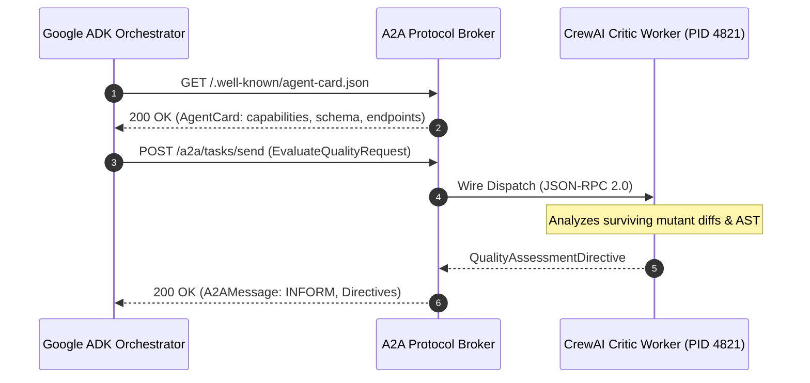

# TestForge Architecture Specification

## 1. System Overview & Core Philosophy

TestForge is an autonomous multi-agent software engineering system engineered to discover, diagnose, and harden weak unit test suites for Python applications. While conventional verification relies on statement/line coverage (which can be trivially satisfied by assertions that execute lines without verifying state), TestForge treats test hardening as an **adversarial consensus problem**.

The architecture combines:
1. **Google Agent Development Kit (ADK v1.14.1)** for stateful supervisor orchestration, session persistence, and lifecycle security callbacks.
2. **CrewAI (v0.102.0)** for adversarial mutation quality critique, operating as an autonomous specialist.
3. **Official Agent2Agent (A2A v0.3.0)** wire protocol providing standardized JSON-RPC agent discovery, capability exchange, and distributed task dispatch.
4. **8-Partition Atomic Blackboard** persisting transaction history to an append-only SQLite database in Write-Ahead Logging (WAL) mode.
5. **Multi-Tier Sandboxing** combining process-isolated subshells with kernel-isolated Docker containers configured with `--network none`.
6. **Mathematical Optimizations**: Greedy set cover suite minimization, diff-incremental PR targeting, recursive bytecode instruction normalization, and Hypothesis property fuzzing.

---

## 2. Canonical 8-Agent Topology

TestForge structures multi-agent consensus through 8 canonical specialist agents:

```
┌────────────────────────────────────────────────────────────────────────┐
│                        SupervisorAgent (ADK)                           │
│               Orchestrates workflow, transitions, and FSM              │
└──────────────────┬───────────────────────────────┬─────────────────────┘
                   │                               │
       ┌───────────▼──────────┐         ┌──────────▼──────────┐
       │CodeIntelligenceAgent │         │  TestPlanningAgent  │
       │ AST table & symbols  │         │ Strategy & budgets  │
       └───────────┬──────────┘         └──────────┬──────────┘
                   │                               │
                   └───────────────┬───────────────┘
                                   │
                   ┌───────────────▼───────────────┐
                   │    TestGeneratorAgent (ADK)   │
                   │  Synthesizes candidate tests  │
                   └───────────────┬───────────────┘
                                   │
                   ┌───────────────▼───────────────┐
                   │   SecurityAgent & Callbacks   │
                   │ Sanitizes PII, validates AST  │
                   └───────────────┬───────────────┘
                                   │
                   ┌───────────────▼───────────────┐
                   │   TestExecutionAgent (ADK)    │
                   │ Spawns parallel sandbox pool  │
                   └───────────────┬───────────────┘
                                   │
                   ┌───────────────▼───────────────┐
                   │MutationQualityCritic (CrewAI) │
                   │ Diagnoses surviving mutants   │
                   └───────────────┬───────────────┘
                                   │
                   ┌───────────────▼───────────────┐
                   │  ReflectionRepairAgent (ADK)  │
                   │ Iterative boundary synthesis  │
                   └───────────────────────────────┘
```

1. **`SupervisorAgent` (`agent:google-adk:supervisor`)**: Enforces the workflow lifecycle state machine (`SUBMITTED` -> `INGESTING` -> `GENERATING_TESTS` -> `VALIDATING_CLEAN_CODE` -> `MUTATION_ANALYSIS` -> `EVALUATING` -> `CHECKPOINTING` -> `FINALIZED`).
2. **`CodeIntelligenceAgent` (`agent:google-adk:code-intel`)**: Performs static AST inspection, constructs function/class symbol tables, and calculates blast radius caller/callee trees.
3. **`TestPlanningAgent` (`agent:google-adk:planner`)**: Evaluates code complexity and formulates iteration budgets and target mutation score thresholds.
4. **`TestGeneratorAgent` (`agent:google-adk:generator`)**: Generates nominal and boundary assertions targeting uncovered paths and surviving mutants using few-shot prompts.
5. **`SecurityAgent` (`agent:google-adk:security`)**: Validates AST safety, defuses prompt injection payloads, and enforces the Zero-Egress Privacy boundary.
6. **`TestExecutionAgent` (`agent:google-adk:execution`)**: Dispatches test suites and mutated targets to `ProcessPoolExecutor` subprocesses or Docker containers.
7. **`MutationQualityCriticAgent` (`agent:crewai:critic`)**: Operates via CrewAI to diagnose why mutants survived and produces prescriptive directives for repair.
8. **`ReflectionRepairAgent` (`agent:google-adk:repair`)**: Consumes critic directives and surviving diffs to synthesize targeted assertions that eliminate surviving mutants.

---

## 3. The 8-Partition Atomic Blackboard

The Blackboard pattern provides decoupled, transparent communication between agents without tight point-to-point coupling. State is divided into 8 strongly-typed Pydantic partition spaces:

```
┌────────────────────────────────────────────────────────────────────────┐
│                        ATOMIC BLACKBOARD (WAL)                         │
├──────────────────┬──────────────────┬──────────────────┬───────────────┤
│ 1. TargetSpace   │ 2. ScopeSpace    │ 3. SuiteSpace    │ 4. MutantSpace│
│  - Source code   │  - Call graph    │  - Candidate ast │  - AST mutants│
│  - File path     │  - Blast radius  │  - Hardened code │  - Kill matrix│
│  - LOC & symbols │  - Risk category │  - Pass@1 status │  - Equivalence│
├──────────────────┼──────────────────┼──────────────────┼───────────────┤
│ 5. ExecutionSpace│ 6. CriticSpace   │ 7. MetricsSpace  │ 8. Checkpoint │
│  - Worker pool   │  - Directives    │  - Line coverage │  - Snapshots  │
│  - Subprocess    │  - Failure modes │  - Branch cover  │  - Revisions  │
│  - Timeouts/Errs │  - Semantic tips │  - Mutation score│  - Delta diff │
└──────────────────┴──────────────────┴──────────────────┴───────────────┘
```

### Persistence and Concurrency
- **Thread Safety**: Every partition read/write is guarded by a re-entrant `threading.RLock()`.
- **Database Engine**: Persistent storage is backed by `sqlite3` using `journal_mode=WAL` (Write-Ahead Logging), permitting concurrent reads during write operations.
- **Snapshot Immutability**: Each checkpoint saves the complete JSON-serialized state dictionary with revision counters and SHA256 hashes, enabling time-travel debugging and non-destructive resumption.

---

## 4. Agent2Agent (A2A) Protocol Architecture

To enable interoperability across distinct agent frameworks, TestForge implements the official **Agent2Agent (A2A v0.3.0)** specification:



1. **Agent Discovery**: The system serves `GET /.well-known/agent-card.json` exposing the agent card with authentication schemas, available capabilities (`harden_module`, `evaluate_quality`), and supported protocol versions (`v0.3.0`).
2. **Standard Message Protocol**: Messages conform to standard A2A envelopes with `message_id`, `correlation_id`, `sender_uri`, `recipient_uri`, `performative` (FIPA REQUEST, INFORM, FAILURE), and JSON payloads.
3. **Cross-Process Execution**: The Critic agent can run as an independent OS process (`worker_pid != parent_pid`) communicating over local HTTP or stdio pipes, with automated fail-safe in-process fallback.

---

## 5. Model Context Protocol (FastMCP) Integration

TestForge acts as both an **MCP Client** (consuming filesystem tools in Google ADK) and an **MCP Server** (exposing TestForge capabilities to external agents like Claude Desktop):

- **ADK Tool Adapter (`ADKMCPToolRegistry`)**: Converts FastMCP tools (`read_text_file`, `list_directory`, `get_file_info`) into native Google ADK `FunctionTool` objects.
- **Path Containment Policy**: All MCP tool accesses enforce a strict root boundary (`BASE_DIR`). Directory traversal attempts (`../../etc/passwd`) or accesses to sensitive files (`.env`, `id_rsa`) are intercepted with `PermissionError`.
- **TestForge Native MCP Server**: Exposes `harden_module`, `get_report`, and `list_jobs` over stdio JSON-RPC.

---

## 6. Multi-Tier Sandbox Isolation

Execution security is enforced across three distinct isolation boundaries:

1. **Subprocess Sandboxing**:
   - Every candidate test suite and mutant evaluation is executed in a dedicated child process via `subprocess.Popen`.
   - Hard execution ceilings (5.0s default) terminate infinite recursion or loops.
   - Resource limits (`RLIMIT_AS`, `RLIMIT_CPU`) prevent memory exhaustion.
2. **Live Docker Daemon Sandboxing (`testforge/docker_sandbox.py`)**:
   - Containerized execution on Docker Desktop (`testforge:latest`).
   - Hard isolation with `--network none`, non-root user, read-only root filesystems, and bounded tmpfs mounts.
   - Empirical proof: sockets inside the container yield `Errno 101 Network is unreachable`.
3. **Zero-Egress Privacy Mode (`testforge/privacy_mode.py`)**:
   - Dynamic OS socket monkeypatching blocks 100% of outbound external TCP connections.
   - Loopback connections (`127.0.0.1:11434` for Ollama) are whitelisted.
   - PII and secrets (Gemini, OpenRouter, GitHub, emails) are scrubbed before inference.

