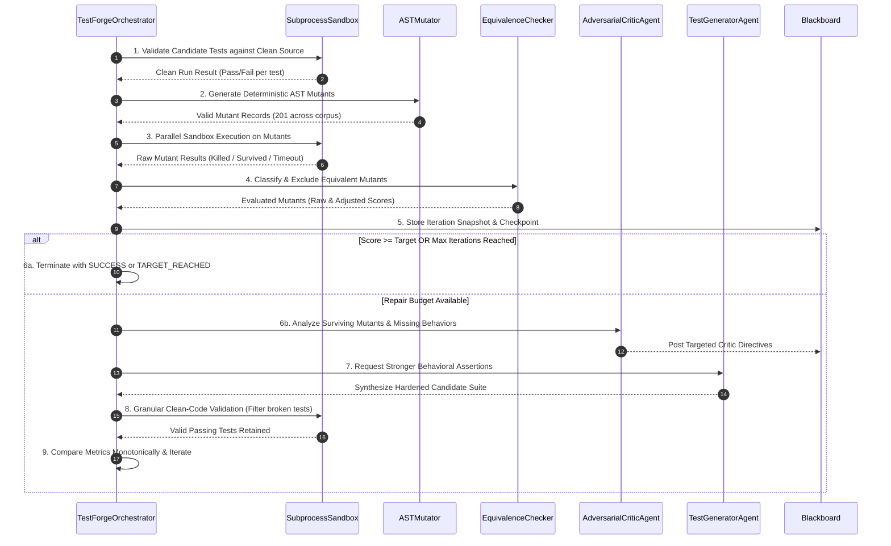

# TestForge Phase 4.1 — Implementation Plan: Mutation-Guided Test Improvement

**Timestamp**: 2026-10-26T10:36:00+05:30  
**Repository**: `/Users/sourabh/TestForge`  
**Status**: Planning Phase (Design Only — Code Changes Deferred to Implementation Phase)

---

## 1. Overview & Objective

The objective of Phase 4.1 is to establish a rigorous, bounded **Mutation-Guided Test Improvement Engine** within TestForge. Rather than relying on generic reflection prompts, the system will use concrete mutation testing evidence—specifically surviving AST mutants and missing branch behaviors—to direct the Adversarial Critic and Test Generator agents to synthesize stronger, targeted test assertions without overfitting or breaking clean-code validity.

---

## 2. Bounded Mutation-Guided Repair Loop Design

The proposed repair loop integrates directly into the existing `TestForgeOrchestrator` (`testforge/orchestrator.py`) and `Blackboard` (`testforge/blackboard.py`):

### Detailed Loop Phases:
1. **Baseline Execution & Clean Validation**:
   - Execute initial candidate tests against the unmodified target source code in `SubprocessSandbox`.
   - Record baseline line coverage (`pytest-cov`) and verify pass@1 status.
2. **Deterministic Mutation Generation**:
   - Apply `ASTMutator.mutate()` across target AST nodes (`COMP_OP`, `BOUNDARY_SWAP`, `BIN_OP`, `LOGICAL_OP`, `NEGATE_COND`, `RETURN_SWAP`).
3. **Parallel Sandbox Mutant Evaluation**:
   - Execute tests across `ParallelSandboxRunner` against each mutant in temporary isolated environments.
4. **Surviving Mutant Diagnosis**:
   - Extract surviving mutants (`status == "SURVIVED"`).
   - Group surviving mutants by mutated function and operator type.
   - Map the AST diff to concrete semantic behavior (e.g. "Boundary condition at line 34: `amount >= 10000` mutated to `amount > 10000`; missing assertion for boundary value `amount == 10000.0`").
5. **Adversarial Critique Generation**:
   - `AdversarialCriticAgent` converts AST diffs into actionable behavioral testing requirements (without hardcoding mutant implementation details).
   - Directives are written to `Blackboard.CriticSpace` and logged to structured telemetry (`testforge_trace.jsonl`).
6. **Targeted Assertion Synthesis**:
   - `TestGeneratorAgent` ingests existing test code + critic directives + target source code.
   - Synthesizes incremental test methods specifically asserting the missing behavioral edges.
7. **Granular Test Validation & Pruning (Fixing Gap 1)**:
   - Instead of discarding the entire suite if one test fails, parse individual test functions using AST.
   - Run each new test against the clean target code.
   - Quarantine and discard only tests that fail clean code; merge passing new tests into the active test suite.
8. **Monotonic Quality Check & Checkpointing**:
   - Re-evaluate mutants with the updated test suite.
   - If adjusted mutation score improves or remains equal with higher coverage, accept the suite.
   - Save versioned checkpoint via `PersistentBlackboardStore`.
   - Increment iteration counter; stop when target mutation score (e.g. 85%) is met or iteration budget (3) is exhausted.

---

## 3. Implementation Sequence & Proposed File Modifications

The proposed implementation requires focused, surgical enhancements to existing modules without creating parallel architectures:

| Phase | Target File | Proposed Enhancement |
| :---: | :--- | :--- |
| **Step 1** | `testforge/sandbox.py` | Add `validate_and_filter_test_suite()` to execute tests individually against clean code, isolating failing functions rather than aborting the entire suite. |
| **Step 2** | `testforge/agents.py` | Enhance `AdversarialCriticAgent` to generate semantic boundary descriptions from `BOUNDARY_SWAP` and `COMP_OP` diffs instead of raw unified diff strings. |
| **Step 3** | `testforge/orchestrator.py` | Update `_execute_pipeline` reflection block (lines 1104–1118) to use granular test filtering and enforce monotonic quality guarantees. |
| **Step 4** | `testforge/equivalence.py` | Expand rule-based static equivalence patterns for constant arithmetic identities and redundant branch checks. |
| **Step 5** | `tests/test_mutation_guided_repair.py` | Create dedicated unit and integration tests verifying the bounded repair loop on evaluation fixtures. |

---

## 4. Verification & Testing Strategy

1. **Unit Testing**:
   - Test granular test extraction and filtering in `testforge/sandbox.py`.
   - Test semantic directive formatting in `testforge/agents.py`.
2. **Corpus Benchmarking**:
   - Run `testforge/corpus/runner.py` across all 5 evaluation fixtures (`task_state_transition`, `token_bucket_rate_limiter`, `inventory_pricing_calculator`, `banking_operations_module`, `currency_converter`).
   - Validate that all 15 controlled defects are killed.
   - Validate that mutation score exceeds the 85.0% threshold.
3. **Regression Safety**:
   - Run full 395-test suite via `.venv-release/bin/pytest tests/ -q` to guarantee zero regressions across the existing codebase.
