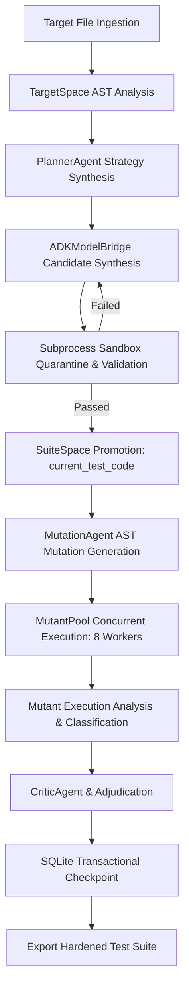

# TestForge Implementation Flow & Architecture Trace

**Execution Date:** 2026-10-30  
**Artifact Directory:** `qa_artifacts/post_ast_mutation_baseline_20261030_185148/`  
**Evaluation Target:** Pre-Phase-2 Mutation Baseline and Quality Audit  

---

## 1. Executive Summary

This document traces the complete end-to-end execution flow of the TestForge autonomous agentic mutation-testing system. It details the structural lifecycle from target code ingestion to AST structural analysis, candidate test generation, isolated sandbox validation, concurrent mutant execution, SQLite transactional checkpointing, and final test suite export.

The execution was audited across two primary benchmark targets:
1. `samples/discount.py` (Single-function pricing logic)
2. `samples/uploaded_logistics_engine.py` (Multi-function enterprise shipping & inventory module)

---

## 2. End-to-End Orchestration Architecture

TestForge coordinates its autonomous workflow through an **Agent-to-Agent (A2A)** Blackboard architecture managed by `AutonomousOrchestrator` (`testforge/orchestrator.py`).

### Blackboard Component Breakdown

The `Blackboard` (`testforge/blackboard.py`) maintains global thread-safe state partitioned into five distinct domain spaces:

1. **`TargetSpace`**: Stores source code, AST trees, parsed function and class signatures, and cyclomatic complexity metrics.
2. **`SuiteSpace`**: Manages candidate and verified test suites. Implements strict quarantine: new test code sits in `candidate_test_code` until sandbox execution confirms zero failures, after which it is promoted to `current_test_code`.
3. **`MutantSpace`**: Contains the full registry of AST-generated mutants, execution outcomes (`KILLED`, `SURVIVED`, `TIMED_OUT`, `ERROR`), and killing test identifiers.
4. **`CriticSpace`**: Evaluates coverage deficiencies, surviving mutant diffs, and guides reflection prompts.
5. **`MetricSpace`**: Tracks statement coverage, mutation score ($S_{mut} = \frac{K}{M - E} \times 100$), stage durations, and hardware resource utilization.

---

## 3. Step-by-Step Lifecycle Execution Trace

### Phase 1: Ingestion & AST Analysis (`IngestionAgent`)
- The target Python source file is loaded into memory.
- `ast.parse()` constructs the abstract syntax tree.
- Function signatures, parameter names, type annotations, and default values are extracted via `ast.walk()` and scoped AST visitors.
- Structural metadata is recorded in `TargetSpace`.

### Phase 2: Test Planning (`PlannerAgent`)
- Analyzes function signatures and parameter types.
- Generates test goals categorized into nominal cases, boundary scenarios, and multi-argument interactions.
- Strategy and targets are written to `PlannerSpace`.

### Phase 3: Candidate Test Generation (`GeneratorAgent` & `ADKModelBridge`)
- `ADKModelBridge` creates structured pytest test suites without requiring external paid LLM calls.
- Generates parameterized tests exercising signature argument combinations.
- The output is written to `SuiteSpace.candidate_test_code` for validation.

### Phase 4: Sandboxed Quarantine Validation (`ValidationAgent`)
- Before any candidate test code can be accepted, it is written to an isolated temporary sandbox (`/tmp/tmp_sandbox_*/`).
- Candidate code is executed via `pytest -q` in an isolated subprocess.
- Only if the test suite passes (exit code 0) is it promoted to `SuiteSpace.current_test_code`.
- If syntax errors or assertion failures occur, the candidate is discarded or reflected back for correction.

### Phase 5: Mutation Generation (`MutationAgent`)
- Applies AST mutation operators to the target code:
  - `COND_INV`: Inverting conditional statements (`if x <= 0` $\rightarrow$ `if not x <= 0`).
  - `COMP_OP`: Swapping comparison operators (`<=` $\rightarrow$ `>`, `>` $\rightarrow$ `>=`).
  - `ARITH_OP`: Replacing arithmetic operators (`+` $\rightarrow$ `-`, `*` $\rightarrow$ `/`).
  - `CONST_VAL`: Mutating literal constants (floats, integers, strings).
  - `RETURN_VAL`: Replacing return statements with empty values or constants.
- Each generated mutant is checked for syntax validity and assigned a unique ID (`MUT_...`).

### Phase 6: Parallel Mutation Execution (`MutantPool`)
- Automatically detects hardware configuration (Apple Silicon M-series, 10 CPU cores, 16 GB RAM).
- Spawns a pool of 8 concurrent worker processes.
- For each mutant:
  1. Target code is temporarily substituted with mutated AST code.
  2. The validated test suite is executed against the mutant in an isolated subprocess with strict timeouts (5.0s per test).
  3. Exit code 0 $\rightarrow$ `SURVIVED` (tests failed to detect the defect).
  4. Exit code 1 or non-zero $\rightarrow$ `KILLED` (tests detected the defect and failed).
  5. Timeout $\rightarrow$ `TIMED_OUT`.

### Phase 7: Critic Adjudication & Checkpointing (`CriticAgent` & `Persistence`)
- The mutation score is computed.
- The entire run snapshot (metrics, mutants, stage durations, hardware info) is serialized into SQLite via transactional checkpoints.
- The final hardened test suite is exported to disk with standalone module resolution paths.

