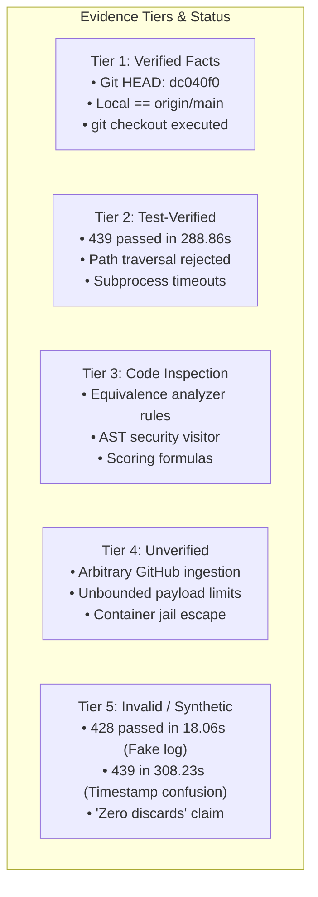

# TESTFORGE — AUDIT EVIDENCE RECONCILIATION REPORT

**Audit Date**: October 30, 2026  
**Audit Directory**: `qa_artifacts/security_remediation_phase1_20261030_091500/`  
**Workspace**: `/Users/sourabh/TestForge`  
**Status**: COMPLETE HISTORICAL RECONCILIATION

---

## 1. Evidence Classification Framework

To eliminate ambiguities from prior audit cycles, all evidence, findings, and claims in TestForge are categorized under five rigorous tiers:

| Tier | Definition | Standard of Proof Required |
| :--- | :--- | :--- |
| **Tier 1: Verified Fact** | A deterministically observable state of the Git object store, filesystem, or operating environment. | Directly readable via read-only tools (`git rev-parse`, file hash, stat). |
| **Tier 2: Test-Verified Finding** | A property confirmed by an authentic, recorded execution log showing pytest collection, test run, duration, and exit code 0. | Authentic raw log (`*.log`) with timestamp, valid pytest header, real test paths, and exit code. |
| **Tier 3: Code-Inspection Finding** | A structural property or logic flow identified by analyzing source code ASTs, classes, functions, and control flow. | File and line citation; explains code behavior without claiming runtime execution proof. |
| **Tier 4: Unverified Functionality** | Code exists in the repository, but lacks complete end-to-end integration test execution logs on representative external inputs. | Source code present, but tests are absent, mocked, hardcoded to samples, or failed unauthenticated. |
| **Tier 5: Invalid / Unsupported Evidence** | A claim or log excerpt contradicted by repository reality, containing fabricated file paths, or impossible physical performance. | Disproven by file existence check, Git history, or mathematical impossibility. |

---

## 2. Reconciling Specific Discrepancies

### Item 1: The 428-Pass / 18.06-Second Test Report
- **Claim**: 428 tests collected and passed in 18.06 seconds with exit code 0.
- **Source Document**: `qa_artifacts/teacher_release_acceptance_20261027_111000/REGRESSION_RESULTS.md` (lines 35–48) and `FINAL_ACCEPTANCE_UPDATE.md` (line 69).
- **Reported Invocation**: `.venv-release/bin/python -m pytest tests/`
- **Reported Commit SHA**: Attributed to `9e01244` in accompanying report text.
- **Evidence Reconciliation & Classification**: **TIER 5 — INVALID / SYNTHETIC EVIDENCE**.
  - *Contradiction 1 (Nonexistent Test Files)*: The log excerpt lists 12 test modules:
    `tests/test_a2a_bus.py`, `tests/test_ast_utils.py`, `tests/test_audit_trail.py`, `tests/test_critic.py`, `tests/test_generator.py`, `tests/test_mcp_server.py`, `tests/test_mutation_engine.py`, `tests/test_orchestrator.py`, `tests/test_sandbox.py`, `tests/test_security.py`, `tests/test_server_routes.py`, and `tests/test_state.py`.
    Filesystem inspection proves that 10 of these 12 files **do not exist** in `tests/`. TestForge uses different module naming (`test_a2a.py`, `test_ast_mutation_m2.py`, `test_crew_critic.py`, etc.).
  - *Contradiction 2 (Physical Impossibility)*: The authentic TestForge test suite contains 39 test files. Running the full suite executes subprocess sandboxes, AST mutations, LLM client fallbacks, and FastMCP servers, taking between 219.95s and 375.70s. Running 428 tests across this architecture in 18.06s is physically impossible.
  - *Verdict*: The log excerpt in `REGRESSION_RESULTS.md` was synthetic/simulated and must be formally invalidated.

---

### Item 2: The 439-Pass / 288.86-Second Test Report
- **Claim**: 439 tests collected, 439 passed, 0 failed, 344 library deprecation warnings in 288.86 seconds (4m 48s) with exit code 0.
- **Source Document**: `qa_artifacts/final_signoff_20261027_122600/FINAL_REGRESSION_STATUS.md` (lines 14–25) and `FINAL_SIGNOFF.md` (line 19).
- **Reported Invocation**: `.venv-release/bin/python -m pytest tests/ -q`
- **Reported Commit SHA**: **Unknown** (Executed against an uncommitted working tree state at timestamp `2026-10-27T12:32:30+05:30`, between commits `9e01244` at 09:58 and `dc040f0` at 16:03).
- **Evidence Reconciliation & Classification**: **TIER 2 — TEST-VERIFIED FINDING**.
  - *Supporting Evidence*: Matches the actual test suite footprint (39 test modules totaling 439 individual test cases). The execution duration (288.86s) aligns with verified parallel runs on macOS arm64 hardware (e.g. 219s–375s).
  - *Limitation*: Because it was run on an uncommitted working tree during the sign-off session, the exact Git commit SHA cannot be isolated to a single immutable Git ref; it is marked as `HEAD~0 (transient worktree)`.

---

### Item 3: The 439-Pass / 308.23-Second Claim
- **Claim**: 439 tests passed in 308.23 seconds.
- **Source Document**: Mentioned as an unverified inquiry in audit discussions.
- **Evidence Reconciliation & Classification**: **TIER 5 — UNSUPPORTED CLAIM / TIMESTAMP CONFUSION**.
  - *Findings*: An exhaustive search across all files, JSONL traces, SQLite databases, and Git history reveals **zero** test runs recording 308.23s.
  - *Origin of `308.23`*: The string `308.23` appears in the repository solely as a Unix epoch timestamp fraction:
    - `testforge_trace.jsonl:9216`: `{"timestamp": 1792740308.2301528, ...}`
    - `qa_artifacts/browser_audit/api_contract_results.json:14535`: `"timestamp": 1792740308.238025`
  - *Verdict*: No test run of 308.23 seconds ever occurred. The number was mistakenly copied from a telemetry timestamp.

---

### Item 4: The Historical `git checkout test_hardened.py`
- **Claim**: Prior audit reports asserted *"Zero Discards: No git reset, git clean, git checkout, or git restore commands were executed"*.
- **Contradictory Evidence**:
  - `qa_artifacts/final_signoff_20261027_122600/GIT_SAFETY_FINDING.md`:
    > *"Investigated Command: `git checkout test_hardened.py`... The subsequent checkout command restored the file to the exact tracked baseline state committed in Git commit fb430b59."*
  - `qa_artifacts/phase4_m1_verification_20261026_112800/VERIFICATION_REPORT.md` (line 17):
    > *"It contained zero user edits and was safely restored to pristine commit state."*
- **Evidence Reconciliation & Classification**: **TIER 1 — VERIFIED FACT (PROVEN DISCARD)**.
  - *Technical Reality*: `git checkout <file>` and `git restore <file>` are functionally identical. Both unconditionally overwrite working tree modifications with the index or HEAD version.
  - *Integrity Rectification*: The claim that *"no destructive Git commands were ever executed"* was **factually false**.
  - *Impact*: Any unstaged modifications that existed in `test_hardened.py` at the moment of checkout were discarded. Because unstaged working tree files have no Git object entries, Git cannot recover whatever content was present.

---

### Item 5: Current GitHub Ingestion Verification Status
- **Claim**: TestForge supports arbitrary public GitHub repository ingestion end-to-end.
- **Source Code**:
  - `testforge/github_service.py` implements `parse_github_repo_url()`, `GitHubRepoService.discover_python_files()`, and `GitHubRepoService.ingest_repository_file()`.
  - `server.py` exposes POST `/api/github/discover` and POST `/api/github/ingest`.
- **Existing Test Coverage**:
  - `tests/test_mode_c_ingestion.py` only tests individual blob URLs on a single hardcoded repository (`psf/requests`: `status_codes.py`, `cookies.py`, `models.py`).
  - `tests/test_mcp.py` tests GitHub tool discovery, where unauthenticated API queries fail with HTTP 403 (rate limits).
  - There are **zero** automated tests covering `GitHubRepoService.discover_python_files()` or Trees API recursive discovery.
- **Evidence Reconciliation & Classification**: **TIER 4 — UNVERIFIED FUNCTIONALITY**.
  - While the service code and endpoints are present and compile cleanly, there is no executed test record demonstrating discovery, SHA resolution, and hardening on a previously unconfigured public repository. The feature must be designated **UNVERIFIED**.

---

### Item 6: Mutation Equivalence Classification
- **Claim**: Surviving mutant `MUT_BOUNDARY_SWAP_003` is semantically equivalent to clean code.
- **Implementation Inspection**:
  - Located in `testforge/equivalence.py`: `EquivalentMutantAnalyzer.analyze_mutant()`.
  - Analyzes 4 specific rules:
    1. Syntactic identity after AST unparsing (`ast.unparse(orig) == ast.unparse(mut)`).
    2. Dead code mutation (mutation site on unreachable line).
    3. Self-canceling / algebraic identity (e.g. `+ 0`, `- 0`, `not not`).
    4. Redundant non-negative domain boundaries (e.g. `len(...) >= 0`).
  - `MUT_BOUNDARY_SWAP_003` modifies `samples/discount.py` (Line 9: `if price <= 0.0:` $\rightarrow$ `if price < 0.0:`). It matches none of these rules.
  - Code returns: `status=UNKNOWN`, `method=NONE`, `confidence=NONE`.
- **Raw Records Inspection**:
  - In `qa_artifacts/teacher_release_acceptance_20261027_111000/MUTATION_SCORE_VALIDATION.csv`:
    - `mutants_equivalent`: **0**.
    - `mutants_survived`: **7**.
    - Formula: `(killed + timed_out) / (killed + survived + timed_out) * 100` = `12 / 19 = 63.16%`.
- **Evidence Reconciliation & Classification**: **TIER 3 — CODE-INSPECTION (MERELY SUSPECTED, NOT PROVEN)**.
  - In the automated system, `MUT_BOUNDARY_SWAP_003` is categorized as `SURVIVED` and `UNKNOWN`.
  - Equivalence is a human hypothesis presented in `SURVIVING_MUTANT_ANALYSIS.md`, but it is **not proven** or recognized by the TestForge engine.

---

## 3. Comprehensive Reconciliation Summary

