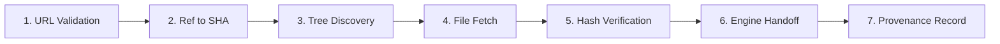

# TESTFORGE — ARBITRARY PUBLIC GITHUB INGESTION VERIFICATION PLAN

**Date**: October 30, 2026  
**Directory**: `qa_artifacts/security_remediation_phase1_20261030_091500/`  
**Status**: SPECIFICATION & TEST DESIGN ONLY (No network calls executed)

---

## 1. Overview & Verification Objectives

This document establishes a rigorous verification plan for arbitrary public GitHub repository ingestion.

Because prior tests in `tests/test_mode_c_ingestion.py` were limited to a single hardcoded repository (`psf/requests`), this verification plan defines the requirements, offline mock fixtures, and controlled live execution protocol to prove end-to-end functionality on a previously unconfigured public repository without regression risks.

---

## 2. Seven-Stage Verification Criteria



### Stage 1: Repository URL Parsing & Validation
- **Requirement**: Accept arbitrary valid public GitHub repository URLs while rejecting invalid schemes, control characters, trailing garbage, and injection tokens.
- **Test Scenarios**:
  - `https://github.com/pallets/click` (Standard)
  - `https://github.com/bottlepy/bottle/` (Trailing slash)
  - `https://github.com/encode/httpx.git` (Git extension)
  - `https://github.com/psf/black/tree/main/src` (Tree with subpath)
  - Reject: `http://github.com/...` (Insecure scheme)
  - Reject: `https://gitlab.com/...` (Unsupported host)
  - Reject: `https://github.com/owner/repo/tree/` (Malformed tree without branch)
  - Reject: `https://github.com/owner/repo; rm -rf /` (Shell injection attempt)

### Stage 2: Default Branch and Resolved Commit SHA
- **Requirement**: Interrogate GitHub metadata API to determine the repository's default branch (e.g. `main`, `master`), and resolve the branch name to an immutable 40-character commit SHA (`^[0-9a-f]{40}$`).
- **Verification Assertions**:
  - `manifest.default_branch in ("main", "master")`
  - `len(manifest.commit_sha) == 40`
  - `int(manifest.commit_sha, 16) is not None` (Valid hex string)
  - Respect rate limit headers (`X-RateLimit-Remaining`, `X-RateLimit-Reset`).

### Stage 3: Recursive Python File Discovery
- **Requirement**: Utilize the Git Trees API (`git/trees/{commit_sha}?recursive=1`) to identify all eligible Python source files.
- **Filtering Rules to Verify**:
  - Only files ending with `.py`.
  - Exclude `.git`, `.github`, `.venv`, `venv`, `__pycache__`, `node_modules`, `build`, `dist`.
  - Exclude files exceeding `max_file_size_bytes` (500 KB).
  - Enforce `max_files` limit (500 files) with `truncated` flag.
  - Correctly classify `is_test_file` for modules starting with `test_` or ending with `_test.py`.

### Stage 4: Retrieval of Selected Source File
- **Requirement**: Retrieve raw source content for a designated discovered file using GitHub Contents API (`/repos/{owner}/{repo}/contents/{path}?ref={commit_sha}`) with base64 decoding and fallback to raw content.
- **Integrity Assertions**:
  - Content successfully decodes to valid UTF-8.
  - AST parses cleanly via `ast.parse(content)`.
  - Relative package imports are resolved safely for standalone execution.

### Stage 5: SHA-256 Source Hash
- **Requirement**: Calculate the canonical SHA-256 checksum of the decoded source code:
  $$\text{SHA-256} = \text{hashlib.sha256}(\text{source\_bytes}).\text{hexdigest}()$$
- **Verification Assertions**:
  - Hexdigest length is exactly 64 lowercase alphanumeric characters.
  - Hashing is repeatable and invariant across multiple reads.

### Stage 6: Byte-for-Byte Engine Handoff
- **Requirement**: Guarantee that the source code passed into `TestForgeOrchestrator(target_source_code=...)` is byte-for-byte identical to the retrieved and import-adjusted source code.
- **Verification Assertions**:
  - `hashlib.sha256(orchestrator.target_source_code.encode()).hexdigest() == fetched.sha256`
  - Sandbox subprocess executes against the identical file without tampering.

### Stage 7: End-to-End Provenance Recording
- **Requirement**: Ensure all downstream artifacts, blackboard checkpoints, and JSONL traces persist the full ingestion provenance metadata.
- **Contract Schema Required**:
  ```json
  {
    "github_metadata": {
      "repository": "<owner>/<repo>",
      "commit_sha": "<40-char SHA>",
      "file_path": "<discovered_relative_path>",
      "source_sha": "<64-char SHA256>",
      "source_github_url": "https://github.com/<owner>/<repo>/blob/<sha>/<path>",
      "is_untrusted": true,
      "sandbox_required": true
    }
  }
  ```

---

## 3. Two-Tier Test Execution Protocol

### Tier 1: Deterministic Offline Unit & Integration Tests (Mocked)
- To avoid network flakiness, rate limits, and unapproved external requests:
  - Create a mock fixture using Python's `unittest.mock` simulating GitHub API responses:
    - `GET /repos/{owner}/{repo}` $\rightarrow$ metadata payload.
    - `GET /repos/{owner}/{repo}/commits/{ref}` $\rightarrow$ commit SHA.
    - `GET /repos/{owner}/{repo}/git/trees/{commit_sha}?recursive=1` $\rightarrow$ multi-file tree structure.
    - `GET /repos/{owner}/{repo}/contents/{file_path}?ref={commit_sha}` $\rightarrow$ base64 encoded source.
  - Verify all 7 stages completely offline without making external HTTP requests.

### Tier 2: Controlled Live Smoke Test (Post-Approval Only)
- Criteria for target repository selection:
  - Small, stable, public repository (e.g. `pallets/click` or `bottlepy/bottle`).
  - Target single leaf module (e.g. `bottle.py` or utility module).
  - Explicit user approval required before issuing live requests.
  - Verify that GITHUB_PERSONAL_ACCESS_TOKEN is used if present, and HTTP 403 rate limits are gracefully surfaced to the UI if unauthenticated.

