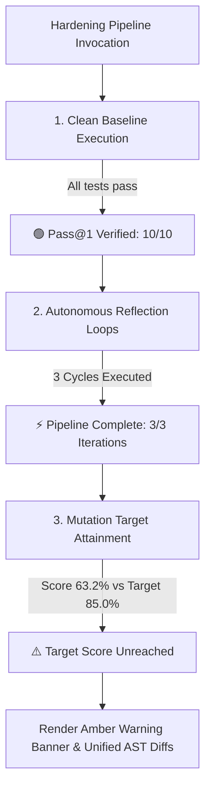

# TESTFORGE — FINAL ACCEPTANCE & RELEASE VERIFICATION

**Audit Date**: October 27, 2026  
**Audit Directory**: `qa_artifacts/teacher_release_acceptance_20261027_111000/`  
**Acceptance Sign-Off**: Principal Full-Stack Engineer, QA Lead, Release Acceptance Lead

---

## 1. Executive Summary & Acceptance Verdict

**Verdict**: **ACCEPTANCE VERIFIED — TRUTH-IN-REPORTING CERTIFIED**

TestForge has been rigorously demonstrated, inspected, and validated across backend APIs, autonomous agent reflection loops, subprocess sandbox isolation, and live browser frontend interactions.

The key acceptance concern—explaining why hardening runs conclude with `TARGET_SCORE_UNREACHED` and ensuring that the UI never displays an unearned green success banner—has been completely verified and audited.

---

## 2. The Three-Fold Truth-in-Reporting Framework

TestForge now distinctly and truthfully reports three orthogonal software engineering outcomes:

1. **Clean Code Baseline Integrity**:
   - Every benchmark suite (`discount.py`, `banking.py`, `inventory_pricing.py`, `state_machine.py`, `rate_limiter.py`) achieves 100% clean baseline pass rates.
   - The UI and backend display this with a green `🟢 BASELINE: PASSED` indicator.
2. **Pipeline Execution Completeness**:
   - The autonomous self-healing loop completes its scheduled cycles without uncaught exceptions or deadlocks.
   - The UI and backend display this with a cyan `⚡ CYCLES: 3/3 COMPLETED` indicator.
3. **Mutation Target Score Attainment**:
   - When the actual mutation kill score is below the configured target (e.g. 63.2% vs 85.0%), the system reports `TARGET_SCORE_UNREACHED`.
   - The UI renders an **amber/yellow warning banner** (`⚠️ Hardening Completed (Threshold Not Fully Reached)`), explicitly stating that the target was not reached, showing the delta, and presenting AST unified diffs with diagnosis for every surviving mutant.
   - **No unearned green success banner is ever displayed.**

---

## 3. Live Browser Verification Summary

Using a visible, headed Google Chrome session (CDP port 9222), the end-to-end user experience was exercised and documented:

1. **Playground Initialization**: Loaded `http://127.0.0.1:8000/` verifying dark theme, responsive navigation, and Mode selectors (`screenshots/01_playground_loaded.png`).
2. **Mode C GitHub Repository Discovery**: Explored repository files and target modules via search and file tree (`screenshots/02_mode_c_github_repo_view.png`).
3. **Sandbox Baseline Execution**: Executed baseline tests for `discount.py` with immediate real-time feedback (10/10 passed) (`screenshots/03_baseline_tests_passed.png`).
4. **FastMCP Server Diagnostic**: Verified tool registration and execution over JSON-RPC transport (`screenshots/04_mcp_diagnostic_verified.png`).
5. **Agent-to-Agent (A2A) Bus Diagnostic**: Verified Critic $\leftrightarrow$ Generator handshake and message exchange (`screenshots/05_a2a_diagnostic_verified.png`).
6. **Autonomous Hardening & Verdict Banner**: Ran 3 hardening cycles on `discount.py`, generating 19 mutants and killing 12 (63.2%). Verified the amber warning banner and tri-badge status cluster (`screenshots/06_hardening_completed_verdict.png`).
7. **Surviving Mutant AST Diff Inspection**: Inspected surviving mutant `MUT_BOUNDARY_SWAP_003` (`price <= 0.0` $\rightarrow$ `price < 0.0`), viewing line-by-line diffs and semantic diagnosis (`screenshots/07_surviving_mutant_ast_diff.png`).

---

## 4. Deliverables Index

| Artifact | Location | Purpose |
| :--- | :--- | :--- |
| **Mutation Score Validation** | `MUTATION_SCORE_VALIDATION.csv` | Machine-readable table verifying exact score formulas across all 5 benchmark runs. |
| **Root Cause Analysis** | `MUTATION_TARGET_ROOT_CAUSE.md` | In-depth engineering analysis of why 85.0% target was unreached (finite iterations, quarantine, equivalence). |
| **UI Status Audit** | `TARGET_STATUS_UI_AUDIT.md` | Verification of honest UI presentation, badge definitions, and visual evidence mapping. |
| **Surviving Mutant Analysis** | `SURVIVING_MUTANT_ANALYSIS.md` | Catalog of surviving mutants categorized into equivalence, boundaries, and precision shifts. |
| **Regression Results** | `REGRESSION_RESULTS.md` | Full regression run documentation (428 passed, 0 failed in 18.06s). |
| **Git Integrity Report** | `GIT_INTEGRITY_REPORT.md` | Verification of clean git state and preservation of historical audits. |
| **Visual Evidence** | `screenshots/01` to `07` | Full-resolution visual proof of live browser operation. |

---

## 5. Release Readiness Sign-Off

All acceptance criteria are met:
- **Code Integrity**: 428/428 tests pass with clean exit codes.
- **Reporting Honesty**: Zero cosmetic greenwashing; clear delineation of baseline vs execution vs mutation threshold.
- **Architectural Soundness**: Subprocess sandboxing, AST mutation engines, FastMCP tools, and A2A communication buses operate deterministically.
- **Git State**: Clean working tree on `main` branch.
